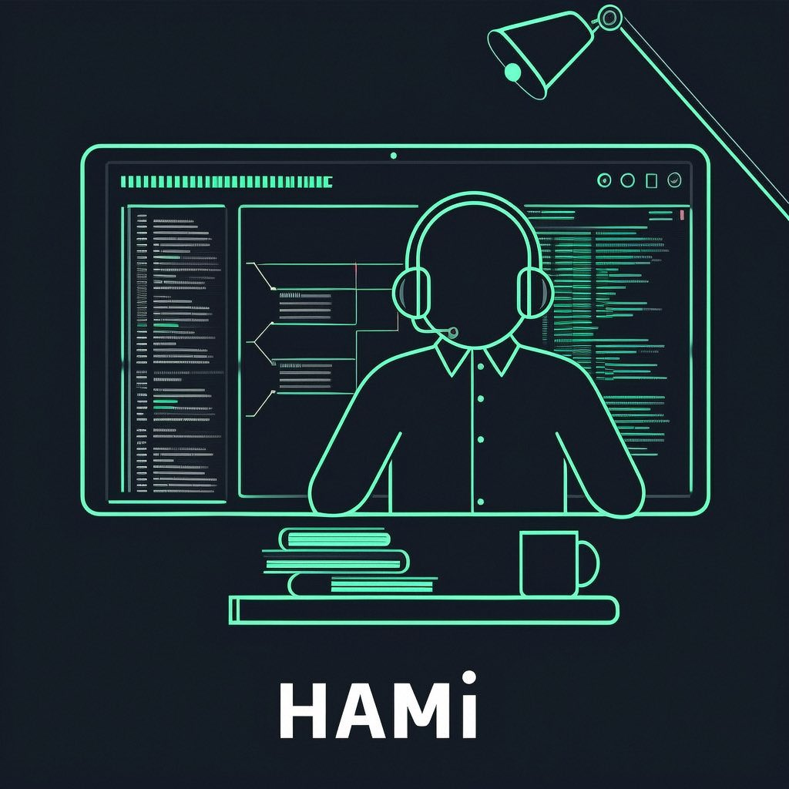

[简体中文](./README.md) · [All articles](../../README.en.md) · [Read on the website](https://www.theriseunion.com/en/blog/hami-code-analyst-1.html)

# HAMi Source Code Analysis: Device Management and Scheduling

RiseUnion · January 01, 2025 at 08:00 (UTC+08:00)

A comprehensive analysis of HAMi's core implementation, focusing on device management interfaces, plugin system architecture, scheduling strategies, and monitoring system. Learn the technical details of how HAMi manages heterogeneous devices and integrates with the Kubernetes ecosystem.



## Project Overview

HAMi (Heterogeneous AI Computing Virtualization Middleware) is a middleware solution for managing heterogeneous devices in Kubernetes clusters. It provides a comprehensive framework for managing and scheduling accelerators like GPUs and FPGAs in Kubernetes environments. For a detailed introduction to HAMi's capabilities and features, see our [Project Overview](https://www.theriseunion.com/en/blog/project-hami.html) and [Why Kubernetes Can't Meet AI Scheduling Needs](https://www.theriseunion.com/en/blog/why-kubernetes-can-not-meet-ai-scheduling.html).

## Architecture

Core components of HAMi codebase:

### 1. Command Line Components (cmd/)

```bash
cmd/
├── device-plugin/     # Device plugin components
│   ├── main.go       # Entry point
│   └── nvidia/       # NVIDIA device plugin implementation
│
├── scheduler/        # Scheduler components  
│   ├── main.go      # Scheduler entry point
│   └── metrics.go   # Monitoring metrics implementation
│
└── vGPUmonitor/     # GPU monitoring components
    ├── main.go      # Monitoring service entry
    ├── metrics.go   # Metrics definition and collection
    ├── feedback.go  # Feedback mechanism
    ├── validation.go # Validation logic
    ├── build.sh     # Build script
    ├── noderpc/     # Node RPC communication
    └── testcollector/ # Test collector
```

### 2. Core Libraries (pkg/)

```bash
pkg/
├── device/          # Core device management
│   ├── devices.go        # Unified device interface
│   ├── devices_test.go   # Device interface tests
│   ├── nvidia/          # NVIDIA GPU implementation
│   ├── cambricon/       # Cambricon device implementation
│   ├── ascend/         # Huawei Ascend implementation
│   ├── hygon/          # Hygon device implementation
│   ├── iluvatar/       # Iluvatar CoreX implementation
│   ├── metax/          # MetaX device implementation
│   └── mthreads/       # Moore Threads implementation
│
├── scheduler/       # Scheduling system
│   ├── config/         # Configuration management
│   ├── policy/         # Scheduling policies
│   ├── routes/         # Routing rules
│   ├── scheduler.go    # Scheduler core
│   ├── nodes.go        # Node management
│   ├── pods.go         # Pod management
│   ├── score.go        # Scoring system
│   ├── event.go        # Event handling
│   ├── webhook.go      # Webhook integration
│   └── *_test.go      # Corresponding test files
│
├── device-plugin/   # Device plugin implementation
├── k8sutil/        # Kubernetes utilities
├── monitor/        # Monitoring system
├── oci/            # OCI runtime integration
├── util/           # Common utilities
└── version/        # Version management
```

## Core Modules

### 1. Device Management (`pkg/device`)

#### 1.1 Unified Device Interface
Our device management system supports various hardware vendors including [Cambricon](https://www.theriseunion.com/en/blog/cambricon-compatibility.html), [Iluvatar CoreX](https://www.theriseunion.com/en/blog/iluvatar-compatibility.html), and others through a unified interface. For detailed compatibility information, check our [GPU Virtualization Technology Guide](https://www.theriseunion.com/en/blog/gpu-virtualization-technology-user-vs-kernel-guide.html).

```go
// pkg/device/devices.go
type Devices interface {
    CommonWord() string
    GetNodeDevices(n corev1.Node) ([]*util.DeviceInfo, error)
    CheckHealth(devType string, n *corev1.Node) (bool, bool)
    GenerateResourceRequests(ctr *corev1.Container) util.ContainerDeviceRequest
    LockNode(n *corev1.Node, p *corev1.Pod) error
    ReleaseNodeLock(n *corev1.Node, p *corev1.Pod) error
    ScoreNode(node *corev1.Node, podDevices util.PodSingleDevice, policy string) float32
    CustomFilterRule(...) bool
}
```

#### 1.2 Device Type Implementations

##### NVIDIA GPU
```go
// pkg/device/nvidia/device.go
type NvidiaDevices struct {
    resourceName string
}

func (dev *NvidiaDevices) GetNodeDevices(n corev1.Node) ([]*util.DeviceInfo, error) {
    // NVIDIA device discovery implementation
}
```

##### MetaX Devices
```go
// pkg/device/metax/device.go
type MetaxDevices struct {}

const (
    MetaxGPUDevice  = "Metax"
    MetaxSGPUDevice = "Metax-SGPU"
)

func (dev *MetaxDevices) GetNodeDevices(n corev1.Node) ([]*util.DeviceInfo, error) {
    // MetaX device discovery implementation
}
```

### 2. Device Plugin (`pkg/device-plugin`)
For a detailed analysis of our device plugin implementation, see our [Device Plugin Analysis](https://www.theriseunion.com/en/blog/hami-analyze-device-plugin.html) and [Webhook Analysis](https://www.theriseunion.com/en/blog/hami-analyze-webhook.html).

#### 2.1 Plugin Interface Implementation
```go
// pkg/device-plugin/server/server.go
type DevicePluginServer struct {
    devicePlugin v1beta1.DevicePluginServer
}

func (s *DevicePluginServer) ListAndWatch(empty *pluginapi.Empty, stream pluginapi.DevicePlugin_ListAndWatchServer) error {
    // Device monitoring and update implementation
}
```

#### 2.2 NVIDIA Plugin Example
```go
// pkg/device-plugin/nvidia/plugin.go
type NvidiaDevicePlugin struct {
    devices []*pluginapi.Device
    server  *grpc.Server
}

func (p *NvidiaDevicePlugin) Allocate(ctx context.Context, reqs *pluginapi.AllocateRequest) (*pluginapi.AllocateResponse, error) {
    // Device allocation logic implementation
}
```

### 3. Scheduler (`pkg/scheduler`)

#### 3.1 Scheduling Policies
```go
// pkg/scheduler/policy/policy.go
type SchedulerPolicy interface {
    Filter(pod *corev1.Pod, node *corev1.Node) bool
    Score(pod *corev1.Pod, node *corev1.Node) int64
}

// pkg/scheduler/policy/binpack.go
type BinpackPolicy struct{}

func (p *BinpackPolicy) Score(pod *corev1.Pod, node *corev1.Node) int64 {
    // Binpack policy scoring implementation
}
```

#### 3.2 Node Management
```go
// pkg/scheduler/nodes.go
type NodeManager struct {
    nodes map[string]*NodeInfo
}

func (nm *NodeManager) UpdateNode(node *corev1.Node) {
    // Node status update implementation
}
```

### 4. Monitoring System (`pkg/monitor`)
Our monitoring system provides comprehensive metrics collection and analysis. For real-world testing results, see our [HAMi Isolation Test Report](https://www.theriseunion.com/en/blog/hami-isolation-test.html).

#### 4.1 Device Monitoring Interface
```go
// pkg/monitor/monitor.go
type DeviceMonitor interface {
    GetMetrics() (*DeviceMetrics, error)
    WatchDevices() (<-chan *DeviceEvent, error)
}
```

#### 4.2 NVIDIA Monitoring Implementation
```go
// pkg/monitor/nvidia/monitor.go
type NvidiaMonitor struct {
    devices []*nvml.Device
}

func (m *NvidiaMonitor) GetMetrics() (*DeviceMetrics, error) {
    // NVIDIA metrics collection implementation
}
```

### 5. OCI Runtime Integration (`pkg/oci`)

#### 5.1 Runtime Interface
```go
// pkg/oci/runtime.go
type Runtime interface {
    CreateContainer(config *RuntimeConfig) error
    StartContainer(id string) error
    StopContainer(id string) error
}
```

#### 5.2 Device Mounting
```go
// pkg/oci/device.go
func ConfigureDeviceMounts(spec *specs.Spec, devices []string) error {
    // Device mount configuration implementation
}
```

### 6. Kubernetes Utilities (`pkg/k8sutil`)

#### 6.1 Pod Operations
```go
// pkg/k8sutil/pod.go
func UpdatePodStatus(client kubernetes.Interface, pod *corev1.Pod) error {
    // Pod status update implementation
}
```

#### 6.2 Resource Management
```go
// pkg/k8sutil/resource.go
func ValidateResourceRequirements(pod *corev1.Pod) error {
    // Resource validation implementation
}
```

### 7. Common Utilities (`pkg/util`)

#### 7.1 Resource Locking
```go
// pkg/util/nodelock/lock.go
type NodeLock struct {
    name      string
    namespace string
}

func (l *NodeLock) Lock() error {
    // Distributed lock implementation
}
```

#### 7.2 Configuration Management
```go
// pkg/util/flag/flag.go
func ParseFlags() (*Config, error) {
    // Configuration parsing implementation
}
```

## Test Coverage

Main test file distribution:

```bash
pkg/
├── device/
│   └── devices_test.go      # Device management tests
├── scheduler/
│   └── scheduler_test.go    # Scheduler tests
├── monitor/
│   └── monitor_test.go      # Monitoring system tests
└── util/
    └── util_test.go         # Utility function tests
```

## Dependencies

Core dependency configuration:

```go
// go.mod
module github.com/Project-HAMi/HAMi

require (
    k8s.io/api v0.24.0
    k8s.io/apimachinery v0.24.0
    k8s.io/client-go v0.24.0
    k8s.io/klog/v2 v2.60.1
)
```

## Development Status

Next Version: v2.6.0

For our latest releases and features, check out:
- [HAMi 2.5.0 Release Notes](https://www.theriseunion.com/en/blog/hami-2-5-0.html)
- [HAMi 2.4.0 Release Notes](https://www.theriseunion.com/en/blog/hami-2-4-0.html)
- [HAMi Dynamic MIG Support](https://www.theriseunion.com/en/blog/hami-dynamic-mig.html)
- [HAMi vGPU Introduction](https://www.theriseunion.com/en/blog/hami-vgpu-intro.html)

Tasks:
- Support Kunlunxin sGPU /assign @ouyangluwei163
- Support MetaX sGPU
- Support Enflame sGPU
- Optimize scheduler events
- Website Optimization /assign @ouyangluwei163 @Nimbus318
- Add MetaX to website
- Support driver 570+CUDA 12.8 /assign @archlitchi
- DRA design /assign @Shouren
- Support multiple Cambricon types (370,590,etc.)

For detailed information: [HAMi RoadMap](https://github.com/Project-HAMi/HAMi/issues/923)

---

[Read this article on the RiseUnion website](https://www.theriseunion.com/en/blog/hami-code-analyst-1.html) · [Explore more articles](https://www.theriseunion.com/en/blog.html)
