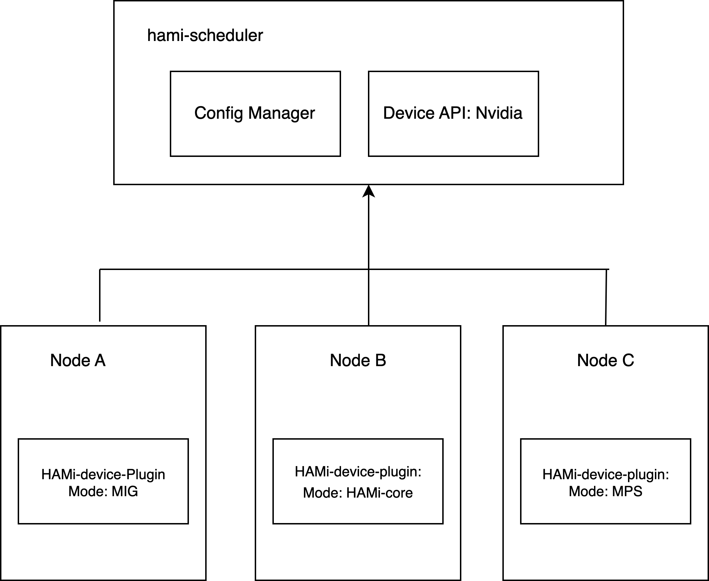
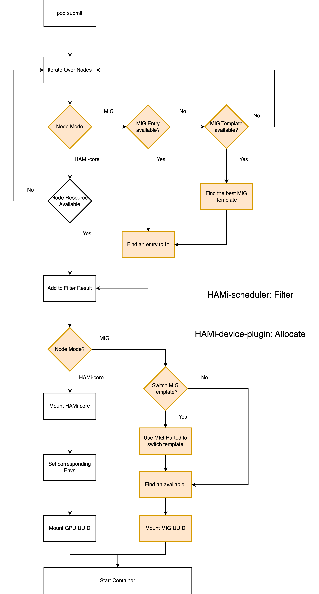

[English](./README.en.md) · [文章目录](../../README.md) · [官网阅读](https://www.theriseunion.com/zh/blog/hami-dynamic-mig.html)

# HAMi 动态 MIG 设计原理

睿思智联 · 2025/02/12 08:00（北京时间）

深入解析 HAMi 动态 MIG 功能的设计原理和实现方案。探讨如何通过 mig-parted 实现 GPU 资源的自动分区和管理，支持节点级别的装箱与分散策略，以及统一的 vGPU 资源池管理。包含完整的配置示例和最佳实践指南。


## 特别鸣谢

本功能的实现离不开 [@sailorvii](https://github.com/sailorvii) 的帮助。

## 使用方法
[查看如何在 HAMi 中使用 MIG 特性](https://www.theriseunion.com/zh/blog/hami-support-mig.html)

## 简介

NVIDIA GPU 内置的资源共享方式包括：时间片轮转（Time-slice）、多进程服务（MPS）和多实例 GPU（MIG）。由于时间片切换会造成一定的性能开销，我们选择采用 MPS 和 MIG 方案。虽然 GPU MIG 配置文件是可变的，用户可以根据预定义的配置获取 MIG 设备，但目前的实现方式要求在用户请求之前就定义好专用配置文件，这限制了 MIG 的使用灵活性。因此，我们计划开发一个自动切分插件，能够根据用户需求动态创建切分实例。

在调度策略方面，我们将支持节点级别的装箱（Binpack）和分散（Spread）策略。参考装箱插件的实现，我们会综合考虑 CPU、内存、GPU 显存以及其他用户自定义资源。

HAMi 的实现基于 [hami-core](https://github.com/Project-HAMi/HAMi-core)（一个 CUDA 底层库）。考虑到 MIG 在全球的广泛应用，我们需要为动态 MIG 和 hami-core 提供统一的 API。

## 目标

- 实现 CPU、内存和 GPU 的联合调度
- GPU 动态切分：支持 Hami-core 和 MIG
- 基于 GPU 显存、CPU 和内存实现节点级别的装箱和分散策略
- 为不同虚拟化技术提供统一的 vGPU 资源池
- 任务可以选择使用 MIG、HAMi-core 或同时使用两者

### 配置映射
- hami-scheduler-device-configMap
此配置映射定义了插件配置，包括资源名称、MIG 几何体配置和节点级别配置。

```yaml
apiVersion: v1
data:
  device-config.yaml: |
    nvidia:
      resourceCountName: nvidia.com/gpu
      resourceMemoryName: nvidia.com/gpumem
      resourceCoreName: nvidia.com/gpucores
      knownMigGeometries:
      - models: [ "A30" ]
        allowedGeometries:
          - 
            - name: 1g.6gb
              memory: 6144
              count: 4
          - 
            - name: 2g.12gb
              memory: 12288
              count: 2
          - 
            - name: 4g.24gb
              memory: 24576
              count: 1
      # ... (其他 GPU 型号配置保持不变)
      nodeconfig: 
          - name: nodeA
            operatingmode: hami-core
          - name: nodeB
            operatingmode: mig
```

## 架构



## 示例

动态 MIG 与 HAMi 任务兼容，如下例所示：
只需设置 `nvidia.com/gpu` 和 `nvidia.com/gpumem` 即可。

```yaml
apiVersion: v1
kind: Pod
metadata:
  name: gpu-pod1
spec:
  containers:
    - name: ubuntu-container1
      image: ubuntu:20.04
      command: ["bash", "-c", "sleep 86400"]
      resources:
        limits:
          nvidia.com/gpu: 2    # 请求 2 个 vGPU
          nvidia.com/gpumem: 8000    # 每个 vGPU 包含 8000M 设备内存（可选，整数）
```

任务可以通过设置 `annotations.nvidia.com/vgpu-mode` 来指定仅使用 `mig` 或 `hami-core`，示例如下：

```yaml
apiVersion: v1
kind: Pod
metadata:
  name: gpu-pod1
  annotations:
    nvidia.com/vgpu-mode: "mig"
spec:
  containers:
    - name: ubuntu-container1
      image: ubuntu:20.04
      command: ["bash", "-c", "sleep 86400"]
      resources:
        limits:
          nvidia.com/gpu: 2    # 请求 2 个 vGPU
          nvidia.com/gpumem: 8000    # 每个 vGPU 包含 8000M 设备内存（可选，整数）
```

## 处理流程

使用动态 MIG 的 vGPU 任务处理流程如下：



需要注意的是，提交任务后，deviceshare 插件会遍历 `hami-scheduler-device` 配置映射中定义的模板，并找到第一个可用的匹配模板。您可以随时修改该配置映射的内容，并重启 vc-scheduler 来自定义配置。

如果您在空闲的 A100-PCIE-40GB 节点上提交上述示例，系统将选择一个 GPU 并使用以下 MIG 模板：

```yaml
  2g.10gb : 3
  1g.5gb : 1
```

然后使用 2 个 2g.10gb 实例启动容器。

> reference: https://github.com/Project-HAMi/HAMi/blob/master/docs/develop/dynamic-mig.md

---

[在睿思智联官网阅读本文](https://www.theriseunion.com/zh/blog/hami-dynamic-mig.html) · [浏览更多文章](https://www.theriseunion.com/zh/blog.html)
