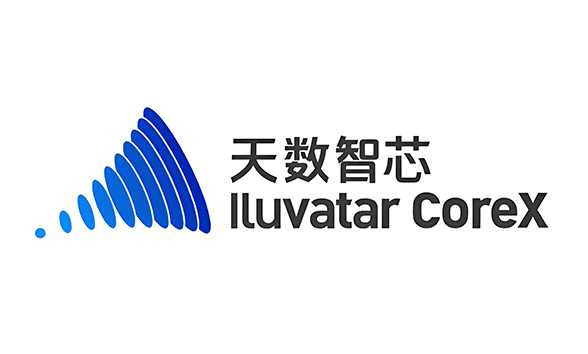

[简体中文](./README.md) · [All articles](../../README.en.md) · [Read on the website](https://www.theriseunion.com/en/blog/hami-iluvatar-support.html)

# Iluvatar GPU Virtualization Guide: MR-V100/BI-V150 Best Practices

RiseUnion · January 01, 2025 at 08:00 (UTC+08:00)

Complete guide to Iluvatar GPU virtualization, covering MR-V100, BI-V150, and BI-V100 series device sharing, memory allocation, and compute control features for optimized AI infrastructure management.



## Introduction

**We now support iluvatar.ai/gpu(i.e MR-V100、BI-V150、BI-V100) by implementing most device-sharing features as nvidia-GPU**, including:

- ***GPU sharing***: Each task can allocate a portion of GPU instead of a whole GPU card, thus GPU can be shared among multiple tasks.
- ***Device Memory Control***: GPUs can be allocated with certain device memory size and have made it that it does not exceed the boundary.
- ***Device Core Control***: GPUs can be allocated with limited compute cores and have made it that it does not exceed the boundary.
- ***Device UUID Selection***: You can specify which GPU devices to use or exclude using annotations.
- ***Very Easy to use***: You don't need to modify your task yaml to use our scheduler. All your GPU jobs will be automatically supported after installation.

> **Compatibility Certification**: HAMi has completed deep compatibility certification with Iluvatar GPU products. For detailed information, please refer to [Iluvatar Compatibility Certification](https://www.theriseunion.com/en/blog/iluvatar-compatibility.html). This certification ensures stability and reliability in production environments.

## Prerequisites

* Iluvatar gpu-manager (please consult your device provider)
* driver version > 3.1.0

## Enabling GPU-sharing Support

* Deploy gpu-manager on iluvatar nodes (Please consult your device provider to aquire its package and document)
> **NOTICE:** *Install only gpu-manager, don't install gpu-admission package.*
* Identify the resource name about core and memory usage(i.e 'iluvatar.ai/vcuda-core', 'iluvatar.ai/vcuda-memory')
* set the 'iluvatarResourceMem' and 'iluvatarResourceCore' parameters when install hami
```bash
helm install hami hami-charts/hami --set scheduler.kubeScheduler.imageTag={your kubernetes version} --set iluvatarResourceMem=iluvatar.ai/vcuda-memory --set iluvatarResourceCore=iluvatar.ai/vcuda-core -n kube-system
```

> **NOTE:** The default resource names are:
> - `iluvatar.ai/vgpu` for GPU count
> - `iluvatar.ai/vcuda-memory` for memory allocation
> - `iluvatar.ai/vcuda-core` for core allocation
>
> You can customize these names using the parameters above.

## Device Granularity

HAMi divides each Iluvatar GPU into 100 units for resource allocation. When you request a portion of a GPU, you're actually requesting a certain number of these units.

### Memory Allocation

- Each unit of `iluvatar.ai/vcuda-memory` represents 256MB of device memory
- If you don't specify a memory request, the system will default to using 100% of the available memory
- Memory allocation is enforced with hard limits to ensure tasks don't exceed their allocated memory

### Core Allocation

- Each unit of `iluvatar.ai/vcuda-core` represents 1% of the available compute cores
- Core allocation is enforced with hard limits to ensure tasks don't exceed their allocated cores
- When requesting multiple GPUs, the system will automatically set the core resources based on the number of GPUs requested

## Running Iluvatar jobs

Iluvatar GPUs can now be requested by a container
using the `iluvatar.ai/vgpu`, `iluvatar.ai/vcuda-memory` and `iluvatar.ai/vcuda-core`  resource type:

```yaml
apiVersion: v1
kind: Pod
metadata:
  name: poddemo
spec:
  restartPolicy: Never
  containers:
  - name: poddemo
    image: harbor.4pd.io/vgpu/corex_transformers@sha256:36a01ec452e6ee63c7aa08bfa1fa16d469ad19cc1e6000cf120ada83e4ceec1e
    command:
    - bash
    args:
    - -c
    - |
      set -ex
      echo "export LD_LIBRARY_PATH=/usr/local/corex/lib64:$LD_LIBRARY_PATH">> /root/.bashrc
      cp -f /usr/local/iluvatar/lib64/libcuda.* /usr/local/corex/lib64/
      cp -f /usr/local/iluvatar/lib64/libixml.* /usr/local/corex/lib64/
      source /root/.bashrc
      sleep 360000
    resources:
      requests:
        iluvatar.ai/vgpu: 1
        iluvatar.ai/vcuda-core: 50
        iluvatar.ai/vcuda-memory: 64
      limits:
        iluvatar.ai/vgpu: 1
        iluvatar.ai/vcuda-core: 50
        iluvatar.ai/vcuda-memory: 64
```

> **NOTICE1:** *Each unit of vcuda-memory indicates 256M device memory*

> **NOTICE2:** *You can find more examples in [examples/iluvatar folder](https://github.com/Project-HAMi/HAMi/tree/master/examples/iluvatar)*

## Device UUID Selection

You can specify which GPU devices to use or exclude using annotations:

```yaml
apiVersion: v1
kind: Pod
metadata:
  name: poddemo
  annotations:
    # Use specific GPU devices (comma-separated list)
    iluvatar.ai/use-gpuuuid: "node1-iluvatar-0,node1-iluvatar-1"
    # Or exclude specific GPU devices (comma-separated list)
    iluvatar.ai/nouse-gpuuuid: "node1-iluvatar-2,node1-iluvatar-3"
spec:
  # ... rest of pod spec
```

> **NOTE:** The device ID format is `{node-name}-iluvatar-{index}`. You can find the available device IDs in the node status.

### Finding Device UUIDs

You can find the UUIDs of Iluvatar GPUs on a node using the following command:

```bash
kubectl get pod <pod-name> -o yaml | grep -A 10 "hami.io/<card-type>-devices-allocated"
```

Or by examining the node annotations:

```bash
kubectl get node <node-name> -o yaml | grep -A 10 "hami.io/node-register-<card-type>"
```

Look for annotations containing device information in the node status.

## Notes

1. You need to set the following prestart command in order for the device-share to work properly
```bash
      set -ex
      echo "export LD_LIBRARY_PATH=/usr/local/corex/lib64:$LD_LIBRARY_PATH">> /root/.bashrc
      cp -f /usr/local/iluvatar/lib64/libcuda.* /usr/local/corex/lib64/
      cp -f /usr/local/iluvatar/lib64/libixml.* /usr/local/corex/lib64/
      source /root/.bashrc
```
2. Virtualization takes effect only for containers that apply for one GPU(i.e iluvatar.ai/vgpu=1 ). When requesting multiple GPUs, the system will automatically set the core resources based on the number of GPUs requested.
3. The `iluvatar.ai/vcuda-memory` resource is only effective when `iluvatar.ai/vgpu=1`.
4. Multi-device requests (`iluvatar.ai/vgpu > 1`) do not support vGPU mode.

## Ecosystem Certification

RiseUnion has completed deep compatibility certification with Iluvatar. The Rise VAST AI Computing Power Management Platform now fully supports Iluvatar's high-performance general-purpose GPU accelerator cards, providing users with a more powerful and comprehensive AI computing resource management and scheduling solution.

### Resource Pooling and Unified Management
  - Achieve data center-level GPU computing resource centralization and unified scheduling
  - Support heterogeneous deployment of domestic and international accelerator cards
  - Provide flexible hardware deployment strategies

### Intelligent Scheduling and Resource Allocation
  - Support dynamic GPU computing power allocation based on task requirements
  - Provide multi-dimensional task management and quota management mechanisms
  - Enable flexible allocation of task priorities and computing resources

### Operations Management Optimization
  - Provide intelligent device monitoring, log management, and alerting capabilities
  - Support visual management interface for improved operational efficiency
  - Ensure continuous stable system operation

For more certification details, please refer to [RiseUnion and Iluvatar Compatibility Certification](https://www.theriseunion.com/en/blog/iluvatar-compatibility.html).

---

[Read this article on the RiseUnion website](https://www.theriseunion.com/en/blog/hami-iluvatar-support.html) · [Explore more articles](https://www.theriseunion.com/en/blog.html)
