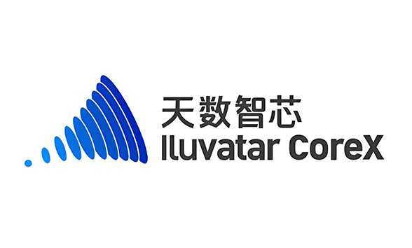

[English](./README.en.md) · [文章目录](../../README.md) · [官网阅读](https://www.theriseunion.com/zh/blog/hami-iluvatar-support.html)

# 天数智芯 GPU 虚拟化指南：MR-V100/BI-V150 设备管理最佳实践

睿思智联 · 2025/04/06 08:00（北京时间）

全面解析天数智芯 GPU 设备虚拟化方案，涵盖 MR-V100、BI-V150、BI-V100 系列显卡共享、显存分配、算力控制等特性，助力企业优化 AI 基础设施部署与管理。



## 简介

本组件支持复用天数智芯GPU设备(MR-V100、BI-V150、BI-V100)，并为此提供以下几种与vGPU类似的复用功能，包括：

- ***GPU 共享***: 每个任务可以只占用一部分显卡，多个任务可以共享一张显卡
- ***可限制分配的显存大小***: 你现在可以用显存值（例如3000M）来分配GPU，本组件会确保任务使用的显存不会超过分配数值
- ***可限制分配的算力核组比例***: 你现在可以用算力比例（例如60%）来分配GPU，本组件会确保任务使用的显存不会超过分配数值
- ***设备 UUID 选择***: 你可以通过注解指定使用或排除特定的 GPU 设备
- ***方便易用***:  部署本组件后，只需要部署厂家提供的gpu-manager即可使用


## 节点需求

* Iluvatar gpu-manager (please consult your device provider)
* driver version > 3.1.0

## 开启GPU复用

* 部署'gpu-manager'，天数智芯的GPU共享需要配合厂家提供的'gpu-manager'一起使用，请联系设备提供方获取
> **注意:** *只需要安装gpu-manager，不要安装gpu-admission.*
* 部署'gpu-manager'之后，你需要确认显存和核组对应的资源名称(例如 'iluvatar.ai/vcuda-core', 'iluvatar.ai/vcuda-memory')
* 在安装HAMi时配置'iluvatarResourceMem'和'iluvatarResourceCore'参数

```bash
helm install hami hami-charts/hami --set scheduler.kubeScheduler.imageTag={your kubernetes version} --set iluvatarResourceMem=iluvatar.ai/vcuda-memory --set iluvatarResourceCore=iluvatar.ai/vcuda-core -n kube-system
```

> **说明:** 默认资源名称如下：
> - `iluvatar.ai/vgpu` 用于 GPU 数量
> - `iluvatar.ai/vcuda-memory` 用于内存分配
> - `iluvatar.ai/vcuda-core` 用于核心分配
>
> 你可以通过上述参数自定义这些名称。

## 设备粒度切分

HAMi 将每个天数智芯 GPU 划分为 100 个单元进行资源分配。当你请求一部分 GPU 时，实际上是在请求这些单元中的一定数量。

### 内存分配

- 每个 `iluvatar.ai/vcuda-memory` 单位代表 256MB 的设备内存
- 如果不指定内存请求，系统将默认使用 100% 的可用内存
- 内存分配通过硬限制强制执行，确保任务不会超过其分配的内存

### 核心分配

- 每个 `iluvatar.ai/vcuda-core` 单位代表 1% 的可用计算核心
- 核心分配通过硬限制强制执行，确保任务不会超过其分配的核心
- 当请求多个 GPU 时，系统会根据请求的 GPU 数量自动设置核心资源

## 运行GPU任务

```yaml
apiVersion: v1
kind: Pod
metadata:
  name: poddemo
spec:
  restartPolicy: Never
  containers:
  - name: poddemo
    image: harbor.4pd.io/vgpu/corex_transformers@sha256:36a01ec452e6ee63c7aa08bfa1fa16d469ad19cc1e6000cf120ada83e4ceec1e
    command:
    - bash
    args:
    - -c
    - |
      set -ex
      echo "export LD_LIBRARY_PATH=/usr/local/corex/lib64:$LD_LIBRARY_PATH">> /root/.bashrc
      cp -f /usr/local/iluvatar/lib64/libcuda.* /usr/local/corex/lib64/
      cp -f /usr/local/iluvatar/lib64/libixml.* /usr/local/corex/lib64/
      source /root/.bashrc
      sleep 360000
    resources:
      requests:
        iluvatar.ai/vgpu: 1
        iluvatar.ai/vcuda-core: 50
        iluvatar.ai/vcuda-memory: 64
      limits:
        iluvatar.ai/vgpu: 1
        iluvatar.ai/vcuda-core: 50
        iluvatar.ai/vcuda-memory: 64
```

> **注意1:** *每一单位的vcuda-memory代表256M的显存.*

> **注意2:** *查看更多的[用例](https://github.com/Project-HAMi/HAMi/tree/master/examples/iluvatar).*

## 设备 UUID 选择

你可以通过 Pod 注解来指定要使用或排除特定的 GPU 设备：

```yaml
apiVersion: v1
kind: Pod
metadata:
  name: poddemo
  annotations:
    # 使用特定的 GPU 设备（逗号分隔的列表）
    iluvatar.ai/use-gpuuuid: "node1-iluvatar-0,node1-iluvatar-1"
    # 或者排除特定的 GPU 设备（逗号分隔的列表）
    iluvatar.ai/nouse-gpuuuid: "node1-iluvatar-2,node1-iluvatar-3"
spec:
  # ... 其余 Pod 配置
```

> **说明:** 设备 ID 格式为 `{节点名称}-iluvatar-{索引}`。你可以在节点状态中找到可用的设备 ID。

### 查找设备 UUID

你可以使用以下命令查找节点上的天数智芯 GPU 设备 UUID：

```bash
kubectl get pod <pod-name> -o yaml | grep -A 10 "hami.io/<card-type>-devices-allocated"
```

或者通过检查节点注解：

```bash
kubectl get node <node-name> -o yaml | grep -A 10 "hami.io/node-register-<card-type>"
```

在节点注解中查找包含设备信息的注解。


## 注意事项

1. 你需要在容器中进行如下的设置才能正常的使用共享功能
```bash
      set -ex
      echo "export LD_LIBRARY_PATH=/usr/local/corex/lib64:$LD_LIBRARY_PATH">> /root/.bashrc
      cp -f /usr/local/iluvatar/lib64/libcuda.* /usr/local/corex/lib64/
      cp -f /usr/local/iluvatar/lib64/libixml.* /usr/local/corex/lib64/
      source /root/.bashrc
```
2. 共享模式只对申请一张GPU的容器生效（iluvatar.ai/vgpu=1）。当请求多个 GPU 时，系统会根据请求的 GPU 数量自动设置核心资源。
3. `iluvatar.ai/vcuda-memory` 资源仅在 `iluvatar.ai/vgpu=1` 时有效。
4. 多设备请求（`iluvatar.ai/vgpu > 1`）不支持 vGPU 模式。

## 生态认证

睿思智联（RiseUnion）已完成和天数智芯的深度适配认证。睿思智联的 Rise VAST AI 算力管理平台现已全面支持天数智芯的高性能通用 GPU 加速卡，为用户提供更强大、更全面的 AI 算力资源管理与调度解决方案。

### 资源池化与统一管理
  - 实现数据中心级 GPU 算力资源的集中池化和统一调度管理
  - 支持国产与非国产加速卡的异构部署
  - 提供灵活的硬件部署策略

### 智能调度与资源分配
  - 支持基于任务需求的动态 GPU 算力分配
  - 提供多维度的任务管理与配额管理机制
  - 实现任务优先级和算力资源的灵活分配

### 运维管理优化
  - 提供智能化的设备监控、日志管理和告警功能
  - 支持可视化的管理界面，提升运维效率
  - 确保系统持续稳定运行

更多认证详情，请参阅[睿思智联与天数智芯兼容性认证](https://www.theriseunion.com/zh/blog/iluvatar-compatibility.html)。

---

[在睿思智联官网阅读本文](https://www.theriseunion.com/zh/blog/hami-iluvatar-support.html) · [浏览更多文章](https://www.theriseunion.com/zh/blog.html)
