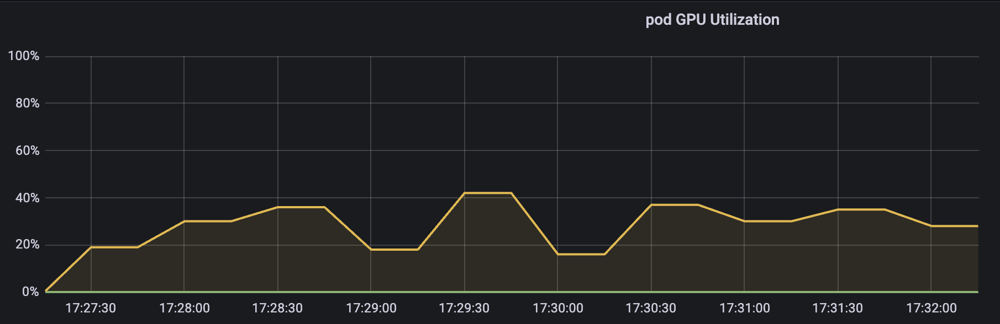
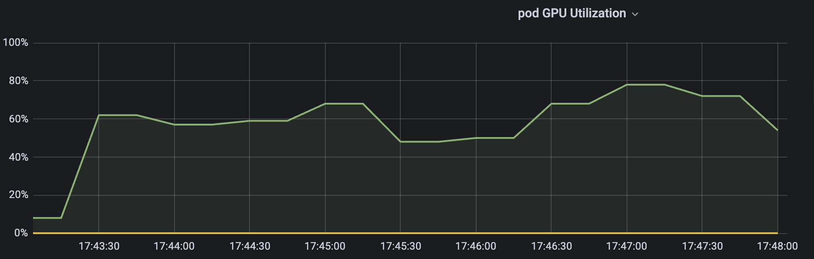

[简体中文](./README.md) · [All articles](../../README.en.md) · [Read on the website](https://www.theriseunion.com/en/blog/hami-isolation-test.html)

# Open Source vGPU Solution HAMi: Core & Memory Isolation Test

RiseUnion · January 01, 2025 at 08:00 (UTC+08:00)

In-depth testing of HAMi's GPU resource isolation capabilities, verifying its effectiveness in Core computing power limitation and Memory isolation through practical test cases.


Abstract: This article mainly tests the GPU Core & Memory isolation functionality of the open-source vGPU solution HAMi.

> Source: ["Open Source vGPU Solution HAMi: Core & Memory Isolation Test"](https://www.lixueduan.com/posts/kubernetes/28-hami-isolation-test/). Thanks to "Exploring Cloud Native" for their continued attention and contributions to HAMi.

## 1. Environment Setup

Here's a brief overview of the test environment:

- GPU: A40 * 2
- K8s: v1.23.17
- HAMi: v2.3.13


### GPU Environment

Using GPU-Operator to install GPU drivers, Container Runtime, etc. Reference -> GPU Environment Setup Guide: Using GPU Operator to Accelerate Kubernetes GPU Environment Setup

Then install HAMi, reference -> Open Source vGPU Solution: HAMi, Implementing Fine-grained GPU Partitioning

### Test Environment

Simply use the torch image to start a Pod as the test environment

```bash
docker pull pytorch/pytorch:2.4.1-cuda11.8-cudnn9-runtime
```

### Test Script

We can use PyTorch's provided Examples as test scripts

```bash
https://github.com/pytorch/examples/tree/main/imagenet
```

This is a training demo that will print the time for each step. The lower the computing power given, the longer each step will take.

Usage is simple:

First clone the project

```bash
git clone https://github.com/pytorch/examples.git
```

Then start the service to simulate GPU consumption tasks

```bash
cd /mnt/imagenet/
python main.py -a resnet18 --dummy
```

### Configuration

Need to inject environment variable `GPU_CORE_UTILIZATION_POLICY=force` into the Pod. The default limitation policy won't restrict computing power when only one Pod is using that GPU.

### Complete YAML

Mount the examples project into the Pod using hostPath for testing, and configure the command as the startup command.

Test by configuring vGPU to be limited to 30% or 60% respectively.

Complete YAML as follows:

```yaml
apiVersion: v1
kind: Pod
metadata:
  name: hami-30
  namespace: default
spec:
  containers:
  - name: simple-container
    image: pytorch/pytorch:2.4.1-cuda11.8-cudnn9-runtime
    command: ["python", "/mnt/imagenet/main.py", "-a", "resnet18", "--dummy"]
    resources:
      requests:
        cpu: "4"
        memory: "32Gi"
        nvidia.com/gpu: "1"
        nvidia.com/gpucores: "30"
        nvidia.com/gpumem: "20000"
      limits:
        cpu: "4"
        memory: "32Gi"
        nvidia.com/gpu: "1" # 1 GPU
        nvidia.com/gpucores: "30" # Request 30% computing power
        nvidia.com/gpumem: "20000" # Request 20G memory (unit is MB)
    env:
    - name: GPU_CORE_UTILIZATION_POLICY
      value: "force" # Set environment variable GPU_CORE_UTILIZATION_POLICY to force
    volumeMounts:
    - name: imagenet-volume
      mountPath: /mnt/imagenet # Mount point in container
    - name: shm-volume
      mountPath: /dev/shm # Mount shared memory to container's /dev/shm
  restartPolicy: Never
  volumes:
  - name: imagenet-volume
    hostPath:
      path: /root/lixd/hami/examples/imagenet # Host directory path
      type: Directory
  - name: shm-volume
    emptyDir:
      medium: Memory # Use memory as emptyDir
```

## 2. Core Isolation Test

### 30% Computing Power

Setting gpucores to 30% shows the following effect:

```bash
[HAMI-core Msg(15:140523803275776:libvgpu.c:836)]: Initializing.....
[HAMI-core Warn(15:140523803275776:utils.c:183)]: get default cuda from (null)
[HAMI-core Msg(15:140523803275776:libvgpu.c:855)]: Initialized
/mnt/imagenet/main.py:110: UserWarning: nccl backend >=2.5 requires GPU count>1, see https://github.com/NVIDIA/nccl/issues/103 perhaps use 'gloo'
  warnings.warn("nccl backend >=2.5 requires GPU count>1, see https://github.com/NVIDIA/nccl/issues/103 perhaps use 'gloo'")
=> creating model 'resnet18'
=> Dummy data is used!
Epoch: [0][   1/5005]        Time  4.338 ( 4.338)        Data  1.979 ( 1.979)        Loss 7.0032e+00 (7.0032e+00)        Acc@1   0.00 (  0.00)        Acc@5   0.00 (  0.00)
Epoch: [0][  11/5005]        Time  0.605 ( 0.806)        Data  0.000 ( 0.187)        Loss 7.1570e+00 (7.0590e+00)        Acc@1   0.00 (  0.04)        Acc@5   0.39 (  0.39)
Epoch: [0][  21/5005]        Time  0.605 ( 0.706)        Data  0.000 ( 0.098)        Loss 7.1953e+00 (7.1103e+00)        Acc@1   0.00 (  0.06)        Acc@5   0.39 (  0.56)
Epoch: [0][  31/5005]        Time  0.605 ( 0.671)        Data  0.000 ( 0.067)        Loss 7.2163e+00 (7.1379e+00)        Acc@1   0.00 (  0.04)        Acc@5   1.56 (  0.55)
Epoch: [0][  41/5005]        Time  0.608 ( 0.656)        Data  0.000 ( 0.051)        Loss 7.2501e+00 (7.1549e+00)        Acc@1   0.39 (  0.07)        Acc@5   0.39 (  0.60)
Epoch: [0][  51/5005]        Time  0.611 ( 0.645)        Data  0.000 ( 0.041)        Loss 7.1290e+00 (7.1499e+00)        Acc@1   0.00 (  0.09)        Acc@5   0.39 (  0.60)
Epoch: [0][  61/5005]        Time  0.613 ( 0.639)        Data  0.000 ( 0.035)        Loss 6.9827e+00 (7.1310e+00)        Acc@1   0.00 (  0.12)        Acc@5   0.39 (  0.60)
Epoch: [0][  71/5005]        Time  0.610 ( 0.635)        Data  0.000 ( 0.030)        Loss 6.9808e+00 (7.1126e+00)        Acc@1   0.00 (  0.11)        Acc@5   0.39 (  0.61)
Epoch: [0][  81/5005]        Time  0.617 ( 0.630)        Data  0.000 ( 0.027)        Loss 6.9540e+00 (7.0947e+00)        Acc@1   0.00 (  0.11)        Acc@5   0.78 (  0.64)
Epoch: [0][  91/5005]        Time  0.608 ( 0.628)        Data  0.000 ( 0.024)        Loss 6.9248e+00 (7.0799e+00)        Acc@1   1.17 (  0.12)        Acc@5   1.17 (  0.64)
Epoch: [0][ 101/5005]        Time  0.616 ( 0.626)        Data  0.000 ( 0.022)        Loss 6.9546e+00 (7.0664e+00)        Acc@1   0.00 (  0.11)        Acc@5   0.39 (  0.61)
Epoch: [0][ 111/5005]        Time  0.610 ( 0.625)        Data  0.000 ( 0.020)        Loss 6.9371e+00 (7.0565e+00)        Acc@1   0.00 (  0.11)        Acc@5   0.39 (  0.61)
Epoch: [0][ 121/5005]        Time  0.608 ( 0.621)        Data  0.000 ( 0.018)        Loss 6.9403e+00 (7.0473e+00)        Acc@1   0.00 (  0.11)        Acc@5   0.78 (  0.60)
Epoch: [0][ 131/5005]        Time  0.611 ( 0.620)        Data  0.000 ( 0.017)        Loss 6.9016e+00 (7.0384e+00)        Acc@1   0.00 (  0.10)        Acc@5   0.00 (  0.59)
Epoch: [0][ 141/5005]        Time  0.487 ( 0.619)        Data  0.000 ( 0.016)        Loss 6.9410e+00 (7.0310e+00)        Acc@1   0.00 (  0.10)        Acc@5   0.39 (  0.58)
Epoch: [0][ 151/5005]        Time  0.608 ( 0.617)        Data  0.000 ( 0.015)        Loss 6.9647e+00 (7.0251e+00)        Acc@1   0.00 (  0.10)        Acc@5   0.00 (  0.56)

```

Each step takes about 0.6 seconds.

GPU utilization:



As we can see, the utilization fluctuates around our target value of 30%, averaging around 30% over a period of time.

### 60% Computing Power

Effect with 60%:

```bash
root@hami:~/lixd/hami# kubectl logs -f hami-60
[HAMI-core Msg(1:140477390922240:libvgpu.c:836)]: Initializing.....
[HAMI-core Warn(1:140477390922240:utils.c:183)]: get default cuda from (null)
[HAMI-core Msg(1:140477390922240:libvgpu.c:855)]: Initialized
/mnt/imagenet/main.py:110: UserWarning: nccl backend >=2.5 requires GPU count>1, see https://github.com/NVIDIA/nccl/issues/103 perhaps use 'gloo'
  warnings.warn("nccl backend >=2.5 requires GPU count>1, see https://github.com/NVIDIA/nccl/issues/103 perhaps use 'gloo'")
=> creating model 'resnet18'
=> Dummy data is used!
Epoch: [0][   1/5005]        Time  4.752 ( 4.752)        Data  2.255 ( 2.255)        Loss 7.0527e+00 (7.0527e+00)        Acc@1   0.00 (  0.00)        Acc@5   0.39 (  0.39)
Epoch: [0][  11/5005]        Time  0.227 ( 0.597)        Data  0.000 ( 0.206)        Loss 7.0772e+00 (7.0501e+00)        Acc@1   0.00 (  0.25)        Acc@5   1.17 (  0.78)
Epoch: [0][  21/5005]        Time  0.234 ( 0.413)        Data  0.000 ( 0.129)        Loss 7.0813e+00 (7.1149e+00)        Acc@1   0.00 (  0.20)        Acc@5   0.39 (  0.73)
Epoch: [0][  31/5005]        Time  0.401 ( 0.360)        Data  0.325 ( 0.125)        Loss 7.2436e+00 (7.1553e+00)        Acc@1   0.00 (  0.14)        Acc@5   0.78 (  0.67)
Epoch: [0][  41/5005]        Time  0.190 ( 0.336)        Data  0.033 ( 0.119)        Loss 7.0519e+00 (7.1684e+00)        Acc@1   0.00 (  0.10)        Acc@5   0.00 (  0.62)
Epoch: [0][  51/5005]        Time  0.627 ( 0.327)        Data  0.536 ( 0.123)        Loss 7.1113e+00 (7.1641e+00)        Acc@1   0.00 (  0.11)        Acc@5   1.17 (  0.67)
Epoch: [0][  61/5005]        Time  0.184 ( 0.306)        Data  0.000 ( 0.109)        Loss 7.0776e+00 (7.1532e+00)        Acc@1   0.00 (  0.10)        Acc@5   0.78 (  0.65)
Epoch: [0][  71/5005]        Time  0.413 ( 0.298)        Data  0.343 ( 0.108)        Loss 6.9763e+00 (7.1325e+00)        Acc@1   0.39 (  0.13)        Acc@5   1.17 (  0.67)
Epoch: [0][  81/5005]        Time  0.200 ( 0.289)        Data  0.000 ( 0.103)        Loss 6.9667e+00 (7.1155e+00)        Acc@1   0.00 (  0.13)        Acc@5   1.17 (  0.68)
Epoch: [0][  91/5005]        Time  0.301 ( 0.284)        Data  0.219 ( 0.102)        Loss 6.9920e+00 (7.0990e+00)        Acc@1   0.00 (  0.13)        Acc@5   1.17 (  0.67)
Epoch: [0][ 101/5005]        Time  0.365 ( 0.280)        Data  0.000 ( 0.097)        Loss 6.9519e+00 (7.0846e+00)        Acc@1   0.00 (  0.12)        Acc@5   0.39 (  0.66)
Epoch: [0][ 111/5005]        Time  0.239 ( 0.284)        Data  0.000 ( 0.088)        Loss 6.9559e+00 (7.0732e+00)        Acc@1   0.39 (  0.13)        Acc@5   0.78 (  0.62)
Epoch: [0][ 121/5005]        Time  0.368 ( 0.286)        Data  0.000 ( 0.082)        Loss 6.9594e+00 (7.0626e+00)        Acc@1   0.00 (  0.13)        Acc@5   0.78 (  0.63)
Epoch: [0][ 131/5005]        Time  0.363 ( 0.287)        Data  0.000 ( 0.075)        Loss 6.9408e+00 (7.0535e+00)        Acc@1   0.00 (  0.13)        Acc@5   0.00 (  0.60)
Epoch: [0][ 141/5005]        Time  0.241 ( 0.288)        Data  0.000 ( 0.070)        Loss 6.9311e+00 (7.0456e+00)        Acc@1   0.00 (  0.12)        Acc@5   0.00 (  0.58)
Epoch: [0][ 151/5005]        Time  0.367 ( 0.289)        Data  0.000 ( 0.066)        Loss 6.9441e+00 (7.0380e+00)        Acc@1   0.00 (  0.13)        Acc@5   0.78 (  0.58)
Epoch: [0][ 161/5005]        Time  0.372 ( 0.290)        Data  0.000 ( 0.062)        Loss 6.9347e+00 (7.0317e+00)        Acc@1   0.78 (  0.13)        Acc@5   1.56 (  0.59)
Epoch: [0][ 171/5005]        Time  0.241 ( 0.290)        Data  0.000 ( 0.058)        Loss 6.9432e+00 (7.0268e+00)        Acc@1   0.00 (  0.13)        Acc@5   0.39 (  0.58)

```

Each step takes about 0.3 seconds. When it was 30%, the time was 0.6s, reduced by 50%, which matches the computing power increase from 30% to 60% doubling.

GPU utilization is:



Similarly fluctuates within a certain range, averaging around the limited 60%.

## 3. Memory Isolation Test

Just need to specify 20000M memory in Pod Resource

```yaml
resources:
  requests:
    cpu: "4"
    memory: "8Gi"
    nvidia.com/gpu: "1"
    nvidia.com/gpucores: "60"
    nvidia.com/gpumem: "200000"
```

Then checking in the Pod shows only 20000M

```bash
root@hami-30:/mnt/b66582121706406e9797ffaf64a831b0# nvidia-smi
[HAMI-core Msg(68:139953433691968:libvgpu.c:836)]: Initializing.....
Mon Oct 14 13:14:23 2024       
+-----------------------------------------------------------------------------+
| NVIDIA-SMI 525.147.05   Driver Version: 525.147.05   CUDA Version: 12.0     |
|-------------------------------+----------------------+----------------------+
| GPU  Name        Persistence-M| Bus-Id        Disp.A | Volatile Uncorr. ECC |
| Fan  Temp  Perf  Pwr:Usage/Cap|         Memory-Usage | GPU-Util  Compute M. |
|                               |                      |               MIG M. |
|===============================+======================+======================|
|   0  NVIDIA A40          Off  | 00000000:00:07.0 Off |                    0 |
|  0%   30C    P8    29W / 300W |      0MiB / 20000MiB |      0%      Default |
|                               |                      |                  N/A |
+-------------------------------+----------------------+----------------------+
                                                                               
+-----------------------------------------------------------------------------+
| Processes:                                                                  |
|  GPU   GI   CI        PID   Type   Process name                  GPU Memory |
|        ID   ID                                                   Usage      |
|=============================================================================|
|  No running processes found                                                 |
+-----------------------------------------------------------------------------+
[HAMI-core Msg(68:139953433691968:multiprocess_memory_limit.c:468)]: Calling exit handler 68
```

Test script
Then run a script to test if it will OOM after requesting 20000M

```python
import torch
import sys

def allocate_memory(memory_size_mb):
    # Convert MB to bytes and calculate number of float32 elements to allocate
    num_elements = memory_size_mb * 1024 * 1024 // 4  # 1 float32 = 4 bytes
    try:
        # Try to allocate GPU memory
        print(f"Attempting to allocate {memory_size_mb} MB on GPU...")
        x = torch.empty(num_elements, dtype=torch.float32, device='cuda')
        print(f"Successfully allocated {memory_size_mb} MB on GPU.")
    except RuntimeError as e:
        print(f"Failed to allocate {memory_size_mb} MB on GPU: OOM.")
        print(e)

if __name__ == "__main__":
    # Get parameter from command line, use default 1024MB if not provided
    memory_size_mb = int(sys.argv[1]) if len(sys.argv) > 1 else 1024
    allocate_memory(memory_size_mb)
```

Start:

```bash
root@hami-30:/mnt/b66582121706406e9797ffaf64a831b0/lixd/hami-test# python test_oom.py 20000
[HAMI-core Msg(1046:140457967137280:libvgpu.c:836)]: Initializing.....
Attempting to allocate 20000 MB on GPU...
[HAMI-core Warn(1046:140457967137280:utils.c:183)]: get default cuda from (null)
[HAMI-core Msg(1046:140457967137280:libvgpu.c:855)]: Initialized
[HAMI-core ERROR (pid:1046 thread=140457967137280 allocator.c:49)]: Device 0 OOM 21244149760 / 20971520000
Failed to allocate 20000 MB on GPU: OOM.
[Additional error messages omitted...]
```

Directly OOM, seems a bit extreme, let's try 19500

```bash
root@hami-30:/mnt/b66582121706406e9797ffaf64a831b0/lixd/hami-test# python test_oom.py 19500
[HAMI-core Msg(1259:140397947200000:libvgpu.c:836)]: Initializing.....
Attempting to allocate 19500 MB on GPU...
[HAMI-core Warn(1259:140397947200000:utils.c:183)]: get default cuda from (null)
[HAMI-core Msg(1259:140397947200000:libvgpu.c:855)]: Initialized
Successfully allocated 19500 MB on GPU.
[HAMI-core Msg(1259:140397947200000:multiprocess_memory_limit.c:468)]: Calling exit handler 1259
```

Everything normal, indicating HAMi's memory isolation is working properly.

## 4. Summary

Test results are as follows:

- Core isolation
    - When gpucores is set to 30%, each task step takes 0.6s, Grafana shows GPU computing power utilization fluctuates around 30%.
    - When gpucores is set to 60%, each task step takes 0.3s, Grafana shows GPU computing power utilization fluctuates around 60%.
- Memory isolation
    - When gpumem is set to 20000M, attempting to request 20000M results in OOM, requesting 19500M works normally.

We can conclude that HAMi vGPU solution's core&memory isolation basically meets expectations:

- Core isolation: Pod's usable computing power fluctuates around the set value, but averages close to the requested gpucores over time
- Memory isolation: When Pod requests GPU memory exceeding the set value, it directly prompts CUDA OOM

---

[Read this article on the RiseUnion website](https://www.theriseunion.com/en/blog/hami-isolation-test.html) · [Explore more articles](https://www.theriseunion.com/en/blog.html)
