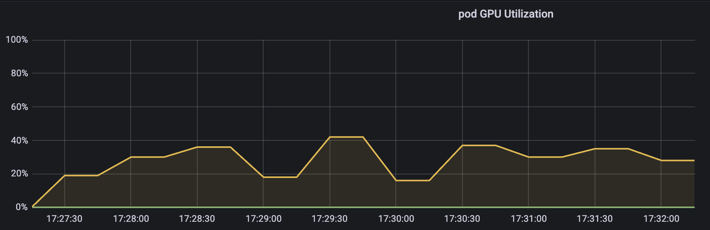
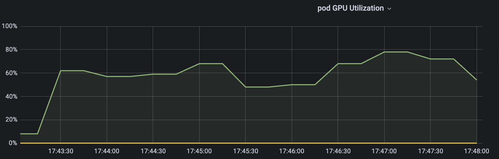

[English](./README.en.md) · [文章目录](../../README.md) · [官网阅读](https://www.theriseunion.com/zh/blog/hami-isolation-test.html)

# 开源 vGPU 方案 HAMi: core & Memory 隔离测试

睿思智联 · 2024/10/28 08:00（北京时间）

深入测试HAMi的GPU资源隔离能力，验证其在Core算力限制和Memory显存隔离方面的效果。通过实际案例展示HAMi如何实现GPU资源的精确控制和有效隔离。


摘要：本文主要对开源的 vGPU 方案 HAMi 的 GPU Core&Memory 隔离功能进行测试。

> 本文引用：[《开源 vGPU 方案 HAMi: core & Memory 隔离测试》](https://www.lixueduan.com/posts/kubernetes/28-hami-isolation-test/)，感谢“探索云原生”持续对 HAMi 的关注和贡献。

## 1.环境准备

简单说一下测试环境

- GPU：A40 * 2
- K8s：v1.23.17
- HAMi：v2.3.13

### GPU 环境

使用 GPU-Operator 安装 GPU 驱动、Container Runtime 之类的,参考 -> GPU 环境搭建指南：使用 GPU Operator 加速 Kubernetes GPU 环境搭建

然后安装 HAMi,参考-> 开源 vGPU 方案：HAMi,实现细粒度 GPU 切分

### 测试环境

直接使用 torch 镜像启动 Pod 作为测试环境就好

```bash
docker pull pytorch/pytorch:2.4.1-cuda11.8-cudnn9-runtime
```

### 测试脚本

可以使用 PyTorch 提供的 Examples 作为测试脚本

```bash
https://github.com/pytorch/examples/tree/main/imagenet
```

这边是一个训练的 Demo，会打印每一步的时间，算力给的越低，每一步耗时也就越长。

具体用法也很简单：

先克隆项目

```bash
git clone https://github.com/pytorch/examples.git
```

然后启动服务模拟消耗 GPU 的任务即可

```bash
cd /mnt/imagenet/
python main.py -a resnet18 --dummy
```

### 配置

需要在 Pod 中注入环境变量 `GPU_CORE_UTILIZATION_POLICY=force`，默认的限制策略时该 GPU 只有一个 Pod 在使用时就不会做算力限制。

### 完整 yaml

以 hostPath 方式将 examples 项目挂载到 Pod 里进行测试，并将 command 配置为启动命令。

通过配置 vGPU 限制为 30% 或者 60% 分别做测试。

完整 yaml 如下：

```yaml
apiVersion: v1
kind: Pod
metadata:
  name: hami-30
  namespace: default
spec:
  containers:
  - name: simple-container
    image: pytorch/pytorch:2.4.1-cuda11.8-cudnn9-runtime
    command: ["python", "/mnt/imagenet/main.py", "-a", "resnet18", "--dummy"]
    resources:
      requests:
        cpu: "4"
        memory: "32Gi"
        nvidia.com/gpu: "1"
        nvidia.com/gpucores: "30"
        nvidia.com/gpumem: "20000"
      limits:
        cpu: "4"
        memory: "32Gi"
        nvidia.com/gpu: "1" # 1 个 GPU
        nvidia.com/gpucores: "30" # 申请使用 30% 算力
        nvidia.com/gpumem: "20000" # 申请 20G 显存（单位为 MB）
    env:
    - name: GPU_CORE_UTILIZATION_POLICY
      value: "force" # 设置环境变量 GPU_CORE_UTILIZATION_POLICY 为 force
    volumeMounts:
    - name: imagenet-volume
      mountPath: /mnt/imagenet # 容器内挂载点
    - name: shm-volume
      mountPath: /dev/shm # 挂载共享内存到容器的 /dev/shm
  restartPolicy: Never
  volumes:
  - name: imagenet-volume
    hostPath:
      path: /root/lixd/hami/examples/imagenet # 主机目录路径
      type: Directory
  - name: shm-volume
    emptyDir:
      medium: Memory # 使用内存作为 emptyDir
```


## 2.Core 隔离测试

### 30% 算力

gpucores 设置为 30% 效果如下：

```bash
[HAMI-core Msg(15:140523803275776:libvgpu.c:836)]: Initializing.....
[HAMI-core Warn(15:140523803275776:utils.c:183)]: get default cuda from (null)
[HAMI-core Msg(15:140523803275776:libvgpu.c:855)]: Initialized
/mnt/imagenet/main.py:110: UserWarning: nccl backend >=2.5 requires GPU count>1, see https://github.com/NVIDIA/nccl/issues/103 perhaps use 'gloo'
  warnings.warn("nccl backend >=2.5 requires GPU count>1, see https://github.com/NVIDIA/nccl/issues/103 perhaps use 'gloo'")
=> creating model 'resnet18'
=> Dummy data is used!
Epoch: [0][   1/5005]        Time  4.338 ( 4.338)        Data  1.979 ( 1.979)        Loss 7.0032e+00 (7.0032e+00)        Acc@1   0.00 (  0.00)        Acc@5   0.00 (  0.00)
Epoch: [0][  11/5005]        Time  0.605 ( 0.806)        Data  0.000 ( 0.187)        Loss 7.1570e+00 (7.0590e+00)        Acc@1   0.00 (  0.04)        Acc@5   0.39 (  0.39)
Epoch: [0][  21/5005]        Time  0.605 ( 0.706)        Data  0.000 ( 0.098)        Loss 7.1953e+00 (7.1103e+00)        Acc@1   0.00 (  0.06)        Acc@5   0.39 (  0.56)
Epoch: [0][  31/5005]        Time  0.605 ( 0.671)        Data  0.000 ( 0.067)        Loss 7.2163e+00 (7.1379e+00)        Acc@1   0.00 (  0.04)        Acc@5   1.56 (  0.55)
Epoch: [0][  41/5005]        Time  0.608 ( 0.656)        Data  0.000 ( 0.051)        Loss 7.2501e+00 (7.1549e+00)        Acc@1   0.39 (  0.07)        Acc@5   0.39 (  0.60)
Epoch: [0][  51/5005]        Time  0.611 ( 0.645)        Data  0.000 ( 0.041)        Loss 7.1290e+00 (7.1499e+00)        Acc@1   0.00 (  0.09)        Acc@5   0.39 (  0.60)
Epoch: [0][  61/5005]        Time  0.613 ( 0.639)        Data  0.000 ( 0.035)        Loss 6.9827e+00 (7.1310e+00)        Acc@1   0.00 (  0.12)        Acc@5   0.39 (  0.60)
Epoch: [0][  71/5005]        Time  0.610 ( 0.635)        Data  0.000 ( 0.030)        Loss 6.9808e+00 (7.1126e+00)        Acc@1   0.00 (  0.11)        Acc@5   0.39 (  0.61)
Epoch: [0][  81/5005]        Time  0.617 ( 0.630)        Data  0.000 ( 0.027)        Loss 6.9540e+00 (7.0947e+00)        Acc@1   0.00 (  0.11)        Acc@5   0.78 (  0.64)
Epoch: [0][  91/5005]        Time  0.608 ( 0.628)        Data  0.000 ( 0.024)        Loss 6.9248e+00 (7.0799e+00)        Acc@1   1.17 (  0.12)        Acc@5   1.17 (  0.64)
Epoch: [0][ 101/5005]        Time  0.616 ( 0.626)        Data  0.000 ( 0.022)        Loss 6.9546e+00 (7.0664e+00)        Acc@1   0.00 (  0.11)        Acc@5   0.39 (  0.61)
Epoch: [0][ 111/5005]        Time  0.610 ( 0.625)        Data  0.000 ( 0.020)        Loss 6.9371e+00 (7.0565e+00)        Acc@1   0.00 (  0.11)        Acc@5   0.39 (  0.61)
Epoch: [0][ 121/5005]        Time  0.608 ( 0.621)        Data  0.000 ( 0.018)        Loss 6.9403e+00 (7.0473e+00)        Acc@1   0.00 (  0.11)        Acc@5   0.78 (  0.60)
Epoch: [0][ 131/5005]        Time  0.611 ( 0.620)        Data  0.000 ( 0.017)        Loss 6.9016e+00 (7.0384e+00)        Acc@1   0.00 (  0.10)        Acc@5   0.00 (  0.59)
Epoch: [0][ 141/5005]        Time  0.487 ( 0.619)        Data  0.000 ( 0.016)        Loss 6.9410e+00 (7.0310e+00)        Acc@1   0.00 (  0.10)        Acc@5   0.39 (  0.58)
Epoch: [0][ 151/5005]        Time  0.608 ( 0.617)        Data  0.000 ( 0.015)        Loss 6.9647e+00 (7.0251e+00)        Acc@1   0.00 (  0.10)        Acc@5   0.00 (  0.56)

```

每一步耗时大概在 0.6 左右。

GPU 使用率



可以看到，使用率是围绕着我们设定的目标值 30% 进行波动，在一个时间段内平均下来差不多就是 30% 左右。

### 60% 算力

60% 时的效果

```bash
root@hami:~/lixd/hami# kubectl logs -f hami-60
[HAMI-core Msg(1:140477390922240:libvgpu.c:836)]: Initializing.....
[HAMI-core Warn(1:140477390922240:utils.c:183)]: get default cuda from (null)
[HAMI-core Msg(1:140477390922240:libvgpu.c:855)]: Initialized
/mnt/imagenet/main.py:110: UserWarning: nccl backend >=2.5 requires GPU count>1, see https://github.com/NVIDIA/nccl/issues/103 perhaps use 'gloo'
  warnings.warn("nccl backend >=2.5 requires GPU count>1, see https://github.com/NVIDIA/nccl/issues/103 perhaps use 'gloo'")
=> creating model 'resnet18'
=> Dummy data is used!
Epoch: [0][   1/5005]        Time  4.752 ( 4.752)        Data  2.255 ( 2.255)        Loss 7.0527e+00 (7.0527e+00)        Acc@1   0.00 (  0.00)        Acc@5   0.39 (  0.39)
Epoch: [0][  11/5005]        Time  0.227 ( 0.597)        Data  0.000 ( 0.206)        Loss 7.0772e+00 (7.0501e+00)        Acc@1   0.00 (  0.25)        Acc@5   1.17 (  0.78)
Epoch: [0][  21/5005]        Time  0.234 ( 0.413)        Data  0.000 ( 0.129)        Loss 7.0813e+00 (7.1149e+00)        Acc@1   0.00 (  0.20)        Acc@5   0.39 (  0.73)
Epoch: [0][  31/5005]        Time  0.401 ( 0.360)        Data  0.325 ( 0.125)        Loss 7.2436e+00 (7.1553e+00)        Acc@1   0.00 (  0.14)        Acc@5   0.78 (  0.67)
Epoch: [0][  41/5005]        Time  0.190 ( 0.336)        Data  0.033 ( 0.119)        Loss 7.0519e+00 (7.1684e+00)        Acc@1   0.00 (  0.10)        Acc@5   0.00 (  0.62)
Epoch: [0][  51/5005]        Time  0.627 ( 0.327)        Data  0.536 ( 0.123)        Loss 7.1113e+00 (7.1641e+00)        Acc@1   0.00 (  0.11)        Acc@5   1.17 (  0.67)
Epoch: [0][  61/5005]        Time  0.184 ( 0.306)        Data  0.000 ( 0.109)        Loss 7.0776e+00 (7.1532e+00)        Acc@1   0.00 (  0.10)        Acc@5   0.78 (  0.65)
Epoch: [0][  71/5005]        Time  0.413 ( 0.298)        Data  0.343 ( 0.108)        Loss 6.9763e+00 (7.1325e+00)        Acc@1   0.39 (  0.13)        Acc@5   1.17 (  0.67)
Epoch: [0][  81/5005]        Time  0.200 ( 0.289)        Data  0.000 ( 0.103)        Loss 6.9667e+00 (7.1155e+00)        Acc@1   0.00 (  0.13)        Acc@5   1.17 (  0.68)
Epoch: [0][  91/5005]        Time  0.301 ( 0.284)        Data  0.219 ( 0.102)        Loss 6.9920e+00 (7.0990e+00)        Acc@1   0.00 (  0.13)        Acc@5   1.17 (  0.67)
Epoch: [0][ 101/5005]        Time  0.365 ( 0.280)        Data  0.000 ( 0.097)        Loss 6.9519e+00 (7.0846e+00)        Acc@1   0.00 (  0.12)        Acc@5   0.39 (  0.66)
Epoch: [0][ 111/5005]        Time  0.239 ( 0.284)        Data  0.000 ( 0.088)        Loss 6.9559e+00 (7.0732e+00)        Acc@1   0.39 (  0.13)        Acc@5   0.78 (  0.62)
Epoch: [0][ 121/5005]        Time  0.368 ( 0.286)        Data  0.000 ( 0.082)        Loss 6.9594e+00 (7.0626e+00)        Acc@1   0.00 (  0.13)        Acc@5   0.78 (  0.63)
Epoch: [0][ 131/5005]        Time  0.363 ( 0.287)        Data  0.000 ( 0.075)        Loss 6.9408e+00 (7.0535e+00)        Acc@1   0.00 (  0.13)        Acc@5   0.00 (  0.60)
Epoch: [0][ 141/5005]        Time  0.241 ( 0.288)        Data  0.000 ( 0.070)        Loss 6.9311e+00 (7.0456e+00)        Acc@1   0.00 (  0.12)        Acc@5   0.00 (  0.58)
Epoch: [0][ 151/5005]        Time  0.367 ( 0.289)        Data  0.000 ( 0.066)        Loss 6.9441e+00 (7.0380e+00)        Acc@1   0.00 (  0.13)        Acc@5   0.78 (  0.58)
Epoch: [0][ 161/5005]        Time  0.372 ( 0.290)        Data  0.000 ( 0.062)        Loss 6.9347e+00 (7.0317e+00)        Acc@1   0.78 (  0.13)        Acc@5   1.56 (  0.59)
Epoch: [0][ 171/5005]        Time  0.241 ( 0.290)        Data  0.000 ( 0.058)        Loss 6.9432e+00 (7.0268e+00)        Acc@1   0.00 (  0.13)        Acc@5   0.39 (  0.58)

```


每一步时间是在 0.3 左右，30% 时时间是 0.6，降为了 50%，也符合算力从 30% 提升到 60% 翻倍的情况。

GPU 使用率则是



同样是在一定范围内波动，平均下来和限制的 60% 也基本一致。

## 3.Memory 隔离测试

只需要在 Pod Resource 中指定使用 20000M 内存

```yaml
resources:
  requests:
    cpu: "4"
    memory: "8Gi"
    nvidia.com/gpu: "1"
    nvidia.com/gpucores: "60"
    nvidia.com/gpumem: "200000"
```

然后到 Pod 中查询看到的就只有 20000M

```bash

root@hami-30:/mnt/b66582121706406e9797ffaf64a831b0# nvidia-smi
[HAMI-core Msg(68:139953433691968:libvgpu.c:836)]: Initializing.....
Mon Oct 14 13:14:23 2024       
+-----------------------------------------------------------------------------+
| NVIDIA-SMI 525.147.05   Driver Version: 525.147.05   CUDA Version: 12.0     |
|-------------------------------+----------------------+----------------------+
| GPU  Name        Persistence-M| Bus-Id        Disp.A | Volatile Uncorr. ECC |
| Fan  Temp  Perf  Pwr:Usage/Cap|         Memory-Usage | GPU-Util  Compute M. |
|                               |                      |               MIG M. |
|===============================+======================+======================|
|   0  NVIDIA A40          Off  | 00000000:00:07.0 Off |                    0 |
|  0%   30C    P8    29W / 300W |      0MiB / 20000MiB |      0%      Default |
|                               |                      |                  N/A |
+-------------------------------+----------------------+----------------------+
                                                                               
+-----------------------------------------------------------------------------+
| Processes:                                                                  |
|  GPU   GI   CI        PID   Type   Process name                  GPU Memory |
|        ID   ID                                                   Usage      |
|=============================================================================|
|  No running processes found                                                 |
+-----------------------------------------------------------------------------+
[HAMI-core Msg(68:139953433691968:multiprocess_memory_limit.c:468)]: Calling exit handler 68

```

测试脚本
然后跑一个脚本测试 申请 20000M 之后是否就会 OOM

```python
import torch
import sys

def allocate_memory(memory_size_mb):
    # 将 MB 转换为字节数，并计算需要分配的 float32 元素个数
    num_elements = memory_size_mb * 1024 * 1024 // 4  # 1 float32 = 4 bytes
    try:
        # 尝试分配显存
        print(f"Attempting to allocate {memory_size_mb} MB on GPU...")
        x = torch.empty(num_elements, dtype=torch.float32, device='cuda')
        print(f"Successfully allocated {memory_size_mb} MB on GPU.")
    except RuntimeError as e:
        print(f"Failed to allocate {memory_size_mb} MB on GPU: OOM.")
        print(e)

if __name__ == "__main__":
    # 从命令行获取参数，如果未提供则使用默认值 1024MB
    memory_size_mb = int(sys.argv[1]) if len(sys.argv) > 1 else 1024
    allocate_memory(memory_size_mb)
```

开始：

```bash
root@hami-30:/mnt/b66582121706406e9797ffaf64a831b0/lixd/hami-test# python test_oom.py 20000
[HAMI-core Msg(1046:140457967137280:libvgpu.c:836)]: Initializing.....
Attempting to allocate 20000 MB on GPU...
[HAMI-core Warn(1046:140457967137280:utils.c:183)]: get default cuda from (null)
[HAMI-core Msg(1046:140457967137280:libvgpu.c:855)]: Initialized
[HAMI-core ERROR (pid:1046 thread=140457967137280 allocator.c:49)]: Device 0 OOM 21244149760 / 20971520000
Failed to allocate 20000 MB on GPU: OOM.
CUDA error: unrecognized error code
CUDA kernel errors might be asynchronously reported at some other API call, so the stacktrace below might be incorrect.
For debugging consider passing CUDA_LAUNCH_BLOCKING=1
Compile with `TORCH_USE_CUDA_DSA` to enable device-side assertions.

[HAMI-core Msg(1046:140457967137280:multiprocess_memory_limit.c:468)]: Calling exit handler 1046

```

直接 OOM 了，看来是有点极限了，试试 19500

```bash
root@hami-30:/mnt/b66582121706406e9797ffaf64a831b0/lixd/hami-test# python test_oom.py 19500
[HAMI-core Msg(1259:140397947200000:libvgpu.c:836)]: Initializing.....
Attempting to allocate 19500 MB on GPU...
[HAMI-core Warn(1259:140397947200000:utils.c:183)]: get default cuda from (null)
[HAMI-core Msg(1259:140397947200000:libvgpu.c:855)]: Initialized
Successfully allocated 19500 MB on GPU.
[HAMI-core Msg(1259:140397947200000:multiprocess_memory_limit.c:468)]: Calling exit handler 1259

```

一切正常，说明 HAMi 的 memory 隔离是正常的。

## 4.小结

测试结果如下：


- Core 隔离
    - gpucores 设置为 30% 时任务每一步耗时 0.6s，Grafana 显示 GPU 算力使用率在 30% 附近波动。
    - gpucores 设置为 60% 时任务每一步耗时 0.3s，Grafana 显示 GPU 算力使用率在 60% 附近波动。
- Memory 隔离
    - gpumem 设置为 20000M，尝试申请 20000M 时 OOM，申请 19500 时正常。


可以认为 HAMi vGPU 方案提供的 core&memory 隔离基本符合预期：

- Core 隔离：Pod 能使用的算力会围绕设定值波动，但是一段时间内平均下来和申请的 gpucores 基本一致
- Memory 隔离：Pod 中申请的 GPU 内存超过设定值时会直接提示 CUDA OOM

---

[在睿思智联官网阅读本文](https://www.theriseunion.com/zh/blog/hami-isolation-test.html) · [浏览更多文章](https://www.theriseunion.com/zh/blog.html)
