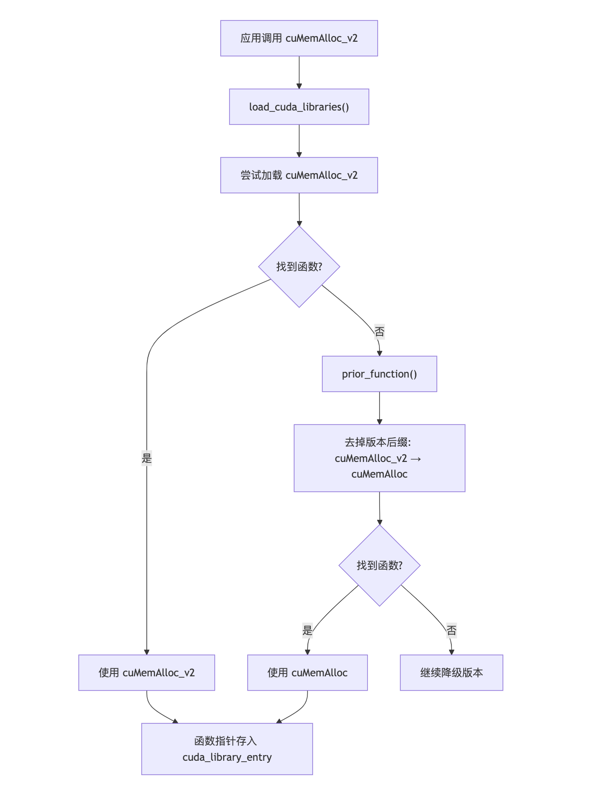
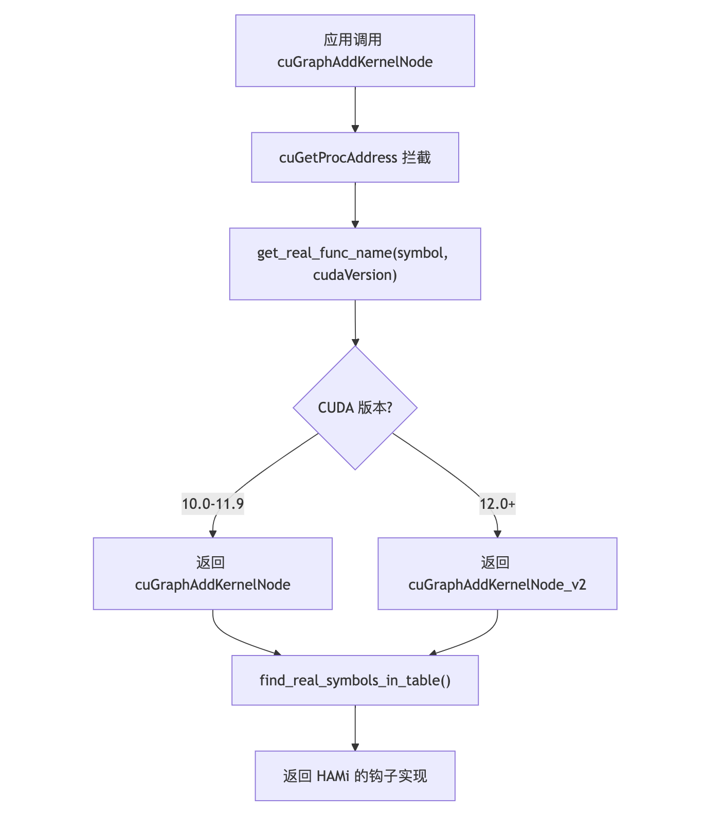
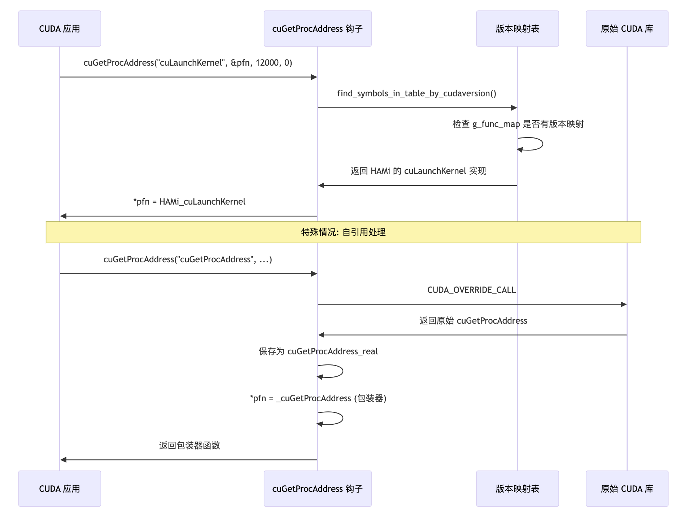
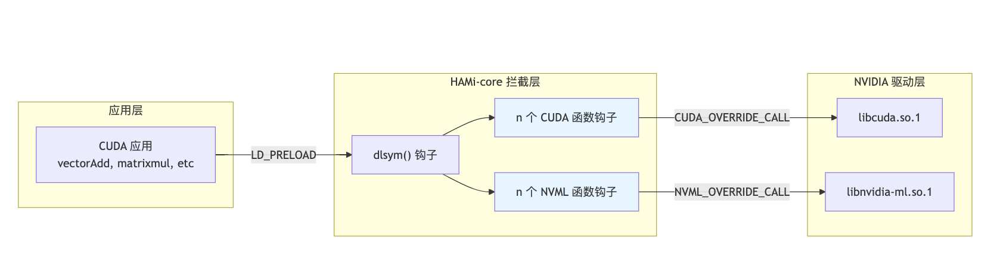

[简体中文](./README.md) · [All articles](../../README.en.md) · [Read on the website](https://www.theriseunion.com/en/blog/hami-qa-cuda-compatibility.html)

# HAMi-core CUDA Compatibility: Cross-Version Stability

RiseUnion · January 01, 2025 at 08:00 (UTC+08:00)

Deep dive into how HAMi-core achieves CUDA cross-version compatibility through function version fallback, multi-version function mapping, runtime function resolution interception, and transparent API interception layers. Learn compatibility strategies for CUDA 10.x through 12.x environments, GPU virtualization best practices, and cloud-native AI workload resource management.

Summary: Deep dive into HAMi-core's CUDA compatibility mechanisms, exploring how this lightweight GPU resource control solution maintains stability across different CUDA versions through intelligent function version fallback, multi-version mapping, and transparent API interception. Learn about HAMi-core's compatibility strategies, potential risks, and production validation approaches.

## Background

In the GPU resource management space, **HAMi** has gained increasing attention as an open-source project.

Within HAMi's architecture, HAMi-core operates closest to the NVIDIA driver layer, providing fine-grained control over GPU memory usage and SM (Streaming Multiprocessor) allocation during container or task execution.

HAMi-core achieves "hard limits" on GPU compute and memory through lightweight injection of `libvgpu.so` into containers via `LD_PRELOAD`.

This approach enables GPU pooling, sharing, and multi-tenant isolation without relying entirely on hardware capabilities like MIG or heavyweight virtualization solutions—making it a practical technical path for many cloud-native AI workloads.

However, this "lightweight GPU resource control" approach raises an important question:

> HAMi-core's core mechanism intercepts calls between the `CUDA Runtime` and `Driver` layers. Can it remain stable when CUDA versions update and driver interfaces change?

This concern is valid, as HAMi-core's implementation relies on intercepting calls between CUDA Runtime and Driver layers:

* API behavior may differ across CUDA versions;
* Symbol exports and memory allocation mechanisms may vary between driver versions;
* Container runtime (`Docker`, `Containerd`, `K8s device plugin`) and `CUDA Toolkit` version compatibility can affect stability.

In other words, HAMi-core's lightweight design and flexibility depend on precise control over `CUDA API` interception. Any changes in the CUDA version chain can challenge this precision.

To address these concerns, we'll publish a series of articles exploring **HAMi-core** features in depth to help you better understand its implementation mechanisms.

This first article examines **CUDA compatibility mechanisms**—a critical yet often overlooked aspect. We'll explore how HAMi-core interacts with different CUDA versions, its compatibility strategies, potential risks, and how to validate and mitigate these risks in production environments.

## CUDA Compatibility Mechanisms

To ensure stable operation across different CUDA versions, HAMi-core implements a multi-layered compatibility mechanism.

### 1. Function Version Fallback

HAMi-core implements an intelligent function version fallback mechanism to handle API changes across CUDA versions. When a specific versioned function cannot be found, the system automatically attempts to locate older versions:

Different CUDA versions may use different API suffixes (e.g., `_v2`, `_v3`), and some older versions have no suffix.

HAMi-core's `prior_function()` automatically decrements the version number when lookup fails:



```c
//Project-HAMi/HAMi-core/blob/main/src/cuda/hook.c

int prior_function(char tmp[500]) {
    char *pos = tmp + strlen(tmp) - 3;
    if (pos[0]=='_' && pos[1]=='v') {
        if (pos[2]=='2')
            pos[0]='\0';
        else
            pos[2]--;
        return 1;
    }
    return 0;
}

for (i = 0; i < CUDA_ENTRY_END; i++) {
        LOG_DEBUG("LOADING %s %d",cuda_library_entry[i].name,i);
        cuda_library_entry[i].fn_ptr = real_dlsym(table, cuda_library_entry[i].name);
        if (!cuda_library_entry[i].fn_ptr) {
            cuda_library_entry[i].fn_ptr=real_dlsym(RTLD_NEXT,cuda_library_entry[i].name);
            if (!cuda_library_entry[i].fn_ptr){
                LOG_INFO("can't find function %s in %s", cuda_library_entry[i].name,cuda_filename);
                memset(tmpfunc,0,500);
                strcpy(tmpfunc,cuda_library_entry[i].name);
                while (prior_function(tmpfunc)) {
                    cuda_library_entry[i].fn_ptr=real_dlsym(RTLD_NEXT,tmpfunc);
                    if (cuda_library_entry[i].fn_ptr) {
                        LOG_INFO("found prior function %s",tmpfunc);
                        break;
                    } 
                }
            }
        }
    }
```

### 2. Multi-Version Function Mapping

For interfaces with significant cross-version differences, HAMi-core uses `g_func_map` to maintain mappings between different versions' actual function names.



Examples:

* CUDA 10.x and CUDA 11.x have slight differences in some function signatures;
* CUDA 12.x merged and adjusted certain APIs.

The mapping table enables HAMi-core to route to the correct function variant at runtime based on the actual environment, without hardcoding version-specific logic.

### 3. Runtime Function Resolution Interception



Since CUDA 11, `cuGetProcAddress` has become the standard way for programs to dynamically resolve Driver API functions. Many modern deep learning frameworks call this function.

HAMi-core intercepts this function to return its own hook function pointers, ensuring:

* Dynamic resolution remains controlled
* Runtime-loaded CUDA functions cannot bypass HAMi-core

This is critical for compatibility with modern CUDA environments.

### 4. Transparent API Interception Layer

HAMi-core intercepts multiple CUDA Driver API functions at the Driver API layer:

* Transparent to applications;
* No application code modifications required;
* CUDA Runtime behavior remains unchanged.



```c
//Project-HAMi/HAMi-core/blob/main/src/cuda/hook.c

 /* Context Part */
    {.name = "cuDevicePrimaryCtxGetState"},
    {.name = "cuDevicePrimaryCtxRetain"},
    {.name = "cuDevicePrimaryCtxSetFlags_v2"},
    {.name = "cuDevicePrimaryCtxRelease_v2"},
    {.name = "cuCtxGetDevice"},
    {.name = "cuCtxCreate_v2"},
    {.name = "cuCtxCreate_v3"},
    {.name = "cuCtxDestroy_v2"},
    {.name = "cuCtxGetApiVersion"},
    {.name = "cuCtxGetCacheConfig"},
    {.name = "cuCtxGetCurrent"},
    {.name = "cuCtxGetFlags"},
```

Hook logic delegates to the original function implementation via `CUDA_OVERRIDE_CALL`, ensuring:

> Beyond injecting resource limit logic, HAMi-core only adds resource management logic when necessary, preserving NVIDIA's native semantics and ensuring functional completeness.

```c
//Project-HAMi/HAMi-core/blob/main/src/include/libcuda_hook.h

#define CUDA_OVERRIDE_CALL(table, sym, ...)                                    \
  ({    \
    LOG_DEBUG("Hijacking %s", #sym);                                           \
    cuda_sym_t _entry = (cuda_sym_t)CUDA_FIND_ENTRY(table, sym);               \
    _entry(__VA_ARGS__);                                                       \
  })
```

### 5. Thread-Safe Initialization

HAMi-core uses `pthread_once` to ensure thread-safe and idempotent initialization:

> This mechanism ensures correct initialization in multi-threaded environments, avoiding race conditions.

```c
//Project-HAMi/HAMi-core/blob/main/src/libvgpu.c
CUresult cuInit(unsigned int Flags){
    LOG_INFO("Into cuInit");
    pthread_once(&pre_cuinit_flag,(void(*)(void))preInit);
    ENSURE_INITIALIZED();
    CUresult res = CUDA_OVERRIDE_CALL(cuda_library_entry,cuInit,Flags);
    if (res != CUDA_SUCCESS){
        LOG_ERROR("cuInit failed:%d",res);
        return res;
    }
    pthread_once(&post_cuinit_flag, (void(*) (void))postInit);
    return CUDA_SUCCESS;
}
```

### 6. Selective Device Info Virtualization

When applications query device status such as memory, HAMi-core:

* Transparently passes NVIDIA's original information by default;
* Only modifies return values when resource limit conditions are triggered;
* This strategy avoids excessive intervention, making the "virtualized device status" feel natural to applications.

```c
/Project-HAMi/HAMi-core/blob/main/src/cuda/device.c

CUresult cuDeviceTotalMem_v2 ( size_t* bytes, CUdevice dev ) {
    LOG_DEBUG("into cuDeviceTotalMem");
    ENSURE_INITIALIZED();
    size_t limit = get_current_device_memory_limit(dev);
    *bytes = limit;
    return CUDA_SUCCESS;
}
```

## Summary: HAMi-core's Lightweight Control and Boundaries for CUDA APIs

HAMi-core's approach is elegant: rather than rewriting GPU virtualization, it achieves resource quota control by intercepting CUDA's "entry points," enabling container-level constraints on memory and SM allocation. Its core principle:

> Minimum intrusion, maximum compatibility.

* By avoiding modifications to CUDA Runtime and application logic, and placing control points directly on CUDA Driver API, HAMi-core maintains both flexibility and stability.
* The function version fallback and mapping table approach provides strong compatibility across CUDA 10.x through the latest CUDA 12.x environments.

```c
//Project-HAMi/HAMi-core/blob/main/src/libvgpu.c
void* __dlsym_hook_section(void* handle, const char* symbol) {
    int it;
    for (it=0;it<CUDA_ENTRY_END;it++){
        if (strcmp(cuda_library_entry[it].name,symbol) == 0){
            if (cuda_library_entry[it].fn_ptr == NULL) {
                LOG_WARN("NEED TO RETURN NULL");
                return NULL;
            }else{
                break;
            }
        }
    }
    DLSYM_HOOK_FUNC(cuInit);
    DLSYM_HOOK_FUNC(cuGetProcAddress);
    DLSYM_HOOK_FUNC(cuGetProcAddress_v2);
```

The primary value of this approach:

> It provides a "software-controllable" fine-grained isolation mechanism for cloud-native GPU computing,
> without requiring complete reliance on vendor ecosystems or hardware features.

For this reason, **compatibility** becomes the most critical consideration for such solutions, directly impacting feature availability.

Understanding CUDA's evolution, mastering interception boundaries, and establishing reliable version validation mechanisms are key to bringing such lightweight control solutions into production environments.

In upcoming articles, we'll continue exploring other critical aspects of HAMi-core. Stay tuned!

---

[Read this article on the RiseUnion website](https://www.theriseunion.com/en/blog/hami-qa-cuda-compatibility.html) · [Explore more articles](https://www.theriseunion.com/en/blog.html)
