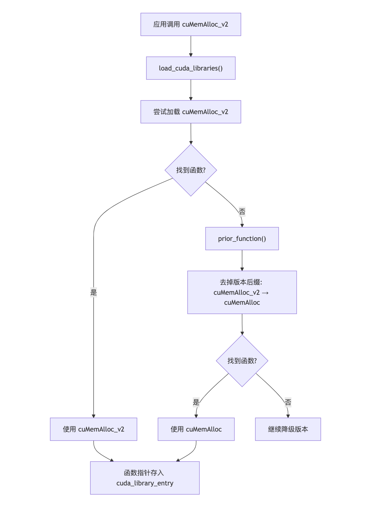
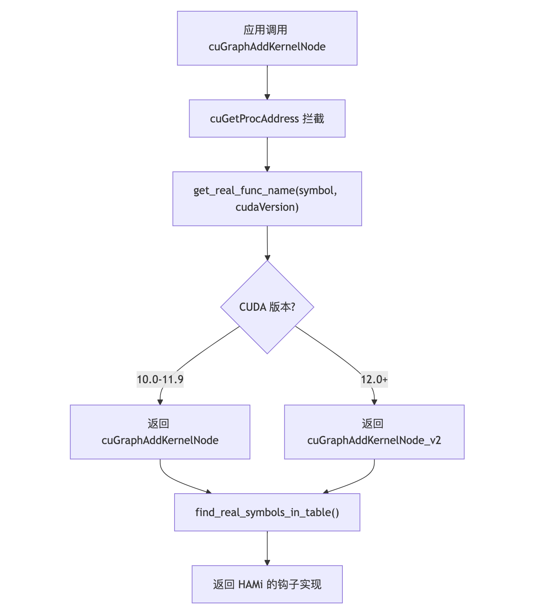
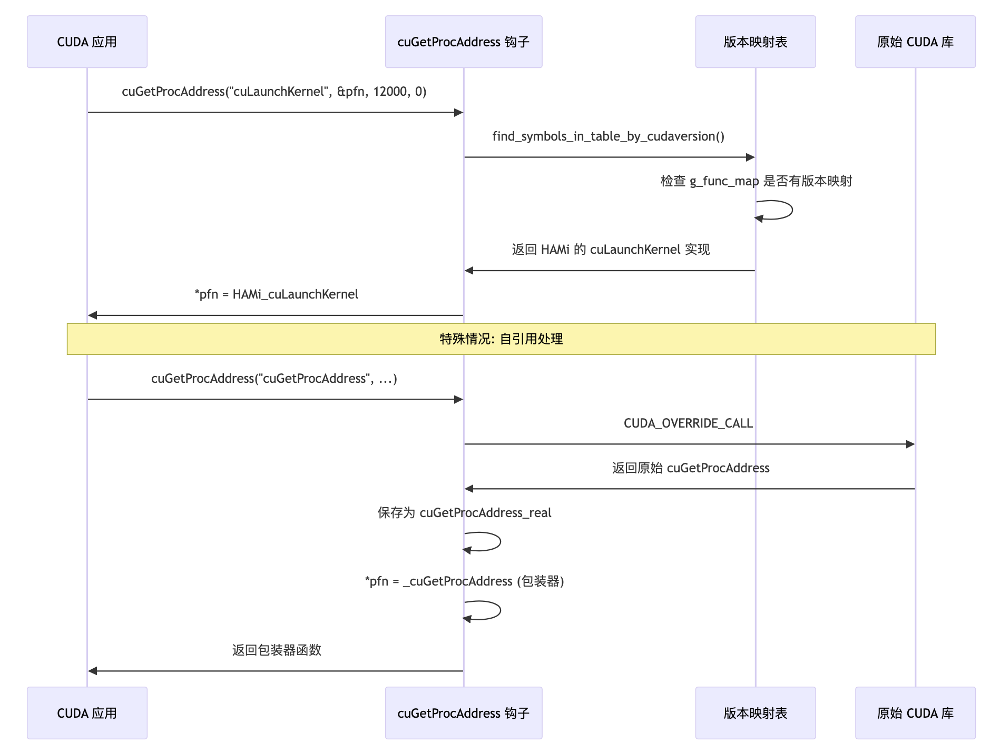
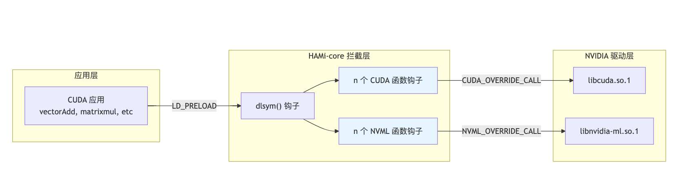

[English](./README.en.md) · [文章目录](../../README.md) · [官网阅读](https://www.theriseunion.com/zh/blog/hami-qa-cuda-compatibility.html)

# HAMi-core CUDA 兼容性机制：跨版本稳定运行解析

睿思智联 · 2025/11/14 08:00（北京时间）

深入解析 HAMi-core 如何实现 CUDA 跨版本兼容，包括函数版本回退机制、多版本函数映射表、运行时函数解析拦截、透明 API 拦截层等核心技术。了解 HAMi-core 在 CUDA 10.x 到 12.x 环境下的兼容策略，以及 GPU 虚拟化、容器化 GPU 资源管理、云原生 AI 工作负载的最佳实践。

## 背景
在 GPU 资源管理领域，**HAMi** 这个开源项目近来受到越来越多关注。

而在 HAMi 的体系中，HAMi-core 是最靠近 NVIDIA 底层的一层，负责在容器或任务运行期间，对 GPU 的显存使用、SM（Streaming Multiprocessor）占用等进行精细化控制。

HAMi-core 以轻量的方式，在容器内通过 `LD_PRELOAD` 注入 `libvgpu.so`，实现了对 GPU 算力和显存的“硬限制”。

这就让 GPU 池化、共享、多租户隔离不再完全依赖 MIG 等硬件能力，或深度的虚拟化方案，对大量云原生 AI 工作负载（workload）而言，这是一个非常实用的技术路径。

然而，这种“轻量级 GPU 资源控制”方案背后，相关的疑问也随之而来：

> HAMi-core 的核心机制是拦截 `CUDA Runtime` 与 `Driver` 层之间的调用。当 CUDA 版本更新、驱动接口变化时，它还能稳定工作吗？

有这种疑问很正常，毕竟 HAMi-core 的实现原理是“截取” CUDA Runtime 与 Driver 层之间的调用：

* 不同 CUDA 版本的 API 行为可能存在差异；
* 不同驱动版本的符号导出、内存分配机制可能不一致；
* 容器运行时（`Docker、Containerd、K8s device plugin`）以及 `CUDA Toolkit` 版本的匹配，都可能影响它的稳定性。

换句话说，HAMi-core 的轻量化与高灵活，正是建立在对 `CUDA API` 拦截的精准控制之上。而只要 CUDA 的版本链有变化——这个“精准”就可能面临挑战。

面对这类问题，我们将用一系列文章，针对 **HAMi-core** 的特性进行深入探讨和分析，以帮助大家更好地去了解相关的实现机制。

本篇为第一篇，让我们一起来从 **“CUDA 兼容性机制”** 这个最关键、也是最容易被忽略的问题出发，看看 HAMi-core 是如何与不同版本的 CUDA 打交道的，它有哪些兼容策略、潜在风险，以及在生产环境中我们该如何验证与规避这些风险。


## 正文开始

为了确保在不同 CUDA 版本下都能稳定工作，HAMi-core 设计了一套多层级的兼容机制。

### 1. 函数版本回退（Version Fallback）

HAMi-core 实现了智能的函数版本回退机制来处理不同 CUDA 版本的 API 变化。当无法找到特定版本的函数时，系统会自动尝试查找旧版本： 

不同 CUDA 版本的 API 后缀可能会有所不同（如 _v2、_v3），有些旧版本甚至没有后缀。

HAMi-core 的 `prior_function()` 会在查找失败时自动降低版本号，例如：



```c
//Project-HAMi/HAMi-core/blob/main/src/cuda/hook.c

int prior_function(char tmp[500]) {
    char *pos = tmp + strlen(tmp) - 3;
    if (pos[0]=='_' && pos[1]=='v') {
        if (pos[2]=='2')
            pos[0]='\0';
        else
            pos[2]--;
        return 1;
    }
    return 0;
}

for (i = 0; i < CUDA_ENTRY_END; i++) {
        LOG_DEBUG("LOADING %s %d",cuda_library_entry[i].name,i);
        cuda_library_entry[i].fn_ptr = real_dlsym(table, cuda_library_entry[i].name);
        if (!cuda_library_entry[i].fn_ptr) {
            cuda_library_entry[i].fn_ptr=real_dlsym(RTLD_NEXT,cuda_library_entry[i].name);
            if (!cuda_library_entry[i].fn_ptr){
                LOG_INFO("can't find function %s in %s", cuda_library_entry[i].name,cuda_filename);
                memset(tmpfunc,0,500);
                strcpy(tmpfunc,cuda_library_entry[i].name);
                while (prior_function(tmpfunc)) {
                    cuda_library_entry[i].fn_ptr=real_dlsym(RTLD_NEXT,tmpfunc);
                    if (cuda_library_entry[i].fn_ptr) {
                        LOG_INFO("found prior function %s",tmpfunc);
                        break;
                    } 
                }
            }
        }
    }
```

### 2. 多版本函数映射表（Function Map）

对于跨版本差异较大的接口，HAMi-core 使用 `g_func_map` 维护不同版本的真实函数名映射。



举例：
* CUDA 10.x 与 CUDA 11.x 某些函数签名略有差异；
* CUDA 12.x 的部分 API 做了合并与调整。

映射表让 HAMi-core 能够在运行时根据实际环境路由到正确的函数变体，而无需硬编码不同版本的逻辑。

### 3. 运行时函数解析拦截



自 CUDA 11 之后，`cuGetProcAddress` 成为程序动态解析 Driver API 的标准方式。
而许多现代深度学习框架都会调用它。

HAMi-core 会对该函数进行拦截，使其返回自身的钩子函数指针，确保：
* 动态解析同样受控
* 运行时加载的 CUDA 函数不会绕过 HAMi-core

这是兼容现代 CUDA 环境的关键。

### 4. 透明的 API 拦截层

HAMi-core 在 Driver API 层拦截多个 CUDA Driver API 函数：
* 对应用透明；
* 不修改应用代码；
* 不改变 CUDA Runtime 行为。



```c
//Project-HAMi/HAMi-core/blob/main/src/cuda/hook.c

 /* Context Part */
    {.name = "cuDevicePrimaryCtxGetState"},
    {.name = "cuDevicePrimaryCtxRetain"},
    {.name = "cuDevicePrimaryCtxSetFlags_v2"},
    {.name = "cuDevicePrimaryCtxRelease_v2"},
    {.name = "cuCtxGetDevice"},
    {.name = "cuCtxCreate_v2"},
    {.name = "cuCtxCreate_v3"},
    {.name = "cuCtxDestroy_v2"},
    {.name = "cuCtxGetApiVersion"},
    {.name = "cuCtxGetCacheConfig"},
    {.name = "cuCtxGetCurrent"},
    {.name = "cuCtxGetFlags"},
```

钩子逻辑通过 `CUDA_OVERRIDE_CALL` 委托给原始的函数实现，因此：

> 除了注入资源限制逻辑外，HAMi-core 只在必要时添加资源管理逻辑，不影响 NVIDIA 的原生语义，确保相关功能的完整性。

```c
//Project-HAMi/HAMi-core/blob/main/src/include/libcuda_hook.h

#define CUDA_OVERRIDE_CALL(table, sym, ...)                                    \
  ({    \
    LOG_DEBUG("Hijacking %s", #sym);                                           \
    cuda_sym_t _entry = (cuda_sym_t)CUDA_FIND_ENTRY(table, sym);               \
    _entry(__VA_ARGS__);                                                       \
  })
```


### 5. 初始化保护（Thread-Safe Init）

HAMi-core 使用 `pthread_once` 确保初始化过程的线程安全性和幂等性： 
> 这种机制确保在多线程环境中也能正确初始化，避免竞态条件。

```c
//Project-HAMi/HAMi-core/blob/main/src/libvgpu.c
CUresult cuInit(unsigned int Flags){
    LOG_INFO("Into cuInit");
    pthread_once(&pre_cuinit_flag,(void(*)(void))preInit);
    ENSURE_INITIALIZED();
    CUresult res = CUDA_OVERRIDE_CALL(cuda_library_entry,cuInit,Flags);
    if (res != CUDA_SUCCESS){
        LOG_ERROR("cuInit failed:%d",res);
        return res;
    }
    pthread_once(&post_cuinit_flag, (void(*) (void))postInit);
    return CUDA_SUCCESS;
}
```

### 6. 设备信息虚拟化（Selective Device Info Virtualization）

当应用查询显存等设备状态时，HAMi-core 会：
* 默认透明传递 NVIDIA 原始信息；
* 仅在触发资源限制条件时修改返回结果；
* 这种策略避免过度干预，使得应用对“虚拟化的设备状态”感知更自然。

```c
/Project-HAMi/HAMi-core/blob/main/src/cuda/device.c

CUresult cuDeviceTotalMem_v2 ( size_t* bytes, CUdevice dev ) {
    LOG_DEBUG("into cuDeviceTotalMem");
    ENSURE_INITIALIZED();
    size_t limit = get_current_device_memory_limit(dev);
    *bytes = limit;
    return CUDA_SUCCESS;
}
```

## 总结：HAMi-core 对于 CUDA API 的轻量控制与边界

HAMi-core 的思路其实非常优雅：它不是去重写 GPU 虚拟化，而是通过拦截 CUDA 的“入口”来实现资源限额控制，让容器层就能对显存、SM 占用做出约束。其核心原则：
> 最小侵入，最大兼容。

* 避免修改 CUDA Runtime，不触碰应用层逻辑，而是将控制点直接放在 CUDA Driver API 上，既保证灵活性，又保持较好的稳定性。
* 函数版本回退 + 映射表方案，使其在 CUDA 10.x 到最新 CUDA 12.x 环境中都具备较强兼容性。

```c
//Project-HAMi/HAMi-core/blob/main/src/libvgpu.c
void* __dlsym_hook_section(void* handle, const char* symbol) {
    int it;
    for (it=0;it<CUDA_ENTRY_END;it++){
        if (strcmp(cuda_library_entry[it].name,symbol) == 0){
            if (cuda_library_entry[it].fn_ptr == NULL) {
                LOG_WARN("NEED TO RETURN NULL");
                return NULL;
            }else{
                break;
            }
        }
    }
    DLSYM_HOOK_FUNC(cuInit);
    DLSYM_HOOK_FUNC(cuGetProcAddress);
    DLSYM_HOOK_FUNC(cuGetProcAddress_v2);
```

这种方案的最大价值，在于：

> 它为云原生 GPU 计算提供了一种“软件层可控”的精细化隔离机制，
> 而不必完全依赖厂商生态或硬件特性。

但也正因为如此，**兼容性** 就成了这类方案最需要考虑的价值，其直接影响了相关特性的可用性。

理解 CUDA 的演进、掌握拦截的边界、建立可靠的版本验证机制，是让这类轻量控制方案真正走进生产环境的关键。

在接下来的几篇中，我们会继续拆解 HAMi-core 的其他关键话题，尽情关注！

---

[在睿思智联官网阅读本文](https://www.theriseunion.com/zh/blog/hami-qa-cuda-compatibility.html) · [浏览更多文章](https://www.theriseunion.com/zh/blog.html)
