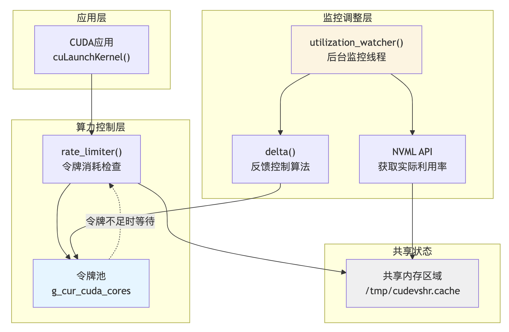

[简体中文](./README.md) · [All articles](../../README.en.md) · [Read on the website](https://www.theriseunion.com/en/blog/hami-qa-sm-partitioning.html)

# HAMi-core Compute Partitioning Mechanism: Feedback-Based Time-Slicing

RiseUnion · January 01, 2025 at 08:00 (UTC+08:00)

Deep dive into how HAMi-core implements compute partitioning through time-slicing and dynamic feedback mechanisms. Learn how HAMi-core implements compute partitioning through token bucket mechanism and utilization collection, and how HAMi-core implements compute partitioning through time-slicing and dynamic feedback mechanisms.

## Background

In our previous article, we explored [HAMi-core CUDA Compatibility Mechanisms: Cross-Version Stability Explained](https://www.theriseunion.com/en/blog/hami-qa-cuda-compatibility.html), examining how HAMi-core addresses the fundamental challenge of "getting workloads to run."

However, the most frequently discussed concerns in community and user interactions often revolve around resource contention, such as:

1. "Can I limit a container to use only 30% of GPU compute resources?"
2. "How does HAMi's compute limiting work? Does it modify drivers or use MPS?"
3. "Why does monitoring sometimes show utilization exceeding my configured limits?"
4. And more...

Among various GPU virtualization technologies, memory isolation is typically straightforward (a matter of presence or absence), but **compute (SM) partitioning** presents a more challenging problem.

In this article, we dive into the HAMi-core source code to explore how it implements compute partitioning through **time-slicing** and **dynamic feedback** mechanisms.

## Core Mechanism: Feedback-Based Time-Slicing

HAMi-core does not modify the GPU hardware scheduler. Instead, it implements a **time-slicing** mechanism at the software layer by intercepting CUDA APIs. The core logic resides in the `rate_limiter()` function ([src/multiprocess/multiprocess_utilization_watcher.c](https://github.com/Project-HAMi/HAMi-core/blob/ee24b8e0/src/multiprocess/multiprocess_utilization_watcher.c)).

Think of it as a **dynamic traffic control system**:

### 1. Admission Control: Token Bucket Mechanism

The system maintains a global CUDA core token pool (`g_cur_cuda_cores`).

* **Interception Point**: Every time a user application attempts to launch a CUDA kernel, HAMi-core intercepts the call.
* **Token Consumption**: Before a kernel can launch, it must request and consume a corresponding number of tokens from the pool.
* **Blocking Wait**: If insufficient tokens are available, the kernel launch request is temporarily blocked until enough tokens are injected.

### 2. Closed-Loop Monitoring: Utilization Collection

To determine when to "release" kernels, a background daemon thread `utilization_watcher()` continuously monitors the system.

* It uses the **NVML API** to periodically sample the actual SM (Streaming Multiprocessor) utilization of the current process on the GPU.
* The sampling interval is controlled by the global parameter `g_wait`.

### 3. Dynamic Adjustment: Feedback Control Algorithm

This is the "brain" of the entire mechanism. The system dynamically adjusts token injection rate by comparing **target utilization** with **actual utilization**:

* **Compute Delta**: The `delta()` function calculates the difference `(Target - Current)`.
* **Adjustment Strategy**:
  * If actual utilization < target limit: Inject more tokens into the pool, allowing more kernels to launch.
  * If actual utilization > target limit: Reduce or stop token injection, forcing subsequent kernels to wait.



**Core Logic Summary**:
> HAMi-core essentially implements a **soft rate limiting** mechanism at the application layer. It does not directly control GPU hardware execution units, but rather controls the "rate" at which kernels are submitted to the GPU.

## Configuration and Usage

In HAMi, configuring compute limits is straightforward and intuitive. Users simply set it via an environment variable:

* **Environment Variable**: `CUDA_DEVICE_SM_LIMIT`
* **Value Range**: `0` - `100` (integer)

```bash
export CUDA_DEVICE_SM_LIMIT=50
```

*This means processes within the container are limited to using no more than 50% of GPU compute capacity.*

## Technical Characteristics and Design Considerations

HAMi-core employs a **software-defined** rate limiting approach. This design achieves broad GPU compatibility without relying on specific hardware features (such as MIG). When understanding how it works, we need to consider the following technical characteristics:

### 1. Asynchronous Feedback Adjustment

The system uses a "sample-feedback" closed-loop mechanism: `utilization_watcher` collects data based on time windows, which means the system's response to burst traffic has inherent **latency**. Under scenarios with dramatic load fluctuations, utilization curves may exhibit brief dynamic oscillations around the target value before converging to a stable state.

### 2. Kernel-Level Scheduling Granularity

The token bucket checkpoint is located before kernel launch: this mechanism primarily controls **task submission frequency**, rather than interrupting executing compute units. For the rare case of extremely long-running kernels, instantaneous compute usage may temporarily exceed the limit, but from a long-term statistical perspective, overall average compute usage remains controlled.

### 3. Statistical Estimation

The token consumption model is based on Grid/Block dimension estimation: while this is not equivalent to hardware-level instruction cycles, for the vast majority of deep learning and compute workloads, this estimation model achieves a good balance between **performance overhead** and **control effectiveness**.

## Summary

Through the source code analysis above, we can see that HAMi-core has chosen a **lightweight, highly compatible** technical path for compute partitioning.

Compared to hardware partitioning (such as MIG) with strict physical segmentation, HAMi's "soft isolation" mechanism is more flexible. It implements a general-purpose GPU compute scheduler at the software layer, allowing a degree of resource sharing when resources are idle, while applying rate limiting when resources are constrained. This approach is well-suited for **improving overall cluster utilization** and **multi-workload co-location** scenarios, providing an efficient resource management solution for cloud-native AI workloads.

RiseUnion's [Rise VAST (Enterprise Edition)](https://www.theriseunion.com/en/product/vast.html) builds upon `HAMi-core` with additional enhancements and optimizations, particularly in timing control precision, workload management, and lock-free performance under high concurrency, to meet the stringent SLA requirements of enterprise customers in production environments.

---

[Read this article on the RiseUnion website](https://www.theriseunion.com/en/blog/hami-qa-sm-partitioning.html) · [Explore more articles](https://www.theriseunion.com/en/blog.html)
