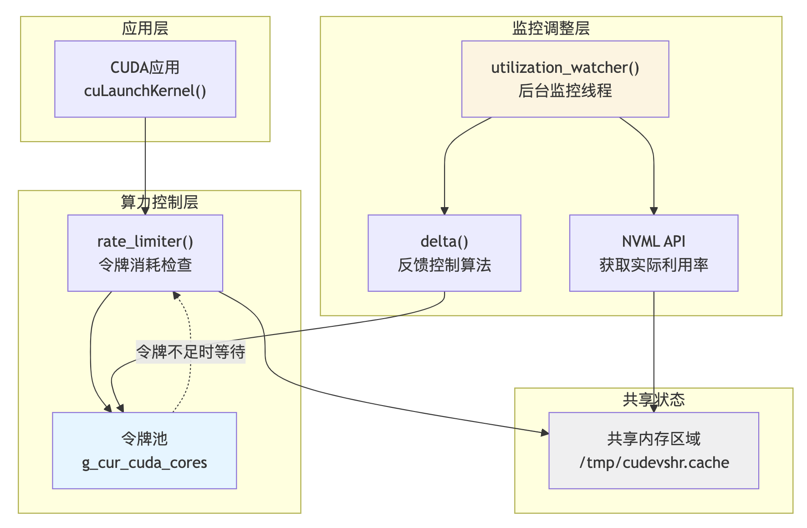

[English](./README.en.md) · [文章目录](../../README.md) · [官网阅读](https://www.theriseunion.com/zh/blog/hami-qa-sm-partitioning.html)

# HAMi-core 算力切分机制：基于反馈的时间片调度

睿思智联 · 2025/12/12 08:00（北京时间）

深入解析 HAMi-core 如何通过时间片调度与动态反馈机制来实现算力切分。了解 HAMi-core 如何通过令牌桶机制与利用率采集来实现算力切分，以及如何通过时间片调度与动态反馈机制来实现算力切分。

## 背景

上一篇，我们深入解读了 [《HAMi-core CUDA 兼容性机制：跨版本稳定运行解析》](https://www.theriseunion.com/zh/blog/hami-qa-cuda-compatibility.html)，探讨了 HAMi-core 如何解决“让任务跑起来”的问题。

然而，社区和用户交流中最常被提及的，往往是关于资源争抢的焦虑，如：
1. “能否让容器只使用 GPU 30% 的计算资源？”
2. “HAMi 的算力限制原理是什么？是修改了驱动还是使用了 MPS？”
3. “为什么监控看到的利用率有时会超过我设置的限制？”

在众多 GPU 虚拟化技术中，对于显存（Memory）的隔离通常比较直接（有和无的问题），但对于 **算力（SM）** 的切分往往是更具挑战性的课题。

本期我们将深入 `HAMi-core` 源码，继续解读 `HAMi-core` 是如何通过 **时间片调度** 与 **动态反馈** 机制来实现算力切分的。


## 核心机制：基于反馈的时间片调度

HAMi-core 并没有修改 GPU 硬件调度器，而是通过拦截 CUDA API，在软件层面实现了一套**时间片调度（Time Slicing）**机制。其核心逻辑位于 `rate_limiter()` 函数中，见：[src/multiprocess/multiprocess_utilization_watcher.c](https://github.com/Project-HAMi/HAMi-core/blob/ee24b8e0/src/multiprocess/multiprocess_utilization_watcher.c)。

你可以将其理解为一个**动态调节的红绿灯系统**：

### 1. 准入控制：令牌桶机制 (Token Bucket)

系统维护了一个全局的 CUDA 核心令牌池（`g_cur_cuda_cores`）。

  * **拦截点**：每次用户程序尝试启动 CUDA Kernel 时，HAMi-core 都会进行拦截。
  * **消耗令牌**：Kernel 启动前，必须从池中申请并消耗相应数量的令牌。
  * **阻塞等待**：如果池中令牌不足，Kernel 的启动请求会被暂时阻塞，直到有足够的令牌注入。

### 2. 闭环监控：利用率采集

为了知道何时该“放行”，后台有一个守护线程 `utilization_watcher()` 在持续工作。

  * 它利用 **NVML API** 周期性地采集当前进程在 GPU 上的实际 SM（Streaming Multiprocessor）利用率。
  * 采样间隔由全局参数 `g_wait` 控制。

### 3. 动态调节：反馈控制算法

这是整个机制的“大脑”。系统通过对比**目标利用率**与**实际利用率**，动态调整令牌的发放速度：

-  **计算差值**：使用 `delta()` 函数计算 `(Target - Current)` 的差值。
-  **调整策略**：
  1. 如果实际利用率 < 目标限制：向池中注入更多令牌，允许更多 Kernel 启动。
  2. 如果实际利用率 > 目标限制：减少或停止注入令牌，强制后续 Kernel 等待。




> `HAMi-core` 本质上是在应用层实现了一个**软流控（Soft Rate Limiting）**，它不直接控制 GPU 硬件执行单元，而是控制 Kernel 下发到 GPU 的“速率”。


## 配置与使用

在 HAMi 中，算力限制的配置非常简单，用户只需通过环境变量进行设置：

  * **环境变量**：`CUDA_DEVICE_SM_LIMIT`
  * **取值范围**：`0` - `100` (按整数)
```bash
export CUDA_DEVICE_SM_LIMIT=50
```
*这意味着该容器内的进程被限制使用不超过 50% 的 GPU 算力。*


## 技术特性与设计考量

HAMi-core 采用的是一种**软件定义（Software-Defined）**的流控方案。这种设计在无需依赖特定硬件特性（如 MIG）的前提下，实现了广泛的 GPU 兼容性。在理解其工作方式时，我们需要关注以下几个技术特性：

### 1. 异步反馈调节
系统采用的是“采样-反馈”闭环机制：`utilization_watcher` 基于时间窗口采集数据，这意味着系统对突发流量的响应具有一定的**滞后性**。在负载剧烈波动的场景下，利用率曲线可能会在目标值附近出现短暂的动态震荡，随后收敛至稳定状态。

### 2. Kernel 级调度粒度
令牌桶的检查点位于 Kernel 启动之前：这种机制主要控制的是**任务提交的频率**，而非打断正在执行的计算单元。对于极少数单次执行时间超长的 Kernel，其瞬时算力占用可能会暂时突破限制，但在长周期的统计视角下，整体平均算力仍会受控。

### 3. 统计学估算
令牌消耗模型基于 Grid/Block 维度进行估算：虽然这与硬件底层的指令周期不完全等价，但在绝大多数深度学习和计算任务中，这种估算模型能够在**性能开销**与**控制效果**之间取得良好的平衡。


## 总结

通过上述源码分析，我们可以看到 `HAMi-core` 在算力切分上选择了一条**轻量化、高兼容**的技术路线。

相比于硬件分区（如 MIG）严格的物理切割，HAMi 的“软隔离”机制更具弹性。它在软件层面实现了一套通用的 GPU 算力调度器，允许在资源空闲时进行一定程度的共享，而在资源紧张时通过流控进行压制，非常适合提升集群整体**利用率**和**多任务混部**的场景，为云原生 AI 任务提供了一种高效的资源管理手段。

睿思智联的 [Rise VAST（企业版）](https://www.theriseunion.com/zh/product/vast.html) 在 `HAMi-core` 之上进行了进一步的增强与调优，特别是在时序控制精度、工作负载以及高并发下的无锁性能等方面，以满足企业客户对 SLA 有更严苛要求的生产环境需求。

---

[在睿思智联官网阅读本文](https://www.theriseunion.com/zh/blog/hami-qa-sm-partitioning.html) · [浏览更多文章](https://www.theriseunion.com/zh/blog.html)
