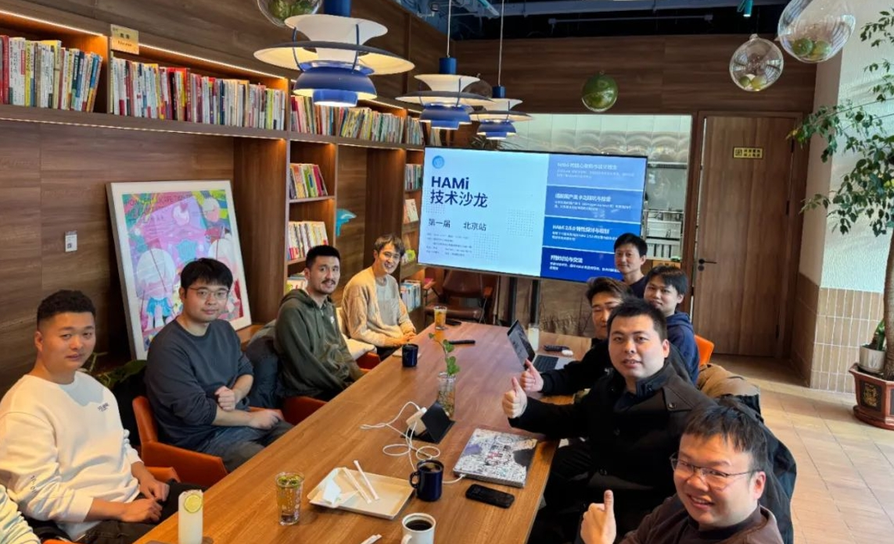

[简体中文](./README.md) · [All articles](../../README.en.md) · [Read on the website](https://www.theriseunion.com/en/blog/hami-salon-1.html)

# HAMi Community First Offline Salon Successfully Held

RiseUnion · January 01, 2025 at 08:00 (UTC+08:00)

Explore insights from HAMi's first community salon in Beijing, featuring RiseUnion, 4Paradigm, and iFLYTEK. Learn about HAMi 2.5.0's new features and its impact on heterogeneous computing management.

Summary: On December 1st, 2024, the first HAMi Community offline salon was successfully held in Beijing. Developers from RiseUnion, 4Paradigm, iFLYTEK, and other enterprises gathered to discuss HAMi's technical innovations and development direction in heterogeneous computing power management.

On December 1st, 2024, the first **HAMi** Community offline salon was held in Beijing, where developers enthusiastically exchanged ideas about HAMi's technical development and future direction. As one of the **core contributors** to the HAMi community, **RiseUnion** hosted this event, sharing technical support and innovative achievements while demonstrating practical applications in heterogeneous computing power management.

## Background ##

HAMi, short for Heterogeneous AI Computing Virtualization Middleware, is a heterogeneous computing power management tool. It supports GPU resource sharing and flexible allocation, achieving hard isolation and precise scheduling of computing resources. Additionally, HAMi features task priority management, flexible scheduling strategies, and comprehensive resource monitoring capabilities, greatly improving resource utilization and computational task execution efficiency.

Currently, HAMi has become the most popular sandbox project in the GPU virtualization and pooling domain within CNCF (Cloud Native Computing Foundation), demonstrating its enormous potential in the cloud-native ecosystem.

## HAMi's Design and Evolution: A Demand-Driven, Efficient, and Flexible Architecture ##

HAMi's architecture has emphasized flexibility and extensibility since its inception. During the salon, [Li Mengxuan](https://github.com/archlitchi) from 4Paradigm, as HAMi's initiator, detailed the design philosophy and evolution of HAMi's architecture: its core lies in deeply understanding complex heterogeneous environments combined with rich practical experience. Through computing power pooling, virtualization, and scheduling technologies, HAMi continuously optimizes GPU resource utilization while effectively reducing computing costs.

## New Features in HAMi 2.5.0 ##

Since its establishment, RiseUnion has been actively participating in community development, believing that open-source technology is a crucial force driving innovation and industry progress.

During the salon, [Yin Yu](https://github.com/Nimbus318) and [Ouyang Luwei](https://github.com/ouyangluwei163) from [RiseUnion](https://www.theriseunion.com/), as HAMi core developers, addressed many common concerns and jointly introduced the new features of HAMi 2.5.0.

RiseUnion will continue contributing to the open-source community through WebUI support for heterogeneous computing, support for Kunlun chips, and related documentation development. (For more information, see: [HAMi 2.4.0 Official Release: RiseUnion Drives Heterogeneous Computing Scheduling](https://www.theriseunion.com/en/blog/hami-2-4-0.html))

## HAMi's Application in iFLYTEK's MaaS Platform ##

Yang Yanbo, the R&D lead at iFLYTEK, shared their experience using HAMi in their MaaS platform. They utilized HAMi's GPU virtualization and pooling capabilities to achieve flexible scheduling of large-scale tasks, improving hardware resource utilization and resolving computing power bottlenecks during peak periods.

## Future Outlook ##

The growth of the HAMi community relies on the participation of every developer and enterprise. **RiseUnion** will continue supporting community development and advancing AI heterogeneous computing technology. In the future, we will continue to deepen HAMi's technical development and promote HAMi's applications and practices in finance, telecommunications, energy, transportation, education, and other fields through more industry cases.

We also welcome more developers to join the HAMi community: [https://github.com/Project-HAMi/](https://github.com/Project-HAMi/) to advance AI computing power management technology together.

**Let diverse computing power unleash more potential, making intelligence ubiquitous!**

---

[Read this article on the RiseUnion website](https://www.theriseunion.com/en/blog/hami-salon-1.html) · [Explore more articles](https://www.theriseunion.com/en/blog.html)
