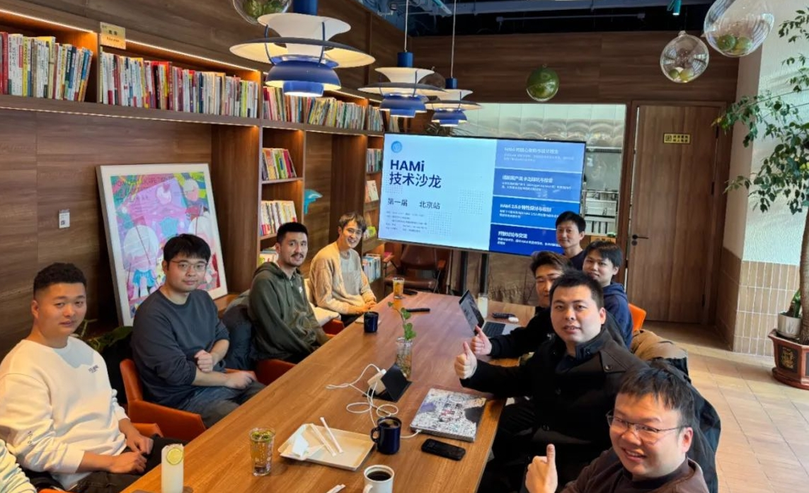

[English](./README.en.md) · [文章目录](../../README.md) · [官网阅读](https://www.theriseunion.com/zh/blog/hami-salon-1.html)

# 睿思智联 + HAMi 社区，共同推动 AI 异构算力发展

睿思智联 · 2024/12/01 08:00（北京时间）

探索HAMi首届社区沙龙重要成果，睿思智联、第四范式、科大讯飞等企业共同探讨HAMi 2.5.0新特性及其在异构算力管理领域的创新应用。

摘要：2024年12月1日，HAMi 社区第一届线下沙龙在北京成功举办。来自睿思智联、第四范式、科大讯飞等企业的开发者齐聚一堂，共同探讨了 HAMi 在异构算力管理领域的技术创新与发展方向。

2024年12月1日，**HAMi** 社区第一届线下沙龙在北京举行，开发者们一起热情地交流了 HAMi 的技术发展和未来方向。作为 HAMi 社区的**核心贡献者**之一，**睿思智联** 承办了本次活动，分享了相关的技术支持和创新成果，也展示了在异构算力管理方面的实际应用。

## 背景 ##

HAMi，全称 Heterogeneous AI Computing Virtualization Middleware，是一款开源的异构算力管理工具。支持 GPU 资源的共享和灵活分配，实现算力资源的硬隔离和精准调度。此外，HAMi 还具备任务优先级管理、灵活调度策略和全面的资源监控功能，大大提高了算力资源的利用率和计算任务的执行效率。

目前，HAMi 已成为 CNCF（云原生计算基金会）中 GPU 虚拟化和池化领域最受欢迎的 sandbox 项目，展现出在云原生生态中的巨大潜力。

## HAMi 的设计与演变：以需求为导向的高效、灵活架构 ##

HAMi 的架构自设计之初便注重灵活性与扩展性。在沙龙中，第四范式的[李孟轩](https://github.com/archlitchi)作为 HAMi 的发起人，详细介绍了 HAMi 架构的设计理念和演变历程：其核心在于深刻理解复杂异构环境并结合丰富的实战经验。通过算力池化、虚拟化及算力调度等技术手段，HAMi 持续优化 GPU 资源的利用率，同时有效降低算力成本。

## HAMi 2.5.0 的新特性 ##

睿思智联从成立以来，就一直积极参与社区的发展，我们相信，开源技术是推动创新和行业进步的重要力量。

在这次沙龙中，来自[睿思智联](https://www.theriseunion.com/)的[尹玉](https://github.com/Nimbus318)和[欧阳陆伟](https://github.com/ouyangluwei163)，作为HAMi 核心开发者，回答了很多大家关注的常见问题，并一同介绍了 HAMi 2.5.0 版本新特性。

睿思智联将在 WebUI 支持异构算力、支持昆仑芯等新特性，以及相关文档建设上，持续为开源社区做出贡献。（更多参考：[HAMi 2.4.0 正式发布：RiseUnion推动异构算力调度](https://www.theriseunion.com/zh/blog/hami-2-4-0.html)）

## HAMi 在科大讯飞 MaaS 平台中的应用

科大讯飞的研发负责人杨彦波，分享了在 MaaS 平台中使用 HAMi 的经验。他们利用 HAMi 的 GPU 虚拟化和池化能力，实现了大规模任务的灵活调度，提高了硬件资源利用率，解决了任务高峰期的算力瓶颈问题。

## 未来展望

HAMi 社区的成长离不开每一位开发者和企业的参与。**睿思智联** 将继续支持社区的发展，推动 AI 异构算力技术的进步。未来，我们会继续深耕 HAMi 的技术研发，并通过更多行业案例，促进 HAMi 在金融、电信、能源、交通、教育等领域的应用和实践。

我们也欢迎更多开发者加入 HAMi 社区：[https://github.com/Project-HAMi/](https://github.com/Project-HAMi/)，一起推动 AI 算力管理技术的发展。

**让多元算力释放更多潜力，让智能无处不在！**

---

[在睿思智联官网阅读本文](https://www.theriseunion.com/zh/blog/hami-salon-1.html) · [浏览更多文章](https://www.theriseunion.com/zh/blog.html)
