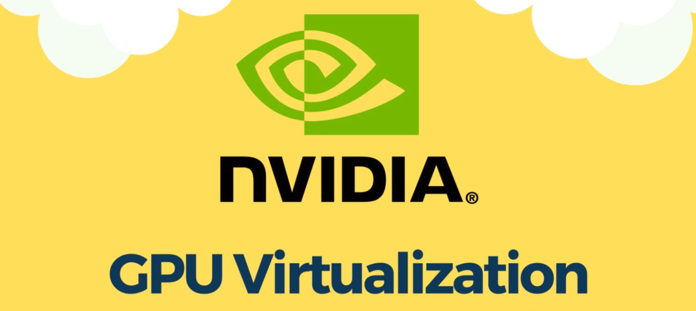
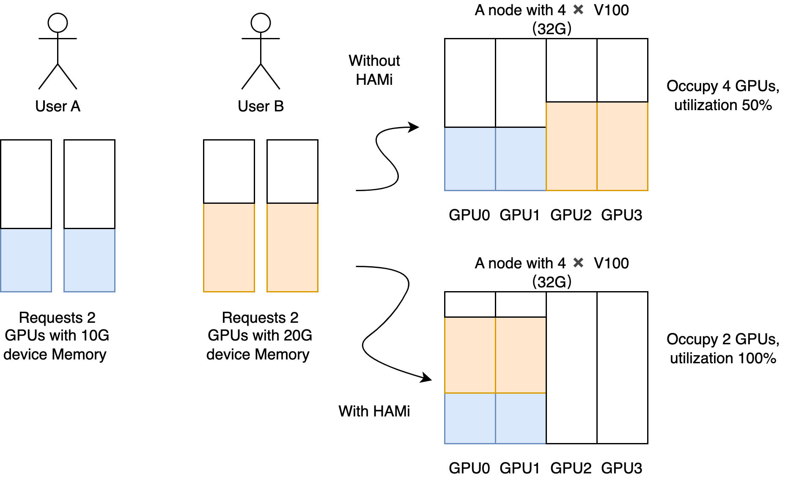
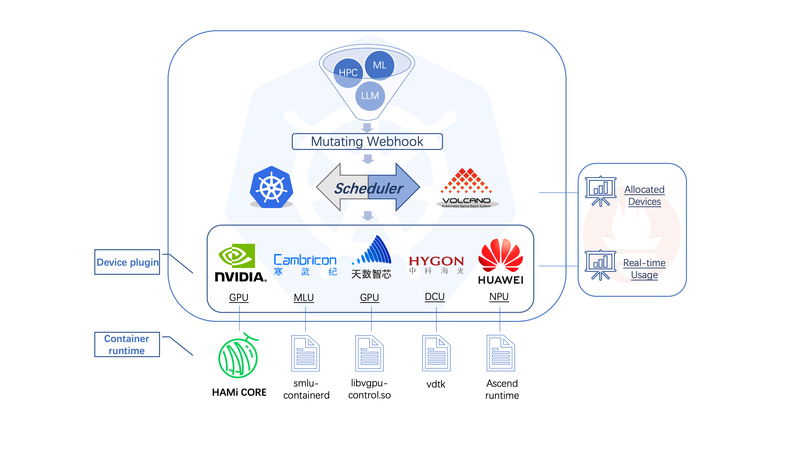
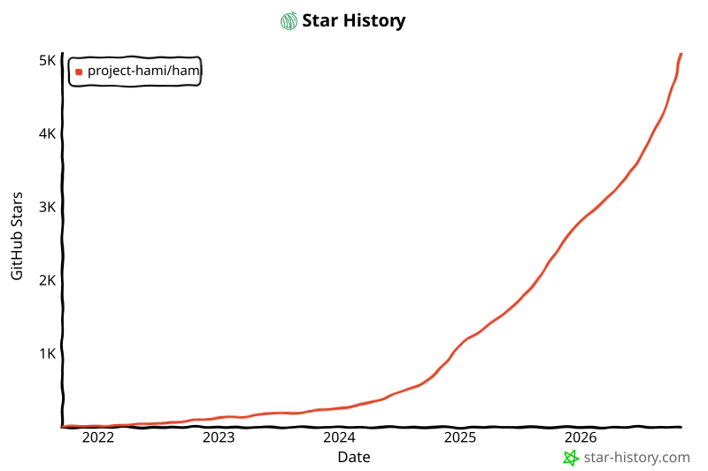

[简体中文](./README.md) · [All articles](../../README.en.md) · [Read on the website](https://www.theriseunion.com/en/blog/hami-vgpu-intro.html)

# How HAMi(GPU Virtualization Technology) Can Save You Money!

RiseUnion · January 01, 2025 at 08:00 (UTC+08:00)

Comprehensive guide to GPU virtualization technologies including vGPU, MIG, and time-slicing. Learn how HAMi, a CNCF sandbox project, enables efficient GPU resource sharing and isolation in Kubernetes environments.



## Background ##

In the digital age, the application of Artificial Intelligence (AI) has permeated various industries, becoming a key factor for enterprises to enhance service quality and efficiency. GPUs, with their powerful parallel computing capabilities, play a crucial role in AI model training and inference. However, the current GPU computing resources face challenges such as supply chain constraints, difficulties in acquiring high-end cards, and a shortage of mid-range and low-end cards, leading to a continuous rise in computing costs and making GPU resources particularly valuable. In this context, efficiently utilizing GPU resources, improving resource utilization, and reducing operational costs have become focal points for enterprises. By enhancing resource monitoring, optimizing resource usage, and implementing GPU pooling and virtualization, these issues can be effectively addressed.

## Why is Unified Management and Scheduling of GPU Virtualization and Pooling Necessary? ##

Traditional GPU resource utilization methods present several issues that lead to resource wastage and inefficiency:

- Low Resource Utilization: In traditional deployment methods, a physical GPU is typically dedicated to a single application or virtual machine, resulting in idle resources even when the application does not fully utilize the GPU's capabilities.
- Multi-Tenant Requirements: Many scenarios require multiple users or applications to share GPU resources, such as cloud gaming, Virtual Desktop Infrastructure (VDI), and AI model training and inference services. Without effective management and scheduling, achieving efficient simultaneous use of GPU resources by multiple users is challenging.
- Inflexible Resource Allocation: Traditional resource allocation methods cannot dynamically adjust GPU resources based on business needs, leading to uneven resource utilization and an inability to meet diverse business demands.
- Complex Operations Management: Without unified management of GPU resources, operational complexity and costs increase, making effective monitoring and scheduling of resources difficult.

To address these challenges, GPU virtualization and pooling technologies have emerged, abstracting physical GPU resources into virtual resources to enable sharing, isolation, and dynamic allocation, thereby improving resource utilization, reducing operational costs, and simplifying operations management.

## Overview of Mainstream GPU Virtualization Technologies ##

GPU virtualization technologies can be categorized into the following types:

### 1. Virtual GPU (vGPU) ###

#### Working Principle: #### 
vGPU enables the sharing of a physical GPU among multiple virtual machines (VMs), with each VM receiving a dedicated portion of GPU resources, thus achieving GPU virtualization.

#### Features: ####
- Logical Partitioning: vGPU logically partitions GPU resources through software and drivers.
- Resource Isolation: Each VM has independent GPU resources, preventing interference and ensuring performance consistency and predictability.
- Security Isolation: Each vGPU instance runs in its own VM, providing robust security boundaries.
- Application Scenarios: Suitable for VDI, cloud gaming, and remote workstations that require GPU acceleration for each virtual machine.
- Resource Allocation: GPU resources are allocated to each VM based on predefined configuration files, ensuring fair distribution and optimized usage.
- Limitations: The maximum number of partitions is limited, depending on the GPU model and the design capabilities of the vGPU management software.

#### Implementation: ####
- GPU Virtualization: Abstracting physical GPU hardware to create multiple virtual GPUs (vGPUs).
- Hypervisor Integration: Managing vGPU allocation and scheduling through hypervisors like VMware vSphere, Citrix XenServer, or KVM.
- Driver and Software Stack: Comprising host drivers, guest drivers, and vGPU managers.

### 2. Multi-Instance GPU (MIG) ###

#### Working Principle: ####
MIG technology partitions a single physical GPU into multiple isolated GPU instances at the hardware level, with each instance possessing independent compute, memory, and bandwidth resources.

#### Features: ####
- Physical Partitioning: MIG performs physical partitioning of the GPU at the hardware level.
- High Performance and Low Overhead: As a hardware-level partitioning solution, MIG achieves superior performance, lower overhead, and enhanced security.
- Resource Isolation: Each instance has independent resources, ensuring performance and Quality of Service (QoS).
- Application Scenarios: Suitable for High-Performance Computing (HPC), AI model training, and inference requiring high performance and enhanced inter-process security.
- Hardware Requirements: Supported only by NVIDIA Ampere, Blackwell, and Hopper generation GPUs, such as A100, B100/200, and H100/200 high-end cards.

#### Implementation: ####
- SM Partitioning: Allocating the GPU's core computing units (Streaming Multiprocessors) to different MIG instances.
- Memory Partitioning: Dividing the GPU's memory into channels, with each channel assigned to different instances.
- High-Speed Interconnect: Partitioning the high-speed interconnect within the GPU to ensure each instance receives a fair share of bandwidth.

### 3. GPU Time Slicing ###

#### Working Principle: ####
This method divides the GPU's processing time into discrete intervals (time slices), allowing multiple tasks to share the GPU through time multiplexing.

#### Features: ####
- Logical Partitioning: Achieved through a software scheduler that implements temporal resource division.
- High Resource Utilization: Maximizes GPU resource utilization without requiring additional hardware or dedicated software.
- Flexibility: Capable of handling varying computational demands based on workload requirements.
- Ease of Implementation: Relatively easy to implement and manage, suitable for environments that do not require complex resource management. Application scenarios include tasks that can tolerate variable GPU access and performance, such as background processing or batch jobs.
- Limitations: Frequent context switching between workloads can incur performance overhead, and it may not effectively handle workloads with highly variable resource demands.

#### Implementation: ####
- Scheduler: Manages GPU resource allocation among different tasks, distributing time slices based on predefined policies.
- Task Queueing: Incoming GPU tasks are queued and organized based on priority or other strategies.
- Resource Allocation: Tasks can run on the GPU within the allocated time slices, utilizing compute cores and memory.

## HAMi: An Open-Source vGPU Solution ##


HAMi (formerly known as k8s-vgpu-scheduler, initiated by 4Paradigm) is a middleware for heterogeneous device management aimed at Kubernetes, designed to enable sharing and resource isolation of heterogeneous devices (such as GPUs, NPUs, MLUs, DCUs, etc.). It primarily provides vGPU support for NVIDIA GPUs and can be viewed as a vGPU solution.[find more](https://www.theriseunion.com/en/blog/project-hami.html)

Currently, HAMi has become one of the most popular sandbox projects in the field of GPU virtualization and pooling within the Cloud Native Computing Foundation (CNCF), showcasing significant potential in the cloud-native ecosystem.



### Key Features: ###

- Fine-Grained Resource Isolation: HAMi achieves fine-grained isolation of GPU cores and memory, ensuring that all Pods sharing the same GPU receive adequate resources.
- Virtualization Technology: HAMi employs a software-level vCUDA solution, intercepting NVIDIA's native CUDA driver (libvgpu.so) to achieve resource isolation and limitation.
- Easy Deployment: HAMi offers a Helm Chart installation method, making deployment straightforward.
- Custom Resource Support: HAMi supports custom resources in Kubernetes, allowing for declaration and requests.



### Core Components: ###

1) **Webhook**: Used to register and validate custom resource requests in Kubernetes, facilitating interaction between the GPU virtualization software and the Kubernetes API for resource management and scheduling. The Webhook operates as follows:
   - When a user creates a Pod requesting vGPU resources, the kube-apiserver invokes the Webhook based on the MutatingWebhookConfiguration.
   - The Webhook checks the resource requests in the Pod; if it detects a request for vGPU resources managed by the GPU virtualization software, it modifies the Pod's SchedulerName field to vgpu-scheduler.
   - The Pod is then scheduled by the vgpu-scheduler. For privileged Pods or those specifying nodeName, the Webhook will skip or reject the request.

2) **Scheduler**: The GPU virtualization software includes its own scheduler (vgpu-scheduler) that makes decisions on how to allocate GPU resources to different Pods during Pod creation. The workflow of the Scheduler (vgpu-scheduler) involves:
   - Scoring Mechanism: Calculating scores based on the ratio of used GPU cores and memory resources to total resources on each node, with higher scores indicating less remaining resources. This helps select the most suitable node for Pod placement.
   - Advanced Scheduling Strategies: Including Spread, Binpack, and Random strategies, where the spread strategy aims to distribute loads across different nodes to optimize overall performance; the binpack strategy concentrates loads to minimize idle resources; and random employs random allocation.
   - Asynchronous Mechanism: Incorporating GPU-aware logic that periodically reports GPU resources on the Node and writes them into Node Annotations, ensuring the scheduler has the latest resource information.

3) **GPU Device Plugin**: The GPU virtualization software utilizes a custom GPU Device Plugin to perceive and allocate NVIDIA GPU resources, with key functions including:
   - GPU Information Retrieval: Using the NVML library to obtain GPU information on the node, including model, UUID, memory, etc., and processing this information based on configuration, such as adjusting memory size.
   - Resource Duplication: To align with Kubernetes' resource allocation logic, physical GPUs are duplicated to create multiple virtual devices for different Pods, enabling GPU card virtualization and reuse.
   - Environment Variable Configuration: When allocating GPUs to Pods, the Device Plugin sets several environment variables:
     - CUDA_DEVICE_SM_LIMIT;
     - CUDA_DEVICE_MEMORY_SHARED_CACHE;
     - Mounting necessary library files, such as libvgpu.so, to replace the native driver in the container.

4) **vGPU-Core**: The GPU virtualization software intercepts CUDA APIs to achieve isolation and limitation of GPU resources. This allows precise control over the GPU resources used by each Pod, enabling fine-grained GPU isolation. vGPU-Core is critical for implementing GPU resource isolation by rewriting the CUDA library (libvgpu.so) and replacing the corresponding library files in the container. This enables precise control over the number of GPU cores and memory size each Pod can access, preventing resource contention. Additionally, vGPU-Core manages details such as CUDA cache sharing, ensuring multiple Pods can efficiently share the same GPU. For instance, the native libvgpu.so prompts a CUDA Out of Memory (OOM) error only when GPU memory is genuinely exhausted, whereas the vGPU-Core implementation of libvgpu.so directly returns OOM if it detects that the memory used in a Pod exceeds the requested amount in the Resource, thus enforcing resource limits. When executing the nvidia-smi command to view GPU information, it can also return the resources requested in the Pod Resource, ensuring isolation during monitoring.

### Technical Advantages ###

- Fine-Grained Resource Allocation: HAMi allows for precise allocation of GPU cores and memory resources based on application needs. Users can specify parameters such as nvidia.com/gpucores and nvidia.com/gpumem in the Pod's YAML file to control GPU resource usage accurately.
- Resource Isolation: By rewriting the CUDA driver, HAMi achieves resource isolation between containers, preventing resource competition and interference.
- Flexible Scheduling Strategies: The HAMi scheduler supports various scheduling strategies, allowing users to select the most suitable strategy to optimize resource utilization based on actual needs.
- Easy Integration: HAMi integrates seamlessly with Kubernetes, facilitating the use of GPU resources in Kubernetes environments.

### Usage Example: ###

```yaml
resources:
  limits:
    nvidia.com/gpu: 1   # Requesting 1 vGPU
    nvidia.com/gpumem: 3000  # Requesting 3000m memory for each vGPU
    nvidia.com/gpucores: 30  # Each vGPU has 30% of the actual GPU's compute power
```

Note: In the Pod's YAML file, you can request the number of vGPUs using nvidia.com/gpu, specify memory size with nvidia.com/gpumem, and define compute power with nvidia.com/gpucores.

For more information, visit: [https://github.com/Project-HAMi/](https://github.com/Project-HAMi/)

[](https://star-history.com/#Project-HAMi/HAMi&Date)

## Conclusion ##

As GPU resources become increasingly scarce, GPU virtualization and pooling technologies are effective means to enhance resource utilization, reduce costs, and meet multi-tenant demands. vGPU, MIG, and time slicing each have their advantages and disadvantages, suitable for different scenarios. HAMi, as an open-source vGPU solution, offers fine-grained resource isolation and flexible deployment options, helping enterprises achieve efficient utilization of GPU resources. Enterprises can choose the appropriate GPU virtualization and pooling solutions based on their business needs and technical characteristics, thereby enhancing computing resource utilization and providing robust support for business innovation.

As one of the core developers of the open-source community HAMi, **RiseUnion** continues to promote the co-construction and development of the [HAMi](https://www.theriseunion.com/en/blog/project-hami.html) community.

If you also want to become a contributor to HAMi, please refer to: [Contributor Guide](https://github.com/Project-HAMi/HAMi/blob/master/CONTRIBUTING.md).

References:

- [RiseUnion + HAMi Community, Jointly Promoting AI Heterogeneous Computing Development](https://www.theriseunion.com/en/blog/hami-salon-1.html)
- [Breaking: RiseUnion Partners with 4Paradigm to Create New AI Computing Ecosystem](https://www.theriseunion.com/en/blog/riseunion-4paradigm-strategic-partner.html)
- [How to Improve GPU Utilization Efficiency—An Analysis of GPU Resource Monitoring and Virtualization](https://mp.weixin.qq.com/s?__biz=MjM5NTk0MTM1Mw==&mid=2650701886&idx=1&sn=9be33c9ec22c729983e1b137449f815f&scene=21#wechat_redirect)
- [Open Source vGPU Solution: HAMi, Achieving Fine-Grained GPU Partitioning](https://mp.weixin.qq.com/s?__biz=Mzk0NzE5OTQyOQ==&mid=2247487108&idx=1&sn=6d0dbed2ba87faa39f02c980d5718839&chksm=c26cecd5f4785cc0ddc03a899adaa0904eb303e3a0a6d2a251a75216ae0eb195b04bc651e3f1&scene=21#wechat_redirect)
- [Resolving AI Computing Challenges on Heterogeneous Platforms | HAMi Enters CNCF Sandbox](https://mp.weixin.qq.com/s?__biz=Mzg3OTU5MjY5NQ==&mid=2247489142&idx=2&sn=626b96fb6fadcc17530341d0412cc64e&chksm=ce31af7e054d70b694845def03294a850d2c04b7bebf3ec6b20a1bfc269d656b8df07faa6c15&scene=21#wechat_redirect)

---

[Read this article on the RiseUnion website](https://www.theriseunion.com/en/blog/hami-vgpu-intro.html) · [Explore more articles](https://www.theriseunion.com/en/blog.html)
