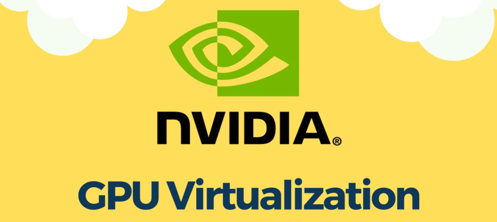
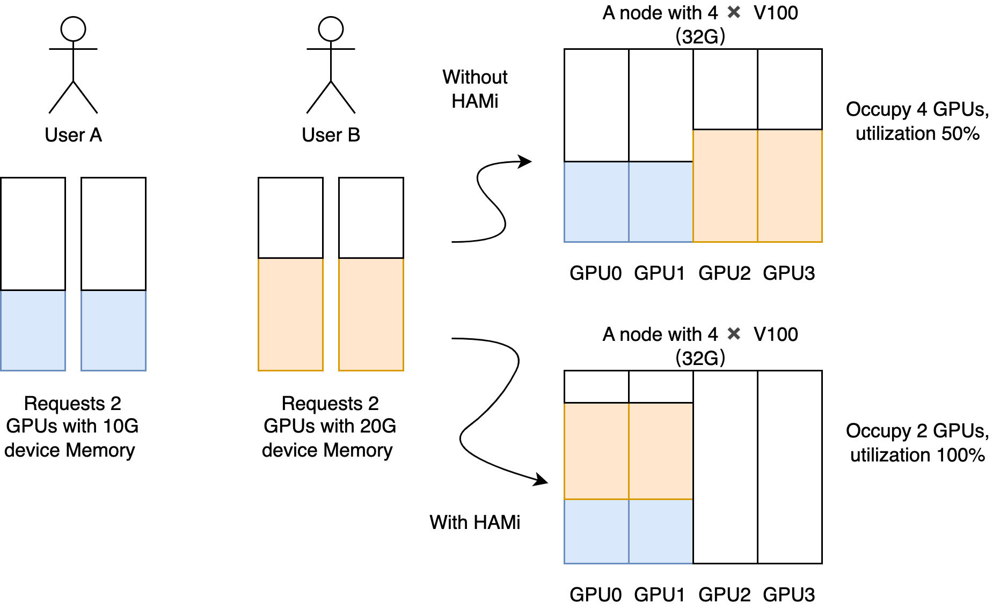
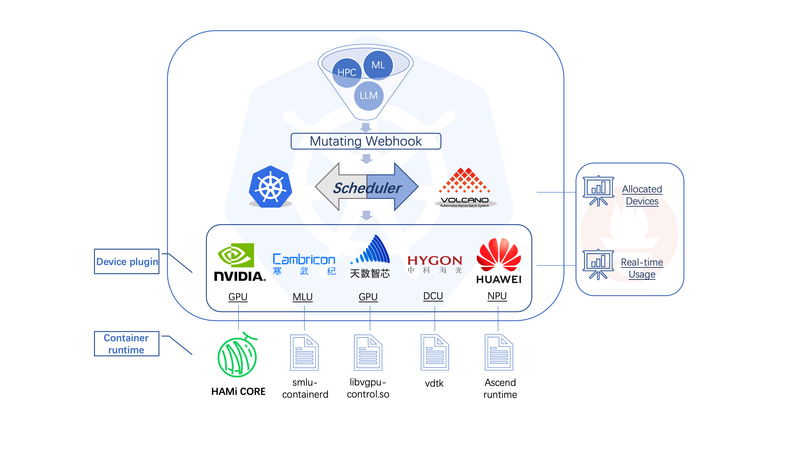
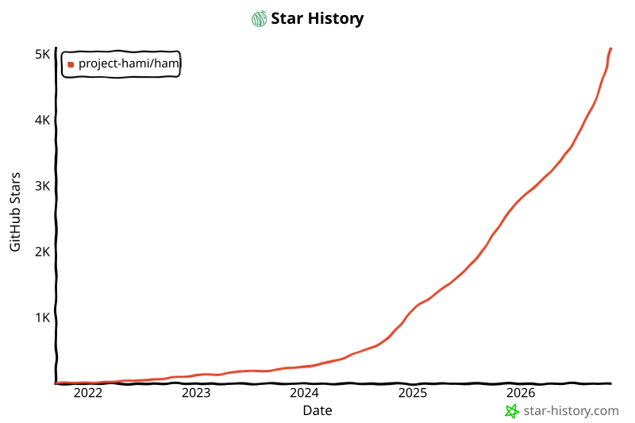

[English](./README.en.md) · [文章目录](../../README.md) · [官网阅读](https://www.theriseunion.com/zh/blog/hami-vgpu-intro.html)

# GPU资源告急？HAMi GPU虚拟化技术是如何为你省钱的！

睿思智联 · 2024/12/17 08:00（北京时间）

全面解析GPU虚拟化技术，包括vGPU、MIG和时间切片方案。了解CNCF沙箱项目HAMi如何在Kubernetes环境中实现高效的GPU资源共享和隔离。



## 背景 ##

在数字化时代，人工智能（AI）的应用已经渗透到各行各业，成为企业提升服务质量和效率的关键。GPU因其强大的并行计算能力，在AI模型训练和推理过程中发挥着至关重要的作用。然而，当前GPU算力资源面临着供应链紧张、高端卡获取困难、中低端卡供不应求等问题，导致算力价格持续走高，使得GPU资源变得尤为珍贵。在此背景下，如何高效利用GPU资源、提高资源利用率、降低系统运营成本，成为企业关注的焦点。通过加强资源监控、优化资源使用、实施GPU池化和虚拟化等手段，可以有效解决这些问题。


## 为什么需要GPU虚拟化、池化统一管理和调度？ ##

传统的GPU资源使用方式存在以下几个问题，导致资源浪费和效率低下：

- 资源利用率低下： 在传统的部署方式中，一个物理GPU通常只能被一个应用程序或虚拟机独占使用，即使该应用程序并未充分利用GPU的所有资源，也会导致其他应用无法使用，造成资源闲置。
- 多租户需求： 许多场景需要多个用户或应用程序共享GPU资源，例如云游戏、虚拟桌面基础设施（VDI）、以及AI模型训练和推理服务。如果没有有效的管理和调度，很难实现多个用户同时高效使用GPU资源.
- 资源分配不灵活： 传统的资源分配方式无法根据业务需求动态调整GPU资源，导致资源利用不均衡，无法满足多样化的业务需求.
- 运维管理复杂： 如果不对GPU资源进行统一管理，会增加运维管理的复杂度和成本，难以实现资源的有效监控和调度.

为了解决这些问题，GPU虚拟化和池化技术应运而生，通过将物理GPU资源抽象为虚拟资源，实现资源的共享、隔离和动态分配，从而提高资源利用率，降低运营成本，并简化运维管理。

## GPU虚拟化主流技术介绍 ##

GPU虚拟化技术主要分为以下几类：

### 1. 虚拟GPU（vGPU） ###

#### 工作原理： #### 
vGPU通过在多个虚拟机（VM）之间共享物理GPU，每个VM获得GPU资源的专用部分，从而实现GPU的虚拟化。

#### 特点： ####
- 逻辑分区：vGPU是通过软件和驱动程序在逻辑上划分GPU资源。
- 资源隔离：每个VM拥有独立的GPU资源，避免相互干扰，保证性能一致性和可预测性。
- 安全隔离：每个vGPU实例都在自己的VM中运行，提供了强大的安全边界。
- 应用场景：适用于VDI、云游戏、远程工作站等需要为每个虚拟机提供GPU加速的场景。
- 资源分配：根据预定义的配置文件将GPU资源分配给每个VM，确保公平分配和优化使用。
- 限制：最大分区数量有限，取决于GPU型号和vGPU管理软件设计能力。

#### 实现方式： ####
- GPU 虚拟化:  抽象物理 GPU 硬件以创建多个虚拟 GPU (vGPU)。
- 管理程序集成: 通过 VMware vSphere、Citrix XenServer 或 KVM 等管理程序管理 vGPU 的分配和调度。
- 驱动程序和软件堆栈: 包括主机驱动程序、客户机驱动程序和 vGPU 管理器等组件。


### 2. 多实例GPU（MIG） ###

#### 工作原理： ####
MIG技术在硬件级别将单个物理GPU划分为多个隔离的GPU实例，每个实例拥有独立的计算、内存和带宽资源。

#### 特点： ####
- 物理分区：MIG是在硬件级别对GPU进行物理分区。
- 高性能和低开销：由于是硬件级别的分区，MIG可以实现更好的性能、更低的开销和更高的安全性。
- 资源隔离：每个实例都具有独立的资源，保证性能和服务质量(QoS)。
- 应用场景：适用于高性能计算（HPC）、AI模型训练和推理等需要高性能和进程间更高安全性的场景。
- 硬件要求：仅受NVIDIA Ampere、Blackwell和Hopper一代GPU支持，如A100、B100/200和H100/200等高端卡。

#### 实现方式： ####
- SM 分区：将GPU的核心计算单元（流式多处理器）分配给不同的MIG实例。
- 内存分区：将GPU的内存划分为通道，并将每个通道分配给不同的实例。
- 高速互连：对GPU内部的高速互连进行分区，确保每个实例都能获得公平的带宽份额.


### 3. GPU时间切片 ###

#### 工作原理： ####
将GPU的处理时间划分为离散的时间间隔（时间片），允许多个任务以时间复用方式共享GPU。

#### 特点： ####
- 逻辑分区：通过软件调度器实现时间上的资源划分。
- 高资源利用率：可以最大限度地提高GPU资源的利用率，无需额外的硬件或专用软件。
- 灵活：能够根据工作负载的需求处理不同的计算需求。
- 易于实现：相对容易实现和管理，适用于不需要复杂资源管理的环境。应用场景：适用于需要在有限硬件上执行大量作业，且可以容忍可变GPU访问和性能的任务，如后台处理或批处理作业。
- 局限性：工作负载之间频繁的上下文切换会导致性能开销，且无法有效处理资源需求变化大的工作负载.

#### 实现方式： ####
- 调度程序: 管理 GPU 资源在不同任务之间的分配，根据预定义的策略将时间片分配给不同的工作负载。
- 任务排队: 将传入的 GPU 任务放置在队列中，并根据优先级或其他策略进行组织。
- 资源分配:  在分配的时间片内，任务可以在 GPU 上运行，并利用计算核心和内存.


## HAMi：开源的 vGPU 解决方案 ##


HAMi（原名k8s-vgpu-scheduler，由第四范式发起）是一个面向Kubernetes 的异构设备管理中间件，旨在实现异构设备（如GPU、NPU、MLU、DCU等）的共享和资源隔离。它目前主要提供对NVIDIA GPU的vGPU支持，可以看作是一个vGPU解决方案。[详细介绍](https://www.theriseunion.com/zh/blog/project-hami.html)

目前，HAMi 已成为 CNCF（云原生计算基金会）中 GPU 虚拟化和池化领域最受欢迎的 sandbox 项目，展现出在云原生生态中的巨大潜力。



### 主要特点: ###

- 细粒度的资源隔离: HAMi可以实现GPU core和memory的细粒度隔离，保证共享同一GPU的各个Pod都能获得足够的资源。
- 虚拟化技术: HAMi使用软件层面的vCUDA方案，通过重写NVIDIA原生的CUDA驱动 (libvgpu.so) 实现对API的拦截，从而实现资源隔离和限制。
- 易于部署: HAMi提供了Helm Chart安装方式，部署较为简单。
- 自定义资源支持：HAMi支持在K8s中自定义资源并进行声明和请求.



### 核心组件: ###

（1）Webhook：用于在Kubernetes中注册和验证自定义的资源请求，主要实现GPU虚拟化软件与Kubernetes API交互，并实现GPU资源的管理和调度。Webhook的工作原理：

- 当用户创建一个请求vGPU资源的Pod时，kube-apiserver根据MutatingWebhookConfiguration配置调用Webhook。
- Webhook会检查Pod中的资源请求，如果发现是请求由GPU虚拟化软件管理的vGPU资源，则将Pod的SchedulerName字段改为vgpu-scheduler。
- 此时该Pod就会由vgpu-scheduler进行调度。对于特权模式的Pod或指定了nodeName的Pod，Webhook会直接跳过或拒绝。

（2）Scheduler：GPU虚拟化软件包括自己的调度器（Scheduler），在创建Pod时做出决策，如何将GPU资源分配给不同的Pod。Scheduler (vgpu-scheduler)的工作流程：vgpu-scheduler使用的是Kubernetes默认的kube-scheduler镜像，但通过配置KubeSchedulerConfiguration，它会调用一个名为Extender Scheduler的插件。该插件作为Vgpu-scheduler Pod中的另一个容器提供服务，实现自定义的调度逻辑，该调度逻辑具体来说包含三部分：

- 打分机制：根据每个节点上的已使用的GPU核心和内存资源与总资源的比例来计算得分，得分越高表示剩余资源越少。这有助于选择最合适的节点来放置Pod。
- 高级调度策略：包含 Spread、Binpack和Random三种调度策略，其中spread策略，倾向于将负载分散到不同的节点上以优化整体性能；而binpack策略则尽量集中负载，减少空闲资源，random则采用随机分配。
- 异步机制：包括GPU感知逻辑，通过定期上报Node上的GPU资源并写入Node的Annotations中，确保调度器能够获取最新的资源信息。

（3）GPU Device Plugin：GPU虚拟化软件通过自定义的GPU Device Plugin来实现对NVIDIA GPU的感知和资源分配，其主要功能包括：
GPU信息获取：使用NVML库获取节点上的GPU信息，包括型号、UUID、内存等，并根据配置对这些信息进行处理，如调整内存大小。

- 资源复制：为了符合Kubernetes的资源分配逻辑，会对物理GPU进行复制，生成多个虚拟设备供不同Pod使用，实现了GPU卡虚拟化复用能力。
- 环境变量设置：在分配GPU给Pod时，Device Plugin会设置一些环境变量：
    - CUDA_DEVICE_SM_LIMIT；
    - CUDA_DEVICE_MEMORY_SHARED_CACHE；
    - 挂载必要的库文件，如libvgpu.so，以便替换容器中的原生驱动。

（4）vGPU-Core：GPU虚拟化软件通过拦截CUDA API来实现GPU资源的隔离和限制。这意味着它可以控制每个Pod使用的GPU资源，实现细粒度的GPU隔离。vGPU-Core是实现GPU资源隔离的关键部分，通过重写CUDA库(libvgpu.so)并替换容器中的相应库文件，实现对CUDA API的拦截。这样可以精确控制每个Pod访问的GPU核心数和内存大小，防止资源争抢。此外，vGPU-Core还处理了CUDA缓存共享等细节，确保多个Pod可以高效地共享同一块GPU。例如原生 libvgpu.so 在进行内存分配时，只有在 GPU 内存真的用完的时候才会提示 CUDA OOM，但是对于vGPU-Core实现的 libvgpu.so来说，检测到 Pod 中使用的内存超过了 Resource 中的申请量就直接返回 OOM，从而实现资源的一个限制。在执行 nvidia-smi 命令查看 GPU 信息时，也可返回 Pod Resource 中申请的资源，这样在查看时也进行隔离。
图片

### 技术优势 ###

资源精细化分配：HAMi 可以根据应用的需求，精细化地分配 GPU 核心和显存资源。用户可以通过在 Pod 的 YAML 文件中设置 nvidia.com/gpucores 和 nvidia.com/gpumem 等参数，精确控制每个容器使用的 GPU 资源。
资源隔离：通过重写 CUDA 驱动，HAMi 可以实现容器之间的资源隔离，防止资源竞争和相互干扰。
灵活的调度策略：HAMi 的调度器支持多种调度策略，可以根据实际需求选择合适的策略，优化资源利用率。
易于集成：HAMi 可以与 Kubernetes 集成，方便用户在 Kubernetes 环境中使用 GPU 资源.


### 使用示例：###

```yaml
resources:
  limits:
    nvidia.com/gpu: 1   # 请求1个vGPUs
    nvidia.com/gpumem: 3000  # 每个vGPU申请3000m显存
    nvidia.com/gpucores: 30  # 每个vGPU的算力为30%实际显卡的算力
```

说明：在Pod的YAML文件中，可以使用nvidia.com/gpu请求vGPU数量，使用nvidia.com/gpumem指定显存大小，使用nvidia.com/gpucores指定算力大小。

更多参考：[https://github.com/Project-HAMi/](https://github.com/Project-HAMi/)

[](https://star-history.com/#Project-HAMi/HAMi&Date)


## 总结 ##

在GPU资源日益紧缺的今天，GPU虚拟化和池化技术是提高资源利用率、降低成本、满足多租户需求的有效手段。vGPU、MIG和时间切片各有优缺点，适用于不同的场景。HAMi 作为一个开源的vGPU方案，提供了细粒度的资源隔离和灵活的部署方式，可以帮助企业实现GPU资源的高效利用。企业可以根据自身的业务需求和技术特点，选择合适的GPU虚拟化和池化方案，从而提升算力资源利用率，为业务创新提供强有力的支持。

**睿思智联**作为开源社区 HAMi 的核心开发者之一，在持续推进 [HAMi](https://www.theriseunion.com/zh/blog/project-hami.html) 社区的共建与发展。

如果你也想成为 HAMi 的贡献者，请参考: [贡献者指南](https://github.com/Project-HAMi/HAMi/blob/master/CONTRIBUTING.md)。

文献参考：

- [睿思智联 + HAMi 社区，共同推动 AI 异构算力发展](https://www.theriseunion.com/zh/blog/hami-salon-1.html)
- [睿思智联与第四范式达成战略合作 共推AI算力池化产品RiseVAST](https://www.theriseunion.com/zh/blog/riseunion-4paradigm-strategic-partner.html)
- [如何提高GPU使用效率——浅析GPU资源监控及虚拟化](https://mp.weixin.qq.com/s?__biz=MjM5NTk0MTM1Mw==&mid=2650701886&idx=1&sn=9be33c9ec22c729983e1b137449f815f&scene=21#wechat_redirect)
- [开源 vGPU 方案：HAMi,实现细粒度 GPU 切分](https://mp.weixin.qq.com/s?__biz=Mzk0NzE5OTQyOQ==&mid=2247487108&idx=1&sn=6d0dbed2ba87faa39f02c980d5718839&chksm=c26cecd5f4785cc0ddc03a899adaa0904eb303e3a0a6d2a251a75216ae0eb195b04bc651e3f1&scene=21#wechat_redirect)
- [化解异构之上的 AI 计算难题 ｜ HAMi 进入 CNCF Sandbox](https://mp.weixin.qq.com/s?__biz=Mzg3OTU5MjY5NQ==&mid=2247489142&idx=2&sn=626b96fb6fadcc17530341d0412cc64e&chksm=ce31af7e054d70b694845def03294a850d2c04b7bebf3ec6b20a1bfc269d656b8df07faa6c15&scene=21#wechat_redirect)

---

[在睿思智联官网阅读本文](https://www.theriseunion.com/zh/blog/hami-vgpu-intro.html) · [浏览更多文章](https://www.theriseunion.com/zh/blog.html)
