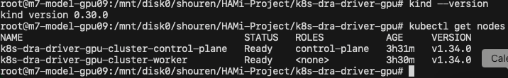
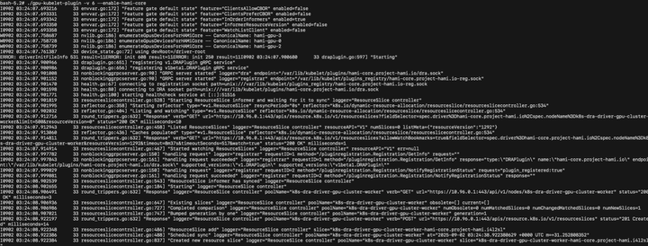
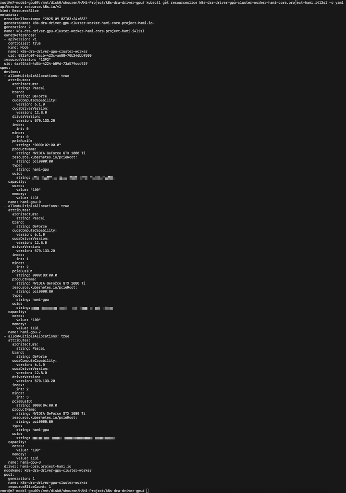
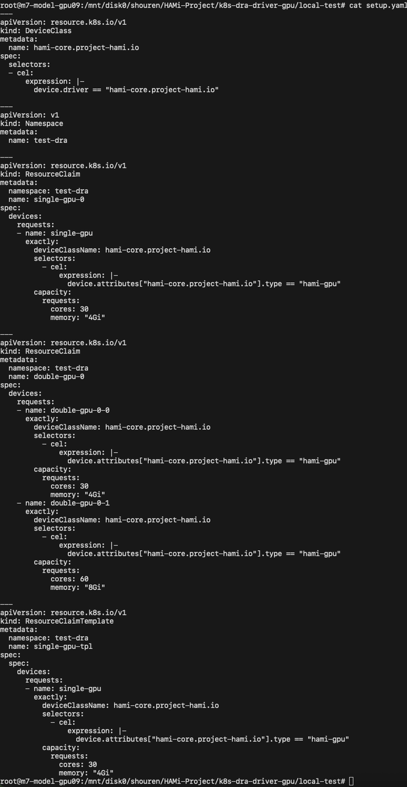
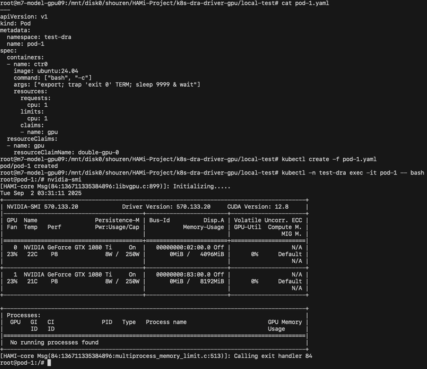
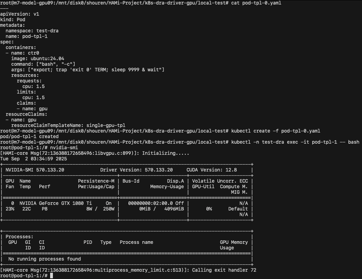

[简体中文](./README.md) · [All articles](../../README.en.md) · [Read on the website](https://www.theriseunion.com/en/blog/hami-with-dra-demo.html)

# Enflame VGCU Virtualization Guide

RiseUnion · January 01, 2025 at 08:00 (UTC+08:00)

In collaboration with the community, HAMi v2.6.0 has been officially released! This version brings significant improvements in stability, performance, and observability, particularly in support for Enflame, Metax, and Cambricon chips, helping more users easily implement GPU pooling and sharing to improve resource utilization.


> This article is republished from: [4Paradigm Developer Community - "HAMi-Core DRA Driver"](https://www.zhihu.com/column/c_1730619939353014273)

## Background

With the release of Kubernetes v1.34, Dynamic Resource Allocation (DRA) has become a stable feature enabled by default. This version also introduces the Consumable Capacity feature to DRA. Compared to the Partitionable devices feature in Kubernetes v1.33, which partitions devices into fixed sizes, Consumable Capacity better embodies the "dynamic" aspect of DRA and aligns perfectly with HAMi-Core's capability for dynamic GPU resource partitioning.

To demonstrate this capability, contributors from 4Paradigm have developed a DRA Driver for HAMi-Core based on NVIDIA's k8s-dra-driver-gpu project. This enables the HAMi community to explore future DRA Driver solutions and planning for HAMi-Core.

## HAMi-Core Overview

HAMi-Core is an open-source project from the HAMi community, primarily contributed by 4Paradigm as one of HAMi's core modules. As a GPU resource controller within containers, HAMi-Core implements device memory virtualization, GPU utilization limits, and real-time GPU monitoring through CUDA API interception.

## DRA Overview

Dynamic Resource Allocation (DRA) is a stable feature enabled by default in Kubernetes since v1.34. It enables users to request, share, and schedule external device resources (such as GPUs, FPGAs, RDMA, and high-speed network cards) among Pods within a cluster on demand. DRA abstracts devices as "claimable resources," replacing traditional static Device Plugin approaches with declarative APIs (ResourceClaim/ResourceClaimTemplate), providing a user experience similar to PersistentVolumeClaim.

DRA offers more flexible management for device resource classification, allocation, and usage, delivering the following benefits:

- **Flexible Filtering**: Use Common Expression Language (CEL) for fine-grained filtering based on arbitrary device attributes.
- **Device Sharing**: Multiple containers or Pods can reference the same device, improving device utilization.
- **Centralized Management**: Device driver developers and cluster administrators can provide hardware classifications optimized for various use cases through DeviceClass, enabling centralized device management.
- **Simplified Declaration**: Pods need not specify exact quantities; they simply reference ResourceClaim or ResourceClaimTemplate, with the system handling matching and binding.

## Implementation Process

During the HAMi-Core adaptation, the following modifications were made to the gpu-kubelet-plugin in k8s-dra-driver-gpu:

1.**ResourceSlice Publishing**: Added cores resource to the ResourceSlice capacity for configuring HAMi-Core's compute power limiting functionality.

2.**Resource Configuration (Prepare Devices)**:
   - Extract requested cores and memory resources from ResourceClaim;
   - Inject HAMi-Core environment variables and files into containers through containerEdits in the CDI (Container Device Interface) specification.

```yaml
Env:
    - CUDA_DEVICE_SM_LIMIT
    - CUDA_DEVICE_MEMORY_LIMIT
    - CUDA_DEVICE_MEMORY_SHARED_CACHE
```
```yaml
VolumeMount:
    - ld.so.preload
    - libvgpu.so
```

3.**Resource Cleanup (Unprepare Devices)**: Clean up temporary directories and files created during resource configuration.

## Demo Results

The demonstration environment is built on kind (version 0.30.0) using Kubernetes v1.34.0 with the DRAConsumableCapacity feature gate enabled.



### Start up driver



### ResourceSlice



### DeviceClass & ResourceClaims

As shown below, we created two ResourceClaims named single-gpu-0 and double-gpu-0 for allocating different quantities of GPUs. Notably, the double-gpu-0 ResourceClaim has different resource configurations for its two GPUs: one allocated 30% compute power and 4GiB memory, while the other allocated 60% compute power and 8GiB memory.



### Pod with ResourceClaim

As shown in the screenshot below, pod-1 requested two GPUs using the double-gpu-0 ResourceClaim. The memory limit results match expectations as displayed.



### Pod with ResourceClaimTemplate



## Future Roadmap

The demonstration code will be published to the demo branch of [k8s-dra-driver](https://github.com/Project-HAMi/k8s-dra-driver).

Additionally, 4Paradigm developers will continue development work in this repository and welcome community participation in the project.

---

[Read this article on the RiseUnion website](https://www.theriseunion.com/en/blog/hami-with-dra-demo.html) · [Explore more articles](https://www.theriseunion.com/en/blog.html)
