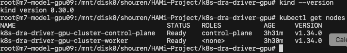
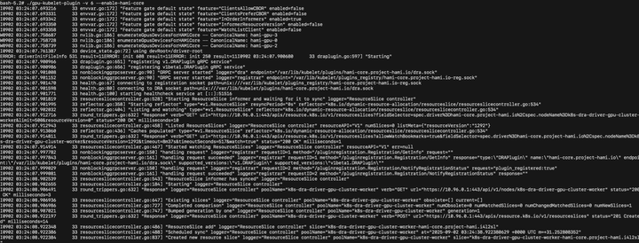
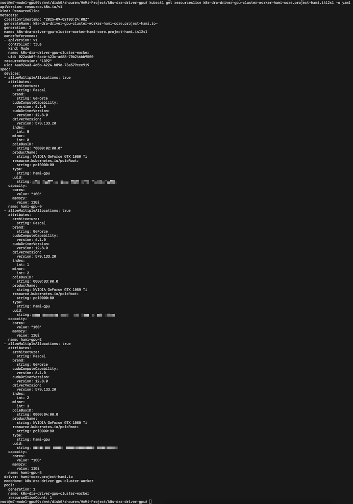
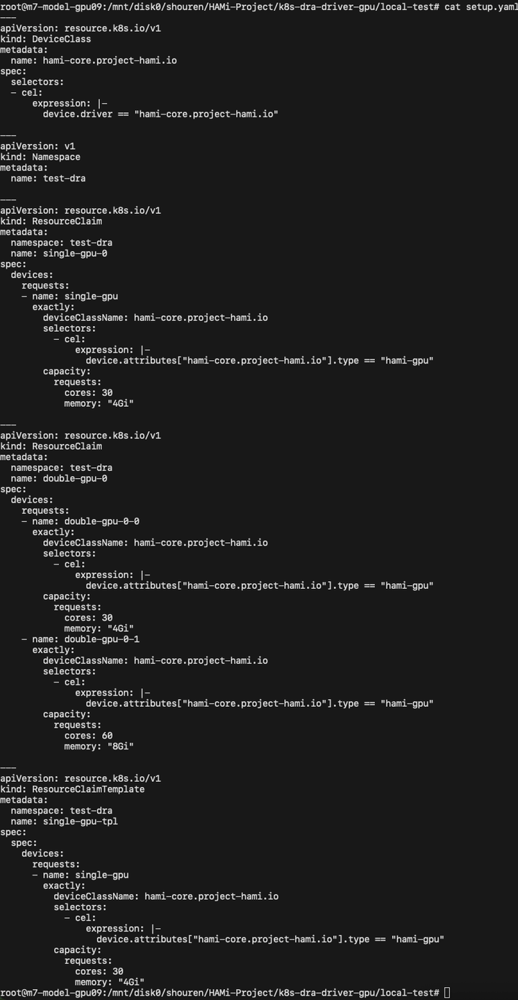
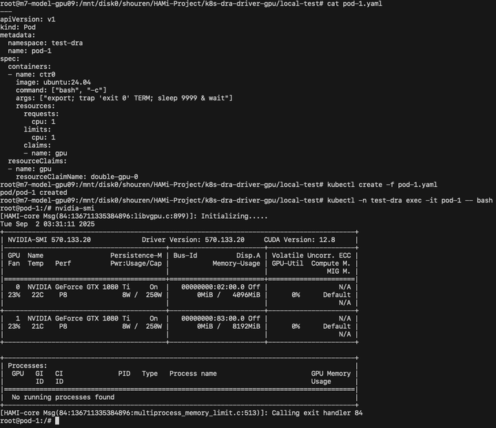
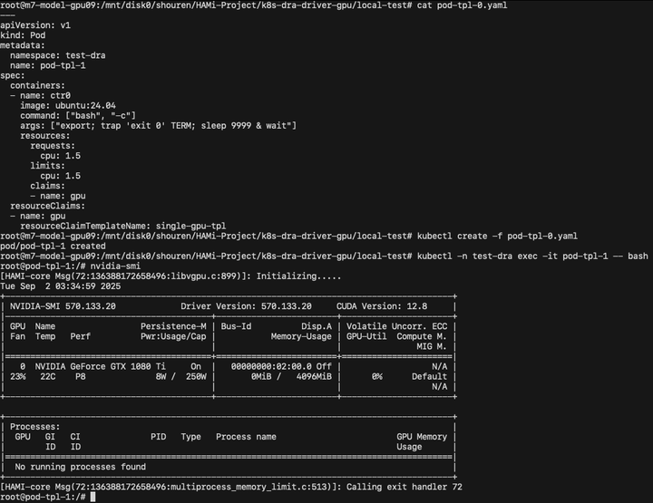

[English](./README.en.md) · [文章目录](../../README.md) · [官网阅读](https://www.theriseunion.com/zh/blog/hami-with-dra-demo.html)

# HAMi 与 DRA 演示

睿思智联 · 2025/09/16 08:00（北京时间）

在社区的共同努力下，HAMi 已正式完成对 Enflame VGCU 的全面适配，将帮助更多使用国产芯片的用户轻松实现 GPU 的池化与共享，提升资源利用率。


> 本文转自：[第四范式开发者社区 - 《HAMi-Core 的 DRA Driver》](https://www.zhihu.com/column/c_1730619939353014273)

## 背景

随着 Kubernetes v1.34 的发布， 动态资源分配（DRA）成为了默认开启的稳定特性，同时这个版本也给 DRA 带来了 Consumable capacity 这个功能特性。相对于 Kubernetes v1.33 版本中的 Partitionable devices 这个按照固定的大小切分设备的功能特性，Consumable capacity 更加体现了 DRA 名称中的动态二字，同时也正好能匹配 HAMi-Core 动态切分 GPU 资源的能力。

为此，来自第四范式的贡献者基于 NVIDIA 的 k8s-dra-driver-gpu 项目，为 HAMi-Core 开发了可以用来演示的 DRA Driver，以便和 HAMi 社区的同学一同探讨未来 HAMi-Core 的 DRA Driver 的方案和规划。

## HAMi-Core 简介

HAMi-Core 是来自 HAMi 社区的一个开源项目，是由第四范式主要贡献的 HAMi 的核心模块之一。 HAMi-Core 作为容器内的 GPU 资源控制器，通过劫持 CUDA API 的方式，实现了诸如设备显存虚拟化、限制 GPU 设备使用率和实时监控 GPU 设备使用率等功能。

## DRA 简介

动态资源分配（DRA）是 Kubernetes 自 v1.34 版本起默认启用的稳定特性，它可以让用户在集群内的 Pod 之间按需申请、共享和调度外部设备资源（如 GPU、FPGA、RDMA和高速网卡等）。DRA 将设备抽象成为“可声明资源”，以声明式 API(ResourceClaim / ResourceClaimTemplate) 替代传统的基于 Device Plugin 的静态技术方式，提供了更加接近 PersistentVolumeClaim 的使用体验。

DRA 为集群设备资源的分类、申请和使用带来更加灵活的管理方式，使用 DRA 可以享受到如下的收益：
- 灵活过滤：使用通用表达式语言（CEL）按任意设备属性做细粒度筛选。
- 设备共享：同一设备可被多个容器或 Pod 一同引用，提升设备利用率。
- 集中管理：设备驱动开发者和集群管理员可以通过 DeviceClass 向应用运维人员提供针对各类使用场景优化的硬件分类，实现设备的集中管理.
- 简化声明：Pod 无需指定具体数量，只需引用 ResourceClaim 或者 ResourceClaimTemplate，由系统完成匹配与绑定。

## 改造过程

在适配 HAMi-Core 的过程中，针对 k8s-dra-driver-gpu 的 gpu-kubelet-plugin 进行了如下改造：

1.发布 ResourceSlice：在 ResourceSlice 的 capacity 中增加了 cores 资源用于配置 HAMi-Core 的算力限制功能。

2.配置资源（Prepare Devices）：
    - 从 ResourceClaim 中获取到用户申请的 cores 和 memory 资源；
    - 通过 CDI(Container Device Interface)  规范中的 containerEdits 向容器中注入 HAMi-Core 所需的环境变量和文件。

```yaml
Env:
    - CUDA_DEVICE_SM_LIMIT
    - CUDA_DEVICE_MEMORY_LIMIT
    - CUDA_DEVICE_MEMORY_SHARED_CACHE
```
```yaml
VolumeMount:
    - ld.so.preload
    - libvgpu.so
```
3.释放资源（Unprepared Devices）：清理配置资源时创建的临时目录和文件

## 效果演示

演示环境基于 kind(version 0.30.0) 构建，使用 v1.34.0 版本的 Kubernetes 并开启了 DRAConsumableCapacity 特性开关。



### Start up driver



### ResourceSlice



### DeviceClass & ResourceClaims

如下图所示，我们分别创建了名为 single-gpu-0 和 double-gpu-0 两个 ResourceClaim 用于分配不同数量的 GPU，特别需要注意的是，double-gpu-0 这个 ResourceClaim 中的两块 GPU 得资源配置是不一样的，一块占用 30% 的算力和 4GiB 的显存，另外一个块占用 60% 的算力和 8GiB 显存。



### Pod with ResouceClaim

如下面的截图所示，pod-1 申请了利用 double-gpu-0 这个 ResourceClaim 申请了两个 GPU，从截图上可以看到显存限制结果符合预期。



### Pod with ResouceClaimTemplate



## 未来规划

本次演示的相关代码后续发布到 [k8s-dra-driver](https://github.com/Project-HAMi/k8s-dra-driver) 的 demo 分支中。
另外，第四范式的开发者也将在这个仓库中进行后续的开发工作，也欢迎有兴趣的同学一同参与到这个项目的开发中。

---

[在睿思智联官网阅读本文](https://www.theriseunion.com/zh/blog/hami-with-dra-demo.html) · [浏览更多文章](https://www.theriseunion.com/zh/blog.html)
