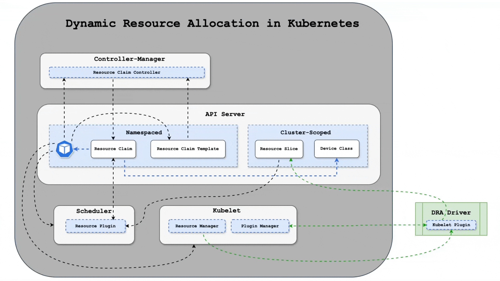

[简体中文](./README.md) · [All articles](../../README.en.md) · [Read on the website](https://www.theriseunion.com/en/blog/hami-with-dra-kind-demo.html)

# Complete Guide: Deploy HAMi-Core DRA Driver in kind

RiseUnion · January 01, 2025 at 08:00 (UTC+08:00)

Comprehensive tutorial on deploying and testing HAMi-Core DRA Driver in kind clusters for Kubernetes dynamic resource allocation and GPU virtualization. Includes step-by-step installation, configuration, and live demonstrations.


> This article is republished from: [4Paradigm Developer Community - "Tutorial: Experience HAMi-Core DRA Driver in kind"](https://zhuanlan.zhihu.com/p/1956405580425037002)


## Introduction

Following our previous demonstration of [HAMi with DRA](https://www.theriseunion.com/en/blog/hami-with-dra-demo.html), we introduced the HAMi-Core DRA Driver capabilities. After intensive development and testing by the 4Paradigm development team, the HAMi-Core DRA Driver code has been released to the main branch of the [k8s-dra-driver](https://github.com/Project-HAMi/k8s-dra-driver) repository and is ready for community evaluation.

## Prerequisites

Before deploying the HAMi-Core DRA Driver, ensure your Linux server environment has the following software installed and configured:

- NVIDIA GPU Driver & CUDA
- Docker
- kind

### Building the Image

```bash
# Clone the repository
git clone https://github.com/Project-HAMi/k8s-dra-driver.git cd k8s-dra-driver

# Build the image
make image
```

Upon successful image build, you can verify the `projecthami/k8s-dra-driver:v0.0.1-dev` image using `docker image list`.

### Creating the Cluster

Before executing the cluster creation script, you can configure the cluster using environment variables defined in `demo/clusters/kind/scripts/common.sh`. For instance, use the `KIND_K8S_TAG` environment variable to specify the desired Kubernetes cluster version.

Additionally, verify that `DRAConsumableCapacity` is set to `true` in the featureGates section of `demo/clusters/kind/scripts/kind-cluster-config.yaml`. To configure multiple nodes, add `role: worker` configurations. For comprehensive kind configuration options, refer to https://kind.sigs.k8s.io/docs/user/configuration.

```bash
# Create the cluster
./demo/clusters/kind/create-cluster.sh
```

The script automatically loads the `projecthami/k8s-dra-driver:v0.0.1-dev` image into the cluster upon creation.

### Installing HAMi-Core DRA Driver

```bash
cd demo/yaml

# Configure namespace and permissions
kubectl apply -f rbac.yaml

# Deploy the HAMi-Core DRA Driver DaemonSet
kubectl apply -f ds.yaml
```

## Testing HAMi-Core DRA

Before testing HAMi-Core DRA functionality, load the required container images into the cluster:

```bash
# Pull the required container image
docker pull ubuntu:24.04

# Import the image into the kind cluster
kind load docker-image ubuntu:24.04 --name k8s-dra-driver-cluster
```

Next, configure the necessary Kubernetes API resources including DeviceClass and ResourceClaim:

```bash
# Configure DRA DeviceClass, ResourceClaim, and ResourceClaimTemplate
kubectl apply -f setup.yaml

# Create the Pod
kubectl create -f pod-0.yaml
```

The `demo/yaml` directory also includes ResourceClaimTemplate-based configurations. Refer to `pod-tpl-0.yaml` to create Pods using ResourceClaimTemplate.

## Environment Cleanup

```bash
# Delete the cluster
./demo/clusters/kind/delete-cluster.sh
```

---

[Read this article on the RiseUnion website](https://www.theriseunion.com/en/blog/hami-with-dra-kind-demo.html) · [Explore more articles](https://www.theriseunion.com/en/blog.html)
