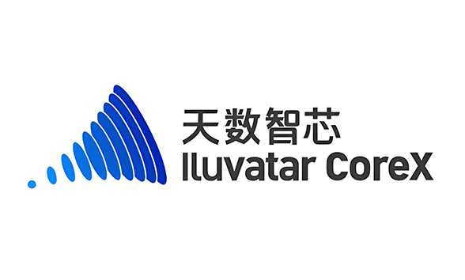
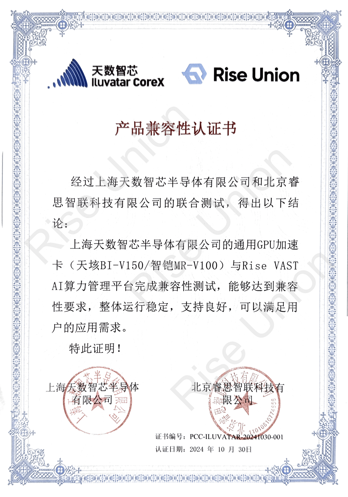

[简体中文](./README.md) · [All articles](../../README.en.md) · [Read on the website](https://www.theriseunion.com/en/blog/iluvatar-compatibility.html)

# Rise VAST Completes Compatibility Certification with Iluvatar CoreX

RiseUnion · January 01, 2025 at 08:00 (UTC+08:00)

RiseUnion's Rise VAST platform achieves compatibility certification with Iluvatar GPU accelerators, enabling efficient management of domestic GPUs through resource pooling and intelligent scheduling, reducing TCO and accelerating AI deployment.

Summary: RiseUnion's Rise VAST platform has successfully achieved deep adaptation with Iluvatar GPU products, marking a significant breakthrough in the domestic AI chip ecosystem. Through Rise VAST's intelligent scheduling, enterprises can more efficiently utilize domestic GPU resources, accelerating AI application deployment.

Recently, **Beijing RiseUnion Technology Co., Ltd.** and **Shanghai Iluvatar CoreX Semiconductor Co., Ltd.** have successfully completed compatibility certification. RiseUnion's Rise VAST AI computing power management platform now supports Iluvatar's high-performance general-purpose GPU accelerator cards, providing users with more powerful and versatile AI computing resource management and scheduling solutions.

## Strong Alliance, Creating New Engine for Intelligent Computing

### About RiseUnion

As a leading AI computing power management platform developer, RiseUnion focuses on providing integrated AI computing resource pooling and scheduling solutions, serving multiple industries including finance, telecommunications, and energy.

Through collaboration with Iluvatar, RiseUnion's Rise VAST platform has achieved deep adaptation with Iluvatar accelerator cards, providing customers with more efficient and flexible AI computing power management experience, helping enterprises achieve efficient resource utilization, reduce TCO, and enhance business innovation capabilities.

### About Iluvatar CoreX

Iluvatar CoreX is a leading manufacturer of high-performance general-purpose GPU chips in China, focusing on independently developing efficient general-purpose GPU products. Their products support mixed-precision training and inference, feature efficient computing performance peaks, and possess broad application compatibility capabilities, meeting the diverse needs of AI applications and providing stable and reliable hardware foundation for large-scale AI deployment. Their products have been widely applied in various industry scenarios including artificial intelligence, finance, and education.

## Empowering Industries, Accelerating AI Innovation Implementation

Through this compatibility certification, RiseUnion's Rise VAST platform, powered by Iluvatar hardware, will bring the following core features and advantages to customers:

### Resource Pooling and Unified Management
- Achieve centralized pooling and unified scheduling management of data center-level GPU computing resources, including heterogeneous support for both domestic and non-domestic accelerator cards
- Compatible with multiple types of computing resources, breaking single-vendor limitations and supporting more flexible hardware deployment strategies

### On-demand Scheduling and Intelligent Allocation
- Provide flexible resource scheduling capabilities, dynamically allocating GPU computing power based on task requirements
- Equipped with multi-dimensional task management and quota management mechanisms, supporting task priority allocation and flexible computing resource allocation

### Simplified Operations Management
- Support intelligent operations management, including device status monitoring, log management, alerting, and other functions to ensure continuous efficient system operation
- Provide standardized, visualized management interface to optimize operational efficiency

## Building New Ecosystem for Independent AI Computing

The successful completion of this compatibility certification marks the joint efforts of RiseUnion and Iluvatar CoreX in promoting the development of domestic AI computing power, further improving the new ecosystem of coordinated development between domestic AI hardware and software.

In the future, both parties will continue to deepen cooperation, providing customers with better computing resource management solutions, helping various industries in their intelligent transformation, and safeguarding innovative applications of domestic AI computing power. 

Additionally, RiseUnion has also engaged in deep collaborations with numerous leading Chinese AI chip manufacturers, such as [Cambricon](https://www.theriseunion.com/en/blog/cambricon-compatibility.html) and [Hygon DCU](https://www.theriseunion.com/en/blog/dcu-compatibility.html), to jointly build an AI computing ecosystem, providing users with richer and more stable computing resources.

---

[Read this article on the RiseUnion website](https://www.theriseunion.com/en/blog/iluvatar-compatibility.html) · [Explore more articles](https://www.theriseunion.com/en/blog.html)
