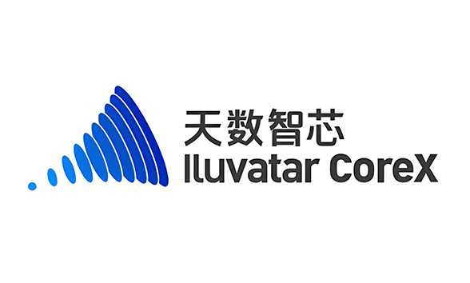
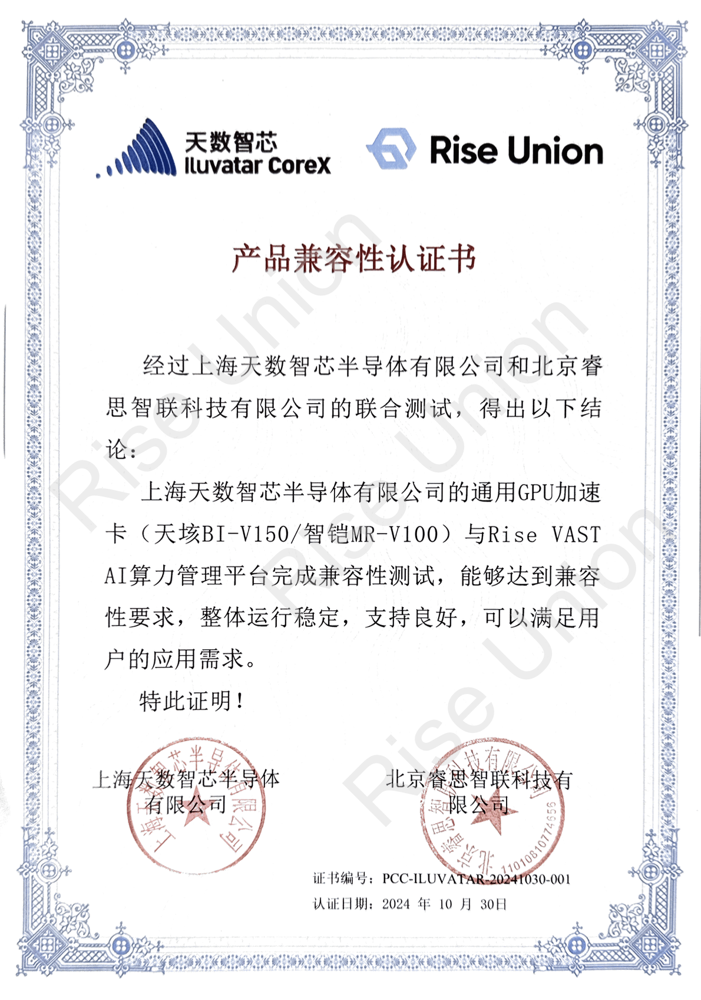

[English](./README.en.md) · [文章目录](../../README.md) · [官网阅读](https://www.theriseunion.com/zh/blog/iluvatar-compatibility.html)

# 重磅：睿思智联 Rise VAST 完成天数智芯 GPU 兼容性认证

睿思智联 · 2025/01/01 08:00（北京时间）

睿思智联Rise VAST平台成功完成与天数智芯GPU加速卡的兼容性认证，通过资源池化与智能调度，实现国产GPU的高效管理，助力企业降低TCO，加速AI应用落地。

摘要：睿思智联 Rise VAST 平台成功实现与天数智芯 GPU 产品的深度适配，标志着国产 AI 芯片生态的重要突破。通过 Rise VAST 的智能调度，企业可以更高效地使用国产 GPU 资源，加速 AI 应用落地。

近日，**北京睿思智联科技有限公司**与**上海天数智芯半导体有限公司**成功完成适配认证。睿思智联的Rise VAST AI算力管理平台，现已支持天数智芯的高性能通用GPU加速卡，为用户提供更强大、更通用的AI算力资源管理与调度解决方案。

## 强强联合，打造智能算力新引擎

### 关于睿思智联

作为领先的AI算力管理平台开发商，睿思智联专注于提供集成AI算力池化与调度的高效解决方案，服务于金融、电信、能源等多个行业。

通过与天数智芯的合作，睿思智联Rise VAST平台实现了对天数智芯加速卡的深度适配，为客户提供更高效、更灵活的AI算力管理体验，帮助企业实现资源高效利用，降低TCO，提升业务创新能力。

### 关于天数智芯

天数智芯是中国高性能通用GPU芯片的领先厂商，专注于自主研发高效能的通用GPU产品，支持多精度混合训练和推理，���备高效的算力峰值，具有广泛的应用适配能力，满足AI应用的多样性需求，为大规模AI部署提供稳定可靠的硬件基础。其产品已广泛应用于人工智能、金融、教育等多个行业场景。

## 助力千行百业，加速AI创新落地

通过本次适配认证，睿思智联Rise VAST平台在天数智芯硬件加持下，将为客户带来以下核心功能与优势：

### 资源池化与统一管理
- 实现数据中心级GPU算力资源的集中池化和统一调度管理，包括国产与非国产加速卡的异构支持
- 兼容多类型算力资源，打破单一厂商的限制，支持更灵活的硬件部署策略

### 按需调度与智能分配
- 提供灵活的资源调度能力，根据任务需求动态分配GPU算力
- 配备多维度的任务管理与配额管理机制，支持任务优先级分配与灵活的算力资源分配

### 简化运维管理
- 支持智能化的运维管理，包括设备状态监控、日志管理、告警等功能，确保系统的持续高效运行
- 提供标准化、可视化的管理界面，优化运维效率

## 构建自主AI算力新生态

此次适配认证的成功标志着睿思智联和天数智芯在推动国产AI算力发展上的共同努力，进一步完善了国产AI硬件和软件协同发展的新生态。

未来，双方将继续深化合作，为客户提供更优质的算力资源管理方案，助力各行业智能化转型，为国产AI算力的创新应用保驾护航。 

此外，睿思智联还陆续与 [寒武纪](https://www.theriseunion.com/zh/blog/cambricon-compatibility.html)、[海光DCU](https://www.theriseunion.com/zh/blog/dcu-compatibility.html)、[沐曦](https://www.theriseunion.com/zh/blog/metax-compatibility.html) 、[摩尔线程](https://www.theriseunion.com/zh/blog/mthreads-compatibility.html)、[昆仑芯](https://www.theriseunion.com/zh/blog/kunlunxin-compatibility.html)等众多中国主流AI芯片厂商展开了深度合作，共同打造AI算力生态，为用户提供更丰富、更稳定的算力资源。

---

[在睿思智联官网阅读本文](https://www.theriseunion.com/zh/blog/iluvatar-compatibility.html) · [浏览更多文章](https://www.theriseunion.com/zh/blog.html)
