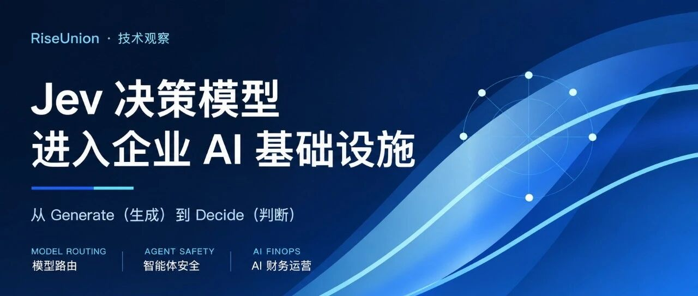
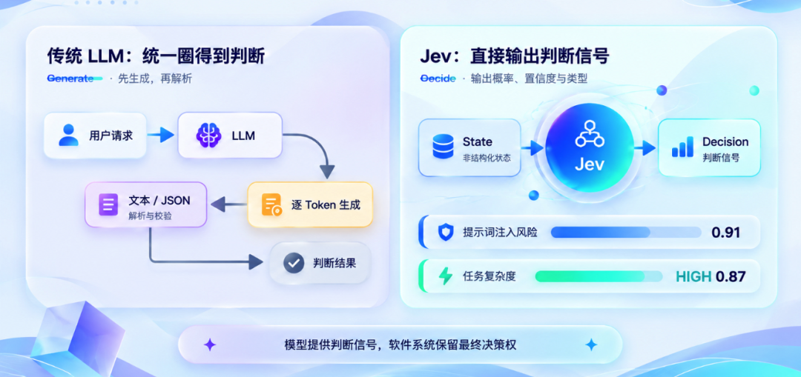
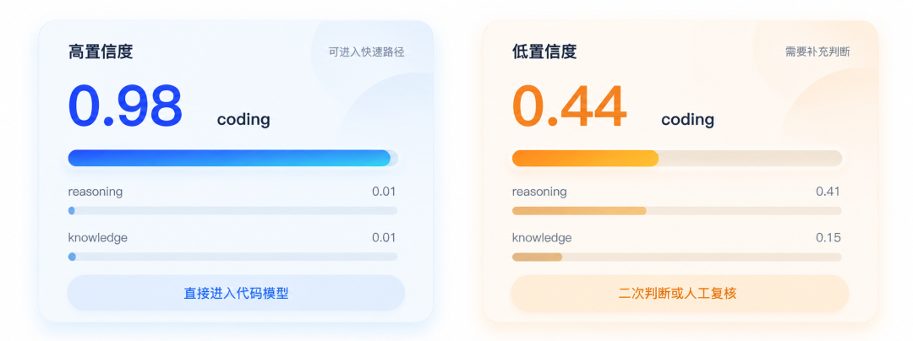
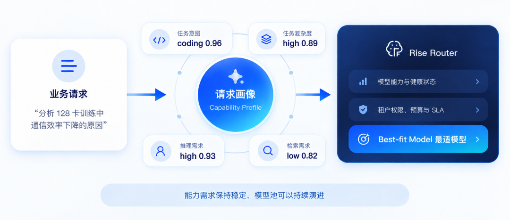
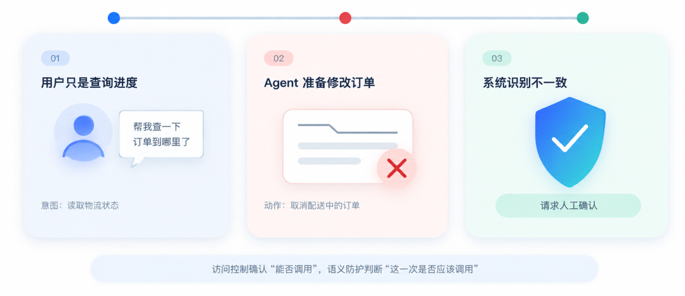
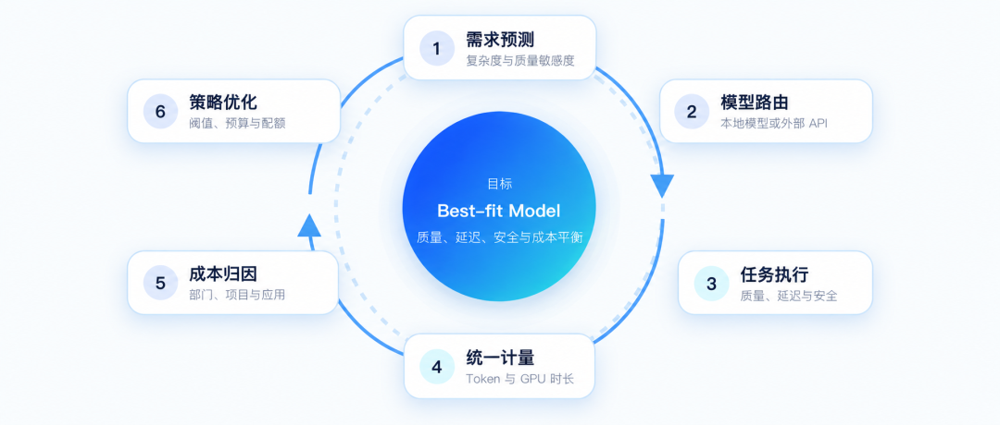
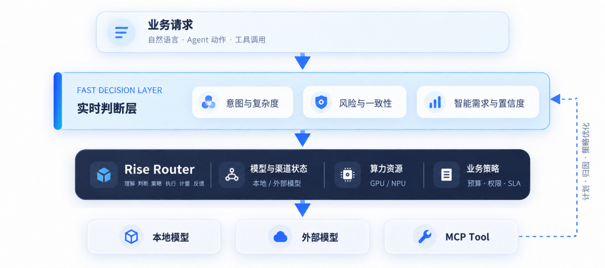

[简体中文](./README.md) · [All articles](../../README.en.md) · [Read on the website](https://www.theriseunion.com/en/blog/jev-decision-models-enterprise-ai.html)

# Jev Gains Momentum: AI Moves from Generating Answers to Supporting Decisions

RiseUnion · September 23, 2026, 09:46 (UTC+08:00) · [Original WeChat article (Chinese)](https://mp.weixin.qq.com/s/2sovKzKASEeWx9h_XRS3QQ)

Exploring how Jev decision models connect with enterprise AI infrastructure through model routing, Agent security and AI FinOps.

On September 15, 2026, TypeSafe AI released Jev, its first System One Model. Three days later, Vercel published a widely discussed set of figures: within just 24 hours of becoming available on AI Gateway, Jev had been used by nearly 13% of paying teams, making it the fastest-adopted new model in Vercel AI Gateway's history at the time.

These figures describe first-day adoption within Vercel's platform, rather than industry-wide market share, and early experimentation does not imply long-term retention. Still, they raise a question: why did a model that does not generate free-form text attract attention so quickly?

For several years, large-model development has focused on generating better outputs: larger parameter counts, longer context windows, stronger reasoning and increasingly sophisticated Agents.

Once enterprises connected large models to production systems, another class of tasks began appearing in volume: judging request type and complexity, identifying security risks, checking whether Agent actions match user intent, and assessing how many Tokens and how much compute a request deserves.

These tasks require language understanding, but not necessarily a generated answer.

Jev represents this new model positioning: taking unstructured state as input and returning typed decision signals with probabilities and confidence, which software systems then use to execute policies.

## From Generate to Decide: Software Does Not Always Need a Passage of Text

Suppose a model gateway needs to decide whether a request should go to a coding model or a general-purpose model.

A common approach is to ask a large language model to select a predefined category, return text or JSON, and then have the application parse and validate it.

This pipeline works, but it effectively converts a judgment into text and then converts that text back into a judgment.

Jev uses a different interface. Software submits a state and a set of questions, and the model directly returns a Boolean, Choice or Score, together with the corresponding probability and confidence.

Figure 1 Comparison of a traditional LLM generation path and Jev's decision path

What a system really needs is often not the sentence "this request is relatively risky," but a signal that can participate directly in control flow: for example, prompt injection risk 0.91, task complexity High 0.87, or strong reasoning needed Yes 0.94.

The model produces signals; software sets thresholds, combines rules and executes actions. Whether the outcome is routing, permission, review or blocking, authority remains in the policy system.

This is Jev's most noteworthy shift: AI is no longer confined to an application's answer-producing end, but starts becoming a decision component inside software systems.

## Why Probabilities Are More Valuable than a Label

If a model returns only `coding`, the system knows that this is a coding task but not how certain the model is.

The actual situations may differ significantly:

| Category  | High | Low |
|:----------|-------------:|-------------:|
| coding    |     **0.98** |     **0.44** |
| reasoning |         0.01 |         0.41 |
| knowledge |         0.01 |         0.15 |

Figure 2 The same coding label leads to different handling policies at high and low confidence

Both outputs rank `coding` highest, but a production system should not handle them identically. The former can go directly to a coding model; the latter may require a second assessment or human review.

Probabilities and confidence let systems handle uncertainty in layers: frequent, high-confidence judgments take a fast path, while complex or high-risk cases escalate to a heavier model or a human workflow.

This does not replace large models with Jev. Instead, it lets large models focus on tasks that truly require open-ended generation, extended analysis and complex reasoning.

In its self-developed workflow evals, TypeSafe reported speed advantages of up to 193.6 times and cost advantages of up to 444.6 times for Jev. The company also noted that these figures may be at the upper end of real production benefits and that the evaluation tasks were designed by its own team, creating potential bias.

These figures therefore serve better as an illustration of Jev's design direction than as a universal claim that it is "193.6 times faster than any LLM." The important principle is that a task requiring only structured judgment may not need a full generative reasoning process.

## Model Routing: From Recognizing Intent to Understanding Capability Requirements

Intent routing is not new. RiseUnion's Rise Router can already distribute requests based on content, model capabilities, cost, health and business policies.

Jev's value is therefore not in giving model gateways intent recognition for the first time, but in expanding a single label into a multidimensional request profile.

For example, "write a quicksort in Python" and "analyze why communication efficiency drops during 128-card training with PyTorch Distributed" may both be labeled coding tasks, yet they have very different requirements for reasoning depth, context length, specialist knowledge and response quality.

What the system needs more is a set of structured signals:

| Judgment dimension   |    Output |
|:-----------|------------:|
| Task intent   | coding 0.96 |
| Task complexity |   high 0.89 |
| Reasoning requirement   |   high 0.93 |
| Retrieval requirement   |    low 0.82 |

Figure 3 Jev converts a business request into a capability profile, then RiseUnion's Rise Router selects the best-fit model

Jev is better suited to answering "what capabilities does this task need?" than to specifying "which model must be called?"

The specific model selection must also account for the model pool, tenant permissions, real-time load, budget and SLA. When the upper layer expresses capability requirements rather than binding to a model name, changes to the model pool do not repeatedly affect business logic.

A complete routing decision combines three kinds of signals:

> **Semantic requirement signals + infrastructure signals + business policies → Best-fit Model**

Jev supplies semantic decision signals, while RiseUnion's Rise Router selects models, distributes traffic and handles failure fallback under real enterprise constraints. They address different layers of the problem.

## As Agents Start Taking Actions, Security Boundaries Change

Traditional large-model security primarily focuses on user inputs and model outputs. In the Agent era, AI also calls databases, Shell, enterprise APIs and MCP Tools to take actions.

Security concerns therefore extend from Content Risk to Action Risk.

RiseUnion's Rise Router already provides identity authentication, access authorization, traffic control, content security, MCP authentication and tool authorization. These mechanisms address "who can call which tool." But Agent scenarios raise another question: what is an already authorized call about to do this time?

Suppose a user asks a customer-service Agent to check an order's delivery status, but the Agent prepares to call the order system and directly cancel the order while it is still in transit. The Agent may indeed have access to order management tools and permission to cancel orders, so traditional authorization checks may not reject the call.

Semantically, however, the user's intent and the actual action are clearly inconsistent.

Figure 4 Semantic risk assessment when a customer-service Agent misinterprets checking delivery status as canceling an order

Such problems fall outside the coverage of static RBAC. The system needs to understand user intent, call parameters, target resources and execution context before a policy engine decides whether to allow, review or reject the action.

TypeSafe's published Agent Trace Observability evaluation follows a similar approach: combining Agent instructions, conversations and tool calls to judge whether unauthorized irreversible actions are present.

For enterprise security, a more reasonable layered approach is to let each mechanism handle the problems it is best suited to, rather than letting Jev replace existing protection:

1.  **Deterministic protection: Identity, permissions, rate limits, keywords and regular expression matching.**
2.  **Fast semantic judgment: Intent recognition, risk scoring and action consistency.**
3.  **Deep security detection: Complex attacks, specialized model detection and high-risk review.**
4.  **Policy engines and human approval: Final execution and accountability.**

Access control manages Capability—what can be done—while semantic protection concerns Action—what is actually being done this time. Decision models can supply additional risk signals, but final business authority should remain with enterprise policies and approval systems.

## AI FinOps: From Accounting after Execution to Decisions before Execution

As enterprises scale AI use, they quickly encounter a practical issue: not every request merits the strongest, most expensive model.

Simple text rewriting and complex software architecture analysis require very different levels of intelligence. Sending both to a strong reasoning model creates higher Token costs, latency and load.

Before inference, Jev can supply signals about task complexity, reasoning requirements and quality sensitivity, assessing how much intelligence a request needs before it reaches a particular model.

Model selection must still account for health, concurrency, tenant quotas, budgets and SLAs.

RiseUnion's Rise Router already brings local inference and external APIs into one governance layer, unifying local GPU time and model Token billing with attribution by tenant, project, business line and API Key. Jev supplies pre-execution demand assessment; RiseUnion's Rise Router handles routing, execution and post-execution accounting.

> **Demand prediction → model routing → task execution → Token and GPU metering → cost attribution → policy optimization**

Figure 5 Demand prediction, model routing, execution, metering, attribution and policy optimization form an AI FinOps loop

This creates a complete AI FinOps loop. The goal is not always to choose the Cheapest Model, but to select the Best-fit Model while meeting quality, latency, security and business requirements.

The relationship can be expressed in one sentence: Jev judges "how much intelligence this request needs," while RiseUnion's Rise Router decides "which model and compute will complete it" and accounts for "how much Token and GPU cost was ultimately consumed."

## Jev Is Not a Universal Judge

Decision models invite an attractive idea: if they are fast and inexpensive, could a large share of rules, security checks and model routing simply be handed over to them?

The answer is no.

API Keys, permissions, rate limits and deterministic matching should remain with rules. Complex analysis and multistep reasoning should remain with large language models. Specialized security models should not be replaced simply because decision models are faster.

TypeSafe uses product language such as "Zero Hallucinations." A more precise interpretation is that Jev gives up free-form text generation and constrains its output types and possible choices through a predefined Schema, preventing type errors outside that Schema.

But correct types do not imply correct judgments.

`Prompt Injection Risk = 0.95` must not be mechanically interpreted as an objective, universally applicable attack probability. Whether model outputs correspond to real risks still depends on task definition, data distribution, thresholds and probability calibration.

Before production deployment, enterprises need benchmarks and probability calibration using their own data. High-privilege Agents, sensitive data and irreversible actions also require strict escalation policies and human approval.

A model can provide judgments without inherently acquiring final business authority.

## Enterprise AI Infrastructure Is Adding a Judgment Layer

Looking back, Jev's most noteworthy aspect may not be that "another faster classifier has appeared." Classification, scoring and risk identification have existed for years. The change is that these judgments are becoming real-time control signals within AI infrastructure.

Enterprise AI systems previously often had just two layers: rules and large models. Many tasks sit between them: they require natural-language understanding without lengthy generated text, and model participation while final authority remains with the software system.

The decision models represented by Jev are attempting to fill this layer.

Figure 6 The judgment layer connects business requests, RiseUnion's Rise Router, execution targets and metering feedback

For RiseUnion, this change connects naturally with its existing product portfolio. RiseUnion already covers heterogeneous compute management, model inference services and a unified model gateway. New decision signals can further connect semantic requirements with model status, GPU or NPU resources, Token consumption and business budgets.

An AI request no longer simply enters a model and returns an answer. It passes through understanding, judgment, policy, execution, metering and feedback. Enterprises also need to manage request risk, intelligence requirements, Agent behavior and compute costs.

Jev is still in Early Access, and its long-term effectiveness, applicability and production stability require further validation in real business settings. Yet the question it raises is already important enough.

Previously, we mainly used AI to help people answer questions.

Next, more AI will be placed inside software systems to help those systems make judgments.

This may be the next change taking place in enterprise AI infrastructure.

References:

1.  TypeSafe AI: Introducing System One Models & Jev

2.  TypeSafe AI: Workflow evals

3.  Vercel: Jev is the fastest-adopted model in AI Gateway history

4.  RiseUnion's Rise Router: A Unified Large-Model Token Entry Point

### About RiseUnion

**Beijing RiseUnion Technology Co., Ltd.** (RiseUnion) focuses on AI compute management and scheduling. It offers an end-to-end solution spanning heterogeneous compute resource management, integrated training and inference model services, a unified model gateway and Token governance, helping enterprises improve compute utilization and accelerate AI deployments.

RiseUnion is committed to making compute as readily available as water and electricity, building an intelligent, controllable and efficient **computing foundation** for enterprise AI transformation.

For more information, visit the [RiseUnion website](https://www.theriseunion.com/en.html)

---

[Read this article on the RiseUnion website](https://www.theriseunion.com/en/blog/jev-decision-models-enterprise-ai.html) · [Explore more articles](https://www.theriseunion.com/en/blog.html)
