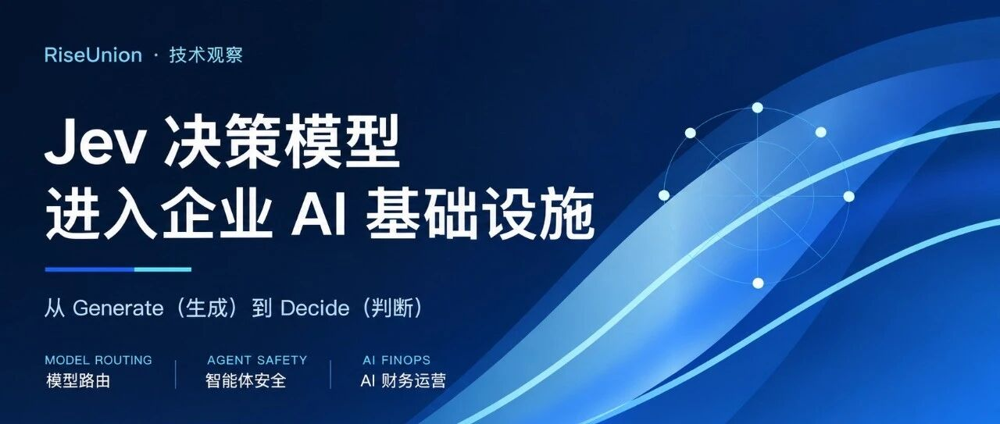
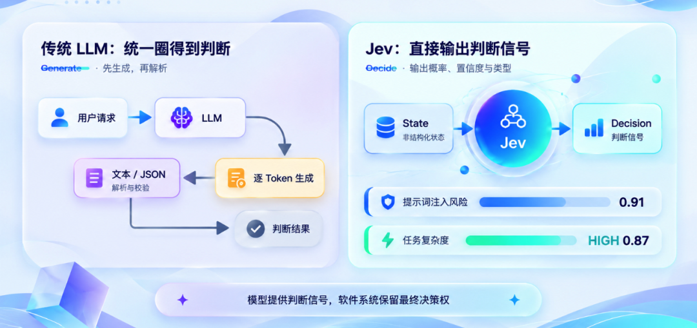
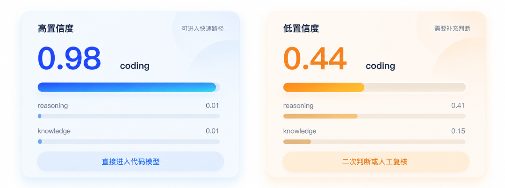
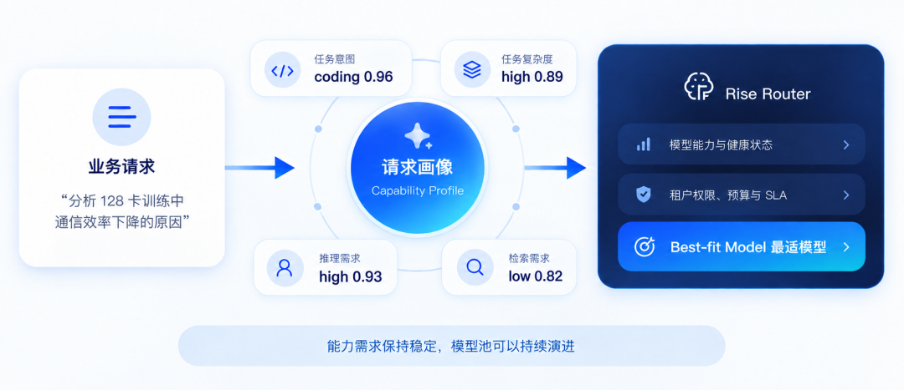
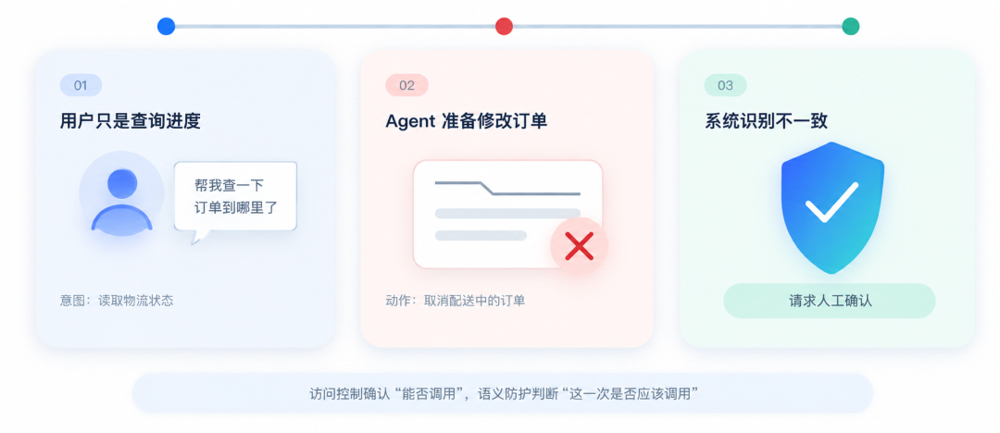
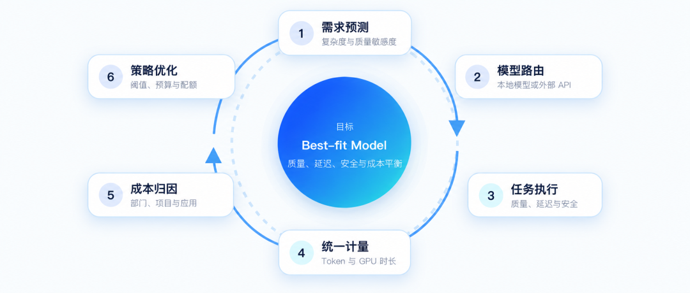
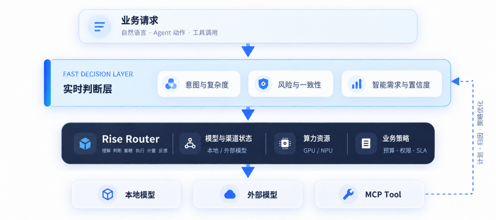

[English](./README.en.md) · [文章目录](../../README.md) · [官网阅读](https://www.theriseunion.com/zh/blog/jev-decision-models-enterprise-ai.html)

# Jev火了：当 AI 从“生成答案”走向“参与决策”

睿思智联 · 2026 年 9 月 23 日 09:46（北京时间） · [微信公众号原文](https://mp.weixin.qq.com/s/2sovKzKASEeWx9h_XRS3QQ)

从模型路由、Agent安全到AI FinOps，探讨Jev决策模型与企业AI基础设施的连接。

2026 年 9 月 15 日，TypeSafe AI 发布首个 System One Model（系统一模型）Jev。三天后，Vercel 公布了一组颇受关注的数据：Jev 上线 AI Gateway 仅 24 小时，就被接近 13% 的付费团队使用，成为当时 Vercel AI Gateway 历史上采用速度最快的新模型。

这组数据反映的是 Vercel 平台内的首日采用情况，不等同于整个行业的市场份额，早期尝鲜也不代表长期留存。但它仍然提出了一个问题：一个不生成自由文本的模型，为什么会迅速获得关注？

过去几年，大模型的发展主线一直是“生成得更好”：更大的参数规模、更长的上下文、更强的推理能力，以及越来越复杂的 Agent。

企业把大模型接入生产系统后，另一类任务开始大量出现：判断请求类型与复杂度，识别安全风险，检查 Agent 动作是否符合用户意图，以及评估一次请求值得消耗多少 Token 和算力。

这些任务需要理解语言，却未必需要生成一段答案。

Jev 所代表的，正是这样一种新的模型定位：输入非结构化状态，输出类型明确、带概率与置信度的决策信号，再由软件系统依据这些信号执行策略。

## 从 Generate（生成）到 Decide（判断），软件需要的不总是一段文本

假设模型网关需要判断一个请求应该交给代码模型，还是普通通用模型。

常见做法是让大语言模型从预设类别中选择一个，返回文本或 JSON，再由应用程序解析和校验。

这条链路可以工作，但它实际上经历了一个“判断转文本，再把文本转回判断”的过程。

Jev 采用了不同的接口。软件提交一段状态和一组判断问题，模型直接返回 Boolean（是非判断）、Choice（有限选项）或 Score（评分），同时给出对应概率与置信度。

图 1　传统 LLM 生成路径与 Jev 决策路径对比

系统真正需要的，往往不是一句“这个请求风险较高”，而是可以直接参与控制流程的信号，例如提示词注入风险 0.91、任务复杂度 High 0.87、需要强推理 Yes 0.94。

模型产生信号，软件设置阈值、组合规则和执行动作。最终是路由、允许、复核还是阻断，权力仍然留在策略系统中。

这也是 Jev 最值得关注的变化：AI 不再只位于应用的回答端，而开始成为软件系统内部的决策组件。

## 为什么概率比一个标签更有价值

如果模型只返回 `coding`，系统知道这是一个代码任务，却不知道模型有多确定。

真实情况可能存在明显差异：

| 任务分类  | 高置信度判断 | 低置信度判断 |
|:----------|-------------:|-------------:|
| coding    |     **0.98** |     **0.44** |
| reasoning |         0.01 |         0.41 |
| knowledge |         0.01 |         0.15 |

图 2　同样输出 coding 标签时，高置信度与低置信度对应不同的处理策略

两次输出的最高类别都是 `coding`，但生产系统不应采取相同策略。前者可以直接进入代码模型，后者可能需要二次判断或人工复核。

概率和置信度让系统可以分层处理不确定性：高频且高置信度的判断走快速路径，复杂或高风险的问题再升级到更重的模型或人工流程。

这并不是用 Jev 替代大模型。相反，它让大模型集中处理真正需要开放式生成、长链条分析和复杂推理的任务。

TypeSafe 在自建的 workflow eval（工作流评测）中，报告 Jev 最高具有 193.6 倍的速度优势和 444.6 倍的成本优势。官方同时说明，这些数字可能位于真实生产收益的高端，评测任务由其团队设计，也存在潜在偏差。

因此，这组数据更适合用来说明 Jev 的设计方向，而不应被外推成“面对任何 LLM 都能快 193.6 倍”的普遍结论。真正重要的原则是：如果任务只是做结构化判断，就未必需要完整的生成式推理。

## 模型路由，从识别意图走向理解能力需求

意图路由并不是新能力。睿思智联的 Rise Router 已经可以结合请求内容、模型能力、成本、健康状态和业务策略进行分流。

因此，Jev 的价值不是让模型网关第一次具备意图识别，而是把单一标签扩展成多维请求画像。

例如，“用 Python 写一个快速排序”和“分析 PyTorch Distributed 在 128 卡训练中通信效率下降的原因”，都可能被标记为代码任务，但它们对推理深度、上下文长度、专业知识和响应质量的要求完全不同。

系统更需要一组结构化信号：

| 判断维度   |    输出结果 |
|:-----------|------------:|
| 任务意图   | coding 0.96 |
| 任务复杂度 |   high 0.89 |
| 推理需求   |   high 0.93 |
| 检索需求   |    low 0.82 |

图 3　Jev 将业务请求转换成能力需求画像，再由睿思智联的 Rise Router 选择最适模型

Jev 更适合回答“这个任务需要什么能力”，而不是直接指定“必须调用哪个模型”。

具体模型的选择，还要结合模型池、租户权限、实时负载、预算和 SLA。只要上层表达的是能力需求，而不是绑定某个模型名称，模型池的变化就不会反复影响业务逻辑。

完整的路由决策由三类信号共同组成：

> **语义需求信号 + 基础设施信号 + 业务策略 → Best-fit Model（最适模型）**

Jev 提供语义侧的决策信号，睿思智联的 Rise Router 则在企业真实约束下完成模型选择、流量分配和故障降级。两者解决的是不同层面的问题。

## Agent 开始执行动作，安全边界也在变化

传统大模型安全主要关注用户输入和模型输出。进入 Agent 阶段后，AI 还会调用数据库、Shell、企业 API 和 MCP Tool 执行动作。

安全问题由此从 Content Risk（内容风险）延伸到 Action Risk（动作风险）。

睿思智联的 Rise Router 已具备身份认证、访问授权、流量控制、内容安全、MCP 认证和工具授权等能力。这些机制解决的是“谁能调用哪个工具”。但 Agent 场景还要回答：一个已经通过授权的调用，这一次准备做什么？

假设用户要求客服 Agent 查询一笔订单的物流进度，而 Agent 准备调用订单系统，直接取消这笔仍在配送中的订单。它可能确实拥有订单管理工具和取消订单的权限，因此传统授权检查未必会拒绝这次调用。

但从语义上看，用户意图和实际动作明显不一致。

图 4　客服 Agent 将“查询物流进度”误解为“取消订单”时的语义风险判断

这类问题超出了静态 RBAC 的覆盖范围。系统需要理解用户意图、调用参数、目标资源和执行上下文，再由策略引擎决定允许、复核还是拒绝。

TypeSafe 公布的 Agent Trace Observability 评测也采用了类似思路：结合 Agent 指令、对话和工具调用，判断是否存在未经允许的不可逆操作。

对于企业安全体系而言，较合理的分层不是让 Jev 取代现有防护，而是让不同机制各自处理擅长的问题：

1.  **确定性防护：处理身份、权限、限流、关键词和正则匹配。**
2.  **快速语义判断：处理意图识别、风险评分和动作一致性。**
3.  **深度安全检测：处理复杂攻击、专业模型检测和高风险复核。**
4.  **策略引擎与人工审批：负责最终执行和责任闭环。**

访问控制管理的是 Capability（能做什么），语义防护关注的是 Action（这一次实际在做什么）。决策模型可以补充风险信号，但最终业务权力仍应由企业策略和审批体系掌握。

## AI FinOps，从执行后核算走向执行前决策

企业规模化使用 AI 后，会很快遇到一个现实问题：并不是每一个请求都值得使用最强、最贵的模型。

简单的文本改写和复杂的软件架构分析，对智能能力的需求完全不同。如果都进入强推理模型，企业将承担更高的 Token 费用、延迟和负载。

Jev 可以在推理前提供任务复杂度、推理需求和质量敏感度等信号，先判断一次请求需要多少智能，再进入具体模型。

模型选择仍要结合健康状态、并发、租户配额、预算和 SLA。

睿思智联的 Rise Router 已把本地推理和外部 API 纳入统一治理面，将本地 GPU 时长与模型 Token 计费并轨，并按租户、项目、业务线和 API Key 归因。Jev 提供执行前的需求判断，睿思智联的 Rise Router 完成路由、执行和事后核算。

> **需求预测 → 模型路由 → 任务执行 → Token 与 GPU 计量 → 成本归因 → 策略优化**

图 5　需求预测、模型路由、执行、计量、归因与策略优化构成 AI FinOps 闭环

AI FinOps 因此形成闭环。目标不是永远选择 Cheapest Model（最便宜模型），而是在质量、延迟、安全和业务要求得到满足的前提下，选择 Best-fit Model（最适模型）。

可以用一句话概括两者的关系：Jev 判断“这个请求需要多少智能”，睿思智联的 Rise Router 决定“用什么模型和算力完成”，并核算“最终消耗了多少 Token 和 GPU 成本”。

## Jev 不是万能判断器

决策模型很容易让人产生一种想象：既然它又快又便宜，是否可以把大量规则、安全检测和模型路由都交给它？

答案是否定的。

API Key、权限、限流和确定性匹配，应继续交给规则。复杂分析和多步推理，应继续交给大语言模型。专业安全问题也不能因为决策模型更快，就直接替换已有的安全模型。

TypeSafe 使用了 “Zero Hallucinations” 这样的产品表述。更准确的理解是，Jev 放弃自由文本生成，输出类型和可选空间由预定义 Schema 约束，因此不会产生 Schema 之外的类型错误。

但类型正确，不等于判断正确。

`Prompt Injection Risk = 0.95` 也不能被机械理解为一次客观、普适的攻击概率。模型输出能否与真实风险对应，仍然取决于任务定义、数据分布、阈值设置和概率校准。

企业投入生产前，需要使用自身数据完成基准测试和概率校准。涉及高权限 Agent、敏感数据和不可逆操作时，还要设置严格的升级策略与人工审批。

模型可以提供判断，但不能天然获得最终业务权力。

## 企业 AI 基础设施正在补上“判断层”

回头看，Jev 真正值得关注的地方，可能并不是“又出现了一个更快的分类器”。分类、评分和风险识别已经存在很多年，新的变化在于，这些判断开始成为 AI 基础设施中的实时控制信号。

过去，企业 AI 系统常常只有规则与大模型两层。两者之间存在大量任务：需要理解自然语言，却不需要生成长文本；需要模型参与，却必须把最终决定权留在软件系统中。

Jev 所代表的决策模型，正在尝试填补这一层。

图 6　判断层连接业务请求、睿思智联的 Rise Router、执行目标与计量反馈

对于睿思智联而言，这一变化与现有产品体系有天然连接。睿思智联已覆盖异构算力管理、模型推理服务与统一模型网关。新的决策信号可以进一步把语义需求与模型状态、GPU 或 NPU 资源、Token 消耗和业务预算连接起来。

一次 AI 请求不再只是进入模型再返回答案，而是经历理解、判断、策略、执行、计量和反馈。企业还要管理请求风险、智能需求、Agent 行为和算力成本。

Jev 仍处于 Early Access（早期访问）阶段，它的长期效果、适用边界和生产稳定性还需要更多真实业务验证。但它提出的问题已经足够重要。

过去，我们主要让 AI 帮助人回答问题。

接下来，会有越来越多 AI 被放进软件系统内部，帮助系统做判断。

这可能是企业 AI 基础设施正在发生的下一步变化。

参考资料：

1.  TypeSafe AI：Introducing System One Models & Jev

2.  TypeSafe AI：Workflow evals

3.  Vercel：Jev is the fastest-adopted model in AI Gateway history

4.  睿思智联的 Rise Router：统一大模型 Token 入口

### 关于睿思智联

**北京睿思智联科技有限公司**（RiseUnion）专注于 AI 算力管理与调度，提供从异构算力资源管理、训推一体模型服务到统一模型网关与 Token 治理的一站式解决方案，帮助企业提升算力利用率，加速 AI 业务场景落地。

睿思智联致力于让算力像水电一样随取随用，为企业 AI 转型构建智能、可控、高效的**算力底座**。

了解更多详细信息，欢迎访问[睿思智联官网](https://www.theriseunion.com/zh.html)

---

[在睿思智联官网阅读本文](https://www.theriseunion.com/zh/blog/jev-decision-models-enterprise-ai.html) · [浏览更多文章](https://www.theriseunion.com/zh/blog.html)
