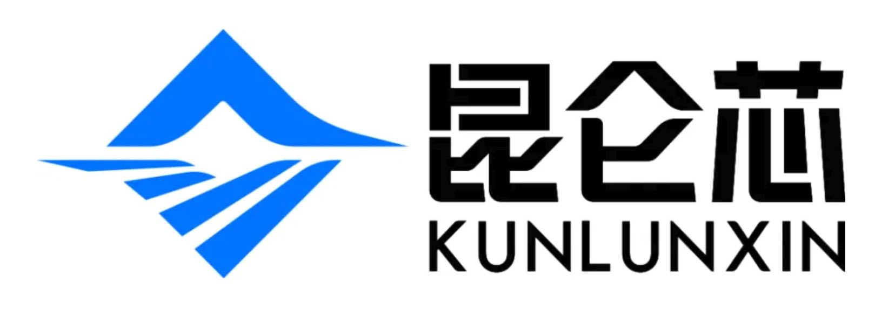

[简体中文](./README.md) · [All articles](../../README.en.md) · [Read on the website](https://www.theriseunion.com/en/blog/kunlunxin-compatibility.html)

# Rise VAST Platform Achieves Full Compatibility with Kunlunxin P800

RiseUnion · January 01, 2025 at 08:00 (UTC+08:00)

RiseUnion announces comprehensive compatibility between its heterogeneous compute resource platform Rise VAST and Kunlunxin P800 AI accelerators, enabling cross-architecture resource collaboration, flexible resource allocation, and efficient deployment of large language models for enterprise AI infrastructure.

RiseUnion (Beijing) Technology Co., Ltd. today announced that its heterogeneous compute resource pooling and unified orchestration platform **Rise VAST** has exclusively completed full compatibility verification and integration with **Kunlunxin P800**, with the corresponding code contributions made to the HAMi community ([Commit bf5b858](https://github.com/Project-HAMi/HAMi/commit/bf5b858a21e8f389e94fd369af3d4caa87195559)/[Commit 8a5a6f4](https://github.com/Project-HAMi/HAMi/commit/8a5a6f43a2ffad455191260eede751e95db8be58)) to support continued community development. This milestone represents a critical advancement in Rise VAST's domestic AI chip compatibility capabilities, offering enterprises enhanced options for building cost-effective, flexible, and vendor-agnostic AI infrastructure.

## Full-Stack Integration: Unlocking Domestic Chip Performance

As Kunlunxin Technology's flagship product, the Kunlunxin P800 delivers enterprise-grade performance with a mature ecosystem, specifically engineered for high-performance large language model training and inference workloads. A single 8-card P800 node can deploy the full DeepSeek R1 model, while a 32-node cluster enables complete full-parameter fine-tuning.

Rise VAST has achieved comprehensive integration with Kunlunxin P800 across the entire compute stack—from GPU virtualization and resource pooling to unified orchestration and model runtime environments. Enterprises can now seamlessly incorporate P800 accelerators into their infrastructure, dynamically allocating compute resources as dedicated, shared, or multi-instance workloads while enabling **cross-architecture resource orchestration and elastic scaling** across heterogeneous hardware.

## Advanced Model Orchestration: Streamlining LLM Deployment

**Rise VAST** combines its expertise in model optimization and inference engine management to deliver comprehensive support for leading open-source inference frameworks on the Kunlunxin P800 platform. By contributing integration code to the HAMi community, Rise VAST not only achieves technical breakthroughs but also drives broader ecosystem development. The platform currently supports major open-source LLMs including DeepSeek, Qwen, and Llama series, delivering superior migration performance and operational efficiency.

The platform delivers end-to-end model lifecycle management—from deployment and debugging to service publishing—enabling rapid transition from development to production. Through intelligent resource orchestration, Rise VAST optimizes heterogeneous compute allocation and dynamic scaling, dramatically improving deployment velocity and resource utilization.

**Rise VAST** continues expanding support for mainstream domestic accelerators, fostering ecosystem integration and accelerating enterprise adoption of domestic AI technologies.

## Vendor-Agnostic Infrastructure: Eliminating Compute Silos

China's AI infrastructure landscape faces persistent challenges including compute fragmentation, suboptimal resource utilization, and barriers to domestic accelerator adoption. **RiseUnion** maintains a **"vendor-neutral, open, and interoperable"** technical strategy, leveraging the Rise VAST platform to unify management across diverse AI accelerator architectures, enabling enterprises to eliminate vendor lock-in while building truly flexible, scalable, and cost-effective heterogeneous compute infrastructure.

By contributing Kunlunxin P800 integration code to the HAMi community, RiseUnion demonstrates its commitment to open collaboration and ecosystem development. This P800 support represents a critical milestone in Rise VAST's domestic accelerator roadmap, signaling the evolution toward practical, enterprise-scale integration of domestic chips and compute platforms.

> 🚀 **Get Started**: Reference the [HAMi Kunlunxin P800 Integration Guide](https://www.theriseunion.com/en/blog/hami-kunlunxin-p800-support.html) for rapid deployment and configuration.

Additionally, RiseUnion has established deep partnerships with major Chinese AI chip manufacturers including [Cambricon](https://www.theriseunion.com/en/blog/cambricon-compatibility.html), [Hygon DCU](https://www.theriseunion.com/en/blog/dcu-compatibility.html), [Iluvatar](https://www.theriseunion.com/en/blog/iluvatar-compatibility.html), [Moore Threads](https://www.theriseunion.com/en/blog/mthreads-compatibility.html), and [Metax](https://www.theriseunion.com/en/blog/metax-compatibility.html), collectively building the AI compute ecosystem and providing users with more diverse and stable compute resources. 

## About Kunlunxin Technology

Kunlunxin Technology is a leading provider of artificial intelligence chips. The company focuses on creating "faster, stronger, and more efficient" intelligent computing products, with deep technical expertise and full-stack competitive advantages in chip architecture, cluster systems, and software ecosystems. Originally established as Baidu's Intelligent Chip and Architecture Department in 2011, the company completed independent financing in 2021. Committed to its mission of "making computing more intelligent," Kunlunxin has achieved large-scale product deployment across various industries and pioneered the activation of a domestic chip cluster with 10,000 cards, injecting powerful momentum into China's AI industry development. Looking ahead, Kunlunxin will continue to focus on AI chip technology R&D and industrial applications, striving to become an epoch-making, globally leading intelligent computing company.

---

[Read this article on the RiseUnion website](https://www.theriseunion.com/en/blog/kunlunxin-compatibility.html) · [Explore more articles](https://www.theriseunion.com/en/blog.html)
