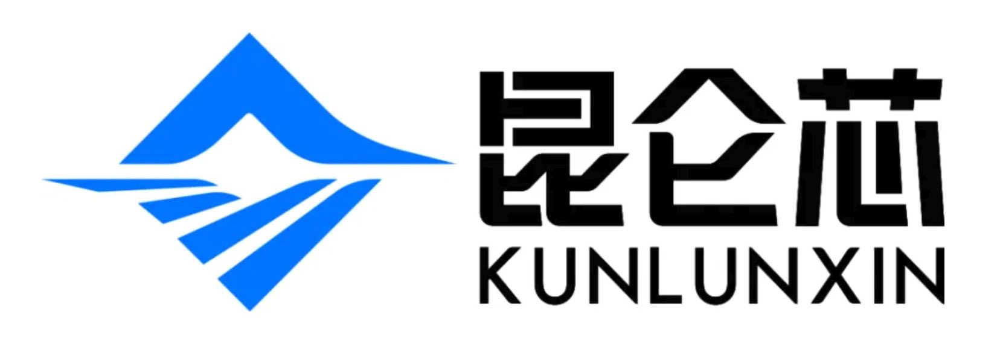

[English](./README.en.md) · [文章目录](../../README.md) · [官网阅读](https://www.theriseunion.com/zh/blog/kunlunxin-compatibility.html)

# 国产算力里程碑：异构算力平台 Rise VAST 率先完成对昆仑芯P800 的全面适配

睿思智联 · 2025/01/01 08:00（北京时间）

北京睿思智联科技有限公司（RiseUnion）正式宣布，其异构算力资源池化与统一调度平台 Rise VAST 已完成对 昆仑芯 P800 的全面适配和兼容性验证。这标志着 Rise VAST 在兼容国产 AI 芯片的能力上再次迈出关键一步，也为企业构建高性价比、灵活可控 ... 

近日，北京睿思智联科技有限公司（RiseUnion）正式宣布，其异构算力资源池化与统一调度平台 **Rise VAST** 已独家完成对 **昆仑芯 P800** 的全面适配和兼容性验证，并将相关代码贡献给 HAMi 社区([Commit bf5b858](https://github.com/Project-HAMi/HAMi/commit/bf5b858a21e8f389e94fd369af3d4caa87195559)/[Commit 8a5a6f4](https://github.com/Project-HAMi/HAMi/commit/8a5a6f43a2ffad455191260eede751e95db8be58))，以支持社区的进一步发展。这标志着 Rise VAST 在兼容国产 AI 芯片的能力上再次迈出关键一步，也为企业构建高性价比、灵活可控的 AI 基础设施提供了更多选择。

## 全面适配，释放国产芯片潜能

作为昆仑芯科技推出的最新一代产品，昆仑芯 P800 性能卓越、生态完备，面向大模型高性能AI训练与推理，P800 单机 8 卡即可部署 满血版 DeepSeek R1，32 台可实现模型的全参训练。

Rise VAST 针对昆仑芯 P800 特性，完成了从算力虚拟化、资源池化、统一调度，到模型运行环境的全链路适配。通过 Rise VAST，企业可将昆仑芯 P800 统一纳管，灵活划分为独享、共享或多实例AI算力资源，并与同类产品实现异构算力统一调度与智能分配，真正实现 **跨芯片架构的资源协同与弹性供给**。

## 深度融合，推动大模型高效部署

**Rise VAST** 结合自身在模型适配与推理引擎管理方面的能力，已支持多种主流开源推理框架在昆仑芯 P800 平台上的运行与优化。通过将适配代码贡献给 HAMi 社区，Rise VAST 不仅实现了技术突破，更为整个开源生态的繁荣发展做出了积极贡献。当前，Rise VAST 已适配包括 DeepSeek 系列、Qwen 系列、Llama 系列等在内的国内外主流开源大模型，具备良好的迁移性能与运行效率。

平台提供一站式的模型部署、调试与服务发布能力，帮助用户快速完成从环境构建到上线运行的全过程管理，并通过统一的调度策略，实现异构资源之间的高效编排与动态优化，显著提升模型部署效率与算力利用率。

**Rise VAST** 将持续扩大主流国产芯片的覆盖度，推动国产大模型生态的融合发展，加速国产 AI 技术的实用化与规模化落地。

## 打破壁垒，打造真正中立的算力底座

当前，国内 AI 基础设施建设面临"算力碎片化"、"资源利用率低"、"国产芯片落地难"等挑战。**睿思智联** 始终坚持 **"中立、开放、兼容"** 的技术路线，通过 Rise VAST 平台将不同品牌、不同架构的 AI 芯片纳入统一管理，助力企业摆脱厂商锁定，构建真正灵活可控、按需扩展的异构算力底座。通过将昆仑芯 P800 适配代码贡献给 HAMi 社区，睿思智联以实际行动践行了开放合作的技术理念。

此次支持昆仑芯 P800，是 Rise VAST 在国产化适配路径上的重要里程碑，也意味着国产芯片与国产算力平台的生态融合正迈向实用化、规模化的新阶段。

> 🚀 **快速开始**：参考 [HAMi 昆仑芯 P800 使用指南](https://www.theriseunion.com/zh/blog/hami-kunlunxin-p800-support.html)，快速上手昆仑芯 P800 的配置和部署。

此外，睿思智联已陆续与 [寒武纪](https://www.theriseunion.com/zh/blog/cambricon-compatibility.html)、[海光DCU](https://www.theriseunion.com/zh/blog/dcu-compatibility.html)、[天数智芯](https://www.theriseunion.com/zh/blog/iluvatar-compatibility.html) 、[摩尔线程](https://www.theriseunion.com/zh/blog/mthreads-compatibility.html)、[沐曦](https://www.theriseunion.com/zh/blog/metax-compatibility.html)等众多中国主流AI芯片厂商展开了深度合作，共同打造AI算力生态，为用户提供更丰富、更稳定的算力资源。

## 关于昆仑芯科技

昆仑芯科技是业界领先的人工智能芯片供应商。公司专注打造“更快、更强、更省”的智能计算产品，在芯片架构、集群系统、软件生态领域具备深厚技术积累和全栈竞争优势。公司前身是百度智能芯片及架构部，自2011年开始布局加速计算领域，并于2021年完成独立融资。 秉承“让计算更智能”的使命，公司已在千行百业实现产品大规模部署落地，并率先点亮国产芯片万卡集群，为中国人工智能产业发展注入澎湃动力。面向未来，昆仑芯将持续深耕AI芯片技术研发和产业应用，致力于成为划时代、全球领先的智能计算公司。

---

[在睿思智联官网阅读本文](https://www.theriseunion.com/zh/blog/kunlunxin-compatibility.html) · [浏览更多文章](https://www.theriseunion.com/zh/blog.html)
