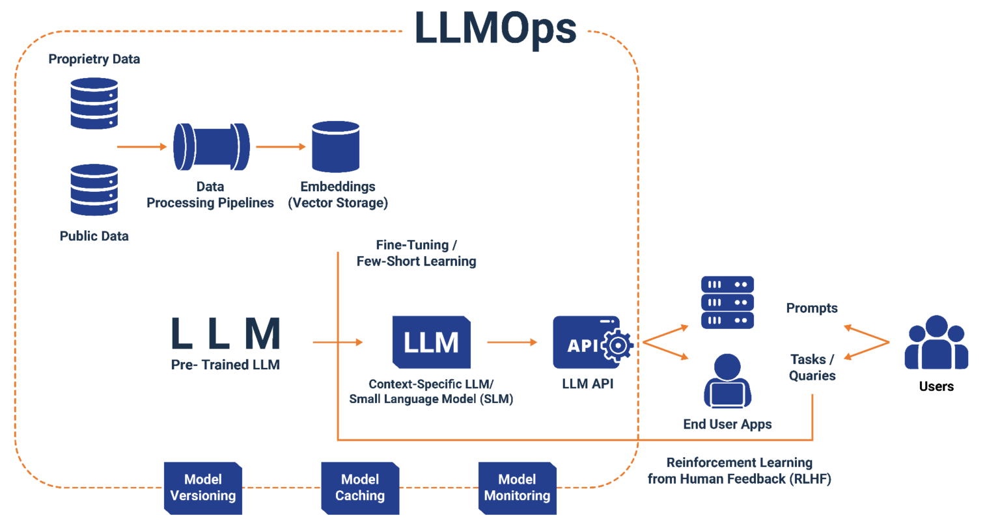

[简体中文](./README.md) · [All articles](../../README.en.md) · [Read on the website](https://www.theriseunion.com/en/blog/llmops-enterprise-local-deployment.html)

# LLMOps: The Critical Battlefield for Enterprise AI

RiseUnion · January 01, 2025 at 08:00 (UTC+08:00)

Deep dive into four major challenges of enterprise on-premises LLM deployment: security governance, observability, model management, and application integration.  RiseUnion's CAMP+VAST provides complete enterprise LLMOps solutions for future-ready AI infrastructure.

## Why LLMOps is the Critical Battlefield for Enterprise AI Adoption

As enterprises fully embrace the large language model era, one trend becomes increasingly clear: **on-premises deployment** will become one of the mainstream scenarios:

* High data security requirements prevent sensitive business/domain models from being deployed in the cloud;
* Existing compute infrastructure must be leveraged, including IDC, private clouds, and domestic GPU resources;
* Multi-model usage requires both open-source models and domestic solution compatibility.

In this context, "getting large models to run" is no longer the challenge—the real threshold is "managing, optimizing, and sustainably delivering" them.
This is precisely the responsibility of **LLMOps (Large Language Model Operations)**.

Just as DevOps made traditional software delivery more stable and efficient, **LLMOps is the infrastructure system that enables AI applications to move from demo to production.**

### Four Major LLMOps Challenges Enterprises Face in On-Premises Model Deployment

#### 1️⃣ Security: Governance is the Primary Imperative for Local Deployment

* On-premises deployment requires enterprises to build their own API access systems to control model access permissions and security isolation;
* Model API keys, access permissions, tenant isolation, and data auditing capabilities must be comprehensive;
* Models running on enterprise intranets require end-to-end control over call behaviors, compute usage, and interface exposure.

💡 Local models require enterprises to assume **"platform governance"** responsibilities, with security as the primary challenge.

#### 2️⃣ Observability: Models as Infrastructure Require Comprehensive Monitoring

* When model calls fail, enterprises must quickly identify whether the issue is insufficient compute resources, model crashes, or request anomalies;
* Comprehensive tracing/logging/evaluation systems must be built to diagnose and optimize model call efficiency issues;
* Key metrics such as model usage costs, call frequency, response latency, and failure rates must be continuously monitored.

💡 In on-premises deployment scenarios, the "one-click call" era has ended—every detail must be **"visible, traceable, adjustable, and controllable."**

#### 3️⃣ Model Management: Model Diversity Creates Combinatorial Explosion

* Enterprises often deploy multiple models simultaneously (such as DeepSeek, Qwen, Zhipu, Baichuan, and other vendors' models of different sizes);
* Adaptation to different inference engines (such as vLLM, SGLang, Mindie, KTransformer, etc.) is complex, with many compatibility issues between frameworks and models;
* Adaptation to different compute hardware (such as NVIDIA, Ascend, Hygon, Cambricon, etc.) exponentially increases scheduling complexity;
* Different model specifications, response times, and inference costs vary significantly, requiring unified model governance and scheduling systems.

💡 Relying on hardcoded routing logic and GPU/NPU binding is insufficient—model scheduling requires **"strategic, automated, and intelligent"** multi-dimensional governance.

#### 4️⃣ Application Integration: How Can Business Systems Use Large Models "Seamlessly"?

* Frequent model deployment changes should not require business systems to constantly refactor code logic;
* Model capabilities must be encapsulated into unified interfaces, providing SDKs/APIs for rapid integration across various services;
* Support for multi-language, multi-business scenario calls, compatible with HTTP/gRPC and other interface protocols;
* Support for MCP protocol to enable more intelligent model requests;

💡 The key to successful on-premises deployment is to make business systems **"unaware"** of model differences and changes, just like calling cloud services.

### Rise CAMP + VAST: Complete Enterprise LLMOps Solution

#### [Rise CAMP](https://www.theriseunion.com/en/product/camp.html)  Platform Focuses on Application Layer Governance:
- Provides unified model service governance capabilities;
- Implements multi-model, multi-tenant security isolation;
- Supports strategic intelligent scheduling and routing;
- Simplifies AI capability integration for business systems.

#### [Rise VAST](https://www.theriseunion.com/en/product/vast.html)  Platform Focuses on Infrastructure Layer:
- Implements unified management of heterogeneous GPU resources;
- Provides hardware-level security isolation guarantees;
- Supports compatibility with multi-vendor compute platforms;
- Optimizes GPU resource utilization and inference performance.

#### Synergistic Platform Effects

1. **Security Capability Stacking**: Application-layer key isolation + Hardware-layer physical isolation = Comprehensive security protection;
2. **Performance Optimization Synergy**: Model-level scheduling strategies + GPU-level resource scheduling = End-to-end performance optimization;
3. **Operational Efficiency Enhancement**: Unified management interface + Automated scheduling = Significantly reduced operational complexity.

#### Enterprise Value Realization

##### Short-term Value:
- Reduces AI project delivery risks and ensures security compliance;
- Improves model operational efficiency and reduces resource waste;
- Simplifies operations and reduces labor costs.

##### Long-term Value:
- Builds sustainable AI infrastructure capabilities;
- Supports scalable deployment and evolution of AI applications;
- Provides technical foundation for enterprise AI strategy.

### Future Outlook: Evolution of Enterprise AI Infrastructure

#### Inevitable Evolution of Enterprise AI Infrastructure

1. **From "Good Enough" to "Production-Ready"**: Enterprises need to build complete AI operational systems to ensure SLA and business continuity for model services;
2. **From "Single-Point Deployment" to "Scale Operations"**: As AI applications proliferate, enterprises need to manage hundreds or thousands of model instances and GPU resources;
3. **From "Technology-Driven" to "Business Value-Driven"**: AI infrastructure must directly support business objectives, achieving quantifiable and optimizable ROI.

#### Rise CAMP + VAST: Future-Oriented Enterprise Solution

Rise CAMP + VAST not only addresses current on-premises deployment challenges but also builds future-oriented AI infrastructure capabilities for enterprises:

1. **Forward-Looking Technical Architecture**: Supports mainstream and emerging inference engines and compute platforms, ensuring long-term technology stack compatibility;
2. **Business Scenario Adaptability**: From single model services to complex AI application orchestration, meeting the evolving needs of enterprise AI strategies;
3. **Scalable Operational Capabilities**: From single clusters to multi-region, multi-cloud environments, supporting the scale expansion of enterprise AI infrastructure;
* **Open Ecosystem Integration**: Deep integration with mainstream AI frameworks and toolchains, reducing maintenance costs for enterprise AI technology stacks.

[Rise CAMP](https://www.theriseunion.com/en/product/camp.html)  + [Rise VAST](https://www.theriseunion.com/en/product/vast.html) provides trusted operational environments and management capabilities for LLM deployment, building future-oriented AI infrastructure for enterprises and enabling them to truly master the initiative in the AI era. In this new era where AI infrastructure determines enterprise AI competitiveness, Rise CAMP + VAST will become the core foundation for enterprise AI strategy implementation.

---

[Read this article on the RiseUnion website](https://www.theriseunion.com/en/blog/llmops-enterprise-local-deployment.html) · [Explore more articles](https://www.theriseunion.com/en/blog.html)
