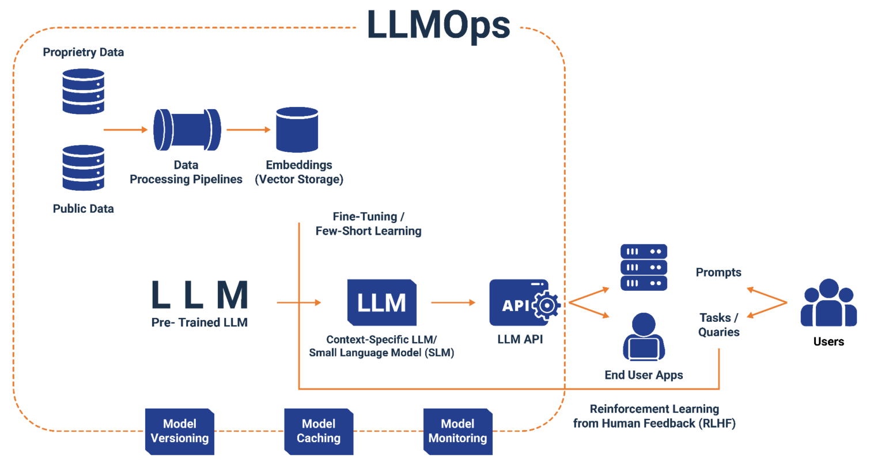

[English](./README.en.md) · [文章目录](../../README.md) · [官网阅读](https://www.theriseunion.com/zh/blog/llmops-enterprise-local-deployment.html)

# LLMOps：企业 AI 落地的关键战场

睿思智联 · 2025/07/18 08:00（北京时间）

深度解析企业本地化大模型部署的四大挑战：安全治理、可观测性、模型管理、应用集成。睿思智联的CAMP+VAST提供完整的企业级LLMOps解决方案，助力企业构建面向未来的AI基础设施，掌握AI时代主动权。

## 为什么 LLMOps 是企业 AI 落地的关键战场？

当企业全面拥抱大模型时代，一条趋势愈发清晰：**本地化部署**将成为主流场景之一：

* 数据安全要求高，敏感业务/领域模型不能上云；
* 算力已建，必须盘活 IDC、私有云、国产 GPU 等资源；
* 多模型混用，既要用开源模型，也要适配国产方案。

在这种背景下，“大模型能跑起来”变得不再困难，而“能管好、调优、可持续交付”才是门槛。
这正是 LLMOps（大模型运维管理） 的职责所在。

正如 DevOps 让传统软件交付更稳定、更高效，**LLMOps 是让 AI 应用从 Demo 走向生产的基础设施体系。**

## 企业在本地化部署大模型时面临的四大 LLMOps 挑战

### 1️⃣ Security：安全治理是本地部署的首要命题

* 本地化部署，企业需要自建 API 接入体系，以控制大模型的访问权限和安全隔离；
* 模型 API 密钥、调用权限、租户隔离、数据审计等安全控制能力必须完善；
* 模型运行在企业内网，需要确保调用行为、算力使用、接口暴露全链条可控。

💡 本地模型需要企业承担**“平台治理”**职责，安全是首要挑战。

### 2️⃣ Observability：模型变成“基础设施”后必须具备可观测性

* 模型调用失败，企业必须尽快定位是算力资源不足、模型崩溃，还是请求异常等；
* 要构建完善 tracing / logging / 评估体系，以定位和优化模型调用效率问题；
* 要对模型使用成本、调用频率、响应延迟、失败率等关键指标进行持续监控。

💡 本地化部署下，“一键调用”时代已结束，每个细节都要**“可见、可查、可调、可控”**。

### 3️⃣ Model Management：模型多样化带来组合爆炸问题

* 企业常常会同时部署多个模型（如 DeepSeek、Qwen、智谱、百川等不同厂商的不同尺寸的模型）；
* 既需要适配不同推理引擎（如 vLLM、SGLang、Mindie、KTransformer等），不同框架和不同模型的适配复杂，兼容性问题很多；
* 也需要适配不同算力硬件（如 NVIDIA、昇腾、海光、寒武纪等），调度难度指数级上升；
* 不同模型规格、响应时间、推理成本差异大，必须建立统一的模型治理与调度体系。

💡 不能靠写死路由逻辑、硬绑 GPU/NPU等，模型调度需要**“策略化、自动化、智能化”**等多维度治理。

### 4️⃣ Application Integration：业务系统如何“无感知地”使用大模型？

* 模型部署频繁变动，业务系统不应频繁重构代码逻辑；
* 需要将模型能力封装成统一接口，提供 SDK/API 供各类服务快速集成；
* 支持多语言、多业务场景调用，兼容 HTTP/gRPC 等多种接口协议；
* 支持 MCP 协议，以更加智能化的方式请求模型；

💡 本地化部署成功的关键，是要像调用云服务一样，让业务系统**“无感知”**模型差异和变化。

## Rise CAMP + VAST：企业级 LLMOps 的完整解决方案

### [Rise CAMP](https://www.theriseunion.com/zh/product/camp.html) 平台专注于应用层治理：
- 提供统一的模型服务治理能力；
- 实现多模型、多租户的安全隔离；
- 支持策略化的智能调度和路由；
- 简化业务系统的 AI 能力集成。

### [Rise VAST](https://www.theriseunion.com/zh/product/vast.html) 平台专注于基础设施层：
- 实现异构 GPU 资源的统一管理；
- 提供硬件级别的安全隔离保障；
- 支持多厂商算力平台的兼容适配；
- 优化 GPU 资源利用率和推理性能。

### 平台协同的倍增效应

1. 安全能力叠加：应用层密钥隔离 + 硬件层物理隔离 = 全方位安全防护；
2. 性能优化协同：模型级调度策略 + GPU 级资源调度 = 全链路性能优化；
3. 运维效率提升：统一管理界面 + 自动化调度 = 运维复杂度大幅降低。

### 企业价值实现

#### 短期价值：
- 降低 AI 项目交付风险，确保安全合规；
- 提升模型运行效率，减少资源浪费；
- 简化运维工作，降低人力成本。

#### 长期价值：
- 构建可持续的 AI 基础设施能力；
- 支持 AI 应用的规模化部署和演进；
- 为企业 AI 战略提供技术保障。

## 未来展望：企业 AI 基础设施的演进方向

### 企业 AI 基础设施的必然演进

1. **从"能用就行"到"生产就绪"**：企业需要构建完整的 AI 运维体系，确保模型服务的 SLA 和业务连续性；
2. **从"单点部署"到"规模化运营"**：随着 AI 应用普及，企业需要管理成百上千的模型实例和 GPU 资源；
3. **从"技术导向"到"业务价值导向"**：AI 基础设施必须直接支撑业务目标，实现 ROI 可量化、可优化。

### Rise CAMP + VAST：面向未来的企业级解决方案

[Rise CAMP](https://www.theriseunion.com/zh/product/camp.html)  + [Rise VAST](https://www.theriseunion.com/zh/product/vast.html) 不仅解决了当前的本地化部署挑战，更为企业构建了面向未来的 AI 基础设施能力：

1. **技术架构前瞻性**：支持主流和新兴的推理引擎、算力平台，确保技术栈的长期兼容性；
2. **业务场景适应性**：从单模型服务到复杂 AI 应用编排，满足企业 AI 战略的演进需求；
3. **运维能力可扩展性**：从单集群到多地域、多云环境，支持企业 AI 基础设施的规模化扩展；
4. **生态集成开放性**：与主流 AI 框架、工具链深度集成，降低企业 AI 技术栈的维护成本。

Rise CAMP + VAST 为 LLM 大模型落地提供可信的运行环境与运营能力，为企业构建了面向未来的 AI 基础设施，让企业真正掌握 AI 时代的主动权。在这个 AI 基础设施决定企业 AI 竞争力的新时代，Rise CAMP + VAST 将成为企业 AI 战略落地的核心支撑。

---

[在睿思智联官网阅读本文](https://www.theriseunion.com/zh/blog/llmops-enterprise-local-deployment.html) · [浏览更多文章](https://www.theriseunion.com/zh/blog.html)
