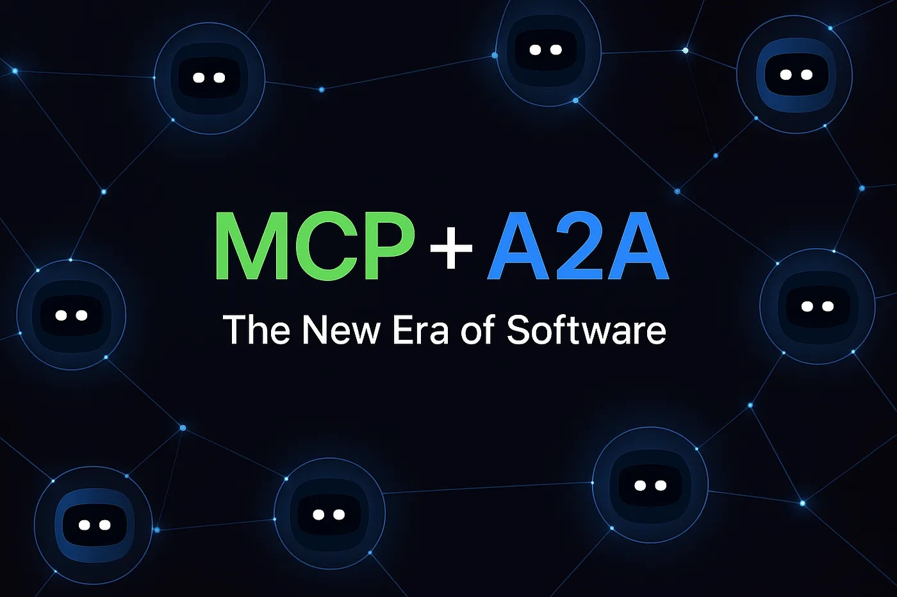
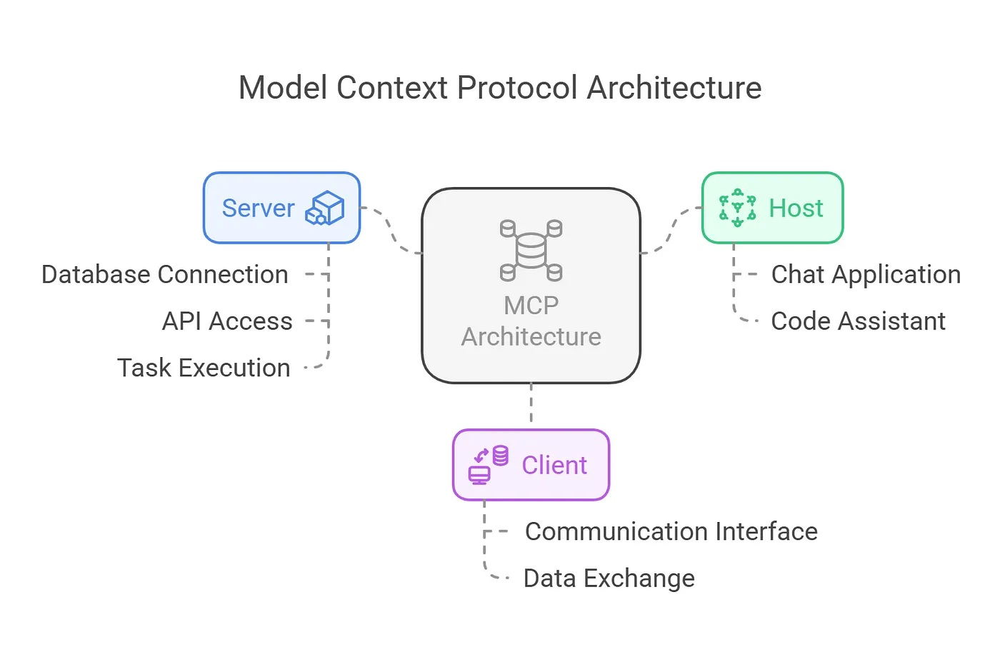
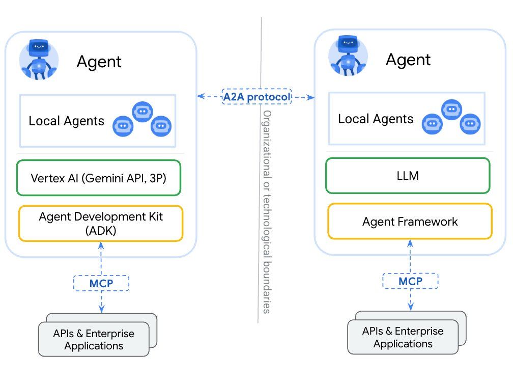

[简体中文](./README.md) · [All articles](../../README.en.md) · [Read on the website](https://www.theriseunion.com/en/blog/mcp-vs-a2a.html)

# A2A vs MCP: Core Protocols Enabling AI Team Collaboration

RiseUnion · January 01, 2025 at 08:00 (UTC+08:00)

In-depth analysis of A2A and MCP protocols powering multi-agent AI collaboration. Learn how these protocols enable AI team cooperation, tool integration, and practical applications in enterprise automation and customer service.

In today's rapidly evolving AI landscape, we're moving beyond evaluating individual AI capabilities to explore a more compelling question: **Can multiple AI agents collaborate like human teams to tackle complex tasks?**

As we transition from isolated AI "islands" to interconnected systems, two groundbreaking protocols - **A2A (Agent-to-Agent)** and **MCP (Machine-Centric Protocol)** - are paving the way for collective AI intelligence.

This article explores these transformative protocols and demonstrates their practical applications through real-world scenarios.

---

## What is MCP? - The "Operating Manual" for AI

**MCP (Machine-Centric Protocol)** serves as a standardized **tool invocation specification** for AI agents. It defines:

- Available services and tools (databases, APIs, third-party services)
- Invocation methods, parameter requirements, and I/O formats
- Task execution workflows and capability boundaries

The core purpose of MCP is to **enable AI agents to interact with external systems independently, similar to how humans operate software.**

### Example Scenario:

Consider an AI tasked with generating daily reports that must:
- Extract sales data from databases
- Generate visualizations using charting APIs
- Distribute reports to management via email systems

With MCP specifications, the AI can:
- Understand how to invoke the "Sales Data API"
- Format data correctly for the visualization service
- Orchestrate the sequence of operations autonomously

MCP's value lies in **standardizing the "operational language" between AI and systems**, reducing custom development overhead and enabling AI agents to expand their capabilities efficiently.

---

## What is A2A? - The Collaboration Protocol for AI

**A2A (Agent-to-Agent Protocol)** establishes the framework for **communication and collaboration between AI agents**.

While traditional AI systems operated in isolation, modern use cases often require multiple agents working in concert. A2A addresses key collaboration challenges:

- Agent discovery mechanisms
- Request initiation, context sharing, and progress synchronization
- Task allocation, result reporting, and error handling

### Example Scenario:

Consider this voice command: "Book a flight to San Francisco next week and submit it for company reimbursement."

This request engages multiple AI agents:

1. **Voice Assistant AI** for semantic understanding and task distribution
2. **Flight Search AI** for travel options
3. **Booking AI** for payment processing and ticketing
4. **Expense Management AI** for corporate reimbursement submission

Through the **A2A protocol**, these agents initiate interactions, share context, and ensure seamless task handoffs. Even when developed by different platforms or organizations, agents can collaborate effectively by adhering to the A2A protocol.

## A2A vs MCP: Distinctions and Synergies

| Protocol | Problem Solved | Analogous Role | Application Domain |
|----------|---------------|----------------|-------------------|
| **MCP** | How AI operates external tools | "Operating Manual" | AI-to-System/API Interactions |
| **A2A** | How AI agents collaborate | "Team Collaboration Rules" | AI-to-AI Communications |

These protocols complement each other:

- **MCP enables tool proficiency** - equipping AI with operational capabilities
- **A2A enables collaboration** - facilitating team-based task completion

In a comprehensive multi-agent system, MCP defines individual capabilities while A2A establishes team communication frameworks. Both are essential for autonomous AI collaboration.

---

## Why This Matters

While current large language models like GPT-4 and Claude demonstrate impressive comprehension and generation capabilities, they primarily operate as standalone entities. The evolution toward **Multi-Agent Intelligence** requires solving fundamental challenges in collaboration, communication, and system integration.

A2A and MCP represent foundational steps toward building an AI ecosystem "operating system" by:

- Enhancing agent reusability and interoperability
- Reducing cross-platform integration complexity
- Driving AI evolution from isolated tools to collaborative entities

These advances extend beyond virtual assistants to impact enterprise automation, intelligent customer service, robotic teams, and smart city initiatives.

## Conclusion

Just as human society thrives on collaboration, the AI ecosystem requires robust cooperation mechanisms to achieve higher intelligence. A2A and MCP are laying this foundation.

As we progress toward a future where multiple AI agents collaborate as efficiently as organizational departments, remember: it's these standardized protocols working behind the scenes that make it all possible.

---

[Read this article on the RiseUnion website](https://www.theriseunion.com/en/blog/mcp-vs-a2a.html) · [Explore more articles](https://www.theriseunion.com/en/blog.html)
