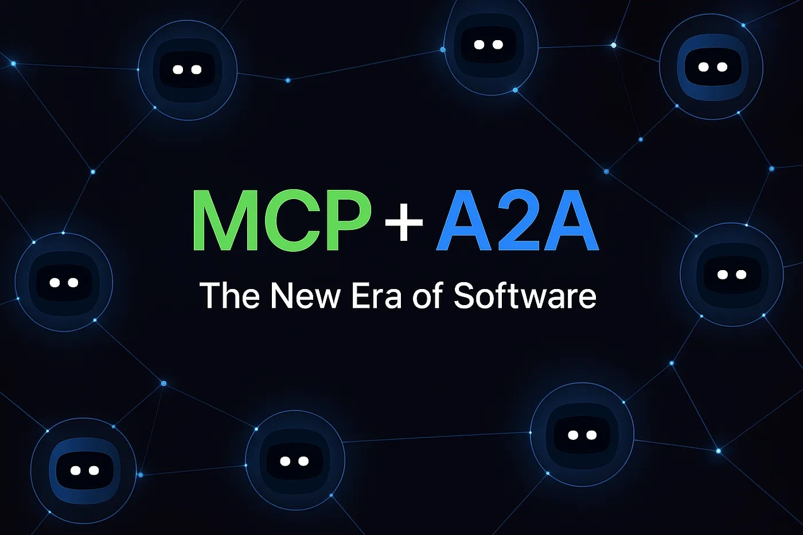
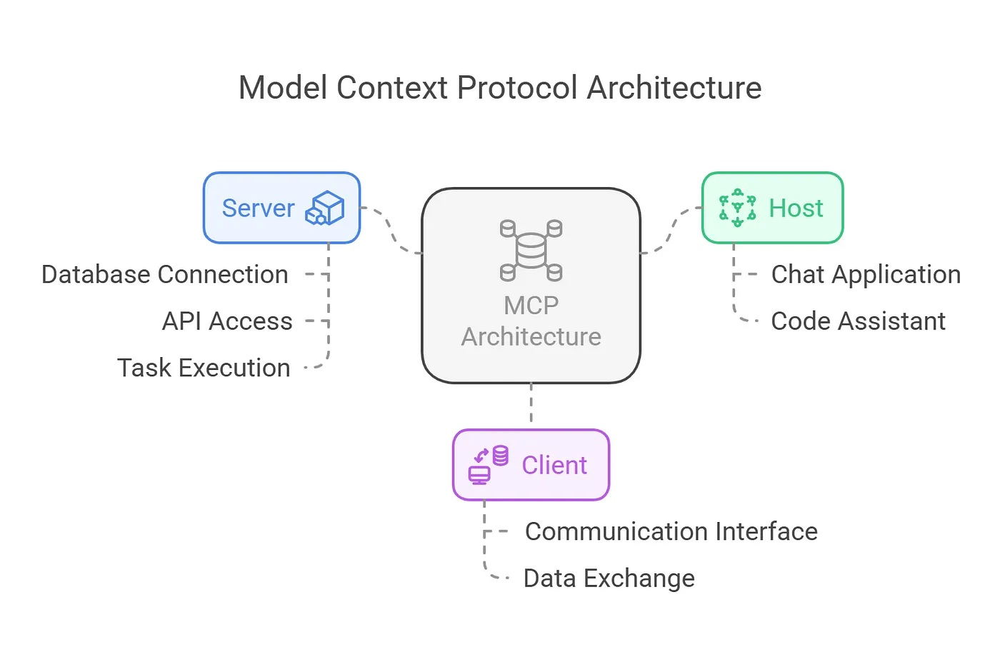
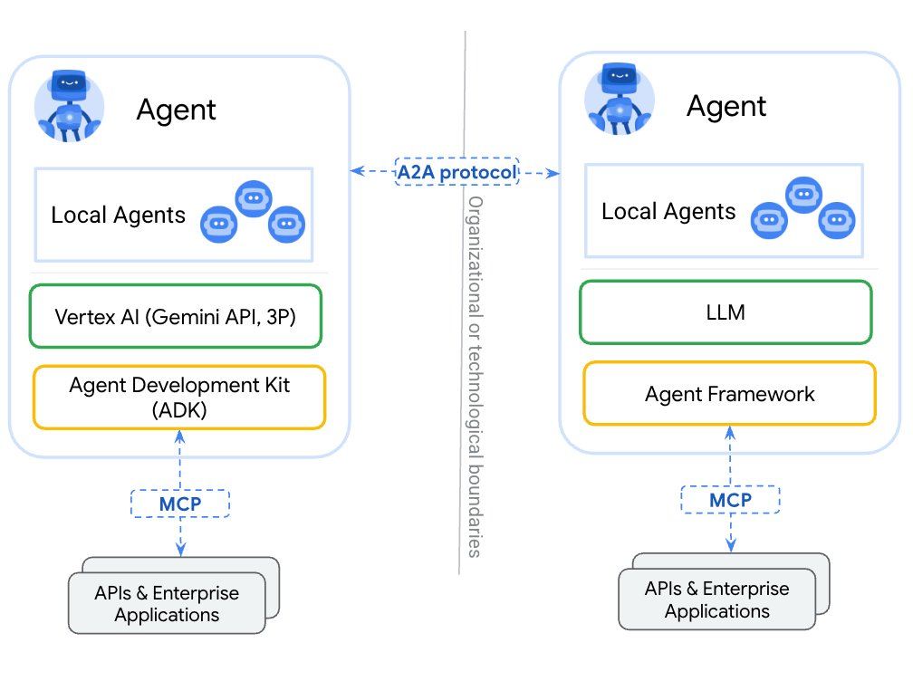

[English](./README.en.md) · [文章目录](../../README.md) · [官网阅读](https://www.theriseunion.com/zh/blog/mcp-vs-a2a.html)

# A2A vs MCP：AI协作新纪元的两大核心协议详解

睿思智联 · 2025/04/11 08:00（北京时间）

深入解析AI多智能体协作的两大关键协议：A2A与MCP。探讨它们如何实现AI间的团队协作、工具调用，以及在企业自动化、智能客服等场景的实际应用，助力打造更智能的AI生态系统。

在人工智能快速演进的今天，我们不再仅仅关注单个 AI 的智能水平，而开始思考：**多个 AI 能否像团队一样协作，共同完成更复杂的任务？**

如果说过去的 AI 是一个个“孤岛”，那么现在，随着 **A2A 协议** 和 **MCP 协议** 的提出，我们正逐步迈入“AI 群体智能”时代。

本文将介绍这两个正在重塑智能体协作方式的关键协议，并通过一些实际场景帮助读者更好地理解它们的意义与区别。

---

## 什么是 MCP？- AI 的“操作说明书”

**MCP（Machine-Centric Protocol）** 是为 AI 智能体提供的**工具调用规范**。简单来说，它定义了：

- AI 可以访问哪些服务或工具（比如数据库、接口、第三方 API）；
- 每个服务的调用方式、参数要求、输入输出格式；
- 如何描述一个任务的执行流程与能力边界。

MCP 的核心作用是：**让 AI 能够像人类操作软件一样，独立调用外部系统资源，完成具体任务。**

### 示例场景：

假设某 AI 负责生成日报，并需要从数据库中提取销售数据、调用图表接口生成可视化图表、再通过邮件系统发送至管理层。  

如果它事先拥有对应系统的 MCP 描述，就可以：
- 明确“销售数据 API”的调用方式；
- 知道“图表服务”需要传入的数据格式；
- 自动组织调用顺序，实现完整闭环。

MCP 的价值在于**标准化了 AI 与系统之间的“操作语言”**，减少定制开发与重复对接成本，使 AI 能更容易扩展自己的“技能树”。

---

## 什么是 A2A？- AI 间的“协作协议”

**A2A（Agent-to-Agent Protocol）**，顾名思义，是定义**AI 智能体之间如何沟通与协作**的一套协议。

过去，AI 更像“单人作战”的专家系统。而在越来越多的真实场景中，一个任务往往需要多个智能体协同完成。A2A 协议正是为了解决这些协作问题而生：

- 如何发现其他可用的智能体；
- 如何发起请求、共享上下文、同步进度；
- 如何协商分工、反馈结果，甚至容错与中断处理。

### 示例场景：

假设你对语音助手说：“帮我订一张下周的去广州的机票，并提交公司报销”。

这个任务实际上涉及多个 AI 智能体：

1. **语音助手 AI** 负责语义理解和任务分发；
2. **航班搜索 AI** 提供航班选项；
3. **票务预订 AI** 完成支付与出票；
4. **报销流程 AI** 向企业系统提交申请单据。

在这个过程中，AI 之间通过 **A2A 协议** 发起交互请求，传递上下文，确保每一个子任务能顺利衔接。哪怕这些智能体由不同平台或企业开发，只要遵循相同的 A2A 协议，就能实现互通协作。

## A2A 与 MCP 的区别与协同

| 协议 | 解决的问题 | 类比角色 | 应用对象 |
|------|------------|----------|----------|
| **MCP** | AI 如何操作外部工具 | “操作说明书” | AI 与系统/API 的交互 |
| **A2A** | AI 如何与其他 AI 协作 | “团队协作规则” | AI 与 AI 的通信 |

两者并不冲突，而是相辅相成：

- **MCP 让 AI 能做事**，掌握工具使用能力；
- **A2A 让 AI 会协作**，具备组队完成任务的能力。

在一个完整的“多智能体系统”中，MCP 描述每个成员的能力边界，A2A 定义团队间的沟通机制。只有两者结合，AI 才真正具备独立协作的能力。

---

## 为什么这很重要？

当前的大模型如 GPT-4、Claude 等，尽管具备强大的理解与生成能力，但大多数仍是“单体智能”。要迈向 **多智能体智能体系（Multi-Agent Intelligence）**，就必须解决协作、通信、调用等底层问题。

A2A 和 MCP 的出现，是构建 AI 生态“操作系统”的第一步：

- 提升智能体的复用性和互操作性；
- 降低跨平台集成门槛；
- 推动 AI 从“工具”向“协作体”演进。

这不仅适用于虚拟助手，还将在企业自动化、智能客服、机器人团队、甚至智能城市等多个领域发挥关键作用。

## 结语

人类社会因协作而高效，同样，AI 世界也需要协作机制才能迈向更高智能。A2A 与 MCP 正在为这一目标奠定基础。

未来，当我们习以为常地看到多个 AI 像“部门”一样高效协作时，不妨记得：这背后，是一整套标准化协议在默默支撑。

---

[在睿思智联官网阅读本文](https://www.theriseunion.com/zh/blog/mcp-vs-a2a.html) · [浏览更多文章](https://www.theriseunion.com/zh/blog.html)
