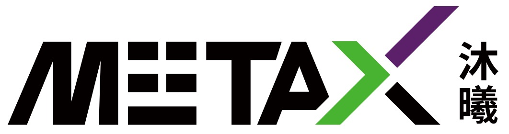
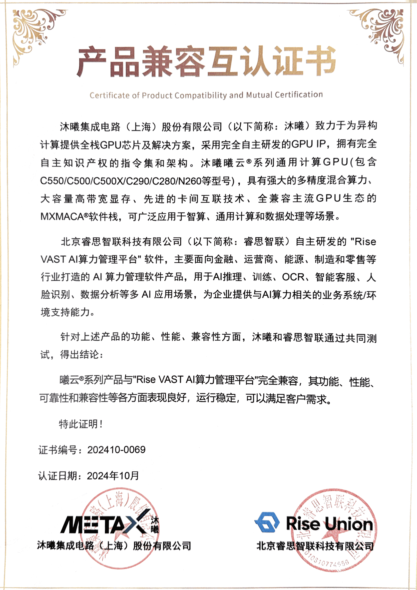

[简体中文](./README.md) · [All articles](../../README.en.md) · [Read on the website](https://www.theriseunion.com/en/blog/metax-compatibility.html)

# Rise VAST Completes Compatibility Certification with Metax GPU

RiseUnion · January 01, 2025 at 08:00 (UTC+08:00)

RiseUnion's Rise VAST platform achieves compatibility certification with Metax GPU, enabling efficient management of domestic GPUs through resource pooling and intelligent scheduling, reducing computing TCO and accelerating AI deployment.

Abstract: Rise VAST platform successfully achieves deep compatibility with MetaX GPU products, marking a significant breakthrough in China's domestic AI chip ecosystem. Through Rise VAST's intelligent scheduling, enterprises can utilize domestic GPU resources more efficiently and accelerate AI application deployment.

**Beijing RiseUnion Technology Co., Ltd.** has successfully completed compatibility certification with **MetaX Integrated Circuits (Shanghai) Co., Ltd.** The Rise VAST AI compute management platform now supports MetaX general-purpose compute GPU products, providing users with more powerful and versatile AI compute resource management and scheduling solutions.

## Strategic Partnership Driving AI Compute Innovation

### About RiseUnion

As a leading AI compute management platform developer, RiseUnion specializes in providing integrated AI compute pooling and orchestration solutions, serving multiple industries including finance, telecommunications, and energy.

Through collaboration with MetaX, the Rise VAST platform achieves deep integration with MetaX GPU series, delivering more efficient and flexible AI compute management experiences for customers, enabling optimal resource utilization, reduced TCO, and enhanced business innovation capabilities.

### About MetaX Integrated Circuits

MetaX is committed to providing full-stack GPU chips and solutions for heterogeneous computing, featuring completely self-developed GPU IP with proprietary instruction sets and architecture. The MetaX general-purpose compute GPU series (including MetaX C-Series models C550/C500/C500X/C290/C280 and MetaX N-Series N260) delivers powerful mixed-precision computing performance, high-capacity high-bandwidth memory, advanced inter-card interconnect technology, and the fully compatible MXMACA® software stack with mainstream GPU ecosystems, enabling broad applications in intelligent computing, general-purpose computing, and data processing scenarios.

## Empowering Enterprise Innovation Across Industries

Through this compatibility certification, the Rise VAST platform, enhanced by MetaX hardware, delivers the following core capabilities and advantages:

### Resource Pooling and Unified Management
- Enables datacenter-scale GPU compute resource centralized pooling and unified orchestration, including heterogeneous support for both domestic and international accelerators
- Supports multi-vendor compute resources, eliminating single-vendor lock-in and enabling flexible hardware deployment strategies

### On-Demand Scheduling and Intelligent Allocation
- Provides flexible resource orchestration capabilities with dynamic GPU compute allocation based on workload requirements
- Features multi-dimensional workload management and quota management mechanisms, supporting task prioritization and flexible compute resource allocation

### Streamlined Operations Management
- Supports intelligent operations management including device monitoring, log management, and alerting to ensure continuous high-performance system operation
- Provides standardized, visual management interfaces optimizing operational efficiency

## Compatibility Certification Results

Through comprehensive testing of MetaX products across functionality, performance, and compatibility dimensions, MetaX and RiseUnion jointly conclude:

**MetaX products are fully compatible with the "Rise VAST AI Compute Management Platform," demonstrating excellent performance across functionality, performance, reliability, and compatibility aspects, with stable operation that meets customer requirements.**

## Building China's Autonomous AI Compute Ecosystem

This successful compatibility certification marks the collaborative efforts of RiseUnion and MetaX in advancing domestic AI compute development, further establishing a new ecosystem for coordinated development of domestic AI hardware and software.

Moving forward, both parties will continue deepening collaboration to provide superior compute resource management solutions for customers, accelerating intelligent transformation across industries and safeguarding innovative applications of domestic AI compute capabilities.

Additionally, RiseUnion has established deep partnerships with major Chinese AI chip manufacturers including [Cambricon](https://www.theriseunion.com/en/blog/cambricon-compatibility.html), [Hygon DCU](https://www.theriseunion.com/en/blog/dcu-compatibility.html), [Iluvatar](https://www.theriseunion.com/en/blog/iluvatar-compatibility.html), [Moore Threads](https://www.theriseunion.com/en/blog/mthreads-compatibility.html), and [Kunlunxin](https://www.theriseunion.com/en/blog/kunlunxin-compatibility.html), collectively building the AI compute ecosystem and providing users with more diverse and stable compute resources.

---

[Read this article on the RiseUnion website](https://www.theriseunion.com/en/blog/metax-compatibility.html) · [Explore more articles](https://www.theriseunion.com/en/blog.html)
