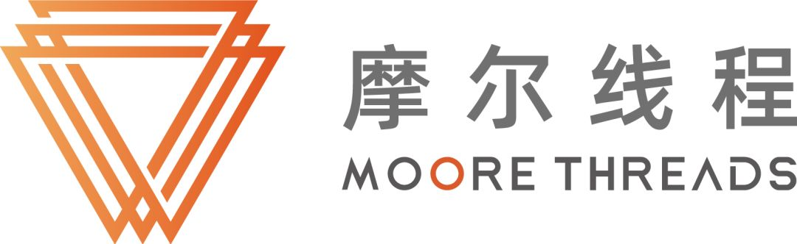
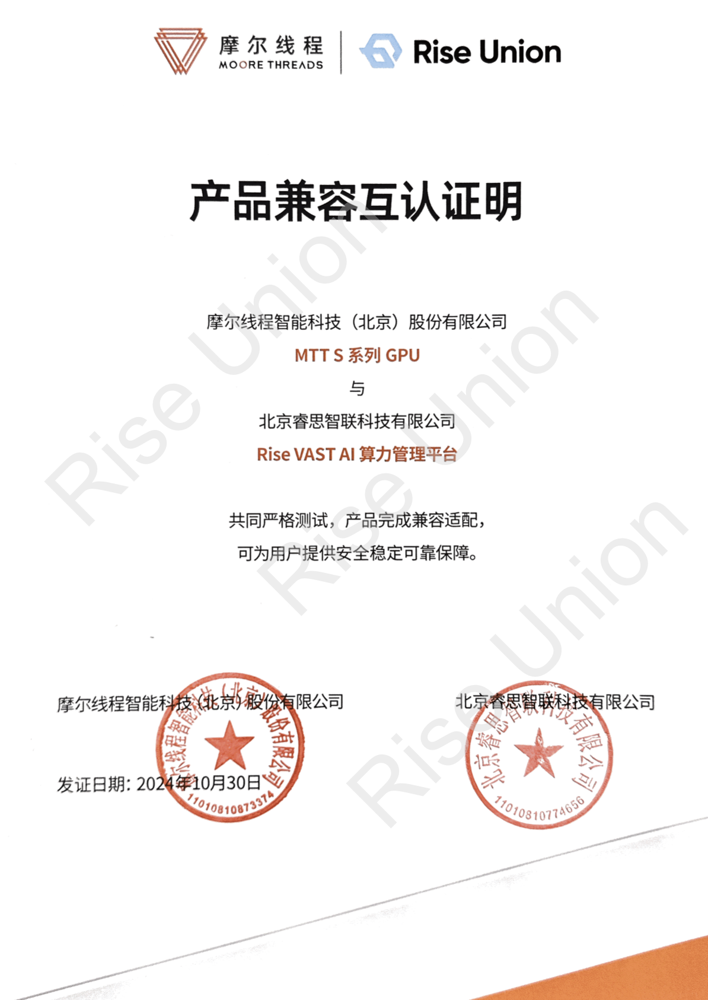

[简体中文](./README.md) · [All articles](../../README.en.md) · [Read on the website](https://www.theriseunion.com/en/blog/mthreads-compatibility.html)

# Rise VAST Completes Compatibility Certification with Mthreads GPU

RiseUnion · January 01, 2025 at 08:00 (UTC+08:00)

RiseUnion's Rise VAST platform achieves compatibility certification with Mthreads GPU, enabling efficient management of domestic GPUs through resource pooling and intelligent scheduling, reducing computing TCO and accelerating AI deployment.

Rise Computing Technology (Beijing) Co., Ltd. and Moore Threads Technology (Beijing) Co., Ltd. have successfully completed compatibility certification. Rise VAST AI Computing Platform now fully supports Moore Threads MTT S Series GPUs, marking a significant milestone in the integration of domestic AI hardware and software infrastructure. This collaboration enhances AI computing resource management and scheduling efficiency, delivering more stable and efficient computing services while fostering the growth of the domestic AI ecosystem.

## **Strategic Partnership for Advanced AI Computing Infrastructure**

### **About RiseUnion **
As a leader in AI computing management, Rise Computing specializes in integrated AI resource pooling and intelligent scheduling solutions. The company serves high-performance computing-intensive sectors including finance, telecommunications, and energy. Through compatibility with Moore Threads MTT S Series GPUs, Rise VAST optimizes resource scheduling efficiency in heterogeneous computing environments, maximizing GPU utilization, reducing Total Cost of Ownership (TCO), and accelerating AI innovation while advancing the domestic AI computing ecosystem.

### **About Moore Threads**
Founded in October 2020, Moore Threads focuses on general-purpose GPU technology, providing global accelerated computing infrastructure and end-to-end solutions. The company empowers digital transformation across industries with robust AI computing support. Moore Threads aims to become a globally competitive GPU leader, developing advanced acceleration platforms for AI and digital twin applications in the intelligent digital world, with a vision to accelerate progress for a better future.

## **Technical Synergy Driving AI Innovation**

The successful compatibility certification enables deep integration between Rise VAST platform and Moore Threads GPUs, providing enterprises with more efficient and flexible AI computing resource management capabilities to accelerate industry AI deployment.

### Resource Pooling and Unified Management
  - Unified pooling and scheduling of multi-vendor, multi-type GPU devices in data centers, enabling flexible coordination between domestic and international computing resources
  - Vendor-agnostic hardware deployment strategies for optimized computing resource configuration

### Dynamic Scheduling and Intelligent Allocation
  - Dynamic computing resource scheduling with on-demand GPU allocation for efficient large-scale AI workload execution
  - Multi-dimensional workload management and resource quota mechanisms supporting priority-based scheduling for improved resource utilization

### Intelligent Operations and Enhanced System Stability
  - Real-time GPU device monitoring, log management, and intelligent alerting capabilities ensuring long-term system stability
  - Intuitive visualization interface simplifying operations and improving management efficiency

## **Collaborative Innovation in AI Computing**

This partnership represents not only a crucial milestone in domestic AI hardware-software integration but also a powerful demonstration of AI ecosystem convergence and advancement. Rise Computing and Moore Threads will continue to deepen their technical collaboration, driving independent innovation and ecosystem development in the domestic AI computing industry. Together, they aim to provide robust support for digital transformation across industries while building a stronger domestic AI computing infrastructure.

---

[Read this article on the RiseUnion website](https://www.theriseunion.com/en/blog/mthreads-compatibility.html) · [Explore more articles](https://www.theriseunion.com/en/blog.html)
