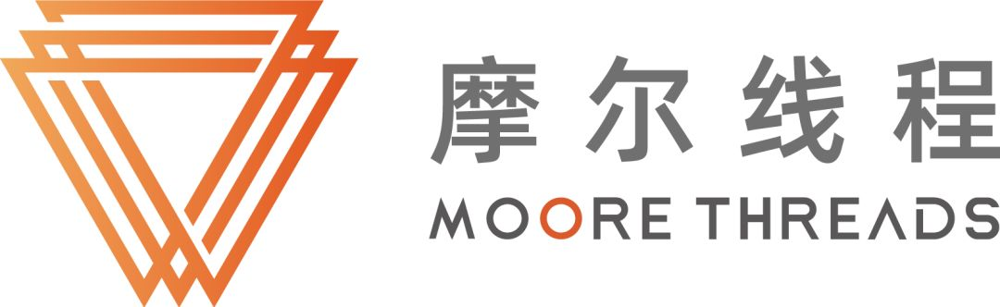
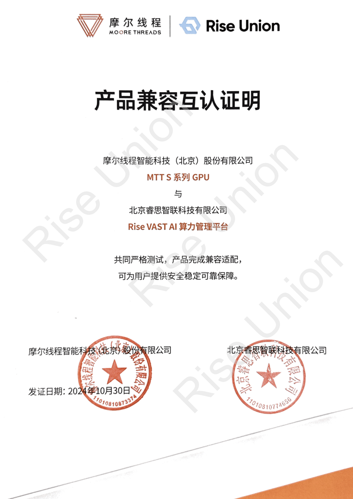

[English](./README.en.md) · [文章目录](../../README.md) · [官网阅读](https://www.theriseunion.com/zh/blog/mthreads-compatibility.html)

# 睿思智联与摩尔线程完成适配认证，携手推动国产 AI 算力生态发展

睿思智联 · 2025/01/01 08:00（北京时间）

睿思智联Rise VAST平台成功完成与摩尔线程GPU的兼容性认证，通过资源池化与智能调度，实现国产GPU的高效管理，助力企业降低TCO，加速AI应用落地。

近日，北京睿思智联科技有限公司与摩尔线程智能科技（北京）股份有限公司正式完成适配认证。睿思智联的 Rise VAST AI 算力管理平台已成功适配支持摩尔线程 MTT S系列全功能 GPU，标志着国产 AI 软硬件深度融合迈出关键一步。此次合作将进一步优化 AI 计算资源的管理与调度效率，为用户提供更稳定、高效的算力服务，共同推动国产 AI 生态的繁荣发展。  

## **强强联合，共筑国产 AI 计算生态**  

### **关于睿思智联**  
作为 AI 算力管理领域的领军企业，睿思智联专注于提供一体化 AI 计算资源池化和智能调度解决方案，广泛服务于金融、电信、能源等高性能计算需求密集型行业。Rise VAST 通过适配摩尔线程 MTT S系列全功能GPU，进一步优化异构算力环境下的资源调度效率，帮助企业最大化 GPU 资源利用率、降低总拥有成本（TCO），并支持 AI 业务的快速创新，推动国产 AI 计算生态的发展。  

### **关于摩尔线程**  
摩尔线程成立于2020年10月，以全功能GPU为核心，致力于向全球提供加速计算的基础设施和一站式解决方案，为各行各业的数智化转型提供强大的AI计算支持。我们的目标是成为具备国际竞争力的GPU领军企业，为融合人工智能和数字孪生的数智世界打造先进的加速计算平台。我们的愿景是为美好世界加速。
## **深化技术协同，赋能行业 AI 创新**  

此次适配认证的完成，使 Rise VAST 平台和摩尔线程全功能GPU 实现深度协同，为企业提供更高效、更灵活的 AI 计算资源管理能力，助力行业 AI 应用的加速落地。  

### 资源池化与统一管理
  - 支持数据中心内多品牌、多类型 GPU 设备的统一池化与调度，实现国产与非国产算力的灵活协同。  
  - 打破单一厂商限制，为企业提供弹性的硬件部署策略，优化算力配置。  

### 按需调度与智能分配 
  - 具备动态算力调度能力，按需分配 GPU 资源，确保大规模 AI 任务的高效执行。  
  - 配置多维度任务管理与资源配额机制，支持任务优先级调度，提高算力利用率。  

### 智能运维与系统稳定性提升
  - 支持 GPU 设备状态实时监控、日志管理、智能告警等功能，保障系统长期稳定运行。  
  - 提供直观的可视化管理界面，简化运维流程，提高管理效率。  

## **携手共创国产 AI 计算未来**  

此次合作不仅是国产 AI 软硬件深度适配的重要里程碑，更是国产 AI 生态融合升级的有力实践。睿思智联与摩尔线程将继续深化技术协作，携手推动国产 AI 计算产业的自主创新与生态构建，为更多行业的数智化转型提供坚实支撑，共同打造更强大的国产 AI 计算基础设施。

此外，睿思智联还陆续与 [寒武纪](https://www.theriseunion.com/zh/blog/cambricon-compatibility.html)、[海光DCU](https://www.theriseunion.com/zh/blog/dcu-compatibility.html)、[天数智芯](https://www.theriseunion.com/zh/blog/iluvatar-compatibility.html) 、[沐曦](https://www.theriseunion.com/zh/blog/metax-compatibility.html)、[昆仑芯](https://www.theriseunion.com/zh/blog/kunlunxin-compatibility.html)等众多中国主流AI芯片厂商展开了深度合作，共同打造AI算力生态，为用户提供更丰富、更稳定的算力资源。

---

[在睿思智联官网阅读本文](https://www.theriseunion.com/zh/blog/mthreads-compatibility.html) · [浏览更多文章](https://www.theriseunion.com/zh/blog.html)
