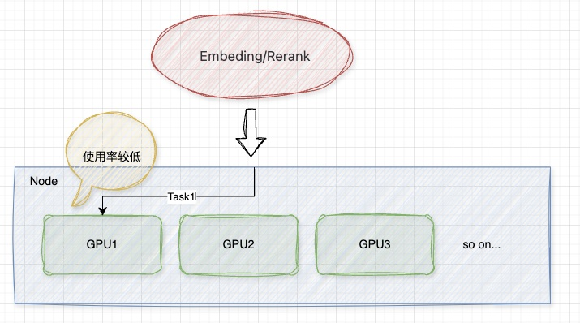
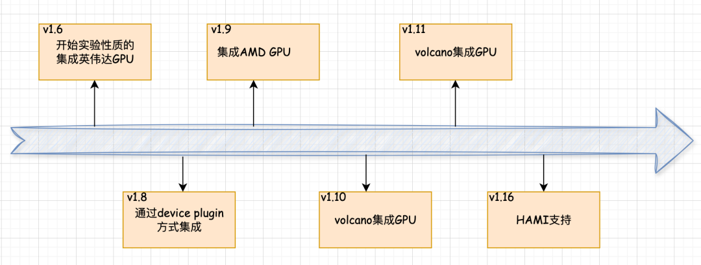

[简体中文](./README.md) · [All articles](../../README.en.md) · [Read on the website](https://www.theriseunion.com/en/blog/navigating-complex-compute-environments-in-the-ai-cloud-native-era.html)

# Navigating the Compute Challenges in the AI Cloud-Native Era

RiseUnion · January 01, 2025 at 08:00 (UTC+08:00)

Explore how to efficiently manage and utilize diverse computational resources in the AI cloud-native era. Analyze NVIDIA's technical advantages and strategic significance in GPU resource orchestration, and uncover HAMi's unique strengths in heterogeneous computing management.

## Background

In the AI cloud-native era, the demand for computational resources has surged with the widespread adoption of large models. Efficient management and utilization of diverse computational resources have become pressing issues. Currently, the processes of model fine-tuning, inference, and AI application development align closely with cloud-native characteristics, prompting more enterprises to deploy computational tasks on Kubernetes (K8s) platforms. For instance, OpenAI mentioned in its official blog that ChatGPT's model training leverages cloud-native technologies, with K8s clusters expanded to 7,500 nodes, providing scalable infrastructure for models like GPT-3 and DALL·E, while also supporting rapid iteration research for smaller models.

However, the diversity of computing devices and significant differences in computational power domestically lead to complex and varied computational environments. Thus, efficiently managing and utilizing these heterogeneous computational resources on K8s presents a significant challenge. Currently, AI application deployment scenarios are mainly divided into three categories:

1. **Pre-training and fine-tuning of large models**: Typically requires substantial computational power, possibly involving multi-card distributed training or single-card fine-tuning.
2. **Inference scenarios for model deployment**: Focuses on the stability and scalability of inference services, possibly requiring single-card or multi-card inference and elastic scaling.
3. **AI application development**: Applications like embedding and reranking for small models, where computational demand is low and typically does not fully utilize a card's resources.

In scenarios involving small AI models, GPU utilization is low:

## Current State of GPUs

### Leading International GPU Vendors

1. **NVIDIA:** Dominates with its CUDA programming environment and GPU computing platform, excelling in FP32 single and double precision floating-point performance and AI computation capabilities, making it a leader in AI training and high-performance computing.
2. **AMD:** Competes with NVIDIA in the gaming market with its Radeon series GPUs, while its Instinct series accelerators lead in AI training and inference with outstanding computational power and energy efficiency.
3. **Intel:** Deeply invested in the discrete GPU market, introducing high-performance GPUs based on the Xe architecture, leading in the integrated GPU domain.
4. **Google:** TPU (Tensor Processing Unit) is an ASIC optimized for AI and machine learning, significantly enhancing deep learning training and inference efficiency within the TensorFlow framework.

With K8s starting experimental support for NVIDIA's GPU resource scheduling in v1.6 and extending support to AMD GPUs in v1.9, some components on the market have implemented device plugins since v1.8. Each vendor has developed its own device plugin to enable their GPUs to be scheduled on K8s. For example, the K8s official GPU scheduling section provides examples of plugins from AMD, Intel, and NVIDIA. Despite the availability of numerous computational resource scheduling solutions, differences among vendors lead to separate maintenance of each solution. Officially supported device plugins often lack features like GPU resource isolation and sharing, resulting in inefficient GPU resource allocation and waste.

To address these issues, third-party vendors have developed various GPU resource scheduling solutions. In the public cloud, vendors have launched different vGPU resource scheduling solutions, such as Alibaba Cloud's cGPU and Tencent Cloud's qGPU. However, these solutions are often locked to the vendors' platforms and are not open-source, imposing numerous restrictions on users' applications, particularly for state-owned enterprises, financial, energy, and education sectors with strong privatization deployment needs.

To meet the urgent needs for resource sharing, isolation, and avoiding vendor lock-in, the heterogeneous AI computing virtualization middleware [HAMi](https://www.theriseunion.com/en/blog/project-hami.html) emerged. HAMi meets most scenario requirements and adapts to various computational resources, providing strong support for localization scenarios. Currently, HAMi has been included in the CNCF cloud-native landscape.

## Introduction to HAMi

HAMi is a cloud-native K8s heterogeneous AI computing virtualization middleware, compatible with NVIDIA's device plugin keywords and K8s scheduler, supporting various computing devices. By integrating different vendors' docker-runtime and Device Plugin, HAMi manages them at a higher level, smoothing out scheduling differences across devices for unified scheduling. Additionally, HAMi's self-developed HAMi Core enables fine-grained GPU partitioning.

### Key Features

1. **Device Sharing**: Each task can be allocated a portion of a device rather than the entire device, allowing multiple tasks to share a single device.
2. **Device Memory Control**: Allocates specific memory sizes or GPU percentages to devices, ensuring boundaries are not exceeded.
3. **Device Type Specification**: Specifies device types to use or avoid for specific tasks through annotations.
4. **Device UUID Specification**: Specifies device UUIDs to use or avoid for specific tasks through annotations.
5. **Ease of Use**: No need to modify task configurations to use the scheduler; automatic support upon installation, with the option to specify non-NVIDIA resources.
6. **Scheduling Strategy Support**: Supports node-level and GPU-level strategies, with default settings for scheduling parameters, offering "binpack" and "spread" strategies at both dimensions.

### Application Scenarios

1. Sharing of computing devices on K8s.
2. Allocating specific device memory for Pods.
3. Balancing GPU usage in clusters with multiple GPU nodes.
4. Scenarios with low device memory and computational unit utilization, such as running multiple TensorFlow services on a single GPU.
5. Situations requiring numerous small GPUs, such as providing a GPU for multiple students in educational settings or offering small GPU instances on cloud platforms.

## Key Milestones of HAMi

Recently, HAMi has made [significant progress](https://www.theriseunion.com/en/blog/hami-2-4-0.html) in functionality, and [RiseUnion and 4Paradigm have officially signed a strategic partnership agreement](https://www.theriseunion.com/en/blog/riseunion-4paradigm-strategic-partner.html), jointly launching the enterprise-level AI computing pooling platform: [Rise VAST (Virtualized AI Computing Scalability Technology, HAMi Enterprise Edition](https://www.theriseunion.com/en/product/vast.html)), further enhancing the management capabilities of heterogeneous computational resources.

### Key Features of Rise VAST (HAMi Enterprise Edition)

1. **Overcommitment of Compute and Memory**: Supports overcommitment of compute and memory resources to enhance utilization.
2. **Compute Expansion and Preemption**: Dynamically expands compute resources and supports preemptive scheduling to optimize resource allocation.
3. **Custom Compute Specifications**: Allows enterprises to define custom compute specifications to meet diverse application needs.
4. **NVLink Topology Awareness**: Supports NVLink topology awareness and optimization to improve data transfer efficiency.
5. **Differentiated Scheduling Strategies**: Offers various scheduling strategies, enabling enterprises to tailor scheduling based on business needs.
6. **Enterprise-grade Isolation**: Enhances resource isolation to ensure security in multi-tenant environments.
7. **Resource Quota Control**: Provides fine-grained control over resource quotas to prevent resource abuse.
8. **Multi-cluster Management**: Supports unified management and scheduling across clusters.
9. **Audit Logs**: Provides detailed audit logs for tracking and analysis.
10. **High Availability Assurance**: Ensures high availability through redundancy and failover mechanisms.
11. **Granular Operational Analytics**: Offers comprehensive operational analytics tools to help enterprises optimize resource configuration and usage.

By unifying compute cluster management, resource sharing, on-demand allocation, and rapid scheduling, Rise VAST fully unleashes the potential of heterogeneous compute resources, accelerating the modernization and intelligent transformation of AI infrastructure.

## Conclusion

The current computational environment is dominated by NVIDIA's GPUs, but devices from other vendors are also gaining traction. Although major vendors provide Kubernetes scheduling support, these solutions often lack fine-grained scheduling capabilities, leading to suboptimal resource utilization. HAMi integrates various vendor open-source solutions, offering more refined resource sharing and isolation capabilities, supporting unified management and scheduling of diverse computational resources.

---

[Read this article on the RiseUnion website](https://www.theriseunion.com/en/blog/navigating-complex-compute-environments-in-the-ai-cloud-native-era.html) · [Explore more articles](https://www.theriseunion.com/en/blog.html)
