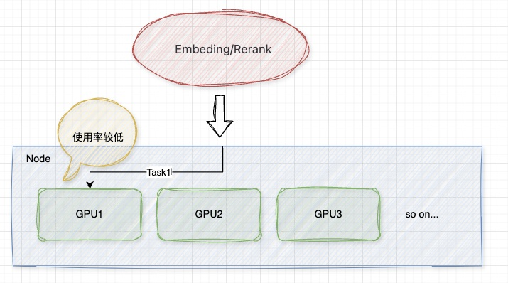
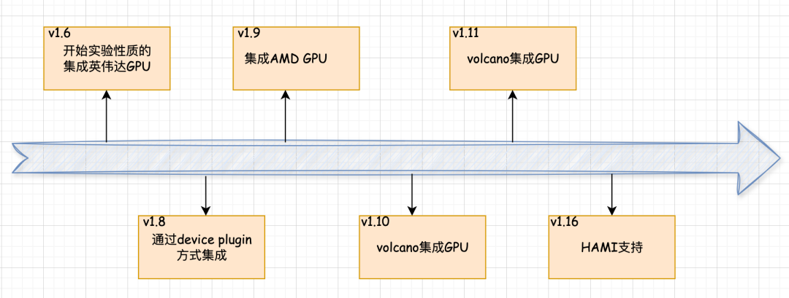

[English](./README.en.md) · [文章目录](../../README.md) · [官网阅读](https://www.theriseunion.com/zh/blog/navigating-complex-compute-environments-in-the-ai-cloud-native-era.html)

# 驾驭 AI 云原生时代的算力挑战：HAMi 与 睿思智联的创新之路

睿思智联 · 2025/01/26 08:00（北京时间）

深入探讨在 AI 云原生时代，如何高效管理和利用多样化的算力资源。分析 NVIDIA 的技术优势及其在 GPU 资源调度中的战略意义，揭示 HAMi 在异构算力管理中的独特优势。

## 背景

在 AI 云原生时代，随着大模型的广泛应用，算力资源的需求急剧增加，如何高效管理和利用多样化的算力资源成为亟待解决的问题。当前，模型的微调、推理以及 AI 应用的开发过程与云原生特性高度契合，越来越多的企业选择将计算任务部署在 Kubernetes（K8s）平台上。例如，OpenAI 在其官方博客中提到，ChatGPT 的模型训练采用了云原生技术，K8s 集群已扩展至 7500 个节点，为 GPT-3、DALL·E 等模型提供了可扩展的基础设施，同时也支持小模型的小规模快速迭代研究。

然而，国内的计算设备种类繁多，算力差异显著，导致算力环境复杂多样。因此，如何在K8s上高效管理和使用这些异构算力资源成为一大挑战。目前，AI应用的落地场景主要分为三大类：

1. **大模型的预训练和微调**：通常需要大量算力，可能涉及多卡分布式训练或单卡微调。
2. **模型部署的推理场景**：关注推理服务的稳定性和可扩展性，可能需要单卡或多卡推理，以及弹性扩容。
3. **AI应用开发**：如嵌入、重排序等小模型的应用，算力需求较小，通常无法占满一张卡的全部资源。

AI应用小模型场景时，GPU 使用率较低：

## 算力卡现状

### 国际主流GPU厂商

1. **英伟达：**以 CUDA 编程环境和 GPU 计算平台称雄，其卓越的 FP32 单双精度浮点性能及 AI 运算能力，使其在 AI 训练和高性能计算领域独占鳌头。
2. **AMD：** Radeon 系列 GPU 在游戏市场与英伟达分庭抗礼，同时，AMD 推出 Instinct 系列加速卡，以卓越的计算力和能效比，领跑 AI 训练和推理领域。
3. **英特尔：** 深耕独立GPU市场，推出基于 Xe 架构的高性能GPU，在集成 GPU 领域领先。
4. **谷歌：** TPU（张量处理单元）是专为 AI 和机器学习优化的 ASIC，在 TensorFlow 框架中显著提升了深度学习训练和推理效率。

### 国内主流GPU厂商

1. **华为昇腾：** 昇腾 AI 芯片系列，专为人工智能计算设计，提供高效的算力支持，广泛应用于深度学习和推理任务。
2. **百度昆仑芯：** 昆仑芯片是百度自主研发的AI加速芯片，具备高性能和高能效，适用于大规模AI计算场景。
3. **海光：** 提供融合通用计算与特定领域加速的CPU与DCU产品，安全性能卓越，适用于多种计算需求。
4. **寒武纪：** 以其领先的AI芯片设计和ASIC产品在深度学习领域占据重要地位，优化神经网络计算架构。
5. **摩尔线程：** 推出春晓、苏堤芯片，支持AI模型开发及智算中心建设，推动AI计算的创新发展。
6. **沐曦：** 专注于高性能计算芯片的研发，提供高效的AI计算解决方案，助力智能应用的落地。
7. **燧原：** 提供面向AI训练和推理的高性能计算芯片，具备卓越的计算能力和能效比，支持多种AI应用场景。

随着 K8S 在 v1.6 开始实验性质地支持英伟达的 GPU 资源调度，并在 v1.9 开始对 AMD GPU 也提供支持，当前市面上的一些组件从 v1.8 开始通过设备插件的方式实现。各个厂商为了让自家的 GPU 能够在 K8S 上被调度使用，也分别开发了属于自己的设备插件。例如，在 K8S 官方的调度 GPU 章节中，分别举例了 AMD、Intel 和 NVIDIA 三家厂商的插件，同时华为昇腾也提供了 MindX DL 套件来支持 Atlas 训练推理卡在 K8S 上的调度管理。虽然已经有很多计算资源的调度方案，但由于厂家不同，各个方案也被厂家分别维护，同时官方支持的设备插件往往不能支持 GPU 的资源隔离和资源共享等功能，导致在使用时常常会造成 GPU 资源分配不合理，从而导致浪费。

为了解决这些问题，第三方厂商开发了多种 GPU 资源调度方案，在公有云上，厂商纷纷推出了不同的 vGPU资源调度方案，例如阿里云的 cGPU、腾讯云的 qGPU 等，但由于这些方案大多锁定在各个云厂商自身平台上，也未开源，这让广大用户的应用受到众多限制限制，特别是国央企、金融、能源、教育等有着强烈私有化部署场景的需求。

为满足资源共享、资源隔离、避免单一厂商绑定等迫切需求，异构 AI 计算虚拟化中间件 [HAMi](https://www.theriseunion.com/zh/blog/project-hami.html)  应运而生。HAMi 能够满足大部分场景需求，并适配多种国产计算资源，为国产化场景提供有力支持。目前，HAMi 已加入 CNCF 云原生基金会的景观图中。

## HAMi 简介

HAMi 是一个云原生的 K8s 异构 AI 计算虚拟化中间件，兼容 NVIDIA 的设备插件关键字及 K8s 的调度器，支持多种计算设备，包括国产的华为昇腾 NPU、寒武纪 MLU、海光 DCU等。通过接入不同厂商的 docker-runtime 以及 Device Plugin，HAMi 在更上层进行统一管理，抹平不同设备的调度差异，实现统一调度。同时，HAMi 通过自研的 HAMi Core 实现对 GPU 的细粒度划分。

### 主要功能

1. **设备共享**：每个任务可以分配设备的一部分，而非整个设备，允许多个任务共享一个设备。
2. **设备内存控制**：为设备分配特定的内存大小或GPU的百分比，确保不超过指定边界。
3. **设备类型规范**：通过设置注释，指定特定任务使用或避免的设备类型。
4.  **设备UUID规范**：通过设置注释，指定特定任务使用或避免的设备UUID。
5.  **易于使用**：无需修改任务配置即可使用调度程序，安装后自动支持，也可指定非 NVIDIA 的资源。
6. **调度策略支持**：支持节点级和GPU级策略，可通过调度参数默认设置，两个维度均支持 “binpack” 和 “spread” 两种策略。

### 应用场景

1. K8s 上的计算设备共享。
2. 为 Pod 分配特定的设备内存。
3. 在具有多个 GPU 节点的集群中平衡 GPU 的使用情况。
4. 设备内存和计算单元利用率低的场景，如在一个 GPU 上运行多个 TensorFlow 服务。
5. 需要大量小型 GPU 的情况，如教学场景中为多名学生提供一块 GPU、提供小型 GPU 实例的云平台等。

## HAMi 的重要里程碑

近期，HAMi 不只在功能方面取得了[重要进展](https://www.theriseunion.com/zh/blog/hami-2-4-0.html)，并且 睿思智联 与 第四范式 [正式签署战略合作协议](https://www.theriseunion.com/zh/blog/riseunion-4paradigm-strategic-partner.html)，双方携手正式推出企业级AI算力池化平台：[Rise VAST（Virtualized AI Computing Scalability Technology，HAMi企业版](https://www.theriseunion.com/zh/product/vast.html)），进一步增强了对异构算力资源的管理能力。

### Rise VAST （HAMi企业版）的主要功能

1. **算力和显存的超分**：支持对算力和显存的超分配，提升资源利用率。
2. **算力扩充和抢占**：动态扩充算力资源，并支持抢占式调度以优化资源分配。
3. **算力规格定义**：允许企业自定义算力规格，满足不同应用需求。
4. **NVLink 拓扑感知**：支持 NVLink 拓扑结构的感知和优化，提升数据传输效率。
5. **差异化调度策略**：提供多种调度策略，支持企业根据业务需求进行差异化调度。
6. **企业级隔离性**：增强资源隔离性，确保多租户环境下的安全性。
7. **资源配额控制**：精细化控制资源配额，防止资源滥用。
8. **多集群管理**：支持跨集群的统一管理和调度。
9. **审计日志**：提供详细的审计日志，便于追踪和分析。
10. **高可用性保障**：通过冗余和故障转移机制，确保系统的高可用性。
11. **精细化运营分析**：提供全面的运营分析工具，帮助企业优化资源配置和使用。

通过对算力集群的统一管理、算力资源共享、按需分配和快速调度，Rise VAST 全面释放异构算力的潜能，加速AI基础设施的现代化和智能化转型。

## 总结

当前的算力环境以 NVIDIA 的 GPU 为主导，但其他厂商的设备也在逐渐普及。尽管各大厂商提供了 Kubernetes 的调度支持方案，这些方案往往缺乏细粒度的调度能力，导致资源利用率不高。HAMi 通过整合多种厂商的开源方案，提供了更为精细的资源共享和隔离能力，支持多种计算资源的统一管理和调度。

---

[在睿思智联官网阅读本文](https://www.theriseunion.com/zh/blog/navigating-complex-compute-environments-in-the-ai-cloud-native-era.html) · [浏览更多文章](https://www.theriseunion.com/zh/blog.html)
