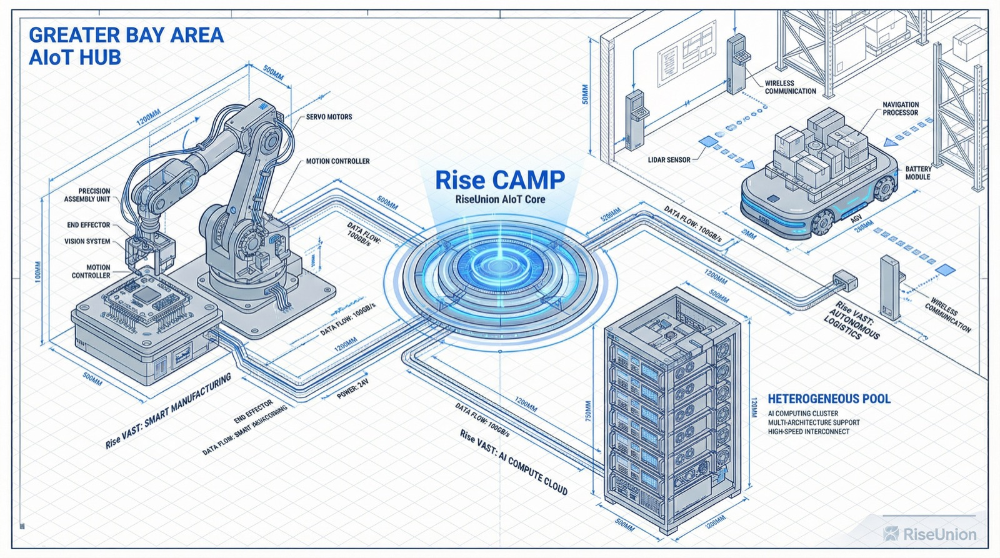
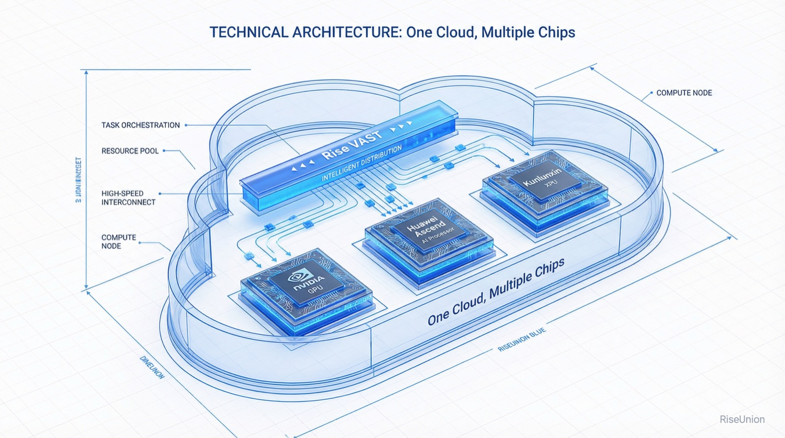
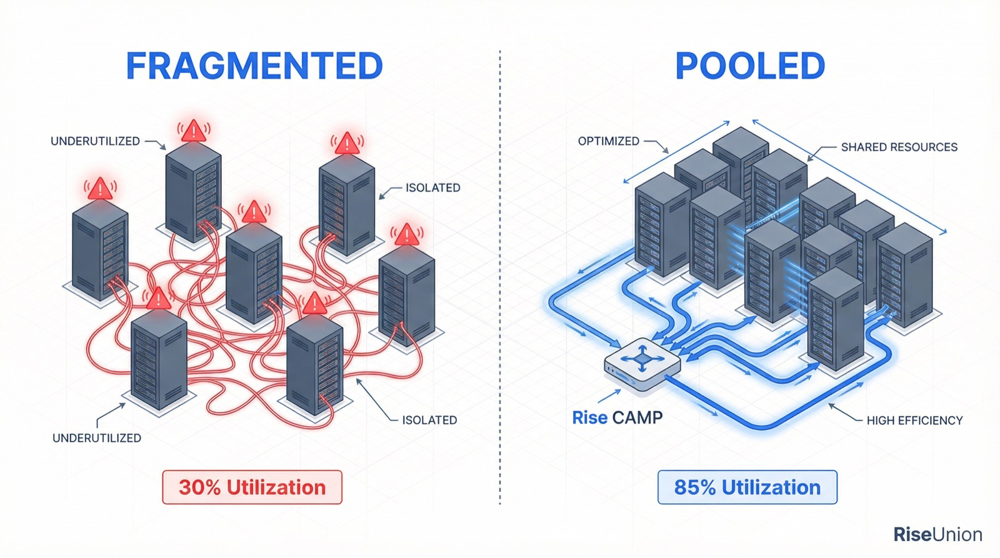

[简体中文](./README.md) · [All articles](../../README.en.md) · [Read on the website](https://www.theriseunion.com/en/blog/news-bay-area-aiot-salon-2026.html)

# Reshaping the Physical AI Computing Foundation: RiseUnion at the 2026 Bay Area AIoT Innovation Salon

RiseUnion · February 10, 2026 at 19:30 (UTC+08:00)

RiseUnion was invited to attend the 2026 Bay Area AIoT Innovation & Growth Salon, joining BYD, Today International, and other leading enterprises to discuss computing power scheduling challenges in the Physical AI era. Through heterogeneous pooling and vGPU technology, RiseUnion helps manufacturing and supply-chain industries achieve efficient computing resource allocation.

In 2026, Physical AI entered the era of large-scale deployment. Heavy-asset industries such as manufacturing, retail, and supply chain are undergoing a paradigm shift from "digitalization" to "intelligent automation." Beijing RiseUnion Technology Co., Ltd. (hereinafter "**RiseUnion**") was invited to attend the **2026 Bay Area AIoT Innovation & Growth Salon**.

At the event, RiseUnion took the stage alongside leading enterprises including Today International, Pilotage Technology, and BYD, engaging in deep discussions on AI large model private deployment, computing cluster scheduling, and intelligent manufacturing transformation.

The salon brought together over 40 enterprise GMs, CIOs, and digital transformation directors. As a technology service provider in the intelligent computing space, RiseUnion shared its large-scale deployment results in heterogeneous computing pooling and domestic intelligent computing infrastructure.

## Fine-Grained Computing Scheduling: The "Neural Backbone" of Physical AI

From Today International's "Smart Warehouse AGV Solutions" to BYD's "Enterprise 1+6+N AI Architecture," the industry consensus is clear: **AI is reshaping the real economy.** However, low computing utilization, difficult resource scheduling, and slow private deployment remain significant pain points.

"**The prosperity of Physical AI depends on the seamless flow of computing power.**" RiseUnion pointed out that the "new manufacturing" environment of 2026 is extremely complex. Enterprises need not simply more servers, but a scheduling system that can support both global and domestic chips while maximizing hardware performance.

To address this need, RiseUnion demonstrated three core technical capabilities:

- **One Cloud, Multi-Chip — Eliminating Vendor Lock-in**: The [Rise VAST](https://www.theriseunion.com/en/product/vast.html) platform delivers unified management of heterogeneous computing from NVIDIA, Ascend, KunlunXin, and more. Whether heavy-duty model training or lightweight edge inference, all workloads operate within a single resource pool.

- **vGPU Slicing for Maximum Efficiency**: Through GPU virtualization and [Rise CAMP](https://www.theriseunion.com/en/product/camp.html) topology-aware scheduling, enterprises can multiply their computing resource utilization. At a time when the manufacturing sector is focused on cost reduction and efficiency gains, this means generating more business value with less hardware.

- **Full-Lifecycle MaaS Support**: [Rise ModelX](https://www.theriseunion.com/en/product/modelx.html) streamlines the entire pipeline from algorithm development to model deployment, lowering the technology adoption barrier for traditional manufacturers.

As a primary drafter of the group standard *"Information Technology — Requirements for Heterogeneous Computing Virtualization and Pooling Systems in Intelligent Computing Services,"* RiseUnion's technical solutions have become an industry benchmark.

## Field-Proven Results: From the Greater Bay Area to Nationwide

RiseUnion has always upheld the principle of **"technology empowering business, computing driving growth."** Its core solutions have completed closed-loop validation across multiple sectors:

- **Finance**: Managed over 600 heterogeneous servers for a state-owned bank, improving resource utilization by more than 50% and supporting core AI scenarios including risk control and marketing.
- **Manufacturing**: Through a hybrid cloud management system, unified scheduling of on-premise GPUs and cloud resources has helped multiple enterprises achieve elastic upgrades to their intelligent manufacturing architecture.
- **Retail**: Selected for the CCFA *2025 China Retail Technology Emerging Enterprise Growth Program*, helping retail enterprises reduce hardware investment by over 30% and improve task processing efficiency by 50%.

## Conclusion: Building the "Smart Grid" for AI-Powered Manufacturing

Computing power is the electricity of the AI era, and an efficient management platform is its "smart grid."

RiseUnion will continue to deepen its work in heterogeneous computing pooling, collaborating with enterprise ecosystem partners across the Greater Bay Area and nationwide, transforming "uncertain" technical challenges into "certain" business growth. In the wave of the Physical AI era, we ensure every chip is put to its best use.

---

[Read this article on the RiseUnion website](https://www.theriseunion.com/en/blog/news-bay-area-aiot-salon-2026.html) · [Explore more articles](https://www.theriseunion.com/en/blog.html)
