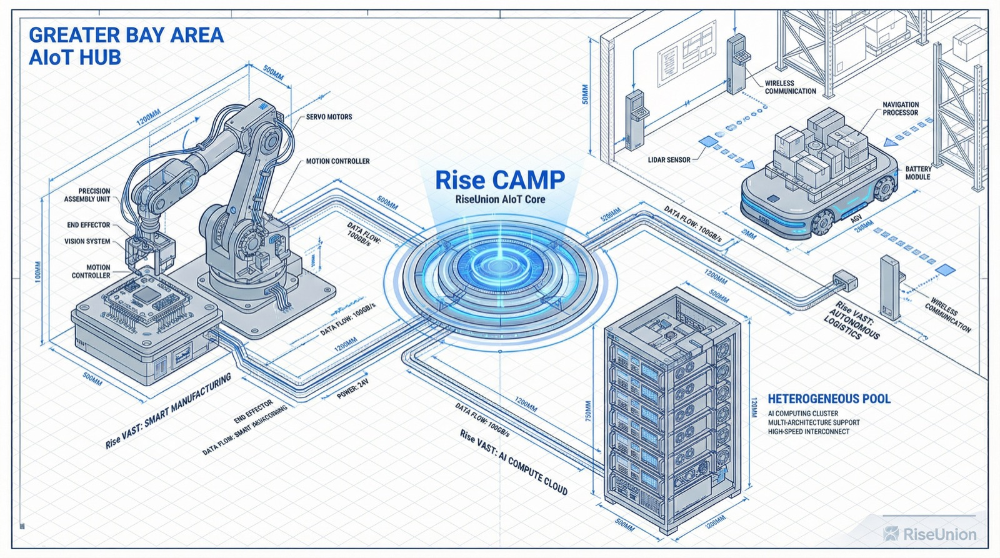
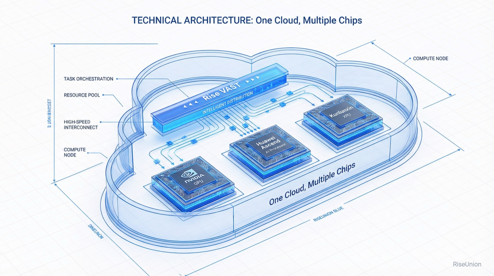
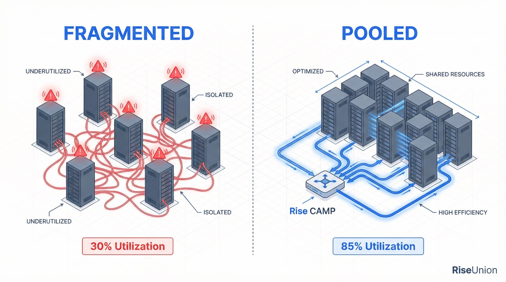

[English](./README.en.md) · [文章目录](../../README.md) · [官网阅读](https://www.theriseunion.com/zh/blog/news-bay-area-aiot-salon-2026.html)

# 重塑物理 AI 算力底座：睿思智联亮相 2026 湾区 AIoT 创新增长沙龙

睿思智联 · 2026/02/10 19:30（北京时间）

睿思智联受邀出席 2026 湾区 AIoT 创新增长沙龙，与比亚迪、今天国际等头部企业探讨物理 AI 时代的算力调度挑战。通过异构池化与 vGPU 技术，助力制造与供应链产业实现智算资源的高效流转。

2026 年，物理 AI 进入规模化落地期。制造、零售及供应链等重资产行业正面临从“数字化”向“智能化”的范式跃迁。近日，北京睿思智联科技有限公司（以下简称“**睿思智联**”）受邀出席 “**2026 湾区 AIoT 创新增长沙龙**”。

在现场，睿思智联与今天国际、先导科技、比亚迪等领军企业同台，深度交流了 AI 大模型私有化部署、算力集群调度及智能制造转型等核心路径。

本次沙龙汇聚了 40 余位企业总经理、CIO 及数字化总监。睿思智联作为智算领域的技术服务商，分享了在异构算力池化、国产智算底座构建等方面的规模化落地成果。

## 算力精细化调度：物理 AI 的“底层神经”

从今天国际的“智慧仓储 AGV 方案”到比亚迪的“企业 1+6+N AI 架构”，行业共识已经形成：**AI 正在重塑实体经济。** 但在落地过程中，算力利用率低、资源调度难、私有化部署慢等痛点依然突出。

“**物理 AI 的繁荣，前提是算力的无感流动。**” 睿思智联在发言中指出，2026 年的“新制造”环境极其复杂，企业需要的不是单纯增加服务器，而是能兼容全球与国产芯片、极致压榨硬件性能的调度系统。

针对这一需求，睿思智联现场拆解了三大核心技术能力：

- **一云多芯，消除厂商锁定**： [Rise VAST](https://www.theriseunion.com/zh/product/vast.html) 平台实现了对英伟达、昇腾、昆仑芯等异构算力的统一纳管。无论是训练大模型的“重武器”，还是边缘端推理的“轻骑兵”，都能在同一套资源池下协同工作。

- **vGPU 切分，极致压榨效能**： 通过 GPU 虚拟化与 [Rise CAMP](https://www.theriseunion.com/zh/product/camp.html) 拓扑感知调度，企业可将昂贵的算力资源利用率提升数倍。在制造业普遍追求降本增效的当下，这意味着用更少的硬件产出更多的业务价值。

- **全生命周期 MaaS 支撑**： [Rise ModelX](https://www.theriseunion.com/zh/product/modelx.html) 打通了从算法开发到模型上线的全流程，降低了传统制造企业跨越技术门槛的成本。

作为《信息技术 智算服务异构算力虚拟化及池化系统要求》团体标准的主要起草单位，睿思智联的技术方案已成为行业规范的参考标杆。

## 场景验证：从大湾区到全国的实战成果

睿思智联始终坚持 “**技术赋能业务，算力驱动增长**”。其核心方案已在多个领域跑通了闭环：

- **金融**：为某国有银行纳管超 600 台异构服务器，资源利用率提升 50% 以上，支撑了风控与营销等核心 AI 场景。
- **制造**：通过混合云管理体系，统一调度本地 GPU 与云端资源，助力多家企业实现智能制造架构的弹性升级。
- **零售**：入选 CCFA《2025 年度中国零售科技新锐企业成长计划》，帮助零售企业减少 30% 以上的硬件投入，提升 50% 的任务处理效率。

## 结语：共建 AI 智造的“智能电网”

算力是 AI 时代的电力，而高效的管理平台则是“智能电网”。

睿思智联将持续深耕异构算力池化技术，与大湾区及全国的企业生态伙伴协作，将“不确定”的技术挑战转化为“确定”的业务增长。在物理 AI 时代的浪潮中，让每一块芯片都物尽其用。

---

[在睿思智联官网阅读本文](https://www.theriseunion.com/zh/blog/news-bay-area-aiot-salon-2026.html) · [浏览更多文章](https://www.theriseunion.com/zh/blog.html)
