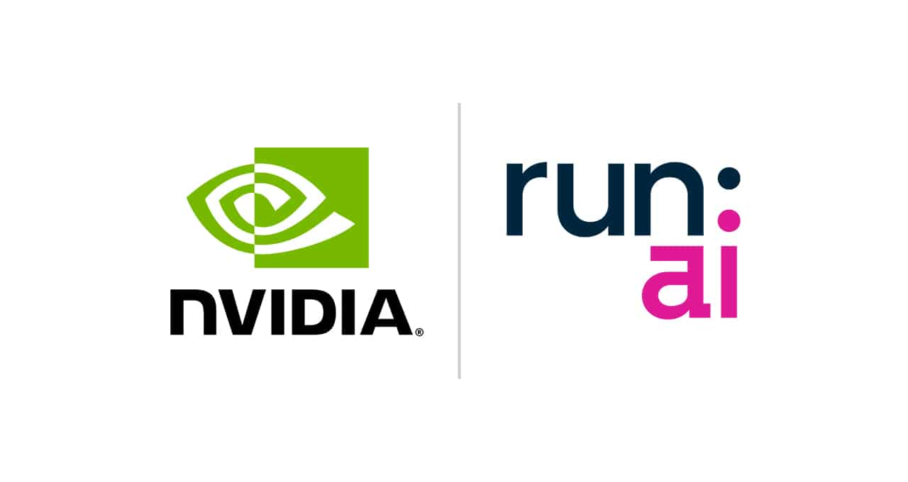

[简体中文](./README.md) · [All articles](../../README.en.md) · [Read on the website](https://www.theriseunion.com/en/blog/nvidia-announces-completion-of-runai-acquisition.html)

# NVIDIA Acquires Run:ai: Deep Integration of AI Infrastructure

RiseUnion · January 01, 2025 at 08:00 (UTC+08:00)

NVIDIA completes $700M acquisition of Run:ai, enhancing GPU resource orchestration capabilities. Explores strategic implications, Run:ai's technical advantages, and impact of open-sourcing on Kubernetes and cloud-native ecosystem, while analyzing RiseUnion's differentiated advantages in heterogeneous computing management.

## Background

NVIDIA has recently announced the completion of its [acquisition](https://blogs.nvidia.com/blog/runai/) of Israeli startup [Run:ai](https://run.ai/), with the deal [reportedly valued at approximately $700 million](https://technews.tw/2025/01/19/why-run-ai-deserves-to-be-acquired-by-nvidia/). [Run:ai](https://run.ai/) is an enterprise focused on Kubernetes-based GPU resource scheduling platforms. This acquisition further emphasizes the importance of Kubernetes in the generative AI era, solidifying its position as the de facto standard for managing GPU-accelerated computing infrastructure. Additionally, NVIDIA's announcement to open-source Run:ai's software to broadly support the AI ecosystem adds deeper significance to this acquisition.

## Run:ai's Technical Position and Value Proposition

### Company Overview

Founded in 2018 in Tel Aviv, Israel, by Omri Geller (CEO) and Dr. Ronen Dar (CTO), Run:ai developed a GPU virtualization and orchestration platform specifically designed for AI workloads. The platform addresses GPU underutilization through efficient resource pooling and sharing mechanisms. In March 2022, Run:ai secured $75 million in Series C funding, bringing their total funding to $118 million.

### Core Challenges and Solutions

Enterprises have long struggled with GPU resource allocation:

* **Limited Virtualization Flexibility:** Unlike CPUs, GPUs resist traditional virtualization technologies (such as VMware vSphere or KVM), hampering efficient task scheduling.
* **Resource Underutilization:** GPUs are often monopolized by single tasks, leaving idle compute power unavailable to other workloads.
* **Kubernetes Limitations:** Native Kubernetes assigns entire GPUs to containers, even when workloads don't require full GPU capacity.

Run:ai's solution builds on Kubernetes primitives and scheduling mechanisms to create a virtualization and orchestration layer supporting GPU partitioning and pooling. This enables dynamic GPU resource allocation, resulting in higher utilization rates and reduced operational costs.

### Run:ai Platform Key Features

* **AI-Optimized GPU Virtualization:** Purpose-built virtualization capabilities for AI workloads with resource pooling and shared scheduling.
* **Deep Kubernetes Integration:** Compatible with all Kubernetes distributions and seamlessly integrates with mainstream AI tools and frameworks.
* **Centralized Resource Management:** Unified platform for cluster monitoring, GPU pool management, and workload resource allocation.
* **Dynamic Scheduling and Fractioning:** Supports GPU dynamic scheduling, resource pooling, and on-demand fractioning for improved resource efficiency.
* **NVIDIA Stack Integration:** Full compatibility with NVIDIA's DGX systems, Base Command, NGC containers, and AI Enterprise software for end-to-end solutions.

## Open-Sourcing Run:ai Software

NVIDIA's decision to open-source Run:ai's software represents a significant strategic shift that will:

* **Foster AI Ecosystem Growth:** Enable broader developer and organization access to Run:ai's technology, driving AI infrastructure innovation.
* **Enhance Kubernetes GPU Scheduling:** Integrate Run:ai's capabilities into the Kubernetes ecosystem, significantly improving GPU-intensive workload handling.
* **Lower AI Deployment Barriers:** Reduce costs and complexity of advanced GPU scheduling, making AI solution deployment more accessible.

## Strategic Implications of NVIDIA's Run:ai Acquisition

* **Enhanced GPU Resource Orchestration:** Addresses core challenges in GPU virtualization and efficient scheduling, supporting enterprise generative AI scaling.
* **Expanded AI Ecosystem:** Integrates advanced scheduling capabilities for DGX systems, HGX platforms, and DGX Cloud users, optimizing generative AI workloads.
* **Market Reach:** Leverages Run:ai's AI infrastructure customer base and market presence, particularly in sectors facing resource orchestration challenges.
* **Technical Innovation:** Incorporates Run:ai's GPU virtualization and scheduling algorithm expertise, maintaining NVIDIA's AI infrastructure leadership.
* **Competitive Advantage:** Strengthens NVIDIA's position as enterprises increase AI and machine learning investments, where GPU management efficiency is crucial.

## Impact on Kubernetes and Cloud Native Ecosystem

* **Advanced GPU Scheduling:** Run:ai's technology optimizes Kubernetes' capabilities in GPU allocation and AI workload management.
* **Cloud Native AI Infrastructure:** The NVIDIA-Run:ai combination accelerates Kubernetes adoption for AI and ML workloads.
* **Industry Applications:** Improved GPU resource management accelerates AI model development and deployment in healthcare, finance, and automotive sectors.
* **Kubernetes Maturity:** Reinforces Kubernetes as the primary platform for AI deployment.

## Conclusion

NVIDIA's acquisition of Run:ai represents a strategic move that not only significantly enhances its GPU orchestration and virtualization capabilities but also injects new vitality into the AI and cloud-native ecosystem through deep integration with Kubernetes and an open-source approach. This strategic decision not only reinforces NVIDIA's leadership in the AI hardware market but also lays a solid foundation for the scaled development of future AI applications. The decision to open-source Run:ai's technology has far-reaching implications, signaling NVIDIA's more open approach to promoting AI technology popularization and development.

## RiseUnion's Differentiated Advantage: Heterogeneous Computing Resource Management

While NVIDIA's acquisition and open-sourcing of Run:ai enhances Kubernetes scheduling capabilities for NVIDIA GPUs, it primarily focuses within the NVIDIA ecosystem. RiseUnion offers a distinct solution for organizations managing heterogeneous computing resources, including domestic GPUs and NPUs (such as Ascend, Cambricon, DCU, Metax, XPU, Iluvatar, and other Chinese manufacturers).

RiseUnion's product line ([Rise VAST](https://www.theriseunion.com/en/product/vast.html) and [Rise CAMP](https://www.theriseunion.com/en/product/camp.html)) specializes in heterogeneous computing resource management and integration, emphasizing platform neutrality and cross-architecture compatibility. Unlike Run:ai's NVIDIA GPU focus, RiseUnion's solution offers:

* **Multi-Architecture Support:** Unified scheduling and management across NVIDIA, Ascend, Cambricon, DCU, Metax, XPU, Iluvatar, and other domestic and international GPU/NPU resources. This is crucial for organizations pursuing domestic alternatives or managing multiple computing architectures.
* **Fine-Grained Resource Control:** Supports precise resource allocation down to 1% GPU compute or MiB memory units, maximizing resource utilization and scheduling flexibility.
* **Open Computing Management Ecosystem:** Deep collaboration with HAMi open-source community and major AI platforms like Baidu PaddlePaddle and Alibaba PAI, avoiding vendor lock-in.
* **Enhanced Domestic Technology Support:** Specialized adaptation for domestic GPUs and heterogeneous computing scenarios, facilitating enterprise technology independence.

While NVIDIA's Run:ai acquisition strengthens its ecosystem, RiseUnion maintains significant advantages in heterogeneous computing management, platform neutrality, and domestic technology support. For organizations seeking broader hardware support, vendor independence, and domestic technology adoption, RiseUnion provides a more comprehensive solution. This capability is particularly valuable in today's increasingly complex AI infrastructure landscape.

---

[Read this article on the RiseUnion website](https://www.theriseunion.com/en/blog/nvidia-announces-completion-of-runai-acquisition.html) · [Explore more articles](https://www.theriseunion.com/en/blog.html)
