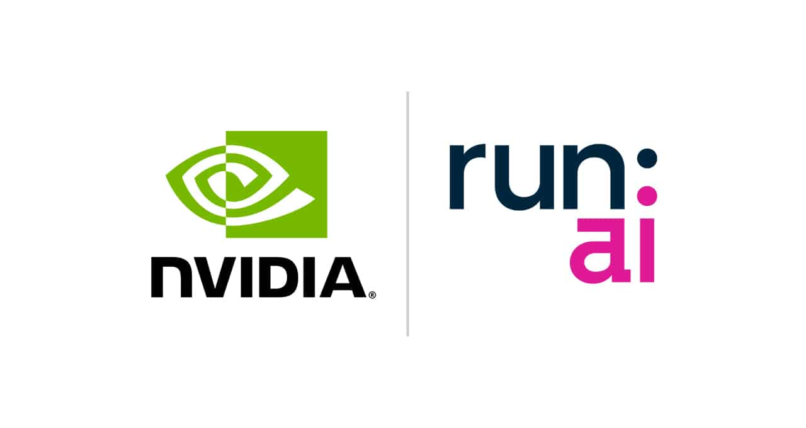

[English](./README.en.md) · [文章目录](../../README.md) · [官网阅读](https://www.theriseunion.com/zh/blog/nvidia-announces-completion-of-runai-acquisition.html)

# NVIDIA 收购 Run:ai：AI 基础设施与 Kubernetes 的深度整合

睿思智联 · 2025/01/20 08:00（北京时间）

NVIDIA 以7亿美元收购 Run:ai，强化 GPU 资源调度能力。探讨此次收购的战略意义、Run:ai 的技术优势，以及开源决策对 Kubernetes 与云原生生态的影响。同时分析睿思智联在异构算力管理领域的差异化优势。

## 背景

近日，NVIDIA 宣布已完成对以色列初创公司 [Run:ai](https://run.ai/) 的[收购](https://blogs.nvidia.com/blog/runai/)，[收购金额reportedly 约为 7 亿美元](https://technews.tw/2025/01/19/why-run-ai-deserves-to-be-acquired-by-nvidia/)。[Run:ai](https://run.ai/) 是一家专注于基于 Kubernetes 的 GPU 资源调度平台的企业。此次收购进一步凸显了 Kubernetes 在生成式 AI 时代的重要性，巩固了其作为 GPU 加速计算基础设施管理事实标准的地位。同时，NVIDIA 宣布将开源 Run:ai 的软件，以便更广泛地支持 AI 生态系统，这一举措为此次收购赋予了更深远的意义。

## Run:ai 的技术定位与价值

### 公司概况

Run:ai 成立于 2018 年，总部位于以色列特拉维夫，由 Omri Geller（CEO）和 Ronen Dar 博士（CTO）共同创立。该公司开发了一套针对 AI 工作负载的 GPU 虚拟化与调度平台，旨在通过高效的资源池化和共享机制解决 GPU 资源利用率低下的问题。2022 年 3 月，Run:ai 完成 7500 万美元 C 轮融资，总融资额达 1.18 亿美元。

### 核心问题与解决方案

GPU 的资源分配问题长期困扰企业：

*   **无法灵活虚拟化：** 与 CPU 不同，GPU 资源难以通过传统的虚拟化技术（如 VMware vSphere 或 KVM）实现分片或动态分配，导致任务调度效率低下。
*   **资源浪费严重：** GPU 通常被单一任务独占，即使未满载运行，其闲置部分也无法被其他任务利用。
*   **Kubernetes 的局限性：** 在原生 Kubernetes 中，容器一旦申请 GPU 资源，将独占整个 GPU，即便负载较低也无法释放多余资源。

Run:ai 的解决方案基于 Kubernetes 原语和调度机制，构建了一个虚拟化与调度层，支持 GPU 分片与池化。通过动态分配 GPU 资源，Run:ai 实现了更高的资源利用率和更低的运行成本。

### Run:ai 平台的技术亮点

*   **面向 AI 工作负载的 GPU 虚拟化与调度：** 提供专为 AI 任务优化的 GPU 虚拟化能力，支持资源池化与共享调度。
*   **深度集成 Kubernetes：** 与所有 Kubernetes 版本兼容，支持主流 AI 工具和框架的无缝对接。
*   **集中式资源管理界面：** 提供统一的管理平台，用于监控集群状态、管理 GPU 池以及分配任务资源。
*   **动态调度与资源分片：** 支持 GPU 动态调度、资源池化和按需分片（fractioning），显著提升资源利用效率。
*   **与 NVIDIA 全栈生态集成：** 深度兼容 NVIDIA 的 DGX 系统、Base Command、NGC 容器以及 AI Enterprise 软件，形成一体化解决方案。

## 开源 Run:ai 软件

NVIDIA 宣布将开源 Run:ai 的软件，这是一个重要的战略转变。此举将：

*   **促进 AI 生态系统的发展：** 开源将使更广泛的开发者和组织能够利用 Run:ai 的技术，推动 AI 基础设施的创新。
*   **增强 Kubernetes 的 GPU 调度能力：** 将 Run:ai 的技术融入 Kubernetes 生态系统，将显著提升 Kubernetes 在 GPU 密集型工作负载方面的表现。
*   **降低 AI 部署的门槛：** 开源降低了使用先进 GPU 调度技术的成本和复杂性，使更多企业能够更容易地部署和扩展 AI 解决方案。

## NVIDIA 收购 Run:ai 的战略意义

*   **强化 GPU 资源调度能力：** Run:ai 的技术解决了 GPU 虚拟化与高效调度的核心痛点，为企业在生成式 AI 领域的扩展提供了重要支撑。
*   **扩展 NVIDIA 的 AI 生态系统：** 通过整合 Run:ai 的调度能力，NVIDIA 能为 DGX 系统、HGX 平台及 DGX Cloud 用户提供更高效的 GPU 管理能力，特别是针对生成式 AI 工作负载的优化。
*   **市场覆盖范围的提升：** Run:ai 在 AI 基础设施领域积累的客户和市场资源将帮助 NVIDIA 进一步扩大市场触达，尤其是在面临资源调度挑战的行业。
*   **技术创新能力的增强：** Run:ai 在 GPU 虚拟化和调度算法上的研发能力，将为 NVIDIA 带来新的技术突破，确保其在 AI 基础设施领域的领先地位。
*   **强化市场竞争力：** 随着企业对 AI 和机器学习的投入持续增加，GPU 管理效率成为竞争优势。此次收购，NVIDIA 在这一领域的领先地位得到进一步巩固。

## 对 Kubernetes 与云原生生态的深远影响

*   **GPU 调度能力的提升：** Run:ai 的技术将优化 Kubernetes 在 GPU 动态分配和 AI 任务负载管理中的表现，进一步增强其在高性能计算领域的竞争力。
*   **推动云原生 AI 基础设施的发展：** NVIDIA 和 Run:ai 的结合将推动 Kubernetes 在 AI 和机器学习工作负载中的应用，加速云原生环境下的 AI 部署与扩展能力。
*   **加速行业应用：** 通过优化 GPU 资源管理，医疗、金融、汽车等对 AI 依赖较大的行业将更快速实现 AI 模型的研发与生产化落地。
*   **Kubernetes 的成熟性进一步提升：** 此次整合证明 Kubernetes 在现代 AI 基础设施中的核心地位，并推动更多企业将其作为 AI 部署的首选平台。

## 总结

NVIDIA 收购 Run:ai 是一项重要的战略举措，不仅显著提升了其在 GPU 调度和虚拟化技术上的竞争力，还通过与 Kubernetes 的深度结合，并以开源的方式，为 AI 和云原生生态注入了新的活力。这一战略决策不仅巩固了 NVIDIA 在 AI 硬件市场的领导地位，也为未来 AI 应用的规模化发展奠定了坚实基础。开源 Run:ai 的举动更是意义深远，预示着 NVIDIA 将以更开放的姿态推动 AI 技术的普及化和发展。

## 睿思智联（RiseUnion）产品的差异化优势：异构算力池化管理平台

虽然 NVIDIA 收购 Run:ai 并开源其技术，将增强 Kubernetes 在 NVIDIA GPU 上的调度能力，但这仍然主要集中在 NVIDIA GPU 生态系统内。对于那些需要管理异构算力资源，包括国产 GPU 和 NPU（如：昇腾 Ascend、寒武纪 Cambricon、海光 DCU、沐曦 Metax、昆仑芯 XPU、天数智芯 Iluvatar等众多国内厂商），睿思智联提供了另一种重要的解决方案。

睿思智联 的产品线（[Rise VAST](https://www.theriseunion.com/zh/product/vast.html) 和 [Rise CAMP](https://www.theriseunion.com/zh/product/camp.html)）专注于异构算力资源的管理与整合，强调平台中立性和跨架构兼容性。与 Run:ai 专注于 NVIDIA GPU 不同，睿思智联的解决方案能够：

*   **支持多元异构算力资源：** 包括 NVIDIA、昇腾 Ascend、寒武纪 Cambricon、海光 DCU、沐曦 Metax、昆仑芯 XPU、天数智芯 Iluvatar 等国内外多种 GPU、NPU 资源，实现统一调度和管理。这对于需要进行国产化替代或拥有多种计算架构的企业至关重要。
*   **提供细粒度资源调度：** 支持更精细的资源分配，例如按 1% 的 GPU 算力或 MiB 的内存进行划分，从而最大程度地提高资源利用率，并支持更灵活的任务调度。
*   **构建开放的算力管理生态：** 通过与 HAMi 等开源社区以及百度千帆、阿里 PAI 等主流 AI 平台的深度合作，睿思智联避免了供应商锁定，为客户提供了更大的灵活性和选择权。
*   **更好地支持国产化需求：** 深度适配国产 GPU 和异构算力场景，帮助企业客户完成国产化转型，实现算力自主可控。

因此，虽然 NVIDIA 收购 Run:ai 增强了其在 NVIDIA GPU 生态系统中的竞争力，但睿思智联在异构算力管理、平台中立性和国产化支持方面仍然具有显著的差异化优势。对于那些寻求更广泛硬件支持、避免供应商锁定以及需要进行国产化转型的企业来说，睿思智联提供了更全面的解决方案。在 AI 基础设施日益复杂化的今天，睿思智联的这种能力显得尤为重要。

---

[在睿思智联官网阅读本文](https://www.theriseunion.com/zh/blog/nvidia-announces-completion-of-runai-acquisition.html) · [浏览更多文章](https://www.theriseunion.com/zh/blog.html)
