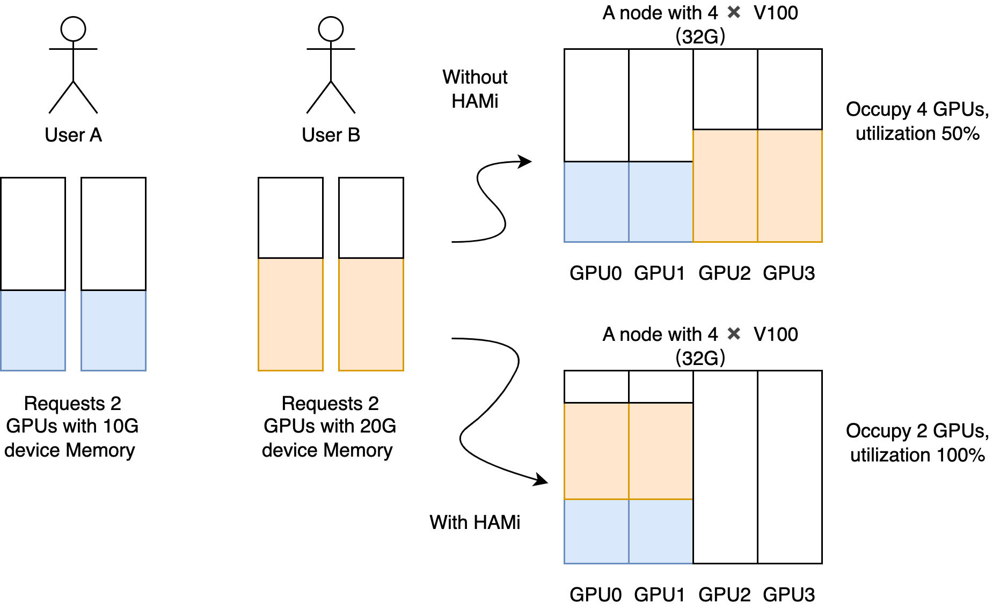
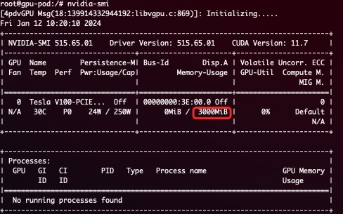
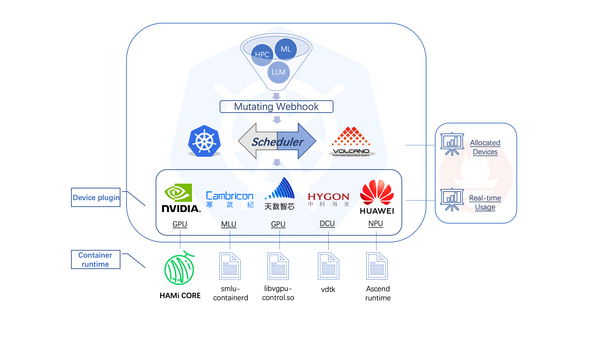
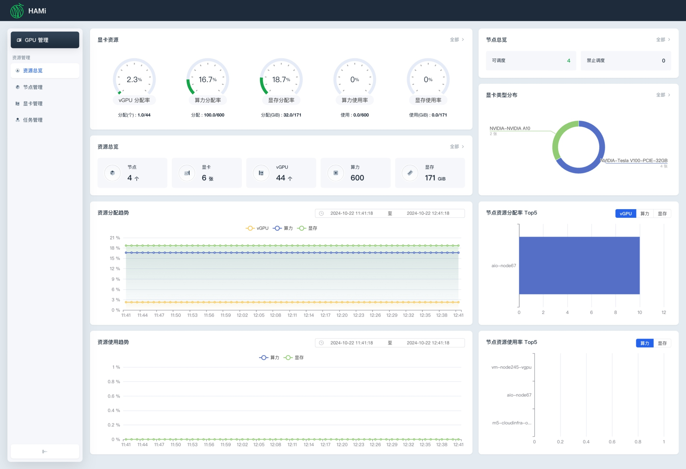
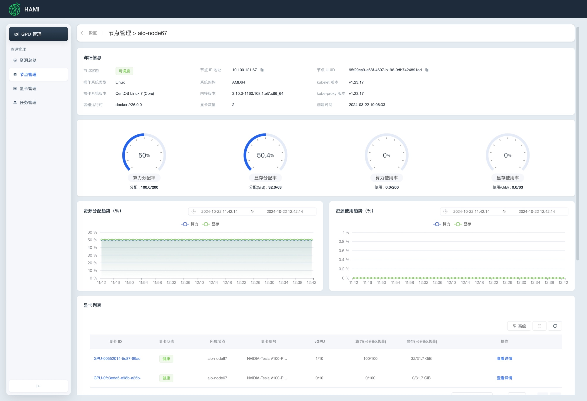
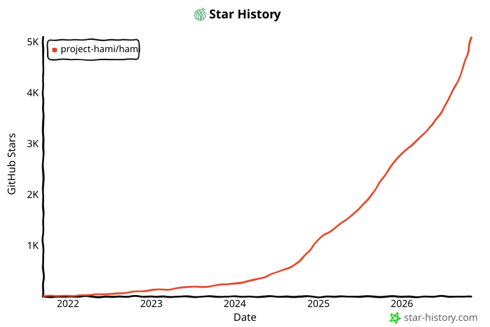

[简体中文](./README.md) · [All articles](../../README.en.md) · [Read on the website](https://www.theriseunion.com/en/blog/project-hami.html)

# HAMi: Open Source GPU Virtualization for AI Computing

RiseUnion · January 01, 2025 at 08:00 (UTC+08:00)

Explore HAMi, a CNCF sandbox project that revolutionizes GPU resource management through vGPU, dynamic MIG, and time-slicing technologies. Learn its Kubernetes integration, scheduling strategies, and how it optimizes AI infrastructure costs.


## Introduction

[HAMi](https://github.com/Project-HAMi/HAMi) (Heterogeneous AI Computing Virtualization Middleware, formerly [k8s-vGPU-Scheduler](https://github.com/4paradigm/k8s-vgpu-scheduler)) is a Kubernetes middleware for heterogeneous device management. It manages diverse AI accelerators (GPUs, NPUs, MLUs, DCUs, etc.), enables device sharing across Pods, and makes optimized scheduling decisions based on device topology and policies.

HAMi aims to remove the gap between different heterogeneous devices and provide a unified interface for users with no changes to their applications. As of December 2024, HAMi has been widely adopted across Internet, public/private cloud, finance, securities, energy, telecommunications, education, and manufacturing sectors. Over 40 companies and institutions are not only end users but also active contributors.


HAMi is a [Cloud Native Computing Foundation](https://cncf.io/) (CNCF) sandbox and [landscape](https://landscape.cncf.io/?item=orchestration-management--scheduling-orchestration--hami) project, as well as a [CNAI Landscape project](https://landscape.cncf.io/?group=cnai&item=cnai--general-orchestration--hami).

## Releases

- [HAMi v2.8.0](https://www.theriseunion.com/en/blog/hami-2-8-0.html) — DRA alignment, Scheduler HA, CDI mode
- [HAMi v2.7.0](https://www.theriseunion.com/en/blog/hami-2-7-0.html) — KunlunXin vXPU, Enflame GCU, AWS Neuron support
- [HAMi v2.6.0](https://www.theriseunion.com/en/blog/hami-2-6-0.html) — Enflame GCU share, MetaX sGPU, topology-aware scoring
- [HAMi v2.5.0](https://www.theriseunion.com/en/blog/hami-2-5-0.html) — Dynamic MIG support
- [HAMi v2.4.0](https://www.theriseunion.com/en/blog/hami-2-4-0.html) — Ascend 910B/310P, WebUI visualization
- [GitHub Releases](https://github.com/Project-HAMi/HAMi/releases/latest)

## Device Virtualization

HAMi provides device virtualization for multiple heterogeneous devices, supporting device sharing and resource isolation. See [Supported Devices](#supported-devices) for the full list.

### Device Sharing Capabilities

- Partial device allocation by specifying core usage (percentage)
- Partial device allocation by specifying device memory (MB)
- Hard limits on streaming multiprocessors
- Zero changes to existing programs required
- [Dynamic MIG slicing](https://www.theriseunion.com/en/blog/hami-2-5-0.html) support, [see example](https://www.theriseunion.com/en/blog/hami-support-mig.html)



### Device Resource Isolation

HAMi supports hard isolation of device resources. Example with NVIDIA GPU:

```yaml
      resources:
        limits:
          nvidia.com/gpu: 1 # requesting 1 vGPU
          nvidia.com/gpumem: 3000 # Each vGPU contains 3000M device memory
```

Only 3G of visible memory will be available inside the container:



> **Note:**
> 1. After installing HAMi, the `nvidia.com/gpu` value registered on the node defaults to the number of vGPUs
> 2. When requesting resources in a pod, `nvidia.com/gpu` indicates the number of physical GPUs needed

### Supported Devices

| Device | Sharing | Memory Isolation | Compute Isolation | Notes |
|--------|:-------:|:----------------:|:-----------------:|-------|
| [NVIDIA GPU](https://github.com/Project-HAMi/HAMi#preparing-your-gpu-nodes) | ✅ | ✅ | ✅ | vGPU & dynamic MIG |
| [Huawei Ascend NPU](https://github.com/Project-HAMi/ascend-device-plugin/blob/main/README.md) | ✅ | ✅ | ✅ | 910B/910C/310P series |
| [Cambricon MLU](https://github.com/Project-HAMi/HAMi/blob/master/docs/cambricon-mlu-support.md) | ✅ | ✅ | ✅ | MLU series |
| [Hygon DCU](https://github.com/Project-HAMi/HAMi/blob/master/docs/hygon-dcu-support.md) | ✅ | ✅ | ✅ | DCU series |
| [Iluvatar CoreX GPU](https://github.com/Project-HAMi/HAMi/blob/master/docs/iluvatar-gpu-support.md) | ✅ | ✅ | ✅ | CoreX series |
| [Moore Threads GPU](https://github.com/Project-HAMi/HAMi/blob/master/docs/mthreads-support.md) | ✅ | ✅ | ✅ | MTT series |
| [MetaX GPU](https://github.com/Project-HAMi/HAMi/blob/master/docs/metax-support.md) | ✅ | ✅ | ✅ | sGPU management |
| [Enflame GCU](https://github.com/Project-HAMi/HAMi/blob/master/docs/enflame-gcu-support.md) | ✅ | ✅ | — | Percentage-based allocation |
| [KunlunXin XPU](https://github.com/Project-HAMi/HAMi/blob/master/docs/kunlun-vxpu-support.md) | ✅ | ✅ | ✅ | vXPU fine-grained slicing |

## Architecture



HAMi consists of several components, including a unified mutatingwebhook, a unified scheduler extender, device plugins, and in-container virtualization technologies for each heterogeneous AI device.

## Quick Start

### Choose Your Cluster Scheduler

[](https://github.com/Project-HAMi/HAMi#quick-start)
[](https://github.com/Project-HAMi/HAMi/blob/master/docs/how-to-use-volcano-vgpu.md)

### Prerequisites

- NVIDIA drivers >= 440
- nvidia-docker version > 2.0
- Default runtime configured as nvidia for containerd/docker/cri-o
- Kubernetes version >= 1.18
- glibc >= 2.17 & glibc < 2.30
- Kernel version >= 3.10
- helm > 3.0

### Installation

1. Label your GPU nodes for HAMi scheduling:

```bash
kubectl label nodes {nodeid} gpu=on
```

2. Add the Helm repo:

```bash
helm repo add hami-charts https://project-hami.github.io/HAMi/
```

3. Deploy:

```bash
helm install hami hami-charts/hami -n kube-system
```

Customize your installation via [configs](https://github.com/Project-HAMi/HAMi/blob/master/docs/config.md).

4. Verify installation:

```bash
kubectl get pods -n kube-system
```

If both `vgpu-device-plugin` and `vgpu-scheduler` pods are Running, installation is successful.

### WebUI

[HAMi-WebUI](https://github.com/Project-HAMi/HAMi-WebUI) is available from v2.4. [Deployment guide](https://github.com/Project-HAMi/HAMi-WebUI/blob/main/docs/installation/helm/index.md).




### Example Task Submission

NVIDIA vGPUs can be requested by containers using the resource type `nvidia.com/gpu`:

```yaml
apiVersion: v1
kind: Pod
metadata:
  name: gpu-pod
spec:
  containers:
    - name: ubuntu-container
      image: ubuntu:18.04
      command: ["bash", "-c", "sleep 86400"]
      resources:
        limits:
          nvidia.com/gpu: "2" # requesting 2 vGPUs
          nvidia.com/gpumem: "3000" # Each vGPU contains 3000M device memory (optional)
          nvidia.com/gpucores: "30" # Each vGPU uses 30% of actual GPU compute (optional)
```

> **Note:**
> - If you use the privileged field, the task will not be scheduled as it can see all GPUs and will affect other tasks.
> - Do not set the nodeName field; use nodeSelector for similar requirements.

[More examples](https://github.com/Project-HAMi/HAMi/blob/master/examples/nvidia)

### Monitoring

Monitoring is automatically enabled after installation. Access cluster metrics at:

```
http://{scheduler_ip}:{monitorPort}/metrics
```

Default monitorPort is 31993; set a different value using `--set devicePlugin.service.httpPort` during installation. [Grafana dashboard example](https://github.com/Project-HAMi/HAMi/blob/master/docs/dashboard.md).

## Talks & References

| Conference | Topic |
|------------|-------|
| KubeCon & AI_dev (China 2024) | [Is Your GPU Really Working Efficiently in the Data Center?](https://www.youtube.com/watch?v=ApkyK3zLF5Q) |
| KubeCon & AI_dev (China 2024) | [Unlocking Heterogeneous AI Infrastructure K8s Cluster](https://www.youtube.com/watch?v=kcGXnp_QShs) |
| KubeDay (Japan 2024) | [Leveraging the Power of HAMi](https://www.youtube.com/watch?v=owoaSb4nZwg) |
| KubeCon (EU 2024) | [Cloud Native Batch Computing with Volcano](https://youtu.be/fVYKk6xSOsw) |

## Community

HAMi is committed to fostering an open and welcoming environment.

- **Community meeting**: Every Friday at 16:00 (UTC+8). [Meeting notes](https://docs.google.com/document/d/1YC6hco03_oXbF9IOUPJ29VWEddmITIKIfSmBX8JtGBw/edit#heading=h.g61sgp7w0d0c)
- **Slack**: [#hami](https://cloud-native.slack.com/archives/C07T10BU4R2) (CNCF Slack)
- **Discord**: [HAMi Server](https://discord.gg/Amhy7XmbNq)
- **Mailing list**: [hami-project](https://groups.google.com/forum/#!forum/hami-project)
- [Maintainers](https://github.com/Project-HAMi/HAMi/blob/master/MAINTAINERS.md) · [Contributing Guide](https://github.com/Project-HAMi/HAMi/blob/master/CONTRIBUTING.md) · [Roadmap](https://github.com/Project-HAMi/HAMi/blob/master/docs/develop/roadmap.md)

## Star History

[](https://star-history.com/#Project-HAMi/HAMi&Date)

## HAMi Enterprise Edition (Rise VAST)

[Rise VAST](https://www.theriseunion.com/en/product/vast.html) is the <span class="font-bold text-blue-600 text-xl">[Enterprise Edition](https://www.theriseunion.com/en/product/vast.html)</span> developed by <span class="font-bold text-blue-600 text-xl">RiseUnion</span> in collaboration with <span class="font-bold text-blue-600 text-xl">4Paradigm</span>, built upon the HAMi open-source foundation. It introduces mission-critical enterprise features, including compute and memory oversubscription, dynamic resource preemption, granular resource specification, topology-aware scheduling, and robust isolation. By providing unified orchestration, shared allocation, and rapid scheduling of compute clusters, Rise VAST unlocks the full potential of heterogeneous infrastructure. [Read more about the RiseUnion and 4Paradigm strategic partnership](https://www.theriseunion.com/en/blog/riseunion-4paradigm-strategic-partner.html).

---

[Read this article on the RiseUnion website](https://www.theriseunion.com/en/blog/project-hami.html) · [Explore more articles](https://www.theriseunion.com/en/blog.html)
