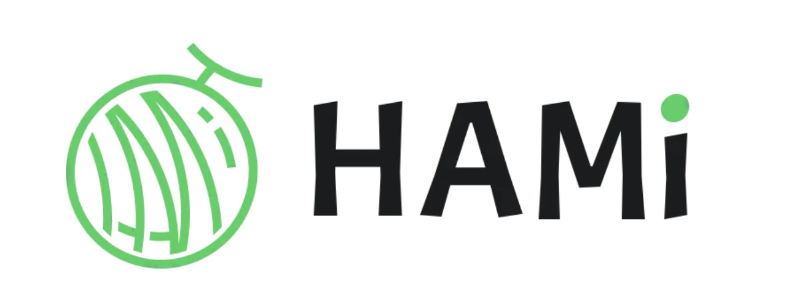
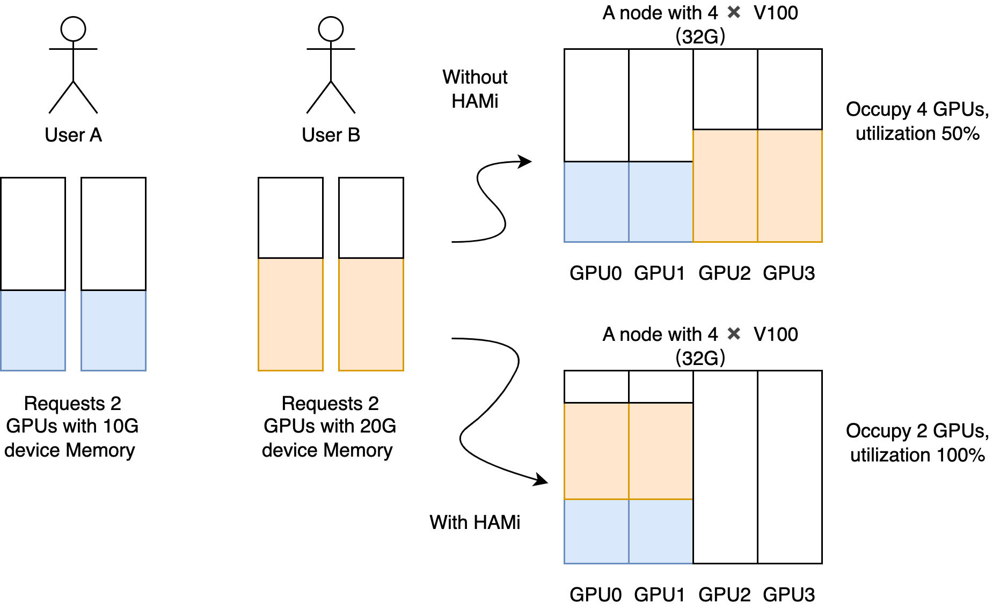
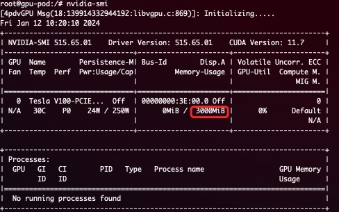
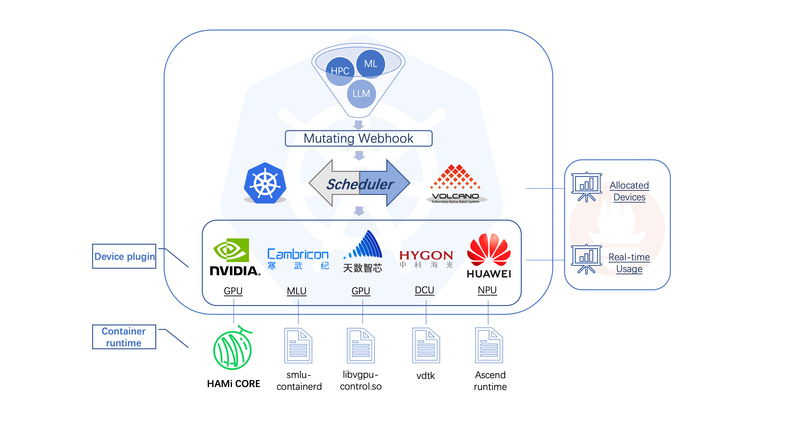
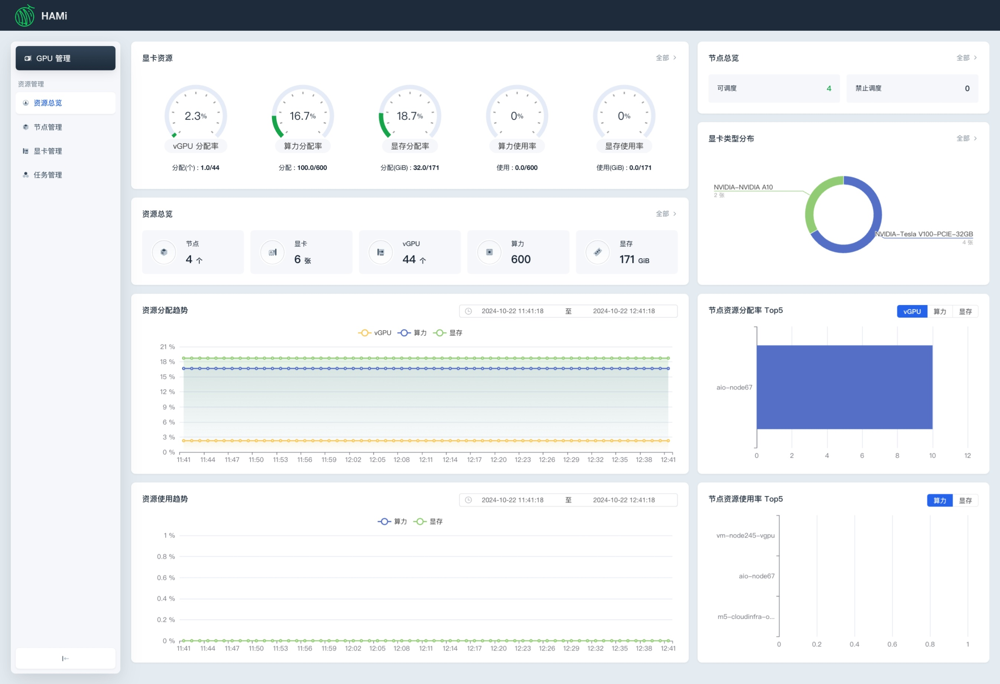
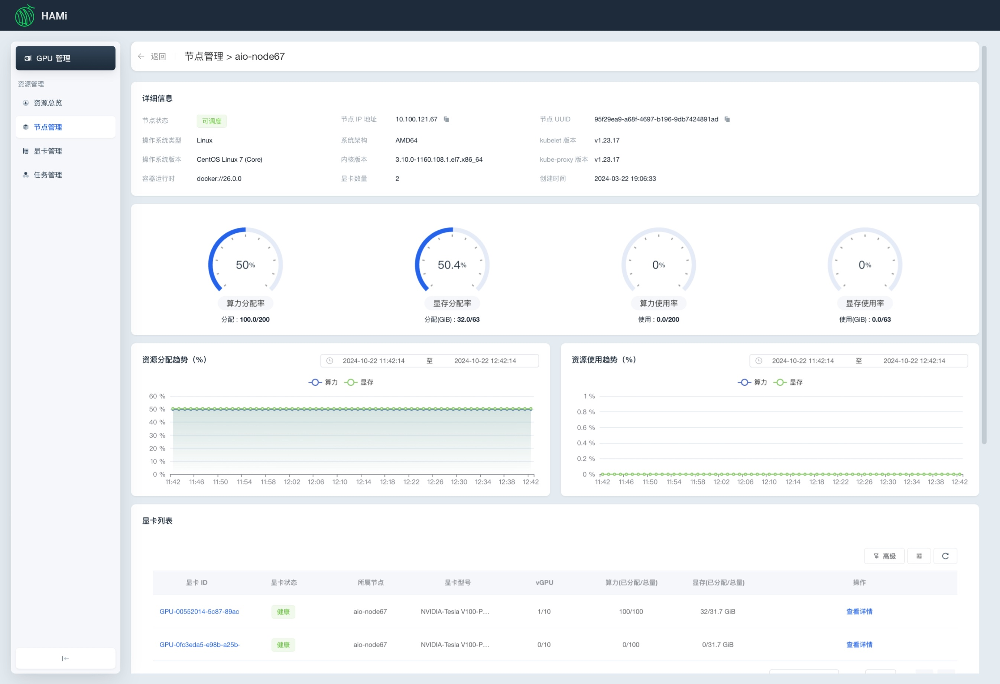
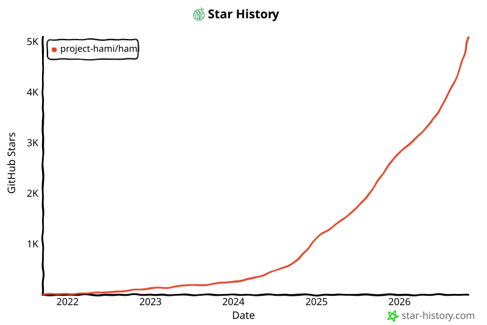

[English](./README.en.md) · [文章目录](../../README.md) · [官网阅读](https://www.theriseunion.com/zh/blog/project-hami.html)

# HAMi：开源 GPU 虚拟化利器，让 AI 算力管理更简单

睿思智联 · 2025/07/18 08:00（北京时间）

深入解析CNCF沙箱项目HAMi如何通过vGPU、动态MIG和时间切片技术实现GPU资源虚拟化与共享。探讨其在Kubernetes环境中的部署架构、资源调度策略，以及如何帮助企业提升AI算力使用效率，降低基础设施成本。



## 项目简介

[HAMi](https://github.com/Project-HAMi/HAMi)（Heterogeneous AI Computing Virtualization Middleware，前身为 [k8s-vGPU-Scheduler](https://github.com/4paradigm/k8s-vgpu-scheduler)）是一个面向 Kubernetes 的异构设备管理中间件。它可以管理不同类型的异构设备（如 GPU、NPU、MLU、DCU 等），实现异构设备在 Pod 之间的共享，并基于设备拓扑和调度策略做出更优的调度决策。

HAMi 旨在消除不同异构设备之间的差异，为用户提供统一的管理接口，无需对应用程序进行任何修改。截至 2024 年 12 月，HAMi 除了在互联网、公有云、私有云等领域外，在金融、证券、能源、运营商、教育、制造业等垂直领域，也得到了广泛采纳。超过 40 家企业和机构不仅是最终用户，同时也是活跃的贡献者。


HAMi 是 [Cloud Native Computing Foundation](https://cncf.io/)（CNCF）基金会的沙箱项目和 [landscape](https://landscape.cncf.io/?item=orchestration-management--scheduling-orchestration--hami) 项目，同时也是 [CNAI Landscape 项目](https://landscape.cncf.io/?group=cnai&item=cnai--general-orchestration--hami)。

## 版本发布

- [HAMi v2.8.0](https://www.theriseunion.com/zh/blog/hami-2-8-0.html) — DRA 标准对齐、Scheduler 高可用、CDI 模式
- [HAMi v2.7.0](https://www.theriseunion.com/zh/blog/hami-2-7-0.html) — 昆仑芯 vXPU、燧原 GCU、AWS Neuron 支持
- [HAMi v2.6.0](https://www.theriseunion.com/zh/blog/hami-2-6-0.html) — 燧原 GCU 共享、沐曦 sGPU、拓扑感知评分
- [HAMi v2.5.0](https://www.theriseunion.com/zh/blog/hami-2-5-0.html) — 动态 MIG 支持
- [HAMi v2.4.0](https://www.theriseunion.com/zh/blog/hami-2-4-0.html) — 昇腾 910B/310P、WebUI 可视化
- [GitHub Releases](https://github.com/Project-HAMi/HAMi/releases/latest)

## 虚拟化能力

HAMi 可为多种异构设备提供虚拟化功能，支持设备共享和资源隔离。关于支持设备虚拟化的设备列表，请参见[支持的设备](#支持的设备)。

### 设备共享能力

- 通过设置核心使用率（百分比），进行设备的部分分配
- 通过设置显存（单位：MB），进行设备的部分分配
- 对流式多处理器进行硬限制
- 无需对现有程序进行任何修改
- 支持[动态 MIG 切片](https://www.theriseunion.com/zh/blog/hami-2-5-0.html)能力，[参考样例](https://www.theriseunion.com/zh/blog/hami-support-mig.html)



### 设备资源隔离能力

HAMi 支持设备资源的硬隔离。以 NVIDIA GPU 为例：

```yaml
      resources:
        limits:
          nvidia.com/gpu: 1 # 请求 1 个 vGPU
          nvidia.com/gpumem: 3000 # 每个 vGPU 包含 3000M 显存
```

在容器内将只看到 3G 可见显存：



> **注意：**
> 1. 安装 HAMi 后，节点上注册的 `nvidia.com/gpu` 值默认为 vGPU 数量
> 2. Pod 中申请资源时，`nvidia.com/gpu` 指当前 Pod 需要的物理 GPU 数量

### 支持的设备

| 设备 | 共享 | 显存隔离 | 算力隔离 | 说明 |
|------|:---:|:---:|:---:|------|
| [NVIDIA GPU](https://github.com/Project-HAMi/HAMi#preparing-your-gpu-nodes) | ✅ | ✅ | ✅ | 支持 vGPU 与动态 MIG |
| [华为昇腾 NPU](https://github.com/Project-HAMi/ascend-device-plugin/blob/main/README.md) | ✅ | ✅ | ✅ | 910B/910C/310P 系列 |
| [寒武纪 MLU](https://github.com/Project-HAMi/HAMi/blob/master/docs/cambricon-mlu-support.md) | ✅ | ✅ | ✅ | MLU 系列 |
| [海光 DCU](https://github.com/Project-HAMi/HAMi/blob/master/docs/hygon-dcu-support.md) | ✅ | ✅ | ✅ | DCU 系列 |
| [天数智芯 GPU](https://github.com/Project-HAMi/HAMi/blob/master/docs/iluvatar-gpu-support.md) | ✅ | ✅ | ✅ | CoreX 系列 |
| [摩尔线程 GPU](https://github.com/Project-HAMi/HAMi/blob/master/docs/mthreads-support.md) | ✅ | ✅ | ✅ | MTT 系列 |
| [沐曦 GPU](https://github.com/Project-HAMi/HAMi/blob/master/docs/metax-support.md) | ✅ | ✅ | ✅ | sGPU 管理 |
| [燧原 GCU](https://github.com/Project-HAMi/HAMi/blob/master/docs/enflame-gcu-support.md) | ✅ | ✅ | — | 百分比分配 |
| [昆仑芯 XPU](https://github.com/Project-HAMi/HAMi/blob/master/docs/kunlun-vxpu-support.md) | ✅ | ✅ | ✅ | vXPU 细粒度切分 |

## 项目架构



HAMi 由多个组件组成，包括统一的 mutatingwebhook、统一的调度器扩展器、不同的设备插件以及针对每种异构 AI 设备的容器内虚拟化技术。

## 快速开始

### 选择你的集群调度器

[](https://github.com/Project-HAMi/HAMi#quick-start)
[](https://github.com/Project-HAMi/HAMi/blob/master/docs/how-to-use-volcano-vgpu.md)

### 前置条件

- NVIDIA 驱动 >= 440
- nvidia-docker 版本 > 2.0
- containerd/docker/cri-o 容器运行时的默认运行时配置为 nvidia
- Kubernetes 版本 >= 1.18
- glibc >= 2.17 & glibc < 2.30
- 内核版本 >= 3.10
- helm > 3.0

### 安装

1. 通过添加标签 "gpu=on" 来标记你的 GPU 节点以进行 HAMi 调度。没有此标签的节点将无法被调度器管理。

```bash
kubectl label nodes {nodeid} gpu=on
```

2. 使用 helm 添加 repo

```bash
helm repo add hami-charts https://project-hami.github.io/HAMi/
```

3. 使用如下指令进行安装

```bash
helm install hami hami-charts/hami -n kube-system
```

通过调整[配置](https://github.com/Project-HAMi/HAMi/blob/master/docs/config_cn.md)来定制安装。

4. 验证安装

```bash
kubectl get pods -n kube-system
```

如果 `vgpu-device-plugin` 和 `vgpu-scheduler` pod 都处于 Running 状态，则安装成功。

### WebUI

[HAMi-WebUI](https://github.com/Project-HAMi/HAMi-WebUI) 从 v2.4 版本开始可用。[部署方式](https://github.com/Project-HAMi/HAMi-WebUI/blob/main/docs/installation/helm/index.md)。




### 提交任务示例

NVIDIA vGPUs 可通过资源类型 `nvidia.com/gpu` 被容器请求：

```yaml
apiVersion: v1
kind: Pod
metadata:
  name: gpu-pod
spec:
  containers:
    - name: ubuntu-container
      image: ubuntu:18.04
      command: ["bash", "-c", "sleep 86400"]
      resources:
        limits:
          nvidia.com/gpu: "2" # 请求 2 个 vGPU
          nvidia.com/gpumem: "3000" # 每个 vGPU 申请 3000M 显存（可选）
          nvidia.com/gpucores: "30" # 每个 vGPU 的算力为 30%（可选）
```

> **注意：**
> - 如果使用 privileged 字段，任务将不会被调度，因为它可见所有 GPU，会影响其它任务。
> - 不要设置 nodeName 字段，类似需求请使用 nodeSelector。

[查看更多范例](https://github.com/Project-HAMi/HAMi/blob/master/examples/nvidia)

### 监控

安装完成后，监控将自动启用。通过以下 URL 获取集群信息：

```
http://{scheduler_ip}:{monitorPort}/metrics
```

默认监控端口为 31993，安装时可通过 `--set devicePlugin.service.httpPort` 修改。[Grafana 仪表板示例](https://github.com/Project-HAMi/HAMi/blob/master/docs/dashboard_cn.md)。

## 演讲与参考资料

| 会议 | 主题 |
|------|------|
| KubeCon & AI_dev（China 2024） | [Is Your GPU Really Working Efficiently in the Data Center?](https://www.youtube.com/watch?v=ApkyK3zLF5Q) |
| KubeCon & AI_dev（China 2024） | [Unlocking Heterogeneous AI Infrastructure K8s Cluster](https://www.youtube.com/watch?v=kcGXnp_QShs) |
| KubeDay（Japan 2024） | [Leveraging the Power of HAMi](https://www.youtube.com/watch?v=owoaSb4nZwg) |
| KubeCon（EU 2024） | [Cloud Native Batch Computing with Volcano](https://youtu.be/fVYKk6xSOsw) |
| 中国云计算基础架构开发者大会（2024） | [在 K8s 集群中解锁异构 AI 基础设施](https://live.csdn.net/room/csdnnews/3zwDP09S) |

## 社区

HAMi 社区致力于营造开放和友好的环境。

- **社区会议**：每周五 16:00（UTC+8），[会议记录](https://docs.google.com/document/d/1YC6hco03_oXbF9IOUPJ29VWEddmITIKIfSmBX8JtGBw/edit#heading=h.g61sgp7w0d0c)
- **Slack**：[#hami](https://cloud-native.slack.com/archives/C07T10BU4R2)（CNCF Slack）
- **Discord**：[HAMi Server](https://discord.gg/Amhy7XmbNq)
- **邮件列表**：[hami-project](https://groups.google.com/forum/#!forum/hami-project)
- [维护者](https://github.com/Project-HAMi/HAMi/blob/master/MAINTAINERS.md) · [贡献者指南](https://github.com/Project-HAMi/HAMi/blob/master/CONTRIBUTING.md) · [路线图](https://github.com/Project-HAMi/HAMi/blob/master/docs/develop/roadmap.md)

## Star 趋势

[](https://star-history.com/#Project-HAMi/HAMi&Date)

## HAMi 企业版（Rise VAST）

[Rise VAST](https://www.theriseunion.com/zh/product/vast.html) 是 <span class="font-bold text-blue-600 text-xl">睿思智联</span> 携手 <span class="font-bold text-blue-600 text-xl">第四范式</span>，在 HAMi 开源版基础之上推出的 <span class="font-bold text-blue-600 text-xl">[企业版](https://www.theriseunion.com/zh/product/vast.html)</span>，增加了诸多企业级特性，包括算力和显存的超分、算力扩充和抢占、算力规格定义、NVLink 拓扑感知、差异化调度策略、企业级隔离性、资源配额控制、多集群管理、审计日志、高可用性保障、精细化运营分析等核心功能。通过对算力集群的统一管理、算力资源共享、按需分配和快速调度，全面释放异构算力的潜能。[查看睿思智联和第四范式签约 HAMi 企业版的相关报道](https://www.theriseunion.com/zh/blog/riseunion-4paradigm-strategic-partner.html)。

---

[在睿思智联官网阅读本文](https://www.theriseunion.com/zh/blog/project-hami.html) · [浏览更多文章](https://www.theriseunion.com/zh/blog.html)
