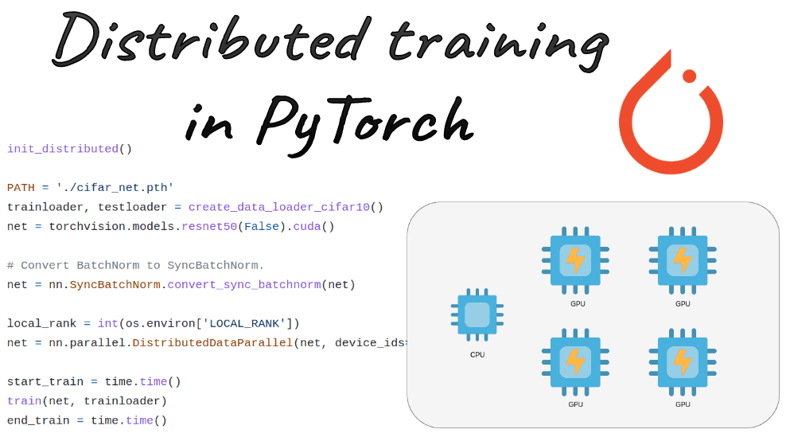
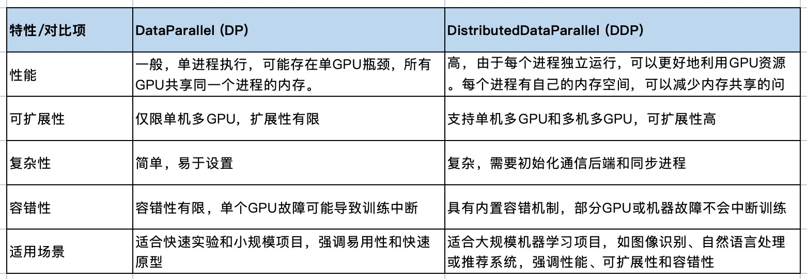

[简体中文](./README.md) · [All articles](../../README.en.md) · [Read on the website](https://www.theriseunion.com/en/blog/pytorch-parallel-training.html)

# Complete Guide to PyTorch Distributed Training: From Basics to Mastery

RiseUnion · January 01, 2025 at 08:00 (UTC+08:00)

Comprehensive guide to PyTorch distributed training, comparing DataParallel vs DistributedDataParallel, with practical examples of multi-GPU implementation for efficient distributed training deployment.



Summary: This article comprehensively introduces the core concepts and practical techniques of PyTorch distributed training. From data parallelism to model parallelism, it explains key technologies like DistributedDataParallel and mixed precision training in detail. Combined with HAMi's intelligent scheduling capabilities, it demonstrates how to conduct large-scale distributed training more efficiently, helping readers master enterprise-level AI training deployment.

## What is PyTorch Parallel Training?

PyTorch is a popular machine learning framework written in Python. Parallel training in PyTorch allows you to leverage multiple GPUs or compute nodes to accelerate the training process of neural networks and other complex machine learning algorithms. This technique is particularly useful for handling large models and large-scale datasets that would otherwise take a very long time to process.

PyTorch offers several mechanisms for parallel training:

- **DataParallel**: Enables multi-GPU training on a single machine with just one line of code
- **DistributedDataParallel**: Faster, more efficient, and more complex
- **RPC-Based Distributed Training (RPC)**: Suitable for advanced training architectures requiring multiple PyTorch servers

### DataParallel
- DataParallel allows training on multiple GPUs on a single machine and is very simple to use. You only need to wrap your model in torch.nn.DataParallel.
- However, DataParallel may not be the most efficient choice in some cases as it involves copying data between GPUs, which can lead to additional communication overhead.

### DistributedDataParallel
- DistributedDataParallel (DDP) is a more advanced and efficient mechanism for multi-GPU training in PyTorch. It works for both single-machine multi-GPU training and can scale to multiple machines for distributed training.
- DDP is typically faster than DataParallel because it reduces the need for data copying and more efficiently utilizes communication between GPUs.
- Using DDP requires some setup, such as initializing process groups, but this is necessary for more efficient distributed training.

### RPC-Based Distributed Training
- RPC is a more flexible distributed training mechanism provided by PyTorch that allows for more complex training structures like distributed pipeline parallelism and parameter server paradigms.
- RPC enables remote procedure calls between multiple PyTorch servers, allowing different computational tasks to be executed on different servers.
- RPC is more suitable for highly customized distributed training scenarios.

## Understanding PyTorch Distributed Data Parallel (DDP)

PyTorch Distributed Data Parallel (DDP) is an advanced parallel training technique that enables synchronized model training across multiple GPUs, which can be located on a single machine or distributed across multiple machines.

### Key Features of DDP

- **Scalability**: DDP allows seamless scaling from a single GPU to multiple GPUs, and from a single machine to multiple machines. This scalability is crucial for training large-scale models and efficiently processing large datasets.
- **Synchronized Training**: DDP uses synchronized training, meaning gradients from all GPUs are averaged before updating model parameters. This ensures model update coherence and helps maintain model accuracy across different GPUs.
- **Fault Tolerance**: DDP is designed to be robust with built-in mechanisms for handling hardware failures. If a GPU or machine fails, DDP can recover and continue training.
- **Performance Optimization**: DDP optimizes performance by overlapping computation and communication. While one GPU is performing computations, another can communicate with other GPUs, reducing idle time.

### How PyTorch DDP Works

1. **Initialization Phase**: Each process initializes its own model copy and data loader. This is typically done using PyTorch's torch.distributed.launch utility.
2. **Data Splitting**: The dataset is split across all GPUs. Each GPU processes a subset of the data, reducing memory requirements and speeding up data loading.
3. **Forward Pass**: Each GPU independently computes on its data subset. This parallel computation ensures even distribution of workload.
4. **Backward Pass**: Gradients computed on each GPU are averaged across all GPUs. This synchronization ensures all model copies receive the same gradient updates.
5. **Parameter Update**: Each GPU independently updates its model parameters using the synchronized gradients. This step ensures all GPUs maintain consistent models.

## Comparing PyTorch DataParallel and DistributedDataParallel

### Performance

**DataParallel**: Works by splitting input data across multiple GPUs, but gradient computation occurs on a single GPU. This centralized gradient computation can create bottlenecks, limiting overall performance. While DP can effectively utilize multiple GPUs for forward and backward propagation, the single GPU handling gradient updates can become overwhelmed, especially with large models or datasets. This inefficiency becomes more pronounced as model complexity increases, leading to slower training times compared to more advanced parallel training methods.

**DistributedDataParallel**: Distributes both data and model replicas across GPUs. Each GPU computes gradients independently and synchronizes these gradients across all GPUs. This parallel approach ensures computation occurs in parallel, and gradients are averaged across all GPUs, significantly reducing bottlenecks. By having each GPU perform gradient updates independently, DDP provides faster training times and better performance. This approach is particularly beneficial for training large-scale models on large datasets as it maximizes hardware resource utilization.

### Scalability

**DataParallel**: Limited scalability as it can only operate within a single machine. Efficiency gains diminish as the number of GPUs on a single machine increases due to the gradient computation bottleneck. This approach scales poorly beyond a certain number of GPUs and is not designed to handle distributed training across multiple machines. Therefore, it's more suitable for small to medium-scale projects where hardware infrastructure is limited to a single machine.

**DistributedDataParallel**: Designed with scalability in mind, supporting multi-GPU setups across multiple machines. This approach can effectively scale from a few GPUs to hundreds of GPUs, making it suitable for high-performance computing environments. DDP allows seamless scaling from a single GPU to multiple GPUs, and from a single machine to multiple machines, providing the flexibility needed for large-scale machine learning projects. This scalability is essential for efficiently training large models and processing large datasets, ensuring optimal utilization of available hardware resources.

### Usage Complexity

**DataParallel**: One of its main advantages is its simplicity. Implementing DP requires minimal code changes, making it accessible to beginners and those seeking quick setup. It's particularly suitable for rapid experimentation and small-scale projects where ease of use is a primary consideration. Simple implementation involves wrapping the model with torch.nn.DataParallel, specifying device IDs, and proceeding with training as usual. This simplicity allows users to quickly prototype and test their models without getting bogged down in complex configurations.

**DistributedDataParallel**: Requires more complex setup. Implementation involves initializing communication backends, splitting datasets, and ensuring all processes are properly synchronized. This setup is typically done using PyTorch's torch.distributed.launch utility, which establishes the necessary communication environment. While this complexity adds an extra layer of setup and configuration, it is compensated for by significant performance improvements.




## Quick Tutorial: Multi-GPU Training with DDP in PyTorch

### Step 1: Setting Up the Environment

First, install the necessary libraries:

```bash
pip install torch torchvision
```

Download sample data:

```bash
wget www.di.ens.fr/~lelarge/MNIST.tar.gz 
tar -zxvf MNIST.tar.gz
```

### Step 2: Initialize DDP Environment

```python
import torch
import torch.distributed as dist
import torch.multiprocessing as mp

def setup(rank, world_size):
    os.environ['MASTER_ADDR'] = 'localhost'
    os.environ['MASTER_PORT'] = '12355'
    dist.init_process_group("nccl", rank=rank, world_size=world_size)

def cleanup():
    dist.destroy_process_group()
```

### Step 3: Define the Model

```python
import torch.nn as nn
from torch.nn.parallel import DistributedDataParallel as DDP

class SimpleModel(nn.Module):
    def __init__(self):
        super(SimpleModel, self).__init__()
        self.flatten = nn.Flatten()
        self.fc1 = nn.Linear(28*28, 10)
        self.relu = nn.ReLU()
        self.fc2 = nn.Linear(10, 10)
        self.fc3 = nn.Linear(10, 10)

    def forward(self, x):
        x = self.flatten(x)
        x = self.fc1(x)
        x = self.relu(x)
        x = self.fc2(x)
        x = self.relu(x)
        x = self.fc3(x)
        return x

def create_model():
    return SimpleModel()
```

### Step 4: Data Loader Setup

```python
from torch.utils.data import DataLoader, DistributedSampler
from torchvision import datasets, transforms

def create_dataloader(rank, world_size, batch_size=32):
    transform = transforms.Compose([transforms.ToTensor()])
    dataset = datasets.MNIST(root='./data', train=True, download=True, transform=transform)
    sampler = DistributedSampler(dataset, num_replicas=world_size, rank=rank)
    dataloader = DataLoader(dataset, batch_size=batch_size, sampler=sampler)
    return dataloader
```

### Step 5: Training Loop

```python
def train(rank, world_size, epochs=5):
    setup(rank, world_size)
    
    dataloader = create_dataloader(rank, world_size)
    model = create_model().to(rank)
    ddp_model = DDP(model, device_ids=[rank])
    
    optimizer = optim.SGD(ddp_model.parameters(), lr=0.01)
    criterion = nn.CrossEntropyLoss()
    
    for epoch in range(epochs):
        ddp_model.train()
        for batch_idx, (data, target) in enumerate(dataloader):
            data, target = data.to(rank), target.to(rank)
            optimizer.zero_grad()
            output = ddp_model(data)
            loss = criterion(output, target)
            loss.backward()
            optimizer.step()
        
        if rank == 0:
            print(f"Epoch {epoch} complete")
    
    cleanup()

def main():
    world_size = 4  # Number of GPUs
    mp.spawn(train, args=(world_size,), nprocs=world_size, join=True)

if __name__ == "__main__":
    main()
```

## Conclusion

PyTorch's parallel training mechanisms provide powerful tools for deep learning practitioners to significantly improve training efficiency. While DataParallel offers a simple implementation, DistributedDataParallel is often the better choice for large-scale training tasks. By understanding the characteristics and use cases of these tools, we can choose the most appropriate parallel training strategy for our specific needs.

## References

- Run:ai ["PyTorch Parallel Training with DDP"](https://www.run.ai/guides/distributed-computing/pytorch-parallel-training)

---

[Read this article on the RiseUnion website](https://www.theriseunion.com/en/blog/pytorch-parallel-training.html) · [Explore more articles](https://www.theriseunion.com/en/blog.html)
