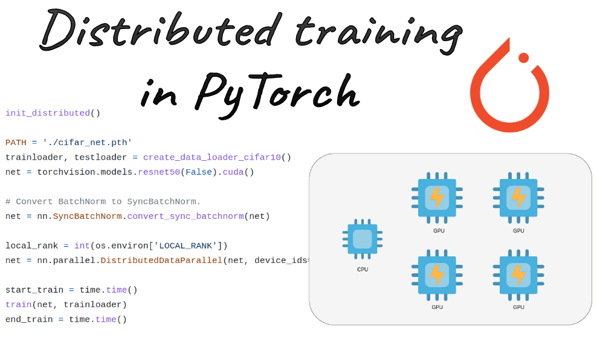
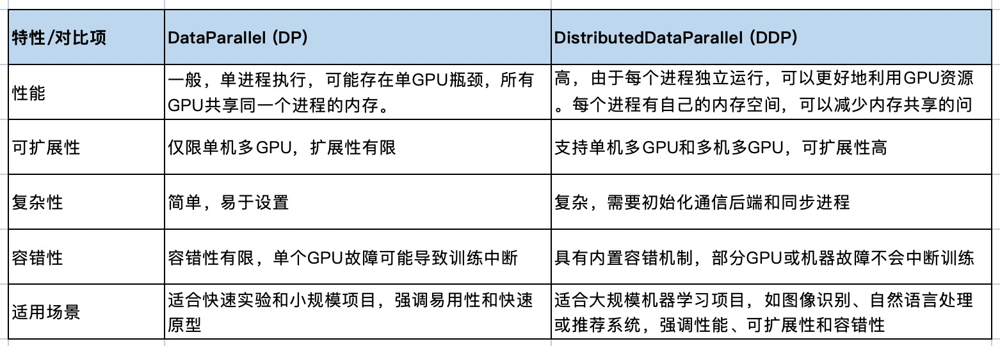

[English](./README.en.md) · [文章目录](../../README.md) · [官网阅读](https://www.theriseunion.com/zh/blog/pytorch-parallel-training.html)

# PyTorch 分布式训练完全指南：从入门到精通

睿思智联 · 2024/10/31 08:00（北京时间）

全面解析PyTorch分布式训练技术，深入对比DataParallel和DistributedDataParallel的优劣，结合实例讲解多GPU训练实现，助您掌握高效的分布式训练部署。



摘要：本文全面介绍 PyTorch 分布式训练的核心概念和实践技巧。从数据并行到模型并行，详细讲解了 DistributedDataParallel、混合精度训练等关键技术。结合 HAMi 的智能调度能力，展示如何更高效地进行大规模分布式训练，帮助读者掌握企业级 AI 训练部署的要领。

## 什么是PyTorch并行训练？

PyTorch是一个流行的用Python编写的机器学习框架。在PyTorch中，并行训练允许你利用多个GPU或计算节点来加速训练神经网络和其他复杂机器学习算法的过程。这种技术尤其适用于处理大型模型和大规模数据集，否则这些数据集的处理将需要非常长的时间。

PyTorch提供了几种并行训练的机制：

- **DataParallel**: 通过一行代码实现单机多GPU训练。
- **DistributedDataParallel**: 速度更快，效率更高、更复杂。
- **RPC-Based Distributed Training (RPC)**: 适用于需要多个PyTorch服务器的先进训练架构。

### DataParallel

DataParallel允许在单台机器上使用多个GPU进行训练，而且使用起来非常简单。你只需要将你的模型封装在torch.nn.DataParallel中即可。但是，DataParallel在某些情况下可能不是最高效的选择，因为它涉及到在每个GPU之间复制数据，这可能会导致额外的通信开销。

### DistributedDataParallel
- DistributedDataParallel（DDP）是PyTorch中用于多GPU训练的更高级和更高效的机制。它不仅适用于单台机器上的多GPU训练，还可以扩展到多台机器，实现分布式训练。
- DDP通常比DataParallel更快，因为它减少了数据复制的需要，并且更有效地利用了GPU之间的通信。
- 使用DDP需要一些设置，比如初始化进程组（process group），但这是为了实现更高效的分布式训练。

### RPC-Based Distributed Training
- RPC是PyTorch提供的一种更灵活的分布式训练机制，它允许更复杂的训练结构，如分布式流水线并行和参数服务器范式。
- RPC允许在多个PyTorch服务器之间进行远程过程调用，这使得可以在不同的服务器上执行不同的计算任务。
- RPC更适合于需要高度定制的分布式训练场景。

## 理解PyTorch分布式数据并行（DDP）

PyTorch Distributed Data Parallel (DDP) 是一种先进的并行训练技术，它可以在多个GPU之间同步训练模型，这些GPU可以位于单台机器上，也可以分布在多台机器上。

### DDP的关键特性

- **可扩展性**: DDP允许无缝扩展从单个GPU到多个GPU，从单台机器到多台机器。这种可扩展性对于训练大规模模型和高效处理大数据集至关重要。
- **同步训练**: DDP使用同步训练，这意味着来自所有GPU的梯度在更新模型参数之前被平均。这确保了模型更新的连贯性，并有助于在不同的GPU之间保持模型准确性。
- **容错能力**: DDP设计有内置机制来处理硬件故障。如果一个GPU或机器失败，DDP可以恢复并继续训练。
- **性能优化**: DDP通过计算和通信的重叠来优化性能。当一个GPU进行计算时，另一个可以与其他GPU通信，减少空闲时间。

### PyTorch DDP的工作原理

1. **初始化阶段**: 每个进程初始化自己的模型副本和数据加载器。这通常使用PyTorch的torch.distributed.launch工具完成。
2. **数据分割**: 数据集在所有GPU之间分割。每个GPU处理数据的一个子集，减少内存需求并加速数据加载。
3. **前向传播**: 每个GPU独立地对其数据子集进行计算。这种并行计算确保了工作负载的均匀分布。
4. **反向传播**: 每个GPU计算的梯度在所有GPU之间平均。这种同步确保所有模型副本接收相同的梯度更新。
5. **参数更新**: 每个GPU独立地使用同步的梯度更新其模型参数。这一步确保所有GPU保持一致的模型。

## 比较PyTorch DataParallel 和 DistributedDataParallel

### 性能

**DataParallel**: 通过在多个GPU之间分割输入数据，但梯度计算仅在一个GPU上进行。这种集中化的梯度计算可能会创建瓶颈，限制整体性能。虽然DP可以有效地利用多个GPU进行前向和反向传播，但单个GPU处理梯度更新可能会变得不堪重负，尤其是对于大型模型或数据集。随着模型复杂性的增加，这种低效率变得更加明显，导致与更高级的并行训练方法相比，训练时间更长。

**DistributedDataParallel**: 在多个GPU之间分割数据和模型副本。每个GPU独立计算梯度，并在所有GPU之间同步这些梯度。这种并行方法确保计算并行发生，梯度在所有GPU之间平均，显著减少瓶颈。通过每个GPU独立执行梯度更新，DDP提供更快的训练时间和更好的性能。这种方法特别适用于训练大型模型和处理大型数据集，因为它最大限度地利用了硬件资源。

### 可扩展性

**DataParallel**: 可扩展性有限，因为它只能在单台机器上运行。由于梯度计算瓶颈，效率提升随着单台机器上的GPU数量增加而减少。这种方法在超过一定数量的GPU时扩展性较差，并且不适合处理跨多台机器的分布式训练。因此，它更适合于小型到中型规模的项目，其中硬件基础设施仅限于单台机器。

**DistributedDataParallel**: 设计具有可扩展性，支持跨多台机器的多GPU设置。这种方法可以从几台GPU扩展到数百台GPU，适用于高性能计算环境。DDP允许无缝扩展从单个GPU到多个GPU，从单台机器到多台机器，提供处理大型机器学习项目所需的灵活性。这种可扩展性对于高效训练大型模型和处理大型数据集至关重要，确保充分利用可用硬件资源。

### 复杂性
**DataParallel**：主要优势之一是它的简单性。实现DP需要的代码更改很少，这使得初学者以及寻求快速设置的人可以轻松使用。它特别适用于快速实验和小规模项目，在这些项目中，易用性是首要考虑的。简单的实现包括使用torch.nn.DataParallel包装模型，指定设备ID，然后像往常一样进行训练。这种简单性允许用户快速原型化和测试他们的模型，而不会陷入复杂的配置中。

**DistributedDataParallel**：需要更复杂的设置。实现涉及初始化通信后端，分割数据集，并确保所有进程正确同步。这种设置通常使用PyTorch的torch.distributed.launch工具来完成，该工具建立了必要的通信环境。虽然这种复杂性增加了一个额外的设置和配置层次，但它通过显著的性能提升得到了补偿。

### 容错性
**DataParallel**：容错性有限。如果在训练过程中单个GPU失败，由于梯度计算依赖于所有GPU的正常运行，进程可能会被中断或完全失败。这种缺乏容错性使得DP对于长时间运行的训练任务来说不太可靠，特别是在硬件稳定性无法保证的环境中。用户需要手动处理任何GPU故障，这可能既麻烦又耗时。

**DistributedDataParallel**：内置了容错机制，即使在某些GPU或机器失败的情况下，也能使训练过程继续进行。这些机制使得DDP能够从硬件故障中恢复，对训练过程的影响最小。这种健壮性确保了长时间运行训练任务的高可靠性，使得DDP更适合在不太稳定的环境中部署。

### 使用场景
**DataParallel**：最适合初学者和小规模实验。它适用于那些以易实现和快速原型化为首要考虑的场景。需要快速测试和迭代模型的研究人员和开发人员可以从DP的简单性和易用性中受益。它也适用于教育目的，无需复杂的设置，就能直接介绍并行训练概念。

**DistributedDataParallel**：对于在大型数据集上训练大型神经网络至关重要。它适用于那些效率、可扩展性和容错性至关重要的生产系统。大型机器学习项目，如涉及图像识别、自然语言处理或推荐系统的深度学习模型，可以从DDP的性能和健壮性中显著受益。




## 快速教程：使用DDP在PyTorch中进行多GPU训练

### 第1步：设置环境

首先，安装必要的库：

```bash
pip install torch torchvision
```

下载示例数据：

```bash
wget www.di.ens.fr/~lelarge/MNIST.tar.gz 
tar -zxvf MNIST.tar.gz
```

### 第2步：初始化DDP环境

```python
import torch
import torch.distributed as dist
import torch.multiprocessing as mp

def setup(rank, world_size):
    os.environ['MASTER_ADDR'] = 'localhost'
    os.environ['MASTER_PORT'] = '12355'
    dist.init_process_group("nccl", rank=rank, world_size=world_size)

def cleanup():
    dist.destroy_process_group()
```

### 第3步：定义模型

```python
import torch.nn as nn
from torch.nn.parallel import DistributedDataParallel as DDP

class SimpleModel(nn.Module):
    def __init__(self):
        super(SimpleModel, self).__init__()
        self.flatten = nn.Flatten()
        self.fc1 = nn.Linear(28*28, 10)
        self.relu = nn.ReLU()
        self.fc2 = nn.Linear(10, 10)
        self.fc3 = nn.Linear(10, 10)

    def forward(self, x):
        x = self.flatten(x)
        x = self.fc1(x)
        x = self.relu(x)
        x = self.fc2(x)
        x = self.relu(x)
        x = self.fc3(x)
        return x

def create_model():
    return SimpleModel()
```

### 第4步：数据加载器设置

```python
from torch.utils.data import DataLoader, DistributedSampler
from torchvision import datasets, transforms

def create_dataloader(rank, world_size, batch_size=32):
    transform = transforms.Compose([transforms.ToTensor()])
    dataset = datasets.MNIST(root='./data', train=True, download=True, transform=transform)
    sampler = DistributedSampler(dataset, num_replicas=world_size, rank=rank)
    dataloader = DataLoader(dataset, batch_size=batch_size, sampler=sampler)
    return dataloader
```

### 第5步：训练循环

```python
def train(rank, world_size, epochs=5):
    setup(rank, world_size)
    
    dataloader = create_dataloader(rank, world_size)
    model = create_model().to(rank)
    ddp_model = DDP(model, device_ids=[rank])
    
    optimizer = optim.SGD(ddp_model.parameters(), lr=0.01)
    criterion = nn.CrossEntropyLoss()
    
    for epoch in range(epochs):
        ddp_model.train()
        for batch_idx, (data, target) in enumerate(dataloader):
            data, target = data.to(rank), target.to(rank)
            optimizer.zero_grad()
            output = ddp_model(data)
            loss = criterion(output, target)
            loss.backward()
            optimizer.step()
        
        if rank == 0:
            print(f"Epoch {epoch} complete")
    
    cleanup()

def main():
    world_size = 4  # Number of GPUs
    mp.spawn(train, args=(world_size,), nprocs=world_size, join=True)

if __name__ == "__main__":
    main()
```

## 结论

PyTorch的并行训练机制为深度学习从业者提供了强大的工具，可以显著提高训练效率。虽然DataParallel提供了简单的实现，但DistributedDataParallel通常是大型训练任务的首选。通过理解这些工具的特性和使用场景，我们可以为特定需求选择最合适的并行训练策略。

## 参考资料

- Run:ai ["PyTorch Parallel Training with DDP"](https://www.run.ai/guides/distributed-computing/pytorch-parallel-training)

---

[在睿思智联官网阅读本文](https://www.theriseunion.com/zh/blog/pytorch-parallel-training.html) · [浏览更多文章](https://www.theriseunion.com/zh/blog.html)
