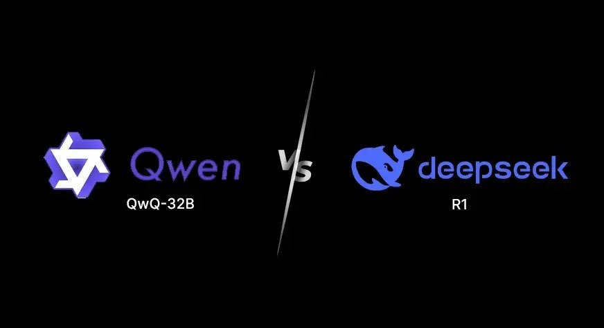
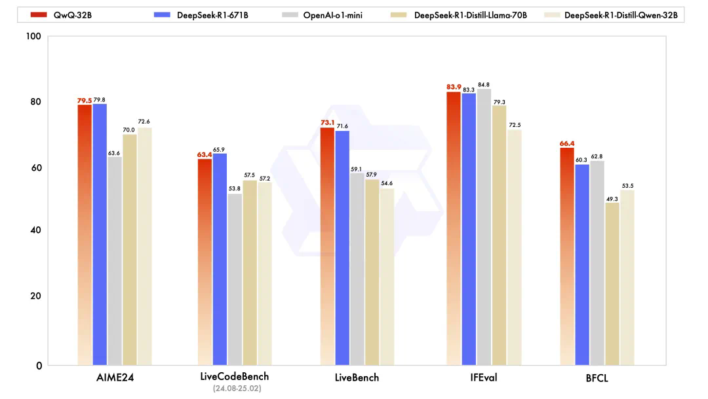
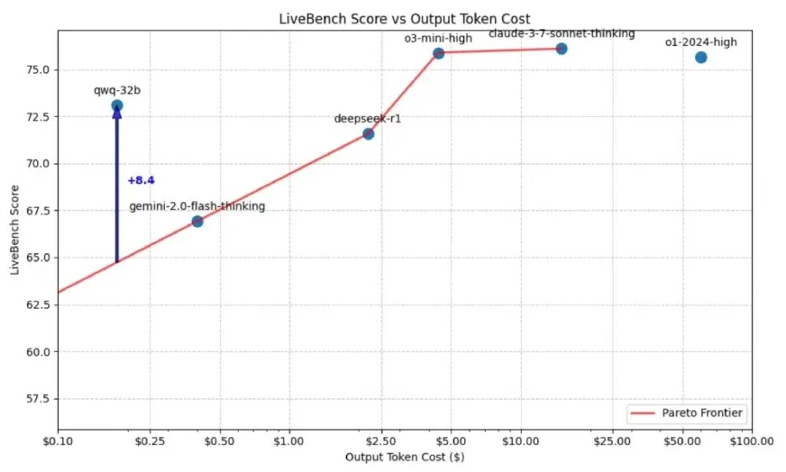

[简体中文](./README.md) · [All articles](../../README.en.md) · [Read on the website](https://www.theriseunion.com/en/blog/qwq-32b-vs-deepseek-r1-32b.html)

# QwQ-32B vs DeepSeek-R1: Which AI Excels for Your Use Case?

RiseUnion · January 01, 2025 at 08:00 (UTC+08:00)

Compare QwQ-32B and DeepSeek-R1 performance across mathematical reasoning, coding, and logical tasks. Discover which model delivers better results with limited hardware resources, analyze benchmark scores, and find the optimal AI solution based on your specific requirements and infrastructure constraints.

## Q1: What is QwQ-32B?

**A1:** QwQ-32B is a large autoregressive language model developed by Alibaba's Qwen team based on the **Qwen2.5 architecture**. It's available as a pre-trained version on Hugging Face with approximately 32.5 billion parameters. The model leverages cutting-edge deep learning techniques such as Rotary Position Encoding (RoPE) and SwiGLU activation functions, focusing specifically on enhancing reasoning, mathematical problem-solving, and coding tasks. Despite being significantly smaller than [DeepSeek-R1 (671B parameters)](https://www.theriseunion.com/en/blog/deepseek-v3-r1-671b-intro.html), QwQ-32B delivers impressive performance through advanced reinforcement learning techniques.

## Q2: What are the key features of QwQ-32B?

**A2:** QwQ-32B's key features include:

1. **Reinforcement Learning Optimization** — Multi-stage reinforcement learning (RLHF) training process specifically enhances mathematical reasoning, coding capabilities, and complex problem-solving skills.
2. **Advanced Math and Coding Capabilities** — Built-in mathematical problem correctness verifiers and code execution servers ensure high accuracy and practicality in math solutions and code outputs.
3. **Enhanced Instruction Following** — Additional reinforcement learning training improves alignment with human preferences and instruction understanding, enabling more stable performance in multi-turn dialogues and instruction-based tasks.
4. **Agent-Based Reasoning** — Adaptive environmental feedback mechanisms improve the accuracy and coherence of multi-step logical decision-making.
5. **Competitive Performance** — Despite its smaller size, QwQ-32B performs comparably to much larger models across multiple benchmarks.
6. **Extended Context Length** — Supports 131,072 tokens, enabling processing of long documents, complex proofs, and large codebases.
7. **Multilingual Support** — Handles 29+ languages, satisfying global users' needs in multilingual scenarios.
8. **Open Source** — QwQ-32B is freely available for developers to use.

## Q3: How does QwQ-32B perform?

According to official benchmark results from Alibaba ([Reference 1](https://news.qq.com/rain/a/20250307A01SEF00)/[Reference 2](https://wallstreetcn.com/articles/3742453)), QwQ-32B demonstrates exceptional performance across key evaluations:

Here are the LiveBench scores for the cutting-edge reasoning models, showing that QwQ-32B's score is between DeepSeek-R1 and o3-mini, while its cost is only 1/10 of theirs:

- **Mathematical Reasoning**: QwQ-32B scored 79.5 on the AIME24 evaluation set, nearly matching [DeepSeek-R1-617B's](https://www.theriseunion.com/en/blog/deepseek-v3-r1-671b-intro.html) 79.8 and significantly outperforming OpenAI o1-mini's 63.6.
- **Programming Capabilities**: In LiveBench tests, QwQ-32B scored 73.1, exceeding DeepSeek-R1's 71.6, demonstrating superior code functionality. However, on LiveCodeBench, QwQ-32B achieved 63.4, slightly below DeepSeek-R1's 65.9, but still demonstrating strong code generation and execution capabilities.
- **Logical Reasoning**: QwQ-32B scored 66.4 in BFCL tests, outperforming DeepSeek-R1's 60.3, showing particular strength in structured and logical problem-solving suitable for multi-step reasoning tasks.

Additionally, through extended context length capabilities and reinforcement learning fine-tuning, QwQ-32B maintains high accuracy and coherence in multi-turn conversations and complex tasks.

## Q4: What GPU requirements are needed to deploy QwQ-32B?

**A4:** For QwQ-32B inference tasks, the computational requirements are lower than for training, but still demand substantial GPU resources to ensure response speed and accuracy:

- **Recommended GPUs**: High-performance GPUs such as NVIDIA A100, V100, H100, or equivalent. For high-concurrency, large-scale query scenarios, modern GPUs like A100 and H100 are particularly suitable.
- **Memory Requirements**: GPUs with at least 40GB VRAM are recommended, such as A100 40GB or 80GB variants, to fully leverage QwQ-32B's capabilities for processing long texts and complex reasoning tasks.
- **Compute Capacity**: Significant floating-point computation capabilities (FP16, BF16) are required to ensure efficient inference execution.

For large-scale training (if fine-tuning or full training is needed), it's recommended to use a multi-card distributed training environment equipped with GPUs having 40GB or higher memory per card (such as A100 80GB or H100), paired with high-performance CPUs and SSD storage to ensure overall training efficiency. For more comprehensive information about hardware requirements for various model sizes, see the [DeepSeek GPU Requirements Guide](https://www.theriseunion.com/en/blog/deepseek-v3-r1-671b-gpu-requirements.html).

## Q5: What are the key differences between QwQ-32B and DeepSeek-R1-32B?

**A5:** While both QwQ-32B and DeepSeek-R1-32B are 32B-scale models with over 32 billion parameters, they differ in several key aspects:

**Architectural Differences**:

- **QwQ-32B** is based on the Qwen2.5 architecture, with emphasis on text reasoning, mathematical and coding tasks optimization, suitable for multi-turn dialogues and instruction following.
- **DeepSeek-R1-32B** is based on the [DeepSeek architecture](https://www.theriseunion.com/en/blog/deepseek-v3-r1-671b-intro.html), focusing on more efficient **inference performance**, particularly excelling in AI compute and inference engine compatibility.

**Optimization Focus**:

- **QwQ-32B** primarily focuses on optimization for **multi-turn dialogues**, **generation tasks**, and **natural language understanding**, leveraging **Reinforcement Learning from Human Feedback (RLHF)** and **large-scale pre-training** strategies to enhance multi-task adaptability.
- **DeepSeek-R1-32B** emphasizes **inference efficiency** and **heterogeneous compute resource compatibility**, with notable advantages in supporting different hardware platforms and improving inference speed.

**Computational Resources and Hardware Requirements**:

- **QwQ-32B** primarily targets NVIDIA platforms, supporting standard **A100 or V100 GPUs** and can perform model inference with **fp16 or bf16 precision**, but lacks extensive adaptation for domestic hardware vendors, potentially underperforming on non-NVIDIA accelerators.
- **DeepSeek-R1-32B**, due to DeepSeek's popularity, has received extensive support and performance optimization from domestic vendors, offering advantages in cross-platform compatibility and heterogeneous compute resource management.

For a detailed comparison of different DeepSeek models in the series, see the [DeepSeek R1 Model Series Introduction](https://www.theriseunion.com/en/blog/deepseek-r1-models-intro.html).

## Q6: Which inference model is better: QwQ-32B or DeepSeek-R1-32B?

**A6:** QwQ-32B is considered a direct competitor to DeepSeek-R1, and given its scale, it potentially outperforms DeepSeek-R1 in some aspects. Let's compare these models:

- **Model Scale**: QwQ-32B has 32 billion parameters, significantly smaller than [DeepSeek-R1 (671 billion parameters)](https://www.theriseunion.com/en/blog/deepseek-v3-r1-671b-intro.html). This makes QwQ-32B more performance-efficient and capable of running on less robust hardware.
- **Mathematical Reasoning (AIME24)**: Both models score similarly in mathematical reasoning tests: QwQ-32B at 79.5 versus DeepSeek-R1 at 79.8. This indicates QwQ-32B achieves nearly identical mathematical reasoning capabilities to the much larger DeepSeek-R1.
- **Coding Capabilities**: In LiveBench tests, QwQ-32B scored 73.1, exceeding DeepSeek-R1's 71.6, demonstrating superior code functionality and execution. However, in LiveCodeBench tests, QwQ-32B scored 63.4, slightly below DeepSeek-R1's 65.9, suggesting QwQ-32B may lag slightly in specific coding benchmarks.
- **Logical Reasoning**: QwQ-32B scored 66.4 in BFCL tests, outperforming DeepSeek-R1's 60.3, demonstrating stronger capabilities in structured and logical problem-solving suitable for multi-step reasoning tasks.
- **Web Search Capabilities**: QwQ-32B features enhanced real-time search capabilities, more effectively accessing and processing current information, while DeepSeek-R1's web search functionality is relatively limited.
- **Image Input Support**: DeepSeek-R1 supports processing and analyzing images, while QwQ-32B is limited to text processing, making DeepSeek-R1 more suitable for multimodal applications.
- **Computational Efficiency**: QwQ-32B is designed to operate on lower computational resources than DeepSeek-R1, making it more accessible for resource-constrained users.
- **Speed**: Due to architectural optimizations, QwQ-32B processes most tasks faster, while DeepSeek-R1, with its larger parameter count, may generate responses more slowly, particularly in real-time interactions.
- **Accuracy**: QwQ-32B offers high accuracy but occasionally might miss details in complex tasks. While DeepSeek-R1 is similarly accurate, it may produce minor execution errors in some code-related outputs.

For more about DeepSeek's GPU requirements and hardware recommendations, see the [DeepSeek GPU Requirements Guide](https://www.theriseunion.com/en/blog/deepseek-v3-r1-671b-gpu-requirements.html).

## Q7: When should you use QwQ-32B vs DeepSeek-R1?

**A7.1 Choose QwQ-32B when:**

- You need efficient reasoning and coding precision with limited hardware resources: QwQ-32B delivers top-tier performance with a smaller model footprint (32B parameters), suitable for individuals or teams with resource constraints.
- Logical and mathematical reasoning are priorities: QwQ-32B outperforms DeepSeek-R1 in logical reasoning (BFCL: 66.4 vs 60.3) and matches its mathematical capabilities, making it ideal for structured problem-solving.
- Fast execution of text processing tasks is essential: Being smaller and optimized, QwQ-32B responds faster, making it more suitable for real-time applications.
- Web search and real-time data retrieval are important: QwQ-32B's superior web search capabilities make it the better choice for tasks requiring access to current information.
- You're focused on multilingual text processing: With support for 29+ languages, QwQ-32B is a powerful choice for multilingual tasks without requiring extensive infrastructure.

**A7.2 Choose DeepSeek-R1 when:**

- You need a large-scale multimodal model: DeepSeek-R1 supports both text and image inputs, making it more suitable for multimodal AI applications (document analysis, image description, computer vision tasks).
- Coding execution accuracy is more important than speed: DeepSeek-R1 scores slightly higher than QwQ-32B on LiveCodeBench (65.9 vs 63.4), making it preferable when precise functional correctness is required.
- You have access to high-end hardware resources: DeepSeek-R1 requires powerful computational resources, making it suitable if you have robust GPU or cloud computing infrastructure.
- You need complex AI-assisted research and content generation: DeepSeek-R1's broader application domain enables more detailed and precise responses, ideal for extensive research and long-form content creation.
- You require more comprehensive responses: While QwQ-32B is optimized for efficiency, DeepSeek-R1's larger scale and broader training dataset may provide richer, more contextually aware answers.

For a detailed breakdown of all available [DeepSeek-R1 model versions and their specific use cases](https://www.theriseunion.com/en/blog/deepseek-r1-models-intro.html), see the comprehensive model introduction guide.

## **Summary**

Overall, QwQ-32B is an efficient and powerful reasoning model that approaches [DeepSeek-R1's performance](https://www.theriseunion.com/en/blog/deepseek-v3-r1-671b-intro.html) while being more economical in computational resources, making it well-suited for advanced problem-solving and coding tasks. Although it lacks image processing capabilities, its speed and adaptability make it a compelling choice for users prioritizing efficiency and versatility. For deployment in enterprise environments, consider reviewing the [DeepSeek GPU hardware requirements](https://www.theriseunion.com/en/blog/deepseek-v3-r1-671b-gpu-requirements.html) to ensure optimal performance.

---

[Read this article on the RiseUnion website](https://www.theriseunion.com/en/blog/qwq-32b-vs-deepseek-r1-32b.html) · [Explore more articles](https://www.theriseunion.com/en/blog.html)
