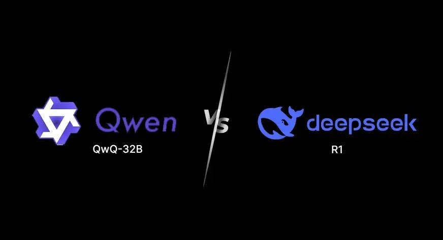
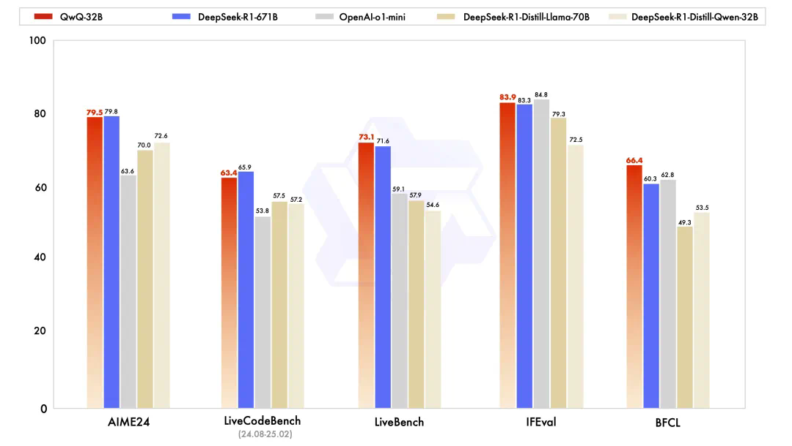
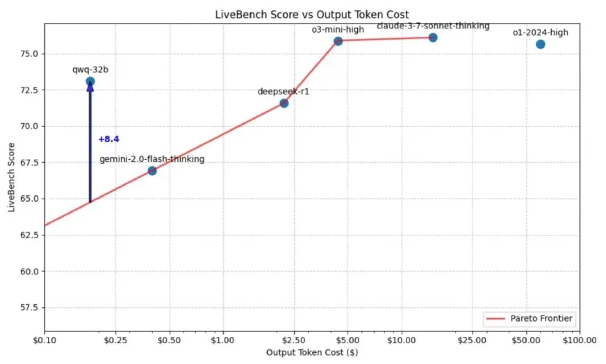

[English](./README.en.md) · [文章目录](../../README.md) · [官网阅读](https://www.theriseunion.com/zh/blog/qwq-32b-vs-deepseek-r1-32b.html)

# QwQ-32B对比DeepSeek-R1：性能与资源平衡的最佳选择

睿思智联 · 2025/03/10 08:00（北京时间）

全面对比QwQ-32B与DeepSeek-R1模型在数学推理、编程与逻辑任务上的性能差异。分析两款模型的硬件需求、响应速度和准确性，帮您根据实际场景需求和资源限制选择最优性价比的AI大模型，降低部署成本同时保证推理质量。

## Q1: 什么是 QwQ-32B？

**A1:** QwQ-32B 是阿里巴巴 Qwen 团队基于 **Qwen2.5** 架构开发的一款大型自回归语言模型，参数规模约为 320 亿（325 亿）左右。该模型在 Hugging Face 上开源并提供预训练权重，专注于提升推理、数学问题解决和编码等任务的能力。尽管体积远小于某些超大规模模型（例如 [DeepSeek-R1（6710 亿参数）](https://www.theriseunion.com/zh/blog/deepseek-v3-r1-671b-intro.html) 的整体参数达到数千亿，但实际推理部分激活 32B 参数），QwQ-32B 通过先进的强化学习技术，确保在性能上能与更大模型媲美。

## Q2: QwQ-32B 的主要特性是什么？

**A2:** QwQ-32B 模型的主要特点包括：

1. **强化学习优化** — 采用多阶段强化学习（RLHF）训练过程，专门优化数学推理、编码能力以及复杂问题解决能力。
2. **先进的数学与编码能力** — 内置数学问题准确性验证器与代码执行服务器，确保输出的数学答案和代码具备较高的正确性和实用性。
3. **增强的指令跟随能力** — 通过额外的强化学习，进一步提升了模型对人类指令的理解和执行能力，使得模型在多轮对话和指令性任务中表现更加稳定。
4. **基于代理的推理** — 模型能够根据环境反馈调整推理过程，提高多步逻辑决策的准确性和连贯性。
5. **竞争力的性能** — 尽管模型较小，QwQ-32B 在多项基准测试中与更大规模的模型表现相当。
6. **扩展的上下文长度** — 支持长达 131,072 个标记的输入，能够处理长文档、复杂证明以及大规模代码库等任务。
7. **多语言支持** — 支持 29 种及以上语言，满足全球用户在多语言场景下的需求。
8. **开源** — QwQ-32B 模型是开源的，供开发者自由使用。

## Q3：QwQ-32B 的性能表现如何？

根据阿里巴巴官方发布的基准测试结果([参考 1](https://news.qq.com/rain/a/20250307A01SEF00)/[参考 2](https://wallstreetcn.com/articles/3742453))，QwQ-32B 在多项关键评测中表现优异：

以下是前沿推理模型的 LiveBench 分数，显示 QwQ-32B 的得分介于 DeepSeek-R1 和 o3-mini 之间，而成本仅为它们的 1/10：

- **数学推理**：在 AIME24 评测集上，QwQ-32B 达到 79.5 分，几乎与 [DeepSeek-R1-617B](https://www.theriseunion.com/zh/blog/deepseek-v3-r1-671b-intro.html) 的 79.8 分持平，远超 OpenAI o1-mini 的 63.6 分。
- **编程能力**：在 LiveBench 测试中，QwQ-32B 的得分为 73.1，高于 DeepSeek-R1 的 71.6；而在 LiveCodeBench 上得分 63.4，与 DeepSeek-R1 的 65.9 稍有差距，但总体依然表现出较强的代码生成与执行能力。
- **通用能力**：在 LiveBench、IFEval 和 BFCL 等评测中，QwQ-32B 的表现均略超 DeepSeek-R1，特别是在逻辑推理（BFCL 得分 66.4 对比 DeepSeek-R1 的 60.3）上具有明显优势。

此外，通过扩展上下文长度和强化学习调优，QwQ-32B 能够在多轮对话和复杂任务中保持较高的准确性和连贯性。

## Q4：部署 QwQ-32B 需要什么样的 GPU？

**A4:** 对于 QwQ-32B 的推理任务，通常不需要与训练时那么高的计算需求，但仍然需要一定的 GPU 性能来确保响应速度和精确度：

- 推荐 GPU：至少需要具有较强计算能力的 GPU，如 NVIDIA A100、V100、H100 或其他高性能的 GPU。尤其是在高并发、大规模查询的场景下，A100 和 H100 这些较为现代的 GPU 更为适合。
- 显存要求：推荐显存至少为 40GB 以上的 GPU，例如 A100 40GB 或 80GB 版本，这样可以充分利用 QwQ-32B 在处理长文本、复杂推理任务时的需求。
- 计算能力：需要较高的浮点计算能力（FP16、BF16），以确保推理的高效执行。

对于大规模训练（若需要微调或全量训练），建议使用多卡分布式训练环境，配备每卡 40GB 或更高显存的 GPU（如 A100 80GB 或 H100），并搭配高性能 CPU 和 SSD 存储，以确保整体训练效率。有关不同模型规模的硬件需求的更全面信息，请参阅 [DeepSeek GPU 需求指南](https://www.theriseunion.com/zh/blog/deepseek-v3-r1-671b-gpu-requirements.html)。

## Q5: QwQ-32B 与 DeepSeek-R1-32B 的关键区别是什么？

**A5:** QwQ-32B 和 DeepSeek-R1-32B 都是 32B 级别的模型，拥有 32 亿以上的参数，但它们有几个关键的不同之处：

**模型架构差异**：

- **QwQ-32B**：基于 Qwen2.5 架构，重点在于文本推理、数学和编码任务的优化，适合多轮对话和指令跟随。
- **DeepSeek-R1-32B**： 基于 [DeepSeek 架构](https://www.theriseunion.com/zh/blog/deepseek-v3-r1-671b-intro.html)，专注于更高效的 **推理性能**，特别是在 AI 计算和推理引擎的适配方面表现突出。

**优化方向**：

- **QwQ-32B** 的优化主要集中在**多轮对话**、**生成任务**和**自然语言理解**方面，其使用的 **强化学习（RLHF）** 和 **大规模预训练** 策略，提升了模型的多任务适应能力。
- **DeepSeek-R1-32B** 侧重于 **推理效率** 和 **异构计算资源适配**，特别是在支持不同硬件平台和提升推理速度上具有明显优势。

**计算资源和硬件要求**：

- **QwQ-32B** 以 NVIDIA 为主，支持标准的 **A100 或 V100 GPU**，并且可以通过 **fp16 或 bf16 精度** 来进行模型推理，但仍然缺乏国内厂商的广泛适配，在国产卡的表现力可能不及N卡。
- **DeepSeek-R1-32B** 由于DS 的出圈，得到了国内众多厂商纷纷支持和性能优化，在跨平台适配和异构计算资源管理方面更有优势。

有关 DeepSeek 系列中不同模型的详细比较，请参阅 [DeepSeek R1 模型系列介绍](https://www.theriseunion.com/zh/blog/deepseek-r1-models-intro.html)。

## Q6：QwQ-32B 与 DeepSeek-R1-32B 哪个推理大模型更好？

**A6:** QwQ-32B 被视为 DeepSeek-R1 的直接竞争者，考虑到它的规模，它甚至有可能超越 DeepSeek-R1。我们来一一对比这两个模型：

- **模型规模**： QwQ-32B 拥有 320 亿个参数，比 [DeepSeek-R1 拥有 6710 亿参数](https://www.theriseunion.com/zh/blog/deepseek-v3-r1-671b-intro.html)小得多。这一点使得 QwQ-32B 在性能上更加高效，可以在较低的硬件资源上运行。
- **数学推理能力（AIME24）**： 两个模型在数学推理测试中得分相差无几：QwQ-32B 为 79.5，DeepSeek-R1 为 79.8。这表明，QwQ-32B 在数学推理方面的表现与 DeepSeek-R1 这个更大规模的模型几乎相同。
- **编码能力**： 在 LiveBench 测试中，QwQ-32B 的得分为 73.1，高于 DeepSeek-R1 的 71.6，表明它在代码功能和执行方面表现优异。但在 LiveCodeBench 测试中，QwQ-32B 的得分为 63.4，稍微逊色于 DeepSeek-R1 的 65.9，这意味着 QwQ-32B 在特定的编码基准上可能稍微落后。
- **逻辑推理能力**： QwQ-32B 在 BFCL 测试中得分为 66.4，高于 DeepSeek-R1 的 60.3，显示出它在结构化和逻辑问题解决方面的强大能力，适用于需要多步骤推理的任务。
- **网页搜索能力**： QwQ-32B 集成了更强的实时搜索能力，可以更有效地访问和处理最新信息，而 DeepSeek-R1 的网页搜索功能相对有限。
- **图像输入支持**： DeepSeek-R1 支持处理和分析图像，而 QwQ-32B 仅限于文本处理，因此对于多模态应用而言，DeepSeek-R1 更为适合。
- **计算效率**： QwQ-32B 设计上能在比 DeepSeek-R1 更低的计算资源上运行，因此对于资源有限的用户来说，QwQ-32B 是更为可访问的选择。
- **速度**： 由于架构优化，QwQ-32B 在处理大部分任务时更快，而 DeepSeek-R1 由于参数更多，生成响应时可能会更慢，尤其是在实时交互时。
- **准确性**： QwQ-32B 提供了高准确性，但在一些复杂任务中，偶尔可能会错过一些细节。尽管 DeepSeek-R1 同样准确，但在某些编码相关的输出上，可能会出现轻微的执行错误。

有关 DeepSeek 的 GPU 需求和硬件推荐的更多信息，请参阅 [DeepSeek GPU 需求指南](https://www.theriseunion.com/zh/blog/deepseek-v3-r1-671b-gpu-requirements.html)。

## Q7：什么时候使用 QwQ-32B vs DeepSeek-R1？

**A7.1 选择 QwQ-32B：**

- 需要高效的推理与编码精度，但硬件资源有限：QwQ-32B 由于较小的模型规模（320 亿参数），在不需要高端基础设施的情况下提供顶级性能，适合资源有限的个人或团队。
- 优先考虑逻辑与数学推理：QwQ-32B 在逻辑推理（BFCL：66.4 vs 60.3）方面超越了 DeepSeek-R1，且在数学能力上与 DeepSeek-R1 不分上下，适合结构化问题解决。
- 需要快速执行文本处理任务：由于 QwQ-32B 更小且经过优化，它的响应速度更快，因此更适合实时应用。
- 网页搜索和实时数据获取很重要：QwQ-32B 拥有更强的网页搜索能力，是需要获取最新信息的任务的更佳选择。
- 专注于多语言文本处理：QwQ-32B 支持 29 种及以上语言，是处理多语言任务的强大选择，而无需依赖大型基础设施。

**A7.2 选择 DeepSeek-R1：**

- 需要大规模的多模态模型：DeepSeek-R1 支持文本和图像输入，更适合需要多模态 AI 应用（如文档分析、图像描述和计算机视觉任务）。
- 编码执行的准确性比速度更重要：DeepSeek-R1 在 LiveCodeBench 测试中的得分略高于 QwQ-32B（65.9 vs 63.4），如果需要精确的功能正确性，DeepSeek-R1 更适合。
- 拥有高端硬件资源：DeepSeek-R1 需要强大的计算资源，如果你有强大的 GPU 或云计算基础设施，可以利用它进行大规模应用。
- 需要复杂的 AI 辅助研究和内容生成：DeepSeek-R1 的更广泛应用领域使得它能够生成更为详细、精确的响应，是广泛研究和长篇内容创作的理想选择。
- 需要更全面的响应：虽然 QwQ-32B 在效率上有所优化，但 DeepSeek-R1 由于其庞大的规模和更大的训练数据集，可能会提供更丰富、更具上下文意识的回答。

有关所有可用 [DeepSeek-R1 模型版本及其特定用例](https://www.theriseunion.com/zh/blog/deepseek-r1-models-intro.html)的详细分析，请参阅综合模型介绍指南。

## **总结**

总的来说，QwQ-32B 是一款高效且能力强大的推理模型，在性能上接近 [DeepSeek-R1](https://www.theriseunion.com/zh/blog/deepseek-v3-r1-671b-intro.html)，但在计算资源上更加节省，适合处理高级问题解决和编码任务。尽管它缺乏图像处理能力，但其速度和适应性使其成为优先考虑效率和多功能性的用户的强大选择。对于企业环境中的部署，建议参考 [DeepSeek GPU 硬件需求](https://www.theriseunion.com/zh/blog/deepseek-v3-r1-671b-gpu-requirements.html)，以确保最佳性能。

---

[在睿思智联官网阅读本文](https://www.theriseunion.com/zh/blog/qwq-32b-vs-deepseek-r1-32b.html) · [浏览更多文章](https://www.theriseunion.com/zh/blog.html)
