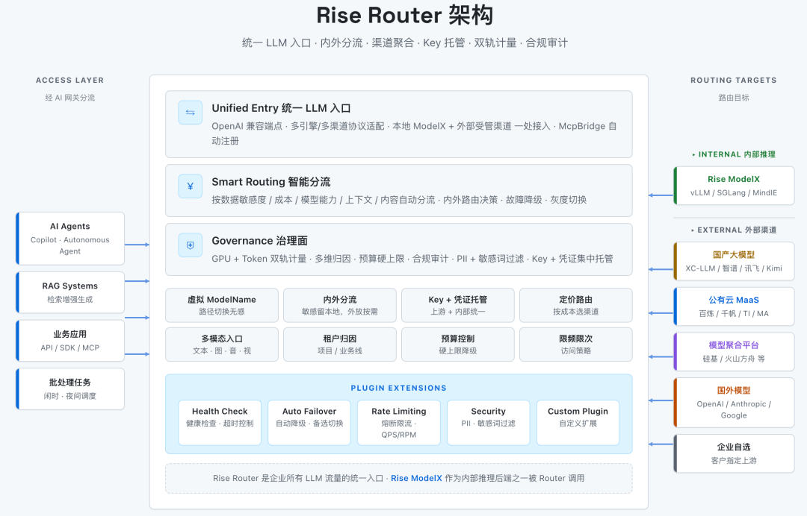

[简体中文](./README.md) · [All articles](../../README.en.md) · [Read on the website](https://www.theriseunion.com/en/blog/rise-router-hybrid-token-governance.html)

# Rise Router: Reshaping Enterprise Hybrid Token Governance

RiseUnion · April 29, 2026 at 08:00 (UTC+08:00)

In the Token era, enterprise LLM traffic flows through many channels — local inference, domestic LLMs, public-cloud MaaS, aggregator platforms. Multi-channel is fine; the missing piece is a single entry point. Rise Router collapses internal and external LLM traffic onto one OpenAI-compatible endpoint, routes by policy, and unifies key custody, dual-track metering, budget control, and outbound compliance audit on a single governance plane.

By 2026, the enterprise AI conversation has shifted from "can we get it running" to "how do we govern it."

In the License era, software was billed per seat. In the Token era, everything is billed per token — and an enterprise's token supply is no longer a single channel. A typical customer setup looks like this: a domestic GPU cluster running local inference for core business workloads; non-sensitive traffic from various departments calling out to domestic LLM providers; teams chasing frontier capabilities also wired into model aggregation platforms or public-cloud MaaS. Each channel is a separate API, a separate key, a separate meter, a separate compliance posture.

Multi-channel coexistence makes sense — picking the right model per scenario is correct. The problem is that **this token traffic has no single entry point**. Departments duplicate integrations, keys are scattered, internal and external metering live on two different ledgers, and compliance audits stop at the boundary. These are real governance gaps that surface in the Token era.

**[Rise Router](https://www.theriseunion.com/en/product/router.html)**, recently released by RiseUnion, is positioned as the **unified entry point and governance plane** for enterprise LLM token traffic. The business side calls every LLM capability through one endpoint; Router internally routes the request by policy to local inference or an externally managed channel. Finance, compliance, and operations see all LLM consumption on a single governance plane.

## All LLM Traffic Flows Through Rise Router

In a customer's private deployment, Rise Router sits on top of [Rise ModelX](https://www.theriseunion.com/en/product/modelx.html): business applications integrate with Router, and Router routes requests to whichever inference channel the policy selects. **Rise ModelX** (and the [Rise VAST](https://www.theriseunion.com/en/product/vast.html) + [Rise CAMP](https://www.theriseunion.com/en/product/camp.html) domestic compute fabric beneath it) is **one of the local channels** Router can route to, sitting alongside externally managed channels.

Router currently routes across six channel types:

1. Local inference: vLLM / SGLang / MindIE running on Rise ModelX, etc.
2. Direct domestic LLMs: DeepSeek / Qwen / Zhipu / iFlytek / Kimi / MiniMax, etc.
3. Public-cloud MaaS: Bailian / Qianfan / TI / MA.
4. Model aggregation platforms: SiliconFlow / Volcano Ark, etc.
5. Foreign models: upstream channel providers built on open-source projects like new-api / one-api.
6. Customer BYOC: take the customer's existing third-party API keys under Router's unified governance.

For enterprises that already operate a self-built LLM gateway — or one based on open-source projects like new-api or one-api — Rise Router offers two paths. First, hook the existing gateway into Router as an upstream channel and overlay enterprise-grade multi-tenant authorization, dual-track Token / GPU FinOps, outbound compliance audit, and hard budget enforcement on top of it. Second, replace the self-built gateway outright, closing the gaps such gateways typically have around domestic-compute scheduling, tenant-level hard budget caps, PII / sensitive-content outbound audit, and coordination with the enterprise's existing data-classification and LLM guardrail stack.

## Six Core Capabilities

### Unified OpenAI-Compatible Endpoint

A single business-facing endpoint hides the protocol differences between local inference (vLLM / SGLang / MindIE) and external channels. Endpoints register automatically, HTTP and HTTPS are served on both ports simultaneously, and MCP / Function Call / JSON Mode / streaming SSE are all supported.

### Internal/External Smart Routing

Router selects a path automatically based on data sensitivity, cost, model capability, context length, and request content, and matches the right model per task type (chat / code / long context / multimodal). It coordinates with the enterprise's existing data classification and LLM guardrail components — classification and interception policies are enforced uniformly on the governance plane. A virtual ModelName makes path switches invisible to business code; failures fall back to a backup channel automatically; multi-key / multi-account / multi-region load balancing absorbs high concurrency.

### Centralized Key and Credential Custody

Upstream vendor keys, Rise ModelX internal credentials, tenant/project/user authorization, key rotation and revocation, and access policies (schedules, IP allowlists, rate and quota limits) are all unified on the Router governance plane. Business applications never hold an external key.

### Dual-Track Token Metering (GPU + API)

GPU-time billing for local Rise ModelX and token billing for external APIs are **attributed on a unified track**, broken down by tenant / project / business line / API key on a single FinOps dashboard.

### Budget Control and Runaway Prevention

Hard budget caps at the tenant and business-line level trigger automatic downgrade, alert, or hard block; cost-anomaly alerts, off-peak / nighttime scheduling, and rate / quota limits provide layered protection against runaway Agent consumption or human misuse.

### Outbound Compliance Audit

Full request-path logging covers all internal and external traffic, including PII interception, sensitive-content filtering, and multimodal outbound audit. Combined with the enterprise's data classification and LLM guardrail policies, outbound behavior is governed in a controlled fashion that meets compliance audit requirements for finance and state-owned enterprises.

## Target Customers and Typical Scenarios

Rise Router customers share a common profile: a local domestic-compute foundation (Ascend, Kunlun, Cambricon and other domestic accelerators managed by Rise CAMP), combined with growing demand for external token capacity, cost optimization for non-sensitive workloads, and outbound compliance audit requirements.

Three typical scenarios:

- **Unified routing by sensitivity and scenario**: Router coordinates with the enterprise's data classification and LLM guardrail components and, based on their classification, routes sensitive requests to local Rise ModelX inference while sending other traffic to externally managed channels by cost or capability. Local saturation triggers automatic spillover, upstream failures fall back to backup channels, and every outbound request is logged end-to-end — meeting the regulatory audit bar for finance, securities, and similarly regulated industries.

- **Unified Agent access to LLM capabilities**: Agent / Copilot / RAG workloads call both local and external models through Rise Router, with full support for MCP / Function Call / JSON Mode / streaming SSE. Rate / quota limits and hard budget caps prevent runaway Agent consumption; multimodal (text / image / audio / video) is fully covered.

- **Multi-channel canary and model selection**: A single workload can be wired to several upstreams (local Rise ModelX, domestic LLMs, public-cloud MaaS, aggregation platforms), traffic-split by ratio, with quality metrics and token cost reconciled side by side. This supports A/B comparisons during the domestic-compute migration window and lets product teams choose models based on real production data rather than vendor benchmarks.

## Closing

External LLM capabilities are abundant; a local domestic-compute cluster is a non-negotiable foundation. Whether the two cooperate smoothly inside an enterprise hinges on whether there's a unified governance layer in between. Rise Router turns that layer into a product: all LLM traffic flows through it, and the business, finance, and compliance teams see the whole picture on the same governance plane.

---

[Read this article on the RiseUnion website](https://www.theriseunion.com/en/blog/rise-router-hybrid-token-governance.html) · [Explore more articles](https://www.theriseunion.com/en/blog.html)
