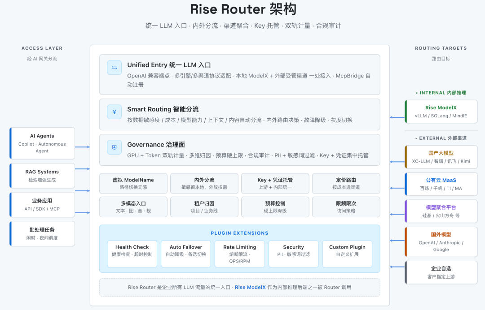

[English](./README.en.md) · [文章目录](../../README.md) · [官网阅读](https://www.theriseunion.com/zh/blog/rise-router-hybrid-token-governance.html)

# Rise Router：重塑企业级 AI 混合 Token 治理新范式

睿思智联 · 2026/04/29 08:00（北京时间）

进入 Token 时代，企业 LLM 流量来自本地推理、国产大模型、公有云 MaaS、聚合平台等多条渠道——多通道并存合理，缺的是一个统一入口。Rise Router 把内外 LLM 流量收敛到一个 OpenAI 兼容端点，按策略分流，并在同一治理面上完成 Key 托管、双轨计量、预算控制与出站合规审计。

进入 2026 年，企业 AI 投入的关注点已经从"能不能跑起来"转向"怎么管起来"。

License 时代企业按软件许可证收费，进入 Token 时代后，一切按 token 结算——而企业的 token 来源不再是单一渠道。一个典型的客户使用场景：内部信创集群跑着核心业务的本地推理；业务部门的非敏感场景在调用外部国产大模型；某些前沿能力诉求的业务团队还接入了模型聚合平台或公有云 MaaS。每一类通道都是独立的 API、独立的 Key、独立的计量、独立的合规口径。

"多通道并存"本身合理——按场景选模型是对的，问题在于**这些 token 流量缺乏一个统一入口**。各部门重复对接、Key 散落各处、内外计量分两套账、合规审计断在边界——这些都是 Token 时代真实存在的治理缺口。

睿思智联近期推出的 **[Rise Router](https://www.theriseunion.com/zh/product/router.html)**，定位为企业大模型 Token 流量的**统一入口与治理面**。业务侧通过一个端点调用所有 LLM 能力，Router 内部按策略将请求分流到本地推理或外部受管渠道；财务、合规、运维在同一治理面上看到全部 LLM 消费。

## 所有 LLM 流量都从 Rise Router 进出

Rise Router 在客户私有化环境中位于 [Rise ModelX](https://www.theriseunion.com/zh/product/modelx.html) 之上：业务应用对接 Router，Router 根据策略把请求分流到底层各类推理通道。**Rise ModelX**（以及背后的 [Rise VAST](https://www.theriseunion.com/zh/product/vast.html)、[Rise CAMP](https://www.theriseunion.com/zh/product/camp.html) 信创算力底座）是 Router 可路由的**本地通道之一**，与外部受管控渠道并列。

Router 当前可路由的通道覆盖六类：

1. 本地推理：如基于 Rise ModelX 上的 vLLM / SGLang / MindIE 等；
2. 国产大模型直连：如 DeepSeek / Qwen / 智谱 / 讯飞 / Kimi / MiniMax 等；
3. 公有云 MaaS：如百炼 / 千帆 / TI / MA；
4. 模型聚合平台：如公共平台如硅基流动 / 火山方舟；
5. 国外模型：如基于 new-api / one-api 等开源项目搭建的上游渠道服务商；
6. 企业自选 BYOC：将客户已有的第三方 API Key 托管进 Router 统一治理。

对于已有企业自建 LLM 网关、或上游基于 new-api、one-api 等开源项目搭建的企业，Rise Router 提供两条路径：一是把现有自建网关作为上游通道接入 Router，在其之上叠加企业级的多租户授权、双轨 Token / GPU FinOps、出站合规审计与预算硬阻断；二是作为升级替代，补齐自建网关在信创算力调度、租户级预算硬上限、PII / 敏感词出站审计、与企业既有数据分级和大模型围栏协同等企业治理场景下的能力空缺。

## 六大核心能力

### 统一 OpenAI 兼容入口

业务侧统一端点，屏蔽本地推理（vLLM / SGLang / MindIE）和外部渠道之间的协议差异。自动注册端点，HTTP/HTTPS 双端口同时服务，MCP / Function Call / JSON Mode / 流式 SSE 全部兼容。

### 内外分流智能路由

按数据敏感度、成本、模型能力、上下文长度、请求内容自动选路径，并按任务类型（对话 / 代码 / 长文本 / 多模态）匹配最合适的模型；可与企业既有的数据分级、大模型围栏类治理组件协同对接，相关分类与拦截策略统一在治理面落地执行。虚拟 ModelName 让路径切换业务无感；故障自动降级到备用通道，多 Key / 多账号 / 多地域负载均衡分担高并发。

### Key 与凭证集中托管

上游厂商 Key、Rise ModelX 内部凭证、租户/项目/用户多维授权、Key 轮转与吊销、访问策略（时间计划、IP 白名单、限频限次）统一在 Router 治理面。业务应用不持有任何外部 Key。

### 双轨 Token 计量（GPU + API）

本地 Rise ModelX 的 GPU 时长计费与外部 API 的 Token 计费**并轨归因**，按租户/项目/业务线/API Key 多维度展示在同一套 FinOps 看板。

### 预算控制与防失控

租户和业务线级预算硬上限，触发后自动降级、告警或硬阻断；成本异常告警、闲时/夜间调度、限频限次多层防护，防止 Agent 失控消耗或人为误用。

### 出站合规审计

完整请求链路日志覆盖内外全流量，包括 PII 拦截、敏感词过滤、多模态出站审计；配合企业数据分级与大模型围栏策略对出站行为做受控管理，满足金融、央企的合规审计要求。

## 适用客户与典型场景

Rise Router 客户的共性是：本地有信创算力基座（如 Rise CAMP 管理下的昇腾、昆仑芯、寒武纪等国产算力），同时业务增长产生外部 token 补充需求 + 非敏感业务降本诉求 + 合规对外出网审计需求等等。

三个典型场景：

- **按敏感度与场景一体化路由**：Router 与企业既有数据分级、大模型围栏类组件协同，依据其判定结果将敏感请求路由到本地 Rise ModelX 推理，其他流量按成本或能力受控外放；本地满负荷自动溢出，上游故障自动降级到备用通道。出站请求全程留痕，满足金融/证券等高合规场景的监管审计要求。

- **Agent 统一调用大模型能力**：Agent / Copilot / RAG 通过 Rise Router 调用本地与外部模型，MCP / Function Call / JSON Mode / 流式 SSE 全部兼容；限频限次和预算硬上限防止 Agent 失控消耗；多模态（文本 / 图像 / 音视频）全覆盖。

- **多渠道灰度与模型择优**：同一业务挂多家上游渠道（本地 Rise ModelX、国产大模型、公有云 MaaS、聚合平台），按流量比例灰度，效果指标和 Token 成本同台回收。既支撑国产化迁移过渡期的新老双写对比，也让业务团队基于真实线上数据做模型选型，而不是凭厂商跑分。

## 结语

外部大模型能力很丰富，本地信创集群也是必备底座。两者能否在企业内部协同顺畅，取决于中间是否有一个统一的治理层。Rise Router 把这个层做成了一个产品：所有 LLM 流量从它进出，业务侧、财务、合规在同一治理面上看到全貌。

---

[在睿思智联官网阅读本文](https://www.theriseunion.com/zh/blog/rise-router-hybrid-token-governance.html) · [浏览更多文章](https://www.theriseunion.com/zh/blog.html)
