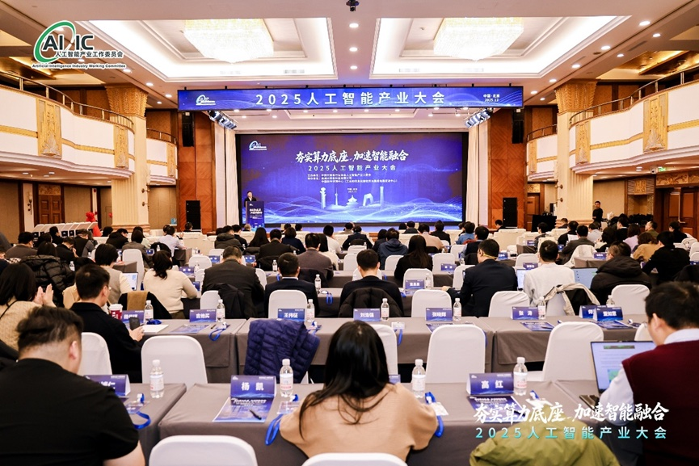
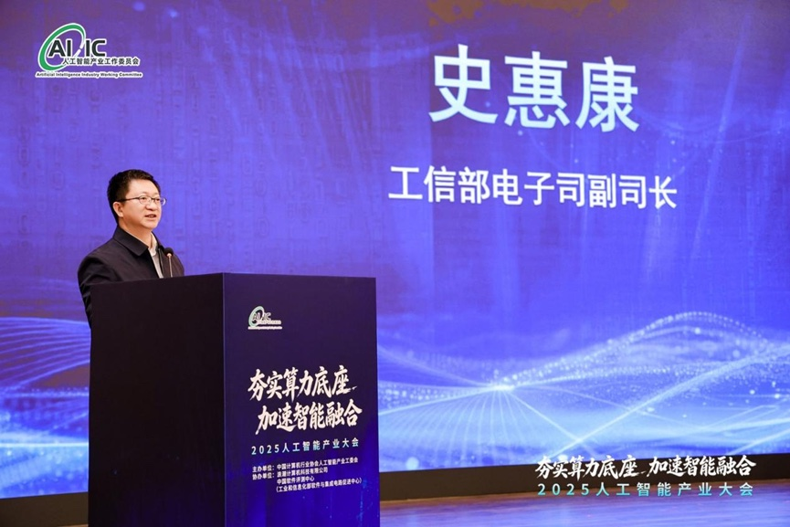
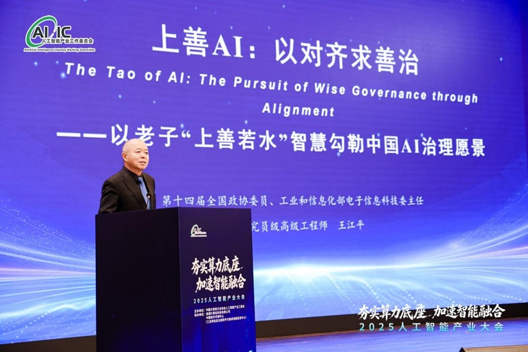
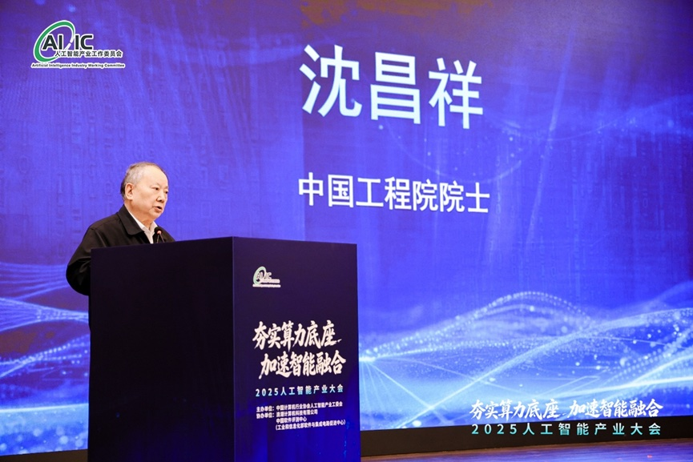
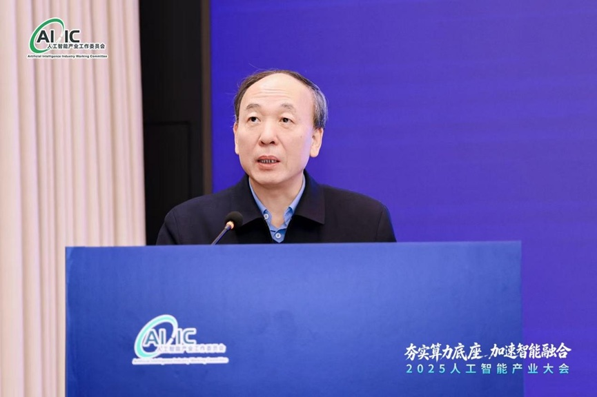
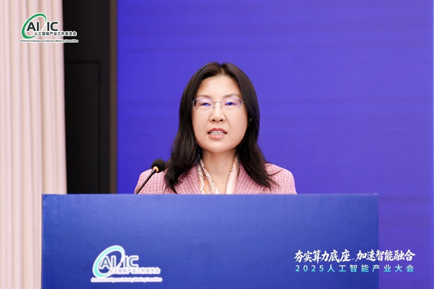
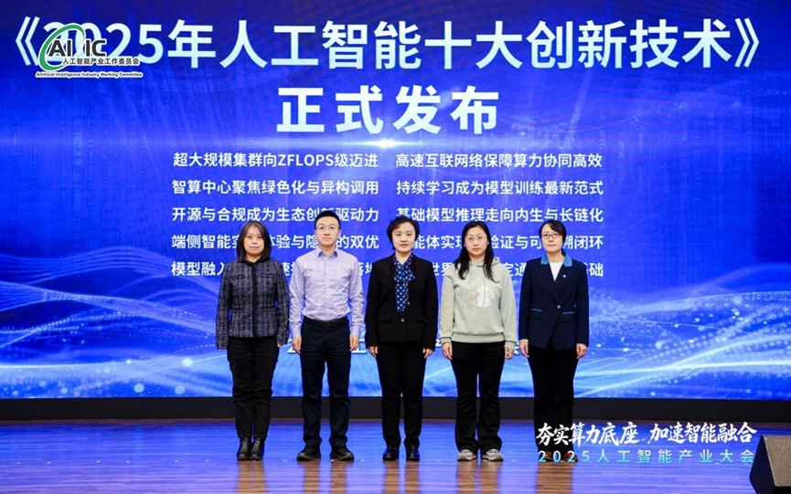
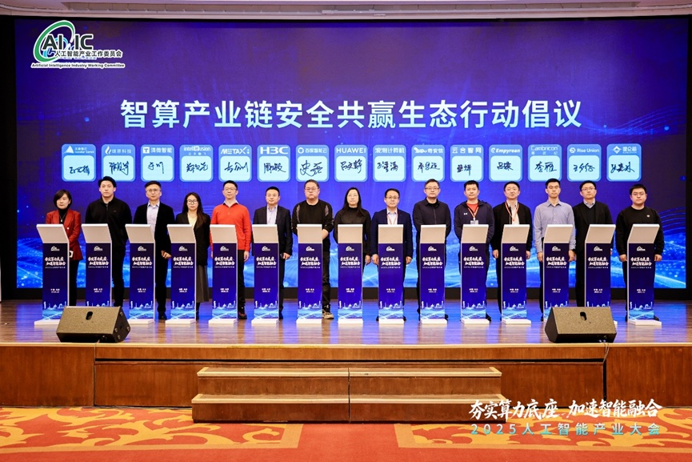

[简体中文](./README.md) · [All articles](../../README.en.md) · [Read on the website](https://www.theriseunion.com/en/blog/riseunion-2025-artificial-intelligence-industry-conference.html)

# 2025 AI Industry Conference: RiseUnion Launches Ecosystem Initiative

RiseUnion · December 26, 2025 at 08:00 (UTC+08:00)

At the 2025 Artificial Intelligence Industry Conference in Beijing, RiseUnion joined 15 leading companies including Huawei, Cambricon, and Kunlunxin to launch the 'Intelligent Computing Industry Chain Security and Win-Win Ecosystem Initiative.' As the lead organization of the AIIC Computing Pooling Working Group, RiseUnion is committed to building an autonomous, secure, and win-win intelligent computing industry chain.

On December 24, 2025, the **2025 Artificial Intelligence Industry Conference** opened in Beijing under the theme **"Building a Solid Compute Foundation, Accelerating Intelligent Integration."**

Hosted by the **Artificial Intelligence Industry Working Committee** (AIIC) of the China Computer Industry Association, and co-organized by Inspur Computer Technology Co., Ltd. and the China Software Testing Center (CSIP), the conference brought together government leaders, academicians, industry representatives, and leading researchers to explore new paths for AI industry development and drive technological innovation and deployment. The event was chaired by Hu Guodong, Chairman of AIIC and Deputy Party Secretary of the China Center for Information Industry Development.

In his opening remarks, **Shi Huikang**, Deputy Director-General of the Electronics and Information Technology Department at the Ministry of Industry and Information Technology (MIIT), emphasized:

> As a strategic technology shaping the future, artificial intelligence is a key force in building new development patterns. China is steadily advancing from an important participant to a global leader.

He called on the industry to implement the **"AI+"** initiative, build an advanced computing ecosystem, and drive integrated innovation across compute, storage, networking, and power—strengthening the foundation for industry growth. Addressing current challenges in the industry chain and supply chain, Shi outlined three priorities:

* Continue strengthening **technology breakthroughs** in core products like AI chips;
* Drive **industry upgrades** in high-end systems through domestic application traction;
* Build robust standards and IP systems, deepen industry-academia-research integration, and accelerate the transition from **"following"** and **"running alongside"** to **"leading"**.

---

## Wang Jiangping: Eastern Wisdom in AI Ethics Governance

Wang Jiangping, Member of the 14th National Committee of the Chinese People's Political Consultative Conference and former Vice Minister of MIIT, delivered a keynote titled *"Benevolent AI: Seeking Good Governance Through Alignment."* Drawing on Laozi's Eastern philosophy that "the highest good is like water," he systematically outlined Chinese wisdom and practical approaches to AI ethics governance. He proposed "agile governance" as a framework to address the uncertainties brought by rapid technological evolution, achieving dynamic balance between innovation and risk management.

Wang emphasized that human-AI alignment is central to the intelligent era, requiring coordinated design of technical constraints and ethical norms to ensure AI remains aligned with human values and societal goals. Addressing the reality that AI governance systems lag significantly behind technological development, he proposed a "four-in-one" governance framework covering institutions, technology, applications, and culture. He further noted that only through "cultural alignment" to foster mutual recognition of values among sovereign AIs can we gradually build global consensus on AI governance. This vision offers a distinctly Chinese approach to building an inclusive, stable, and resilient AI governance system.

---

## Academician Shen Changxiang: Trusted Computing as the Foundation for AI Security

Academician Shen Changxiang of the Chinese Academy of Engineering detailed the foundational and supporting role of autonomous trusted computing technology in next-generation AI systems. He noted that cybersecurity is fundamentally a computing science challenge—not something that can be addressed through passive defense alone, but requires a trusted computing system with "active immune" capabilities to fundamentally address the "black box" and uncontrollable risks facing large models.

Shen reported that this trusted computing system has been deployed at scale across multiple critical industries and important application scenarios in China, gradually forming a complete industry chain from technical standards development to core product R&D and system-level integration. He called for stronger collaboration across government, industry, academia, research, and users, building on Trusted Computing 3.0 as the technical foundation to continuously strengthen security defenses for data storage and operational environments, providing dynamic, controllable, and sustainable safeguards for the healthy development of the AI industry.

---

## Academician Zhao Chunjiang: Smart Agriculture Empowering Agricultural Power

Academician Zhao Chunjiang of the Chinese Academy of Engineering outlined the critical role of smart agriculture in driving agricultural modernization and supporting agricultural power. He noted that smart agriculture's essence lies in deep integration of three productivity factors—biotechnology, information technology, and intelligent equipment—reshaping agricultural production methods through technological synergy.

Zhao highlighted several cutting-edge achievements from his team's research in smart agriculture. In unmanned farm scenarios, fully automated operations cover thousands of acres; in intelligent breeding, deep integration of big data analytics with genomics technology dramatically shortens breeding cycles and improves efficiency, providing solid technological support for national food security. He emphasized that smart agriculture is not just a technological revolution, but a systemic transformation that shifts agriculture from "experience-driven" to "data-driven," transitioning from traditional production to a modern industrial system.

---

## Academician Duan Huiling: Interface Mechanics Bridging AI and Physical Intelligence

Academician Duan Huiling of the Chinese Academy of Sciences explored how "physical intelligence" serves as a bridge between AI and the real world, from a mechanics and engineering science perspective. She proposed reshaping the development paradigm for next-generation industrial software through "digital-intelligent mechanics," with the key being integrated modeling of materials-structure-performance and real-time coordination of design-geometry-performance.

By deeply integrating physical mechanism information with generative AI large models, this research path addresses complex engineering challenges like multi-scale and multi-physics coupling, advancing industrial software toward greater intelligence and autonomy. She also introduced ongoing efforts to build cloud-based R&D platforms and future learning centers, exploring new models of deep industry-academia-research collaboration to better serve national strategic needs in intelligent manufacturing and high-end equipment development.

---

## The Top 10 AI Innovation Technologies of 2025

Gao Hongling, Secretary-General of AIIC, along with Li Huiying (Director of the Intellectual Property Institute at the China National Industrial Information Security Development Research Center), Liu Xiaolei (Deputy Director of the Hardware Research Office at the Information Technology Research Center of the China Electronics Standardization Institute), Kong Dezhi (Director of the AI Center at the China Electronic Product Reliability and Environmental Testing Research Institute), and Zhou Lan (Deputy Chief Engineer at the Information and Industrial Integration Research Institute of the China Academy of Information and Communications Technology), jointly released *"The Top 10 AI Innovation Technologies of 2025."*

The list systematically identifies the most representative and leading-edge technological directions in AI across multiple dimensions—infrastructure upgrades, algorithm and model evolution, application innovation, and frontier exploration. These ten innovation technologies support and evolve together, collectively advancing AI toward greater efficiency, reliability, and deep integration, providing a critical technological engine for industry upgrades and the cultivation of new productive forces.

---

During the conference, **RiseUnion** joined **15** leading companies—including Huawei, Cambricon, Empyrean, Qi Anxin, Enflame, Kunlunxin, Metax, Intellifusion, Enflame, and TsingMicro—in launching the **"Intelligent Computing Industry Chain Security and Win-Win Ecosystem Initiative,"** a key highlight of the event.

The initiative addresses industry collaboration needs and future challenges in the AI sector, aiming to build a secure and trusted AI industry ecosystem. Through deep collaboration among enterprises, it seeks to unlock AI's potential while ensuring technological development serves shared human values, injecting strong momentum into digital transformation across industries.

As an active participant in AI industry ecosystem building and the lead organization of the AIIC Computing Pooling Working Group, **RiseUnion's** participation in launching this initiative reflects both its technical capabilities and industry responsibility, demonstrating its commitment to building an autonomous, controllable, secure, and win-win intelligent computing industry chain.

Moving forward, RiseUnion will work with all initiating organizations and industry partners to deepen technical collaboration and strengthen ecosystem development, contributing greater strength to China's high-quality AI industry development.

---

[Read this article on the RiseUnion website](https://www.theriseunion.com/en/blog/riseunion-2025-artificial-intelligence-industry-conference.html) · [Explore more articles](https://www.theriseunion.com/en/blog.html)
