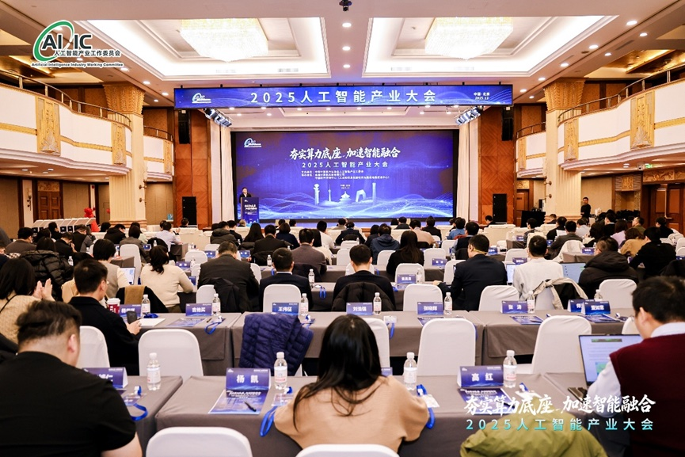
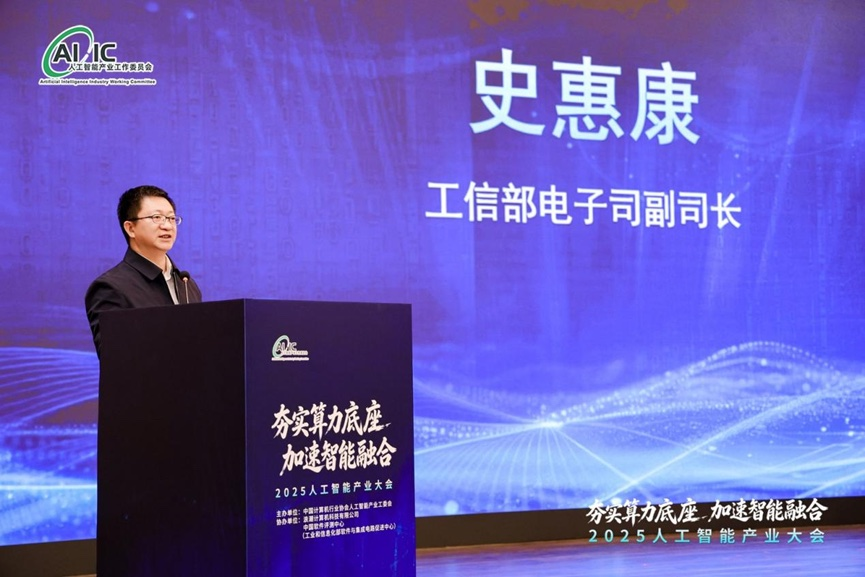
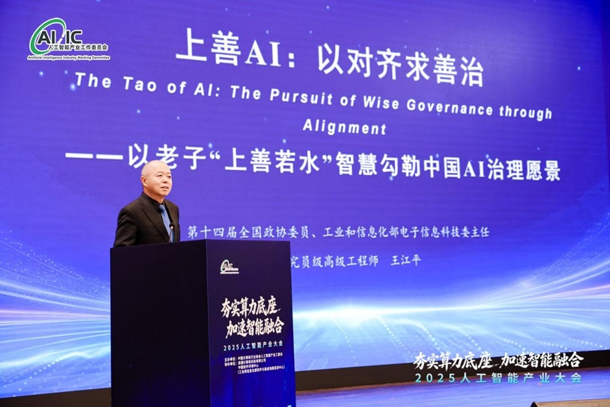
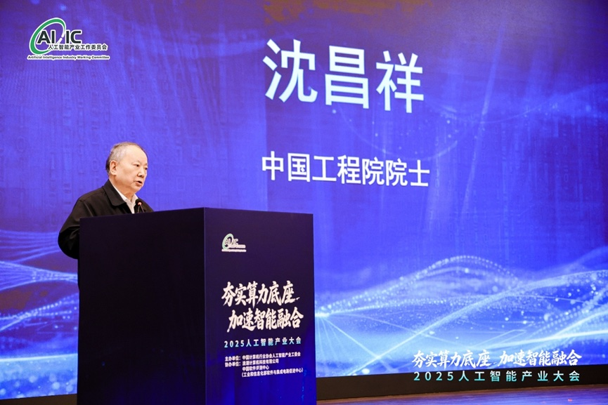
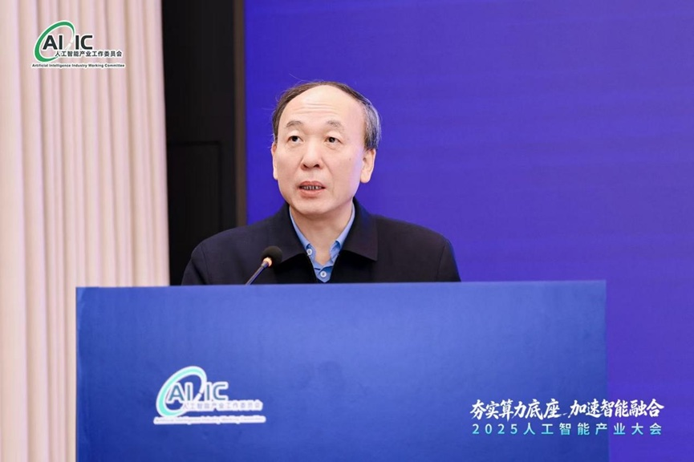
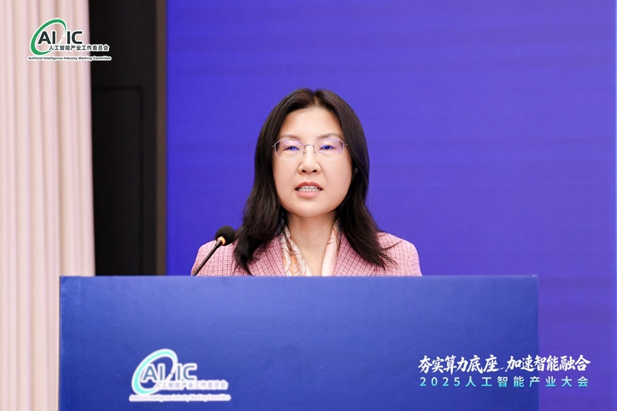
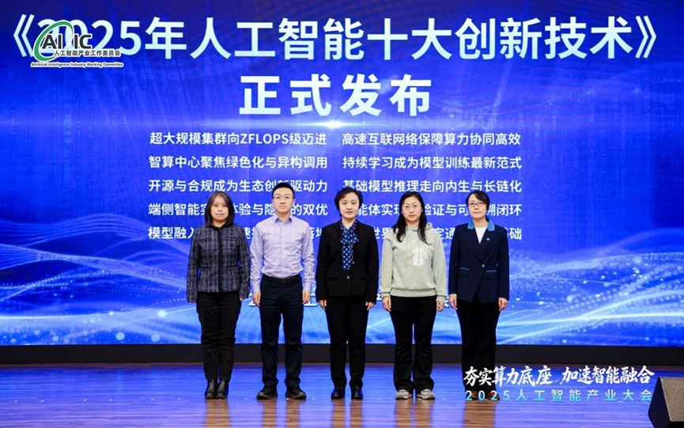
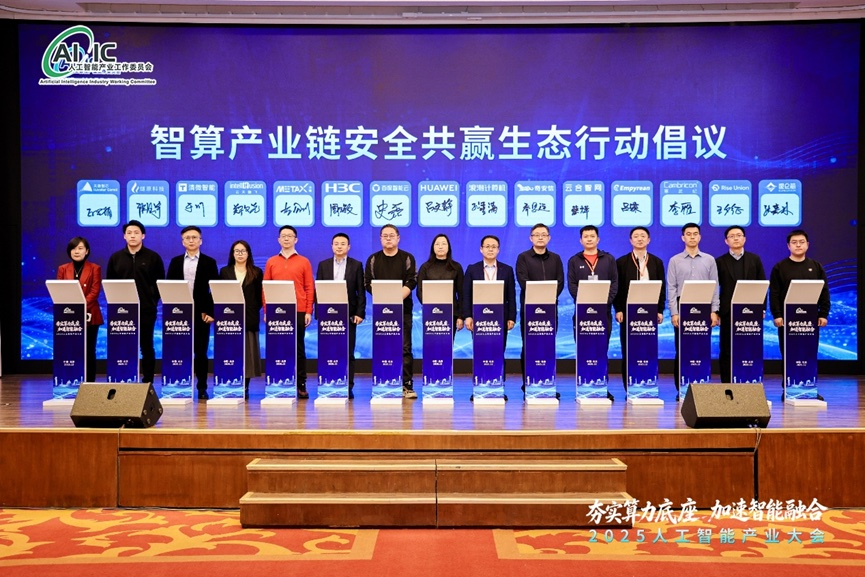

[English](./README.en.md) · [文章目录](../../README.md) · [官网阅读](https://www.theriseunion.com/zh/blog/riseunion-2025-artificial-intelligence-industry-conference.html)

# “2025人工智能产业大会” 在京举办，睿思智联携手 15 家企业共推智算生态

睿思智联 · 2025/12/26 08:00（北京时间）

2025人工智能产业大会在北京召开，睿思智联携手华为、寒武纪、昆仑芯等15家行业领军企业联合发起'智算产业链安全共赢生态行动倡议'。作为人工智能产业工作委员会池化工作组组长单位，睿思智联致力于构建自主可控、安全共赢的智算产业链，推动AI产业高质量发展。

2025 年 12 月 24 日，以 **“夯实算力底座，加速智能融合”** 为主题的 **2025 人工智能产业大会** 在北京隆重召开。

本次大会由中国计算机行业协会 **人工智能产业工作委员会**（以下简称 “工委会”）主办，浪潮计算机科技有限公司、中国软件评测中心（工业和信息化部软件与集成电路促进中心）协办，汇聚政府部门领导、院士专家、企业代表及学界泰斗，共探人工智能产业发展新路径，推动技术创新与产业落地。会议由工委会会长、中国电子信息产业发展研究院党委副书记胡国栋主持。

工业和信息化部电子信息司副司长 **史惠康** 在致辞中强调，

> 人工智能作为引领未来的战略性技术，是塑造新发展格局的关键力量，我国正从产业重要参与者向全球引领者稳步迈进。

他呼吁产业各界深入落实 **“人工智能 +”** 行动，共建先进计算产业生态，推动算力、存力、运力、电力等核心要素融合创新，筑牢产业发展底座，并针对产业链供应链现存挑战，提出三点要求：

* 持续强化人工智能芯片等核心产品 **技术攻坚**；
* 依托国产应用牵引高端整机 **产业升级**；
* 健全标准与知识产权体系，深化产学研用融合，推动产业实现从 **“跟跑”**、**“并跑”** 到 **“领跑”** 的跨越。

---

## 王江平委员：AI 伦理治理的东方智慧

第十四届全国政协委员、工业和信息化部原副部长王江平以《上善AI：以对齐求善治》为题发表主旨演讲，从老子“上善若水”的东方哲学思想出发，系统阐述了人工智能伦理治理的中国智慧与实践路径。他提出，应以“敏捷治理”理念应对技术快速演进所带来的不确定性，在创新进取与风险防范之间实现动态平衡。

王江平强调，人机对齐是智能时代的核心命题，必须通过技术约束与伦理规范的协同设计，确保人工智能始终与人类价值观和社会目标保持一致。针对当前AI治理体系明显滞后于技术发展的现实挑战，他提出构建涵盖制度、技术、应用与文化的“四位一体”治理框架，并进一步指出，唯有通过“文化对齐”推动主权AI之间的价值互认，才能逐步形成面向全球的AI治理共识。这一思想为构建兼具包容性、稳定性与韧性的人工智能治理体系，提供了具有鲜明中国特色的解决方案。

---

## 沈昌祥院士：可信计算筑牢 AI 安全底座

中国工程院院士沈昌祥围绕人工智能安全问题，深入阐释了自主可信计算技术在新一代AI体系中的基础性、支撑性作用。他指出，网络安全的本质是计算科学问题，不能仅依赖被动防御，而应通过具备“主动免疫”能力的可信计算体系，从根本上化解大模型面临的“黑盒化”与不可控风险。

沈昌祥介绍，该可信计算体系已在我国多个关键行业和重要应用场景中实现规模化落地，逐步形成从技术标准制定、核心产品研发到系统级集成应用的完整产业链。他呼吁进一步加强政产学研用协同创新，以可信计算3.0为技术基础，持续夯实数据存储与运行环境的安全防线，为人工智能产业的健康发展提供动态、可控、可持续的安全保障。

---

## 赵春江院士：智慧农业赋能农业强国建设

中国工程院院士赵春江在演讲中系统阐述了智慧农业在推动农业现代化、支撑农业强国建设中的关键作用。他指出，智慧农业的本质在于生物技术、信息技术与智能装备三大生产力要素的深度融合，通过技术协同重塑农业生产方式。

赵春江重点介绍了团队在智慧农业领域的多项前沿实践成果：在无人农场场景中，实现了覆盖千亩农田的全流程无人化作业；在智能育种方面，通过将大数据分析与基因组技术深度结合，大幅缩短育种周期，有效提升育种效率，为国家粮食安全提供了坚实的科技支撑。他强调，智慧农业不仅是一场技术革命，更是推动农业从“经验驱动”向“数据驱动”、从传统生产向现代产业体系跃迁的系统性变革。

---

## 段慧玲院士：界面力学牵引 AI 与物理智能融合

中国科学院院士段慧玲从力学与工程科学的视角，深入揭示了“物理智能”在人工智能与真实世界交互过程中的桥梁性作用。她提出，以“数智力学”为核心，重塑新一代工业软件的发展范式，其关键在于实现材料—结构—性能的一体化建模，以及设计—几何—性能的实时协同。

通过将物理机理信息与生成式AI大模型深度融合，该研究路径致力于解决多尺度、多物理场耦合等复杂工程问题，推动工业软件向更加智能化、自主化的方向演进。同时，她介绍了正在积极推进的云端研发平台与未来学习中心建设，探索产学研深度融合的新型协同模式，更好服务国家智能制造和高端装备发展的重大战略需求。

---

## 2025年人工智能十大创新技术

工委会秘书长高宏玲、中国国家工业信息安全发展研究中心知识产权研究所所长李慧颖、中国电子技术标准化研究院信息技术研究中心硬件研究室副主任刘晓蕾、中国电子产品可靠性与环境试验研究所人工智能中心主任孔德智、中国信息通信研究院信息化与工业化融合研究所副总工程师周兰共同发布《2025年人工智能十大创新技术》。

该榜单从基础设施升级、算法与模型演进、应用创新与前沿探索等多个维度，系统梳理了人工智能领域最具代表性和引领性的技术方向。十大创新技术相互支撑、协同演进，共同推动人工智能向更高效、更可靠、更深度融合的方向持续发展，为产业升级与新质生产力培育提供重要技术引擎。

---

在大会发布环节，**睿思智联** 与 华为、寒武纪、华大九天、奇安信、燧原科技、昆仑芯、沐曦、云天励飞、天数智芯、清微智能等 **15** 家行业领军企业联合发起 **“智算产业链安全共赢生态行动倡议”**，成为本次大会的重要亮点。

该倡议聚焦产业协同发展需求，直面 AI 产业未来挑战，旨在共建安全、可信的人工智能产业生态，通过企业间的深度协作释放 AI 技术潜能，确保技术发展始终服务于人类共同价值，为千行百业的数字化转型升级注入强劲动能。

作为积极投身人工智能产业生态建设的重要企业，同时作为人工智能委员会池化工作组组长单位，**睿思智联** 此次参与发起生态行动倡议，既是对自身技术实力与行业责任的践行，也彰显了其助力构建自主可控、安全共赢的智算产业链的决心。

未来，睿思智联将与各发起单位及产业伙伴一道，深化技术协同、强化生态共建，为我国人工智能产业高质量发展贡献更大力量。

---

[在睿思智联官网阅读本文](https://www.theriseunion.com/zh/blog/riseunion-2025-artificial-intelligence-industry-conference.html) · [浏览更多文章](https://www.theriseunion.com/zh/blog.html)
