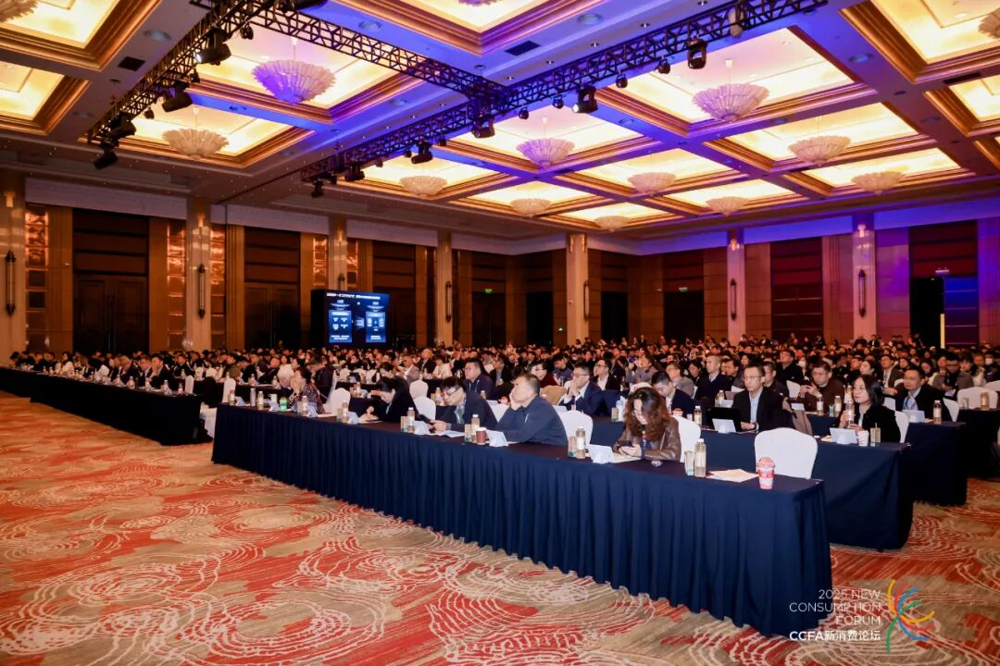

[简体中文](./README.md) · [All articles](../../README.en.md) · [Read on the website](https://www.theriseunion.com/en/blog/riseunion-2025-ccfa.html)

# RiseUnion Attends CCFA 2025 Retail Innovation Conference, Sharing Bottom-Layer GPU Pooling Scheduling Technology

RiseUnion · November 21, 2025 at 08:00 (UTC+08:00)

RiseUnion attends CCFA 2025 Retail Innovation Conference, sharing bottom-layer GPU pooling scheduling technology,赋能零售企业迈向“硬科技”驱动的增长新时代.

## Background

The **CCFA New Consumption Forum - 2025 China Retail Innovation Conference** recently concluded successfully in Shanghai.

At this annual event focused on industry digital transformation and technology enablement, the China Chain Store & Franchise Association (CCFA) officially released the **"2025 China Retail Technology Emerging Enterprise Growth Program"**.

**RiseUnion** distinguished itself from numerous technology companies and successfully joined the program, recognized for its innovative breakthroughs and practical achievements in **underlying GPU pooling and orchestration software services**. This recognition demonstrates that RiseUnion's full-stack AI infrastructure capabilities, built through **[Rise VAST](https://www.theriseunion.com/en/product/vast.html), [Rise CAMP](https://www.theriseunion.com/en/product/camp.html), and [Rise ModelX](https://www.theriseunion.com/en/product/modelx.html)**, have gained industry-wide acknowledgment for helping retail enterprises build efficient AI infrastructure and overcome compute bottlenecks.

---

## 01 Compute Revolution
### Breaking Through the "Stock Era" in Retail

Retail has fully entered an era of stock competition. How can businesses discover growth opportunities in a limited market?

**Peng Jianzhen, President of the China Chain Store & Franchise Association**, pointed out in his opening address:

> Embracing technology enablement has become an industry consensus. AI, big data, and other technologies are comprehensively reshaping retail operations.

However, as AI models are widely deployed in retail scenarios (such as visual recognition and intelligent recommendation), expensive compute costs and inefficient resource utilization have become significant barriers.

RiseUnion addresses this challenge. Leveraging our core product **[Rise VAST](https://www.theriseunion.com/en/product/vast.html)**, a compute resource management platform, we help retail enterprises achieve "software-defined compute":

**Unified Heterogeneous Resource Pooling**: Consolidate distributed GPU devices into a unified resource pool, breaking physical boundaries.

**Fine-grained Management and Orchestration**: Whether for large model training or fragmented inference tasks, RiseUnion's platform enables dynamic GPU resource partitioning and on-demand allocation, fundamentally solving resource contention and idle capacity issues, transforming every unit of compute into business value.

---

## 02 Core Technology
### Responding to Conference Themes, Enabling Retail Transformation

At this conference, industry leaders repeatedly emphasized the importance of **"hard technology"** and **"AI agents"**, which aligns perfectly with RiseUnion's technical approach.

#### 🎯 From "Soft Emotion" to "Hard Technology"

**Wei Zhe, Chairman of Vision Knight Capital**, emphasized in his keynote "Hard Technology and Soft Emotion Driving China's New Retail":

> Hard technology is the core driver of efficiency improvement in retail.

Addressing the pain points of complex AI development workflows and difficult environment management in retail enterprises, RiseUnion provides robust support through **[Rise CAMP](https://www.theriseunion.com/en/product/camp.html)**, an AI development platform. It offers technical teams a one-stop development and runtime environment, streamlining the entire process from data management to model training, accelerating the rapid deployment of AI algorithms in business scenarios such as product selection and ordering.

#### 🔗 Building the Foundation for "Enterprise AI Agents"

**Cheng Wei, Vice President of Tencent Cloud**, noted:

> Enterprise AI agents are key to linking internal and external growth.

The efficient operation of AI agents requires high-concurrency, low-latency inference capabilities. RiseUnion's **[Rise ModelX](https://www.theriseunion.com/en/product/modelx.html)** model serving platform is designed for large-scale AI applications, supporting multi-model service orchestration and elastic scaling. This ensures that retail enterprises' AI systems—such as AI customer service and visual recognition—remain smooth and stable during peak promotional periods, delivering seamless "buy-and-get" experiences.

---

## 03 Cost Reduction and Efficiency Gains
### Proven Value Through Data

Behind the selection for the "Emerging Enterprise Growth Program" lies RiseUnion's proven track record in real-world deployment scenarios.

Through the full-stack collaboration of **Rise VAST + CAMP + ModelX**, RiseUnion's solutions have demonstrated significant value in high-frequency scenarios such as instant retail and member profile analysis:

- 📉 **Cost Reduction**: Helping retail enterprises **reduce hardware investment by over 30%**;
- 🚀 **Efficiency Gains**: **Improving AI task processing efficiency by 50%**;
- 💡 **Precision Operations**: Perfectly aligned with the precision operations philosophy advocated by platforms like Alipay and WeChat Pay, providing retail enterprises with end-to-end support from underlying technology to front-end business.

---

## Conclusion

Being selected for the **"2025 China Retail Technology Emerging Enterprise Growth Program"** is both an honor and a responsibility.

Moving forward, RiseUnion will continue to deepen our focus on underlying technology, continuously optimizing the **[Rise VAST](https://www.theriseunion.com/en/product/vast.html), [Rise CAMP](https://www.theriseunion.com/en/product/camp.html), and [Rise ModelX](https://www.theriseunion.com/en/product/modelx.html)** product portfolio, serving as the most robust **"compute foundation"** for retail enterprises.

We will partner with more retail organizations to jointly explore AI-driven growth engines, supporting China's retail industry in achieving high-quality development during the "15th Five-Year Plan" period!

---

[Read this article on the RiseUnion website](https://www.theriseunion.com/en/blog/riseunion-2025-ccfa.html) · [Explore more articles](https://www.theriseunion.com/en/blog.html)
