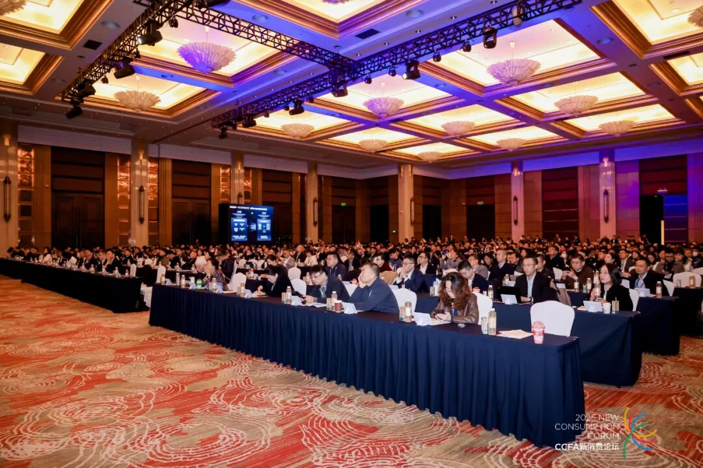

[English](./README.en.md) · [文章目录](../../README.md) · [官网阅读](https://www.theriseunion.com/zh/blog/riseunion-2025-ccfa.html)

# 睿思智联出席CCFA 2025零售创新大会，分享底层 GPU 池化调度技术

睿思智联 · 2025/11/21 08:00（北京时间）

睿思智联出席CCFA 2025零售创新大会，分享底层 GPU 池化调度技术，赋能零售企业迈向“硬科技”驱动的增长新时代。

## 背景

近日，**CCFA新消费论坛 - 2025中国零售创新大会** 在上海圆满落幕。

在这场聚焦行业数字化转型与科技赋能的年度盛会上，中国连锁经营协会（CCFA）正式发布了 **《2025年度中国零售科技新锐企业成长计划》**。

**睿思智联** 凭借其在 **底层GPU池化调度软件服务** 领域的创新突破与实战成果，从众多科技企业中脱颖而出，成功入选该计划。这标志着睿思智联通过 **[Rise VAST](https://www.theriseunion.com/zh/product/vast.html)、[Rise CAMP](https://www.theriseunion.com/zh/product/camp.html)、[Rise ModelX](https://www.theriseunion.com/zh/product/modelx.html)** 等构建的全栈AI基础设施能力，在为零售企业构建高效AI基础设施、打破算力瓶颈方面的能力，获得了行业的高度认可。

---

## 01 算力革命
### 零售“存量时代”的破局关键

零售业已全面进入存量竞争时代。如何在有限的市场中挖掘增长机会？

**中国连锁经营协会会长彭建真**在大会致辞中一针见血地指出：

> 拥抱科技赋能已成为行业共识，AI、大数据等技术正全面重构零售运营系统。

然而，随着AI模型在零售场景的广泛应用（如视觉识别、智能推荐），昂贵的算力成本和低效的资源利用率成为了企业面前的“拦路虎”。

睿思智联正是为解决这一痛点而来。依托核心产品 [Rise VAST](https://www.theriseunion.com/zh/product/vast.html) 算力资源管理平台，我们帮助零售企业实现了“软件定义算力”：

**异构资源统一池化：**：将分散的GPU设备整合为统一资源池，打破物理边界。
**精细化管理和调度**：无论是大模型的训练还是碎片化的推理任务，睿思智联的产品都能实现 GPU 资源的动态切分与按需分配，从根本上解决资源争抢与闲置问题，让每一份算力都能转化为业务价值。

---

## 02 硬核科技
### 响应大会热点，赋能零售升级

本次大会上，行业大咖们反复提及 **“硬科技”** 与 **“智能体”** 的重要性，这与睿思智联的技术路径不谋而合。

#### 🎯 从“软情绪”到“硬科技”

**嘉御资本董事长卫哲**在《硬科技软情绪驱动中国新零售》演讲中强调：
> 硬科技是零售业效率提升的核心驱动力。

针对零售企业 AI 研发流程复杂、环境管理难的痛点，睿思智联通过 **[Rise CAMP](https://www.theriseunion.com/zh/product/camp.html)** 人工智能开发平台提供了有力支撑。它为技术团队构建了一站式的开发和运行环境，打通了从数据管理到模型训练的全流程，加速了 AI 算法在选品、订货等业务场景的快速落地。

#### 🔗 为“企业智能体”筑基

**腾讯云副总裁程伟**提到：
> 企业智能体是链接内外增长的关键。

智能体的高效运行，离不开高并发、低延迟的推理能力。睿思智联 **ModelX** 模型推理平台 专为大规模 AI 应用设计，支持多模型服务编排与弹性扩缩容。这确保了零售企业在面对大促高峰时，AI 客服、视觉识别等系统依然流畅稳定，支持“即买即得”的无缝体验。

---

## 03 降本增效
### 用数据说话的实战价值

入选“新锐企业成长计划”的背后，是睿思智联在实际落地场景中交付的硬核成绩单。

通过 **Rise VAST + CAMP + ModelX** 的全链路协同，睿思智联的解决方案已在即时零售、会员画像分析等高频场景中验证了显著价值：

- 📉 **成本降低：** 帮助零售企业 **减少硬件投入30%以上**；
- 🚀 **效率飙升：** AI任务处理 **效率提升50%**；
- 💡 **精细运营：** 完美契合支付宝、微信支付等平台倡导的精细化运营理念，为零售商提供从底层技术到前端业务的全链路支持。

---

## 结语

入选 **《2025年度中国零售科技新锐企业成长计划》**，既是一份荣誉，更是一份责任。

未来，睿思智联将继续深耕底层技术，持续优化 [Rise VAST](https://www.theriseunion.com/zh/product/vast.html)、[Rise CAMP](https://www.theriseunion.com/zh/product/camp.html) 和 [Rise ModelX](https://www.theriseunion.com/zh/product/modelx.html) 产品矩阵，做零售企业最坚实的 **“算力底座”**。

我们将与更多零售伙伴携手，共同探索 AI 驱动的新增长引擎，助力中国零售业在“十五五”时期实现高质量发展！

---

[在睿思智联官网阅读本文](https://www.theriseunion.com/zh/blog/riseunion-2025-ccfa.html) · [浏览更多文章](https://www.theriseunion.com/zh/blog.html)
