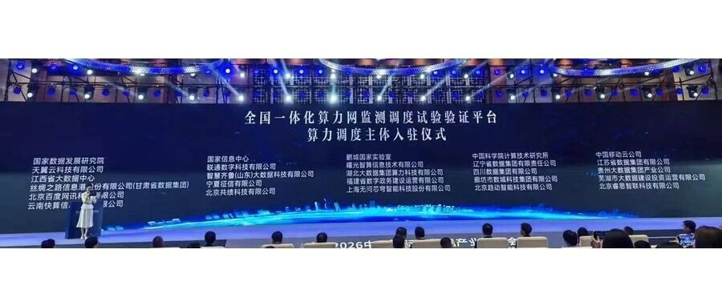
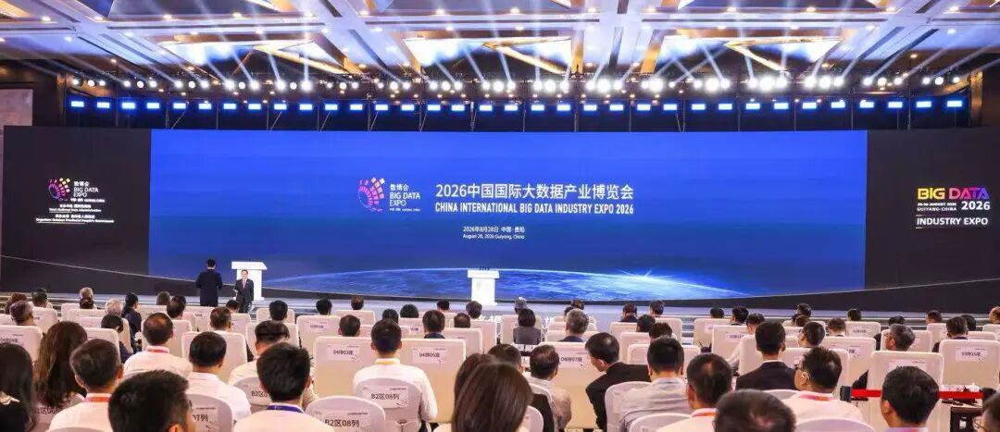
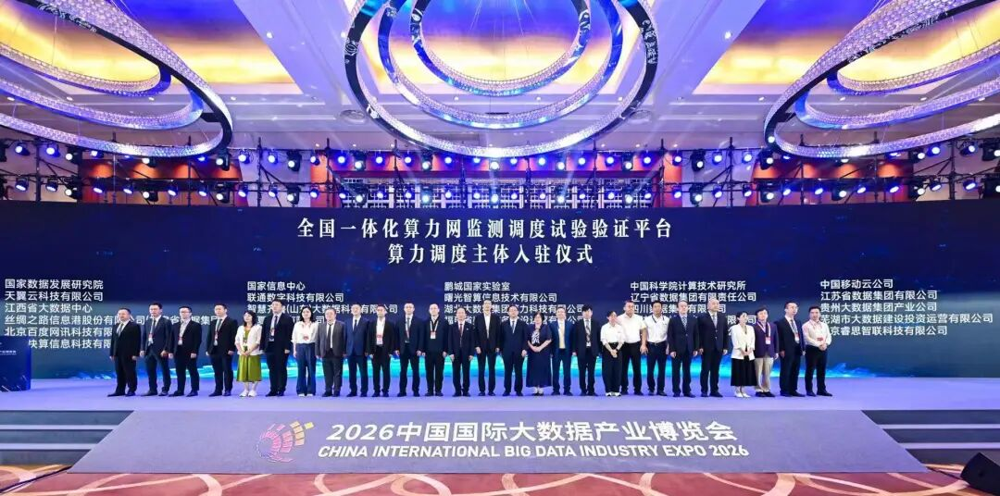

[简体中文](./README.md) · [All articles](../../README.en.md) · [Read on the website](https://www.theriseunion.com/en/blog/riseunion-2026-big-data-expo-computing-network-platform.html)

# RiseUnion Appears at the 2026 Big Data Expo and Officially Joins the National Integrated Computing Power Network Monitoring, Scheduling, Testing and Verification Platform

RiseUnion · August 31, 2026 at 10:00 (UTC+08:00) · [Original WeChat article (Chinese)](https://mp.weixin.qq.com/s/DfZmhCly8Dj0WoD-WvoGkw)

RiseUnion appears at the 2026 Big Data Expo and joins the National Integrated Computing Power Network Monitoring, Scheduling, Testing and Verification Platform as a computing power scheduling provider.

> “
>
> On August 28, the 2026 China International Big Data Industry Expo opened in Guiyang, Guizhou Province. RiseUnion was invited to attend the opening ceremony and participate in the “Data Infrastructure and Data Standardization” exchange event. As a computing power scheduling provider and an outstanding private enterprise, RiseUnion officially joined the National Integrated Computing Power Network Monitoring, Scheduling, Testing and Verification Platform (the “Platform”), becoming a new private-sector force in building the nation’s coordinated computing power network. Joining the Platform marks RiseUnion’s formal entry into the ranks of organizations building China’s national computing power system.

## I. The Big Data Expo: The Digital Economy’s Annual Industry Event

This year’s Big Data Expo was hosted by the National Data Administration and organized by the Guizhou Provincial People’s Government. With the theme “Tokens—A New Path for Unlocking the Value of Data Elements,” it centered on five areas: computing infrastructure, data supply, model-driven development, security safeguards, and intelligent experiences. It was a major digital-economy industry event in the opening year of China’s 15th Five-Year Plan.

The *China Data Industry Development Report (2026)* released at the event projects that the country’s data industry could exceed RMB 10 trillion during the 15th Five-Year Plan period. Behind this national-level event, computing infrastructure is becoming the critical foundation for unlocking the value of data elements.

II. Platform Certification: RiseUnion’s New Position on the National Team**\**
----------------------------------------------------------------------------

At the Big Data Expo’s Data Infrastructure and Data Standardization exchange event, RiseUnion officially joined the National Integrated Computing Power Network Monitoring, Scheduling, Testing and Verification Platform as one of its computing power scheduling providers, comprehensively strengthening its computing power scheduling and operational service capabilities.

Why was RiseUnion selected? As the leader of the AIIC Computing Pooling Working Group and a core contributor to the CNCF open-source project HAMi, RiseUnion has long focused on unified management of heterogeneous computing resources, fine-grained GPU partitioning, and multi-policy intelligent scheduling, and has completed compatibility certification for more than ten domestic chips. On this foundation, RiseUnion has established end-to-end service capabilities spanning “computing power → models → Tokens”:

- Unified management of geographically distributed multi-cluster environments enables cross-domain collaborative scheduling of heterogeneous computing resources;

- A production-grade inference service platform supports standardized service delivery and elastic scaling across multiple engines and models;

- An AI gateway and Token governance system provides unified metering and billing, dual-track cost accounting, and quota and budget controls, delivering a complete metering foundation for usage-based computing center operations and settlement;

- A cloud-edge collaboration architecture enables edge computing node management, autonomous operation during network outages, and remote model delivery.

This National High-Tech Enterprise and Beijing Specialized, Sophisticated, Distinctive, and Innovative SME has built full-stack engineering capabilities in the specialized field of computing power scheduling and operations, from resource pooling to service-based operations. Its solutions have been deployed at production scale in finance, government and enterprise, supercomputing centers, energy, and other sectors.

RiseUnion CEO Jin Meng attended the admission ceremony and said: “Joining the Platform means our scheduling technology is moving from the enterprise level to the national level. We hope to contribute the engineering capabilities accumulated while serving benchmark customers to the nation’s coordinated computing power network.”

RiseUnion CEO Jin Meng (second from left) attends the admission ceremony for computing power scheduling providers joining the National Integrated Computing Power Network Monitoring, Scheduling, Testing and Verification Platform. 

III. Moving in Step: Empowering the National Computing Power Network with Scheduling Technology\
---------------------------------------------------------------------------------------------

The Platform currently monitors 1.45 million PFLOPS (FP16) of intelligent computing capacity. Joining it is both national-level recognition of RiseUnion’s technical strength and operational service capabilities and a new starting point for RiseUnion to integrate more deeply into the development of the National Integrated Computing Power Network and serve the “East Data, West Computing” project with standardized computing power pooling and scheduling technology.\

Going forward, RiseUnion will provide technical support to comprehensively strengthen computing power scheduling and operational service capabilities, helping achieve “one ledger” for computing resources, “one coordinated plan” for computing power scheduling, and “one network” for computing power integration—making computing power as readily available as water and electricity.

### About RiseUnion

Beijing RiseUnion Technology Co., Ltd. focuses on AI computing management and scheduling. It has completed compatibility certifications for more than 10 domestic chips and is one of the core contributors to the CNCF Sandbox open-source project HAMi. The company is a National High-Tech Enterprise, a Beijing Specialized, Sophisticated, Distinctive, and Innovative SME, and the leader of the AIIC Computing Pooling Working Group. It has delivered large-scale production deployments in finance, government, enterprise and defense, transportation, healthcare, and other industries.

RiseUnion is committed to making computing power as readily available as water and electricity, building an intelligent, controllable, and efficient computing foundation for enterprise AI transformation.

For more information, visit **riseunion.ai** or contact us at **400-605-2336**.

---

[Read this article on the RiseUnion website](https://www.theriseunion.com/en/blog/riseunion-2026-big-data-expo-computing-network-platform.html) · [Explore more articles](https://www.theriseunion.com/en/blog.html)
