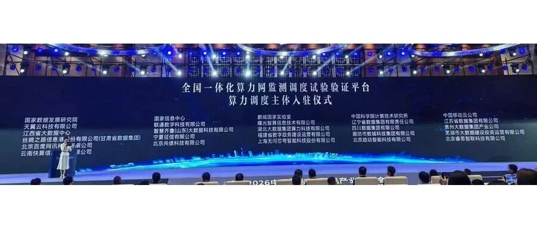
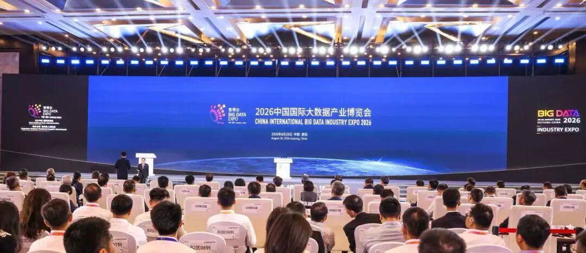
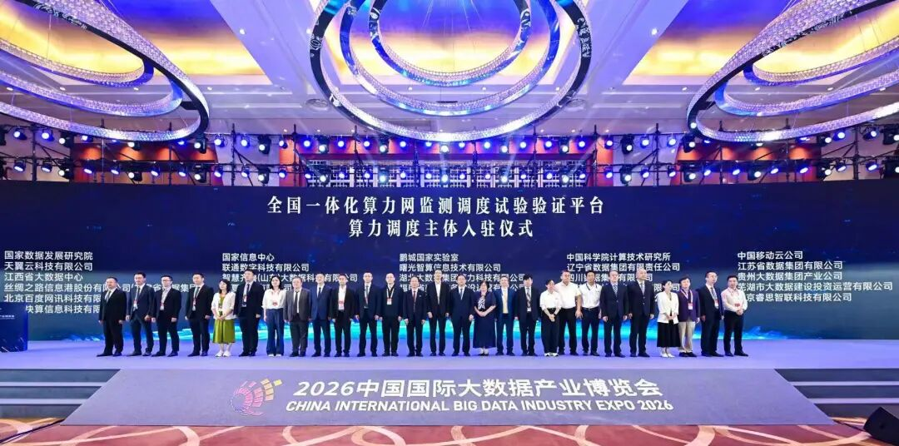

[English](./README.en.md) · [文章目录](../../README.md) · [官网阅读](https://www.theriseunion.com/zh/blog/riseunion-2026-big-data-expo-computing-network-platform.html)

# 睿思智联亮相2026数博会 正式入驻全国一体化算力网监测调度试验验证平台

睿思智联 · 2026/08/31 10:00（北京时间） · [微信公众号原文](https://mp.weixin.qq.com/s/DfZmhCly8Dj0WoD-WvoGkw)

睿思智联亮相2026数博会 作为算力调度主体入驻全国一体化算力网监测调度试验验证平台

> “
>
> 8月28日，2026中国国际大数据产业博览会在贵州省贵阳市开幕。睿思智联应邀出席开幕式，并参加《数据基础设施和数据标准化》交流活动。作为算力调度主体及优秀民营企业，睿思智联正式入驻全国一体化算力网监测调度试验验证平台（“平台”），成为国家算力"一盘棋"建设中的一支民企新力量。本次入驻平台，标志着睿思智联正式跻身国家算力体系建设主体行列。

## 一、数博会：数字经济领域的年度盛会

本届数博会由国家数据局主办、贵州省人民政府承办，以"词元——数据要素价值释放新路径"为主题，围绕算力底座、数据供给、模型驱动、安全护航、智能体验五大板块，是"十五五"开局之年数字经济领域的重要行业盛会。

会上发布的《中国数据产业发展报告（2026）》显示，"十五五"期间我国数据产业规模有望突破10万亿元——国家级盛会背后，算力基础设施正成为释放数据要素价值的关键底座。

二、平台认证：睿智智联的国家队新坐标**\**
-----------------------------------------

在数博会的数据基础设施和数据标准化交流活动上，睿思智联作为算力调度主体之一，正式入驻全国一体化算力网监测调度试验验证平台，全面提升算力调度运营服务能力。

睿思智联何以在列？作为AIIC算力池化工作组组长单位、CNCF开源项目HAMi核心贡献者，睿思智联长期深耕异构算力统一纳管、GPU细粒度切分与多策略智能调度，完成10余种国产芯片兼容认证。在此基础上，睿思智联打通了从"算力→模型→Token"的全链路服务化能力：

- 跨地域多集群统一纳管实现异构算力资源的跨域协同调度；

- 生产级推理服务平台支撑多引擎、多模型的标准化服务交付与弹性伸缩；

- AI网关与Token治理体系提供统一计量计费、双轨成本核算与配额预算管控，为算力中心按量运营与结算提供完整的计量底座；

- 云边协同架构实现边缘算力节点纳管、断网自治与模型远程下发。

这家国家高新技术企业、北京市专精特新中小企业，已在算力调度与运营这一细分赛道积累起从资源池化到服务化运营的全栈工程能力。在金融、政企、超算中心、能源等行业实现大规模生产级落地。

睿思智联CEO 金萌出席了入驻仪式，并表示："入驻平台，意味着我们的调度技术从企业级走向国家级。我们希望把服务标杆客户过程中沉淀的工程能力，贡献给全国算力'一盘棋'。"

图为睿思智联CEO（左二）出席全国一体化算力网监测调度试验验证平台算力调度主体入驻仪式 

三、同频共振：以算力调度技术赋能国家算力网\
-------------------------------------------

目前，平台已有145万PFLOPS（FP16）智能算力纳入监测范围。此次入驻，既是国家级平台对睿思智联技术实力与运营服务能力的认可，也是睿思智联深融入全国一体化算力网建设进程、以标准化算力池化与调度技术服务"东数西算"工程的新起点。\

未来，睿思智联将为全面提升算力调度运营服务能力提供技术支持，助力实现算力资源"一本账"、算力调度"一盘棋"、算力整合"一张网"，让算力像水电一样，随取随用。

### 关于睿思智联

北京睿思智联科技有限公司（RiseUnion）专注于AI 算力管理与调度，已完成 10+ 国产芯片兼容认证，是 CNCF Sandbox 开源项目 HAMi 的核心贡献者之一。公司是国家高新技术企业、北京市专精特新中小企业、AIIC 算力池化工作组组长单位，在金融、政企军工、交通、医疗等行业实现大规模生产级落地。

睿思智联致力于让算力像水电一样随取随用，为企业 AI 转型构建智能、可控、高效的算力底座。

了解更多详细信息，欢迎访问官网：**riseunion.ai** 或联系：**400-605-2336**。

---

[在睿思智联官网阅读本文](https://www.theriseunion.com/zh/blog/riseunion-2026-big-data-expo-computing-network-platform.html) · [浏览更多文章](https://www.theriseunion.com/zh/blog.html)
